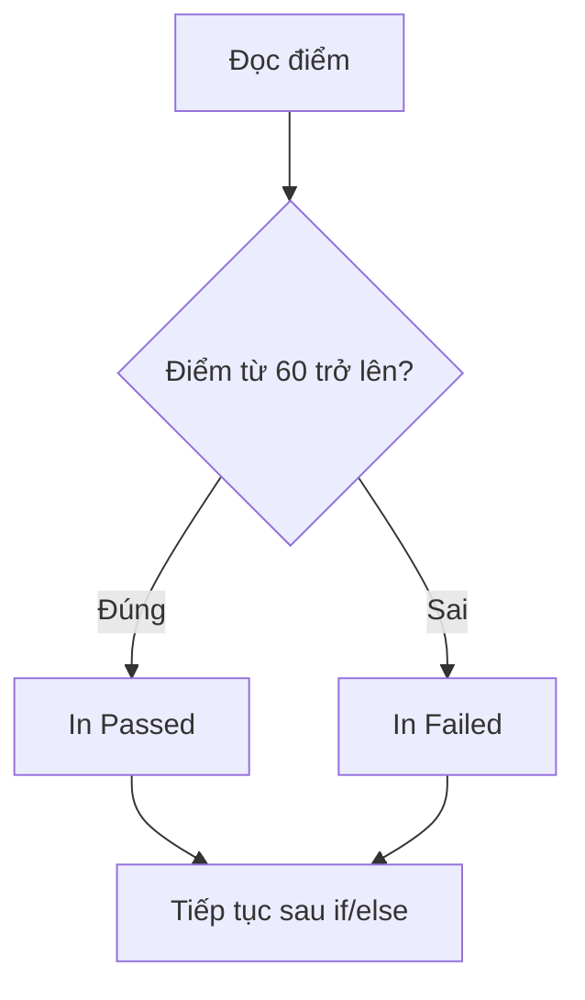
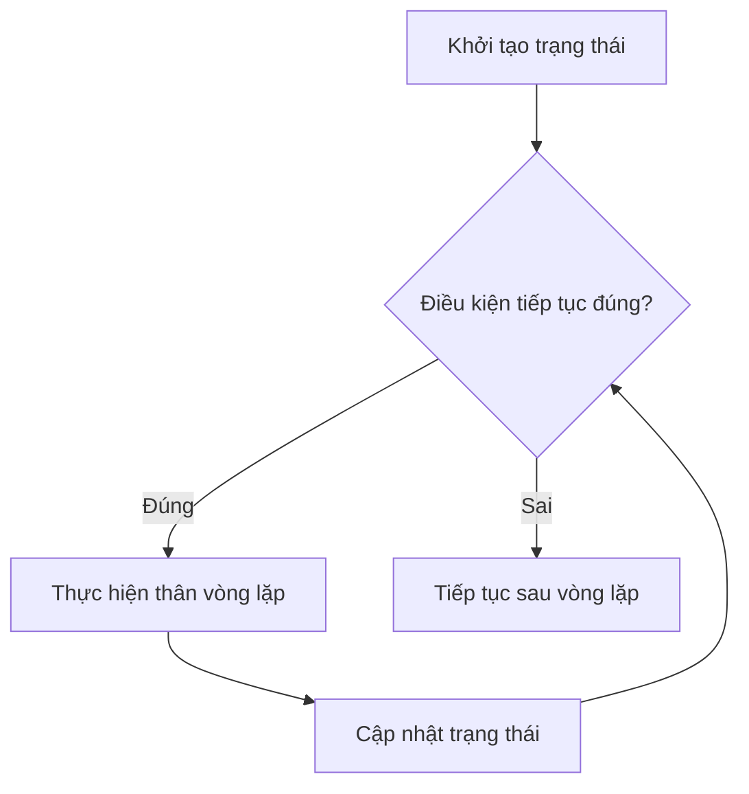
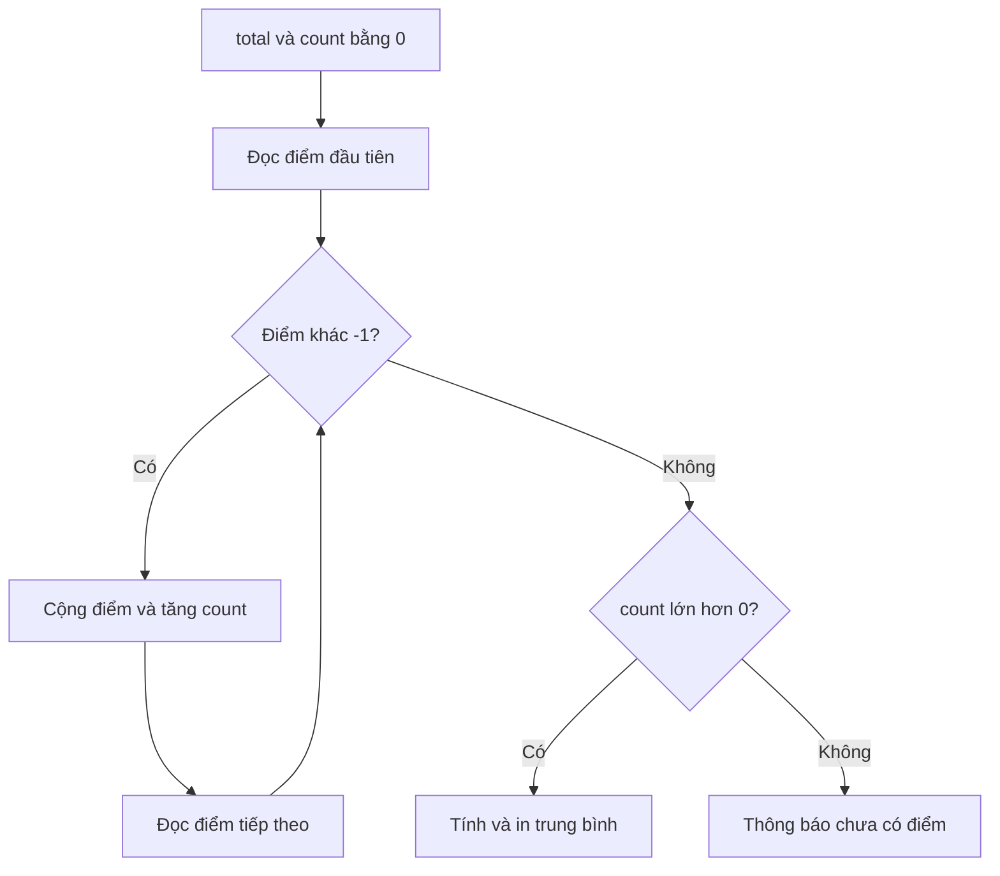

# Control Statement

> **Tóm tắt Chương 3 - Control Statements: Part 1**  
> **Sách:** *Java for Programmers with Generative AI*, Fifth Edition - Paul Deitel & Harvey Deitel.  
> **Nguồn:** [Bản sách trên Google Drive](https://drive.google.com/file/d/1mUZMJUcLtwbPsG_KYHecBefNETR1M6_d/view).  
> Bản ghi chú tiếng Việt theo các mục 3.1-3.13. Ví dụ được viết lại để học và ôn tập. Các đoạn câu lệnh rời đặt trong `main`; `import` đặt ở đầu tệp. Những điểm dễ gây hiểu nhầm về tràn số và chuyển kiểu được giải thích theo hành vi của Java.

## 1. Mục tiêu và bản đồ chương

Chương 2 giúp đọc dữ liệu, tính toán và in kết quả. Chương 3 mở rộng cách điều khiển thứ tự thực hiện: chọn nhánh, lặp thao tác và kết hợp các cấu trúc để giải quyết bài toán hoàn chỉnh.

| Mục sách | Nội dung | Điều cần nắm |
| --- | --- | --- |
| 3.1-3.2 | Lập trình có cấu trúc | Tuần tự, lựa chọn, lặp; nối tiếp và lồng nhau |
| 3.3 | `if` | Thực hiện hoặc bỏ qua một nhóm thao tác |
| 3.4.1-3.4.3 | `if…else`, lồng nhánh, block, `?:` | Chọn một nhánh và biểu diễn lựa chọn giá trị |
| 3.5 | `while` | Kiểm tra điều kiện trước mỗi lượt |
| 3.6.1-3.6.4 | Lặp theo bộ đếm | Biết trước số lượt; chú ý chia nguyên, tràn số, dữ liệu đầu vào |
| 3.7.1-3.7.3 | Lặp theo sentinel | Dừng theo tín hiệu; ép kiểu để tính trung bình có phần lẻ |
| 3.8.1-3.8.2 | Cấu trúc điều khiển lồng nhau | Phân loại kết quả bên trong vòng lặp |
| 3.9-3.10 | Gán kết hợp, tăng/giảm | `+=`, `-=`, `*=`, `/=`, `%=`, `++`, `--` |
| 3.11 | Kiểu nguyên thuỷ | Kiểu và miền giá trị nhất quán trên các nền tảng Java |
| 3.12 | Case study `BigInteger` | Tính số nguyên vượt miền `long` bằng thư viện |
| 3.13 | Tổng kết | Kết hợp lựa chọn, lặp và thao tác dữ liệu |

## 2. Ba cấu trúc điều khiển cơ bản

| Cấu trúc | Ý nghĩa | Ví dụ |
| --- | --- | --- |
| **Sequence - tuần tự** | Làm lần lượt theo thứ tự | Đọc điểm → cộng vào tổng → tăng bộ đếm |
| **Selection - lựa chọn** | Chọn thao tác theo điều kiện | Nếu điểm đủ thì thông báo đậu |
| **Iteration - lặp** | Thực hiện lại khi điều kiện tiếp tục còn đúng | Nhập và cộng nhiều điểm |

Một cấu trúc có thể được **nối tiếp** cấu trúc khác hoặc **lồng** bên trong cấu trúc khác. Ví dụ: `while` nhập 10 kết quả, bên trong có `if…else` phân loại từng kết quả.

Chương tập trung vào `if`, `if…else`, `while`. `switch`, `for`, `do…while` được giới thiệu ở chương 4; enhanced `for` xuất hiện ở chương 6.

Sách dùng UML activity diagram để mô tả luồng điều khiển. Trong các sơ đồ Mermaid dưới đây, hình thoi biểu diễn kiểm tra điều kiện, nhãn trên mũi tên mô tả kết quả kiểm tra và mũi tên quay lại biểu diễn việc lặp.

## 3. `if`: thực hiện thao tác khi điều kiện đúng

```java
int grade = 75;
if (grade >= 60) {
    System.out.println("Passed");
}
System.out.println("Finished checking");
```

- `grade >= 60` là điều kiện tạo giá trị `boolean`.
- Nếu đúng, block bên trong `if` được thực hiện.
- Nếu sai, block được bỏ qua.
- Câu lệnh sau `if` tiếp tục được thực hiện trong cả hai trường hợp, nếu không có thao tác khác làm thay đổi luồng.

`boolean` chỉ có `true` hoặc `false`; số nguyên không tự trở thành điều kiện như trong một số ngôn ngữ khác.

```java
boolean passed = grade >= 60;
if (passed) {
    System.out.println("Eligible for next course");
}
```

Không viết `if (grade)` để kiểm tra điểm trong Java.

## 4. `if…else`, chuỗi phân loại và block

### Chọn một trong hai nhánh

```java
if (grade >= 60) {
    System.out.println("Passed");
} else {
    System.out.println("Failed");
}
```



Trong một lần đánh giá câu lệnh này, chỉ một nhánh được chọn. Điều đó khác với nhiều `if` độc lập có thể cùng có điều kiện đúng.

### Phân loại bằng `else if`

Giả định điểm đã hợp lệ trong khoảng 0-100:

```java
if (grade >= 90) {
    System.out.println("A");
} else if (grade >= 80) {
    System.out.println("B");
} else if (grade >= 70) {
    System.out.println("C");
} else if (grade >= 60) {
    System.out.println("D");
} else {
    System.out.println("F");
}
```

Các điều kiện được xét từ trên xuống, dừng ở nhánh được chọn. Với 95, dù điều kiện `>= 80` cũng đúng về mặt toán học, nhánh B không được xét sau khi nhánh A đã được chọn.

**Thứ tự điều kiện quan trọng:** nếu đặt `grade >= 60` trước trong chuỗi này thì điểm 95 có thể rơi ngay vào nhánh D. Nếu bỏ giả định đầu vào 0-100, điểm 150 cũng bị coi là A; cấu trúc phân loại không tự xác thực miền dữ liệu.

### Block và dangling else

Dấu `{}` nhóm nhiều câu lệnh thành một block. Thụt lề giúp đọc, nhưng không quyết định câu lệnh thuộc nhánh nào.

```java
if (grade < 60) {
    System.out.println("Failed");
    System.out.println("Take the course again");
} else {
    System.out.println("Passed");
    System.out.println("Great job!");
}
```

Không có `{}`, một nhánh chỉ điều khiển câu lệnh theo sau nó. Ngoài ra, `else` gắn với `if` gần nhất chưa có `else` mà cú pháp cho phép; dùng block rõ ràng giúp tránh hiểu nhầm khi lồng nhiều điều kiện.

**Bẫy câu lệnh rỗng:**

```java
// Sai về logic: if điều khiển câu lệnh rỗng trước dấu {.
if (grade >= 60); {
    System.out.println("This block always runs");
}
```

Bỏ dấu `;` ngay sau `if (...)`. Lỗi này có thể biên dịch được nhưng làm kết quả sai.

## 5. Toán tử điều kiện `?:` tạo một giá trị

Dạng tổng quát:

```java
condition ? valueWhenTrue : valueWhenFalse
```

Ví dụ:

```java
String result = grade >= 60 ? "Passed" : "Failed";
System.out.println(result);
```

```java
int number = 7;
System.out.printf("%d is %s%n",
    number, number % 2 == 0 ? "even" : "odd");
// 7 is odd
```

Đây là một **biểu thức** chọn giá trị, phù hợp khi lựa chọn đơn giản và dễ đọc. `if…else` thích hợp khi mỗi nhánh cần nhiều công việc. Chỉ biểu thức của nhánh được chọn trong `?:` được đánh giá.

## 6. `while`: kiểm tra trước, lặp khi điều kiện đúng

```java
int product = 3;
while (product <= 50) {
    product = 3 * product;
}
System.out.println(product); // 81
```

| Lần kiểm tra | Giá trị trước kiểm tra | `product <= 50` | Hành động |
| --- | --- | --- | --- |
| 1 | 3 | true | Tăng thành 9 |
| 2 | 9 | true | Tăng thành 27 |
| 3 | 27 | true | Tăng thành 81 |
| 4 | 81 | false | Kết thúc lặp |

81 là luỹ thừa đầu tiên của 3 lớn hơn 50. Chú ý có **ba lượt thực hiện thân** nhưng **bốn lần kiểm tra điều kiện**.



### Điều cần kiểm tra khi viết vòng lặp

1. Trạng thái ban đầu đã được gán chưa?
2. Điều kiện tiếp tục mô tả đúng mục tiêu chưa?
3. Mỗi lượt có tiến triển về phía kết thúc không?
4. Nếu điều kiện sai ngay từ đầu, chương trình có hành vi phù hợp không?

Thân `while` có thể không chạy lần nào. Quên tăng bộ đếm hoặc đọc giá trị mới là nguyên nhân phổ biến của lặp vô hạn. Cũng không đặt `;` sau `while (condition)` trừ khi thật sự muốn một thân rỗng.

## 7. Counter-controlled iteration: biết trước số lượt

Bài toán sách: đọc điểm của 10 sinh viên rồi tính trung bình. Cần một bộ đếm để giới hạn số lần nhập và một biến tích luỹ để giữ tổng.

| Biến | Giá trị đầu | Vai trò |
| --- | --- | --- |
| `total` | 0 | Tổng các điểm đã nhập |
| `counter` | 1 | Số thứ tự điểm sắp nhập |
| `grade` | Đọc trong mỗi lượt | Điểm hiện tại |

Ví dụ hoàn chỉnh, lưu thành `CounterAverage.java` nếu không khai báo package:

```java
import java.util.Scanner;

public class CounterAverage {
    public static void main(String[] args) {
        Scanner input = new Scanner(System.in);
        int total = 0;
        int counter = 1;

        while (counter <= 10) {
            System.out.print("Enter grade: ");
            int grade = input.nextInt();
            total += grade;
            ++counter;
        }

        double average = (double) total / 10;
        System.out.printf("Total: %d%nAverage: %.2f%n", total, average);
    }
}
```

Ví dụ giả định người dùng nhập đúng số nguyên trong 0-100. Nó viết lại phiên bản trong sách để giữ phần lẻ của trung bình; bản minh hoạ ban đầu của sách dùng phép chia nguyên và thu được 84 từ tổng 846.

### Hai quy ước đếm đều được

| Khởi tạo | Điều kiện | Số lượt |
| --- | --- | --- |
| `counter = 1` | `counter <= 10` | 10 |
| `counter = 0` | `counter < 10` | 10 |

Không ghép tuỳ tiện khởi tạo của cách này với cận của cách kia. Ví dụ bắt đầu từ 1 rồi dùng `< 10` chỉ chạy chín lượt: lỗi **off-by-one**.

Sau mỗi lượt của ví dụ, `total` bằng tổng những điểm đã xử lý; `counter - 1` bằng số điểm đã xử lý. Theo dõi hai quan hệ này giúp kiểm tra logic vòng lặp.

### Phạm vi biến

`grade` được khai báo trong block của `while`, nên chỉ dùng được trong block đó. `total` và `counter` được khai báo ngoài vòng lặp để giữ trạng thái xuyên suốt các lượt. Đặt `total = 0` bên trong mỗi lượt sẽ làm mất phần tổng trước đó.

## 8. Sentinel-controlled iteration: dừng bằng tín hiệu

Nếu chưa biết số lượng điểm, chọn một giá trị đặc biệt để kết thúc. Với miền điểm 0-100, `-1` là một sentinel phù hợp vì không trùng dữ liệu hợp lệ.

Ví dụ đầu vào `97, 88, 72, -1` có ba điểm, tổng 257; **không cộng và không đếm `-1`**.

Luồng cơ bản:

1. Khởi tạo tổng và số lượng bằng 0.
2. Đọc giá trị đầu tiên trước vòng lặp.
3. Nếu khác sentinel, xử lý giá trị rồi đọc giá trị tiếp theo.
4. Khi gặp sentinel, kết thúc nhập.
5. Chỉ tính trung bình nếu có ít nhất một điểm.



### Phiên bản bổ sung kiểm tra miền điểm

Ví dụ sau dùng thêm `if…else` để loại điểm ngoài 0-100. Mọi lượt đều đi tới bước đọc tiếp, kể cả khi vừa gặp một điểm không hợp lệ.

```java
import java.util.Scanner;

public class SentinelAverage {
    public static void main(String[] args) {
        Scanner input = new Scanner(System.in);
        int total = 0;
        int count = 0;

        System.out.print("Enter grade or -1 to finish: ");
        int grade = input.nextInt();

        while (grade != -1) {
            if (grade < 0) {
                System.out.println("Grade must be between 0 and 100");
            } else if (grade > 100) {
                System.out.println("Grade must be between 0 and 100");
            } else {
                total += grade;
                ++count;
            }

            System.out.print("Enter grade or -1 to finish: ");
            grade = input.nextInt();
        }

        if (count > 0) {
            double average = (double) total / count;
            System.out.printf("Count: %d%nTotal: %d%nAverage: %.2f%n",
                count, total, average);
        } else {
            System.out.println("No grades were entered");
        }
    }
}
```

Đây là kiểm tra **miền giá trị**, vẫn giả định token nhập vào là một `int` đọc được. Token như `abc`, số thập phân hoặc số vượt miền `int` cần xử lý riêng; không coi kiểm tra khoảng 0-100 là đã xử lý mọi lỗi nhập.

| Điểm khác biệt | Counter-controlled | Sentinel-controlled |
| --- | --- | --- |
| Biết trước số lượng | Có | Không |
| Điều kiện chính | Bộ đếm chưa vượt cận | Giá trị vừa đọc chưa phải sentinel |
| Bộ đếm dùng để làm gì? | Điều khiển số lượt | Đếm dữ liệu được chấp nhận để tính toán |
| Đọc giá trị đầu | Thường trong thân | Mẫu sách đọc trước vòng lặp |
| Trường hợp không có dữ liệu | Tuỳ thiết kế bài toán | Có thể gặp sentinel ngay lần đầu |

## 9. Chia nguyên, ép kiểu và định dạng số thực

```java
int total = 257;
int count = 3;

double a = total / count;           // 85.0: phần lẻ đã mất
double b = (double) total / count;  // khoảng 85.666666...
double c = (double) (total / count); // vẫn 85.0
```

Ép kiểu phải xảy ra **trước phép chia** nếu muốn giữ phần lẻ. `(double) total` tạo giá trị `double` để tính; biến `total` vẫn có kiểu `int`. Toán hạng `count` được chuyển phù hợp để phép chia là phép toán số thực.

```java
System.out.printf("Average: %.2f%n", b); // Average: 85.67
```

- `%f` mặc định hiển thị sáu chữ số sau dấu thập phân.
- `%.2f` hiển thị hai chữ số sau dấu thập phân, có làm tròn để hiển thị.
- `%n` xuống dòng theo nền tảng.
- Ký hiệu thập phân khi hiển thị có thể phụ thuộc locale.

Định dạng không thay đổi giá trị đang lưu. `float` và `double` có độ chính xác hữu hạn; không hiểu “khoảng 7 hay 15 chữ số có nghĩa” thành số chữ số thập phân luôn chính xác. Chương 4 sẽ dùng `BigDecimal` cho tính toán thập phân cần độ chính xác phù hợp, như tiền.

Nếu không có điểm, không nên tính trung bình. Kiểm tra `count > 0` vừa tránh mẫu 0 vừa thể hiện đúng nghiệp vụ “chưa có dữ liệu”.

## 10. Cấu trúc lồng nhau: tổng hợp kết quả thi

Bài toán sách: xử lý 10 kết quả, mỗi kết quả là 1 (đậu) hoặc 2 (rớt); in số lượng từng loại; nếu **hơn 8** người đậu thì thông báo thưởng cho giảng viên.

```java
int passes = 0;
int failures = 0;
int studentCounter = 1;

while (studentCounter <= 10) {
    System.out.print("Enter result (1 = pass, 2 = fail): ");
    int result = input.nextInt(); // input là Scanner đã tạo

    if (result == 1) {
        ++passes;
    } else {
        ++failures;
    }
    ++studentCounter;
}

System.out.printf("Passed: %d%nFailed: %d%n", passes, failures);
if (passes > 8) {
    System.out.println("Bonus to instructor!");
}
```

`if…else` nằm **trong** `while` để phân loại từng dữ liệu. Kiểm tra thưởng nằm **sau** vòng lặp vì cần kết quả tổng hợp.

| Dữ liệu hợp lệ | Kết quả |
| --- | --- |
| 9 đậu, 1 rớt | Có thông báo thưởng |
| 8 đậu, 2 rớt | Không thưởng vì điều kiện là `> 8` |
| 6 đậu, 4 rớt | Không thưởng |

Đoạn mã giữ giả định của sách rằng đầu vào chỉ là 1 hoặc 2. Vì vậy, `else` coi mọi giá trị khác 1 là rớt. Khi bổ sung validation, cần phân biệt rõ 2 với dữ liệu sai; nếu muốn nhận đủ 10 kết quả hợp lệ, chỉ tăng `studentCounter` khi đã chấp nhận một kết quả.

## 11. Toán tử gán kết hợp

Với những biến số nguyên đơn giản và giá trị tương thích:

| Dạng gọn | Ý nghĩa thường gặp | Ví dụ độc lập |
| --- | --- | --- |
| `x += y` | Cộng rồi gán lại | x từ 3, cộng 7 thành 10 |
| `x -= y` | Trừ rồi gán lại | x từ 5, trừ 4 thành 1 |
| `x *= y` | Nhân rồi gán lại | x từ 4, nhân 5 thành 20 |
| `x /= y` | Chia rồi gán lại | x từ 6, chia 3 thành 2 |
| `x %= y` | Lấy phần dư rồi gán lại | x từ 12, chia dư 9 thành 3 |

Các ví dụ trong cột cuối độc lập với nhau; vế trái của phép gán phải là biến hoặc nơi lưu hợp lệ.

```java
int total = 10;
int grade = 7;
total += grade; // total thành 17
```

### Chuyển kiểu ngầm của phép gán kết hợp

Không nên hiểu `x += y` luôn đồng nhất về mặt kiểu với việc viết `x = x + y` mà không có ép kiểu.

```java
int y = 5;
y += 3.3;
System.out.println(y); // 8
```

Trong trường hợp đơn giản này, hành vi tương ứng với `y = (int) (y + 3.3)`: tính 8.3 rồi chuyển về `int`, loại phần lẻ. **Không phải luôn cắt phần lẻ của toán hạng bên phải trước khi cộng.**

```java
int z = -5;
z += 3.3;
System.out.println(z); // -1: tổng khoảng -1.7 được chuyển về int
```

Với biểu thức vế trái phức tạp, gán kết hợp còn có quy tắc chỉ đánh giá vế trái một lần. Khi mới học, nên giữ phép gán đơn giản và tránh ghép nhiều tác dụng phụ vào một biểu thức.

## 12. `++`, `--`: tăng/giảm và giá trị của biểu thức

| Biểu thức | Thay đổi biến | Giá trị biểu thức |
| --- | --- | --- |
| `++x` | Tăng x thêm 1 | Giá trị mới |
| `x++` | Tăng x thêm 1 | Giá trị trước khi tăng |
| `--x` | Giảm x đi 1 | Giá trị mới |
| `x--` | Giảm x đi 1 | Giá trị trước khi giảm |

```java
int x = 5;
int oldValue = x++; // oldValue = 5, x = 6

int y = 5;
int newValue = ++y; // newValue = 6, y = 6
```

Khi đứng thành câu lệnh riêng, `++x;` và `x++;` đều tăng x một đơn vị. Khác biệt quan trọng khi giá trị của biểu thức được sử dụng.

```java
int counter = 1;
while (counter <= 4) {
    System.out.println(counter);
    ++counter;
}
// 1, 2, 3, 4 trên các dòng riêng
```

Nếu chuyển câu tăng biến lên trước lệnh in mà không điều chỉnh giá trị đầu hoặc điều kiện, dãy đầu ra sẽ thay đổi. Luôn theo dõi **giá trị được dùng** và **thời điểm cập nhật**, không chỉ nhìn xem có bao nhiêu dấu `++`.

## 13. Kiểu nguyên thuỷ và tràn số

Java quy định kiểu nguyên thuỷ nhất quán giữa các nền tảng hỗ trợ Java; ví dụ `int` có 32 bit và `long` có 64 bit. Đây là một phần của tính khả chuyển.

| Kiểu | Đặc điểm cần nhớ |
| --- | --- |
| `byte`, `short`, `int`, `long` | Số nguyên có miền biểu diễn hữu hạn |
| `float`, `double` | Số thực dấu phẩy động với độ chính xác hữu hạn |
| `char` | Một đơn vị mã UTF-16, không luôn là một ký tự hiển thị hoàn chỉnh |
| `boolean` | `true` hoặc `false`; không tự chuyển thành số |

Các hằng hữu ích:

```java
System.out.println(Integer.MIN_VALUE); // -2147483648
System.out.println(Integer.MAX_VALUE); //  2147483647
System.out.println(Long.MAX_VALUE);    //  9223372036854775807
```

### Tràn số nguyên không tự phát hiện lỗi

```java
int value = Integer.MAX_VALUE;
value += 1;
System.out.println(value); // -2147483648
```

Trong Java, tràn phép cộng `int` có hành vi xác định theo biểu diễn số nguyên của Java, thường được mô tả là wraparound; **không phải undefined behavior**. Tuy nhiên, kết quả vẫn khác phép toán số nguyên toán học mà người viết thường mong muốn, và phép cộng bình thường không tự ném ngoại lệ khi tràn.

Với đúng 10 điểm hợp lệ 0-100, tổng tối đa là 1000 nên vừa `int`. Với số lượng đầu vào không giới hạn hoặc phép tính lớn hơn, cần cân nhắc kiểu dữ liệu và khả năng vượt miền.

## 14. `BigInteger`: số nguyên vượt miền `long`

Case study của chương minh hoạ tinh thần tái sử dụng: thay vì tự xây lớp số nguyên nhiều chữ số, dùng `java.math.BigInteger` đã có trong Java API.

```java
import java.math.BigInteger;

BigInteger large = new BigInteger("1000000000000000000000000000000");
BigInteger small = BigInteger.valueOf(17);

System.out.println(large.add(small));
System.out.println(large.subtract(small));
System.out.println(large.multiply(small));
```

| Phép toán | API |
| --- | --- |
| Cộng | `a.add(b)` |
| Trừ | `a.subtract(b)` |
| Nhân | `a.multiply(b)` |
| Tạo từ chuỗi số nguyên lớn | `new BigInteger("...")` |
| Tạo từ giá trị nguyên vừa miền `long` | `BigInteger.valueOf(value)` |

Dùng chuỗi khi literal số đó không vừa các kiểu nguyên thuỷ. Không viết `BigInteger large = 100000...;` rồi mong compiler tự chuyển.

`BigInteger.valueOf(...)` là phương thức **static**, gọi bằng tên lớp. `large.add(...)` là phương thức được gọi trên đối tượng. Khi dùng `%s`, `print` hoặc `println`, đối tượng được chuyển sang biểu diễn chuỗi thích hợp để hiển thị.

### Giá trị trả về phải được sử dụng

`BigInteger` bất biến: phép toán trả kết quả, không sửa giá trị của đối tượng ban đầu.

```java
BigInteger count = BigInteger.valueOf(10);
count.add(BigInteger.valueOf(5)); // bỏ kết quả: count vẫn là 10
count = count.add(BigInteger.valueOf(5)); // count thành 15
```

Không dùng `+`, `-`, `*` trực tiếp để thay thế các phương thức số học của `BigInteger`. Nó hỗ trợ số nguyên với độ chính xác tuỳ ý trong giới hạn tài nguyên và triển khai, chứ không có bộ nhớ vô hạn. Tính toán số lớn cũng tốn bộ nhớ và thời gian hơn tính với kiểu nguyên thuỷ đơn giản.

Sách liên hệ các số nguyên lớn với một số bài toán mật mã. Ở chương này, mục tiêu là biết sử dụng API số lớn, không phải tự thiết kế thuật toán bảo mật.

## 15. Các lỗi cần tránh và cách kiểm chứng

| Lỗi | Cách nhận ra hoặc sửa |
| --- | --- |
| Dùng `if` khi cần xử lý lặp | `if` chỉ kiểm tra/chọn một lần; `while` kiểm tra lại sau mỗi lượt |
| Đặt `;` sau `if` hoặc `while` | Nó có thể tạo thân rỗng và làm thay đổi luồng |
| Quên `{}` quanh nhiều câu lệnh | Chỉ một câu lệnh thực sự thuộc nhánh |
| Đặt sai thứ tự cận trong `else if` | Kiểm tra cận cụ thể/cao hơn trước theo cách phân loại đã chọn |
| Đặt lại tổng trong vòng lặp | Khởi tạo biến tích luỹ trước vòng lặp |
| Quên cập nhật bộ đếm/đầu vào | Kiểm tra tiến triển sau mọi lượt và mọi nhánh |
| Ghép `counter = 1` với `< 10` mà muốn 10 lượt | Kiểm tra số lượt dự kiến và cận cuối |
| Cộng hoặc đếm sentinel | Kiểm tra sentinel trước xử lý dữ liệu |
| Không xử lý trường hợp nhập sentinel ngay | Kiểm tra số lượng trước tính trung bình |
| Ép kiểu sau phép chia nguyên | Ép một toán hạng trước phép chia |
| Nhầm `%.2f` là đổi dữ liệu lưu | Nó định dạng để hiển thị |
| Giả định mọi token đều là số nguyên hợp lệ | Phân biệt kiểm tra kiểu đọc được với kiểm tra miền giá trị |
| Giả định `int` tự lớn lên hoặc tự báo tràn | Chọn kiểu và kiểm tra phù hợp bài toán |
| Dùng `BigInteger.add` nhưng bỏ kết quả | Gán hoặc sử dụng giá trị trả về |

Các ca kiểm chứng quan trọng cho phiên bản sentinel có kiểm tra miền:

| Chuỗi đầu vào | Kết quả mong đợi |
| --- | --- |
| `-1` | Thông báo không có điểm |
| `0, -1` | Count 1, tổng 0, trung bình 0.00 |
| `97, 88, 72, -1` | Count 3, tổng 257, trung bình khoảng 85.67 khi in hai chữ số |
| `101, 50, -1` | Loại 101; count 1, tổng 50 |
| `-2, 100, -1` | Loại -2; count 1, tổng 100 |

Định dạng dấu thập phân phụ thuộc locale; các kết quả có dấu chấm trong ghi chú dùng cách hiển thị tương ứng.

## 16. Thực hành và dùng AI để học

Các bài AI cuối chương khuyến khích tạo bài tập `if`/`while`, điền mã thiếu theo yêu cầu và tìm hiểu ứng dụng `BigInteger`. Cần tự chạy mã và kiểm tra kết quả.

Gợi ý thực hành:

1. Phân loại điểm với các giá trị sát cận: 59, 60, 69, 70, 79, 80, 89, 90 và 100.
2. Viết `while` in 1-4 rồi theo dõi từng bước trước/sau câu tăng biến.
3. Tìm luỹ thừa đầu tiên của 2 lớn hơn 1.000.000; kết quả là 1.048.576, tương ứng `2^20`.
4. Tính trung bình đúng 10 điểm, rồi đổi sang số lượng tuỳ ý bằng sentinel.
5. Bổ sung kiểm tra dữ liệu để chương trình thi chỉ nhận đủ 10 kết quả hợp lệ 1 hoặc 2.
6. In bình phương các số 1-10 và tổng; tổng cần là 385.
7. So sánh `x++` với `++x` bằng các phép gán đơn giản.
8. Tính lập phương của 100.000.000.000.000 bằng `BigInteger`; kiểm tra kết quả bằng cách đếm số chữ số hoặc đối chiếu một công cụ tính toán độc lập.

Prompt gợi ý:

```text
Tôi đang học chương 3 của Java for Programmers with Generative AI.
Hãy phân tích đoạn Java sau bằng if/else và while.
Theo dõi giá trị biến trước/sau mỗi lượt, điều kiện dừng,
và chỉ ra trường hợp nhập sentinel ngay từ đầu.
Nếu sửa mã, giữ phạm vi kiến thức của chương và giải thích lỗi.
Đưa ra các đầu vào kiểm chứng gồm trường hợp biên.
```

## 17. Ghi nhớ cuối chương

- Lập trình có cấu trúc kết hợp tuần tự, lựa chọn và lặp bằng nối tiếp hoặc lồng nhau.
- `if` chọn có làm hay không; `if…else` chọn một trong hai nhánh; `?:` chọn một giá trị.
- `while` kiểm tra trước mỗi lượt và có thể không chạy thân lần nào.
- Bộ đếm phù hợp khi biết số lượt; sentinel phù hợp khi dừng theo dữ liệu.
- Sentinel không được tính vào tổng hoặc số lượng dữ liệu.
- Tính trung bình có phần lẻ cần phép chia số thực và xử lý trường hợp không có dữ liệu.
- `+=` có quy tắc chuyển kiểu; tiền tố và hậu tố khác nhau khi giá trị biểu thức được sử dụng.
- Kiểu nguyên thuỷ có miền hữu hạn; `BigInteger` hỗ trợ số nguyên lớn bằng các phương thức thư viện.

**Tiếp theo:** chương 4 mở rộng với `for`, `do…while`, `switch`, toán tử logic và case study `BigDecimal`.
