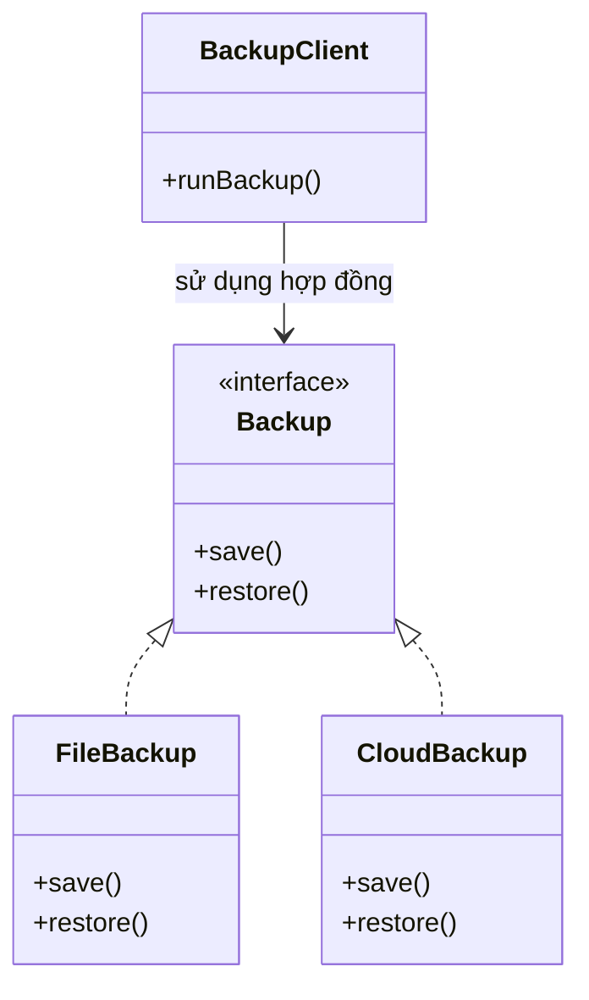
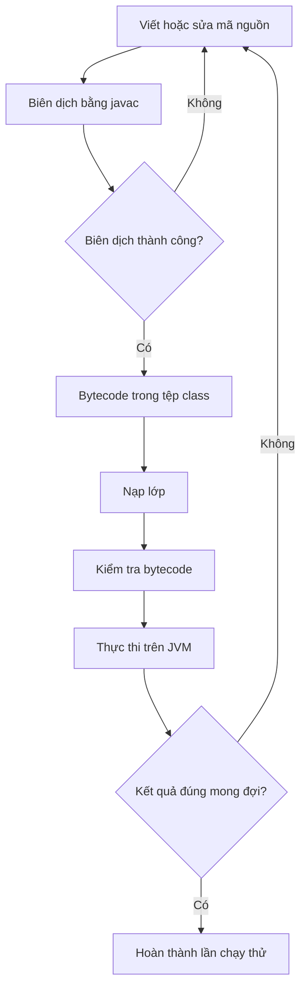
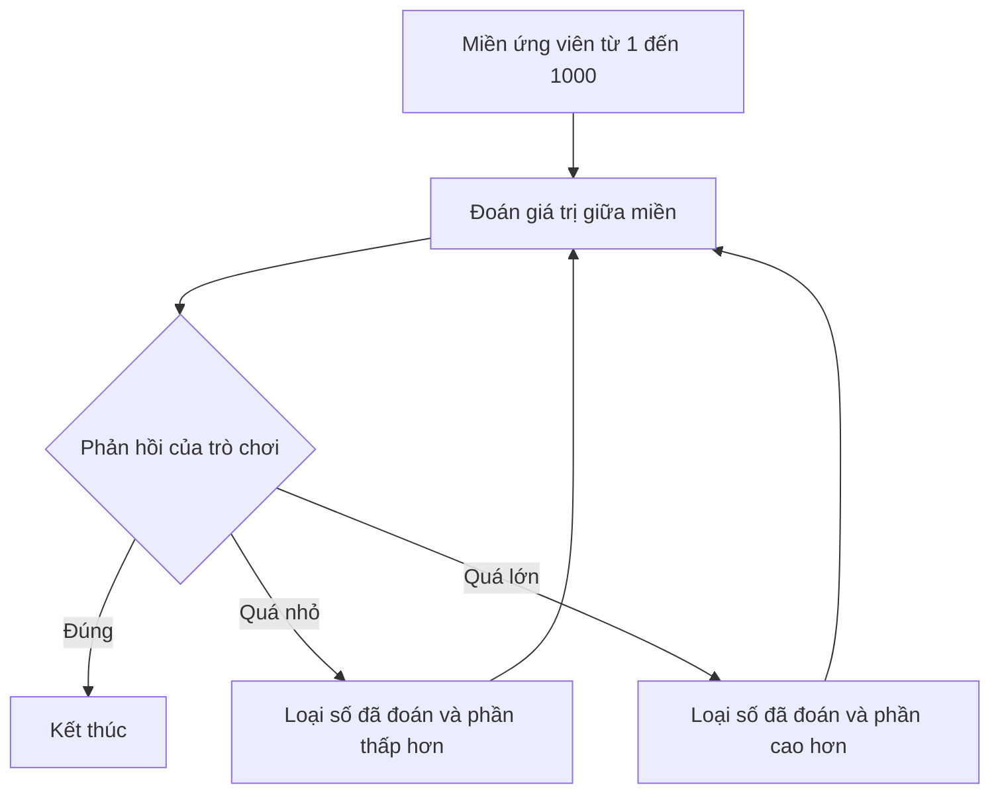
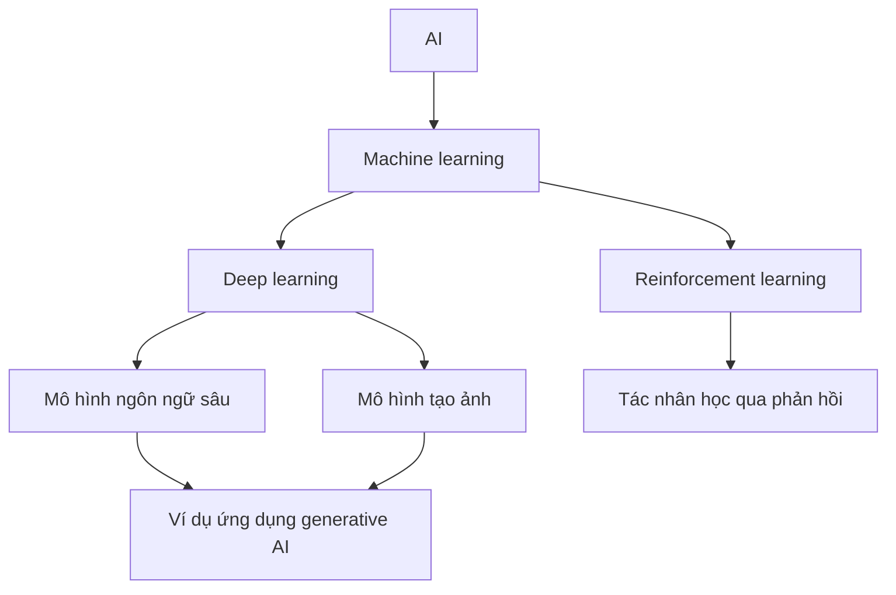
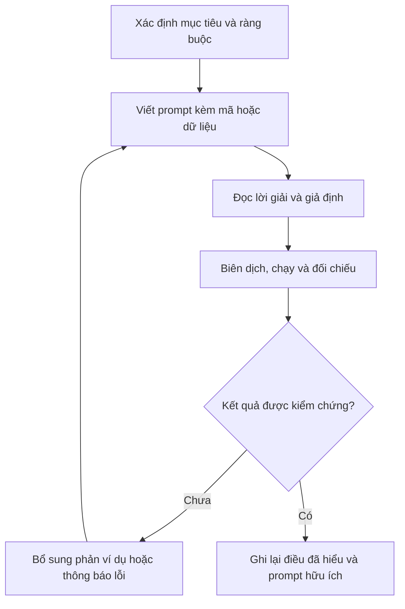

# Intro, Test-Driving a Java Application, and Generative AI

> **Tóm tắt Chương 1**  
> **Sách:** *Java for Programmers with Generative AI*, Fifth Edition - Paul Deitel & Harvey Deitel.  
> **Nguồn:** [Bản sách trên Google Drive](https://drive.google.com/file/d/1mUZMJUcLtwbPsG_KYHecBefNETR1M6_d/view).  
> Ghi chú tiếng Việt bám theo các mục 1.1-1.15. Ví dụ và hoạt động ôn tập được diễn giải lại; các số liệu thị trường và dự báo trong sách không được dùng như thông tin cập nhật hiện tại.

## 1. Chương này giúp bạn làm được gì?

Chương 1 chuẩn bị nền tảng trước khi viết nhiều mã Java: hiểu các thuật ngữ, biết chương trình được biên dịch và thực thi ra sao, thử chạy một ứng dụng bằng JDK và biết cách dùng generative AI để hỗ trợ học tập có kiểm chứng.

| Mục sách | Nội dung | Kết quả học tập |
| --- | --- | --- |
| 1.1-1.3 | Giới thiệu, phần cứng và Java | Hiểu bối cảnh, tính khả chuyển và các nhóm ứng dụng |
| 1.4 | Hướng đối tượng | Phân biệt lớp, đối tượng, thuộc tính và phương thức |
| 1.5 | Java API và thư viện mã nguồn mở | Biết vì sao cần tái sử dụng phần mềm |
| 1.6 | Môi trường phát triển | Mô tả năm giai đoạn từ mã nguồn đến thực thi |
| 1.7.1-1.7.2 | Chạy thử bằng JDK | Dùng `javac`, `java` và chế độ chạy tệp nguồn |
| 1.8.1-1.8.6 | Internet, web, cloud, IoT, edge, mashup | Nhìn được môi trường mà ứng dụng Java hoạt động |
| 1.9.1-1.9.8 | Metaverse và các công nghệ liên quan | Nhận diện VR, AR, MR, blockchain và Web3 |
| 1.10 | Công nghệ phát triển phần mềm | Hiểu refactoring, Git, Agile, TDD, microservices và container |
| 1.11-1.12 | Phân tích dữ liệu, khoa học dữ liệu, big data | Phân biệt mục tiêu và bốn đặc tính V |
| 1.13.1-1.13.6 | AI, AGI, ML, deep learning, reinforcement learning | Phân biệt các khái niệm và cách học |
| 1.14-1.15 | Generative AI và tổng kết | Hiểu prompt, LLM, token, context và việc kiểm chứng |

Sách dùng cách tiếp cận **objects-natural**: trước tiên sử dụng các lớp mạnh có sẵn trong Java API để làm công việc hữu ích; sau đó mới đi sâu vào tự thiết kế lớp. Bạn không cần hiểu mọi chi tiết bên trong thư viện mới bắt đầu sử dụng nó.

## 2. Phần cứng và ý nghĩa đối với người viết chương trình

Sách thảo luận quá trình gia tăng năng lực tính toán, xu hướng nhiều lõi và nhu cầu xử lý lượng dữ liệu lớn.

- **CPU:** xử lý các chỉ thị của chương trình.
- **Bộ nhớ chính:** giữ mã và dữ liệu đang được sử dụng khi chương trình chạy.
- **Lưu trữ thứ cấp:** giữ tệp nguồn, dữ liệu, chương trình đã biên dịch và các tài nguyên lâu dài.
- **Multi-core:** nhiều lõi có thể thực hiện những phần công việc khác nhau song song.
- **Multithreading:** tổ chức chương trình thành nhiều luồng thực thi để xử lý các hoạt động đồng thời.
- **GPU và bộ tăng tốc:** được sách nêu trong bối cảnh các phép tính lớn, đồ hoạ và AI.

Thông điệp học tập: phần cứng nhiều lõi không làm mọi chương trình tự động chạy nhanh hơn tương ứng. Tổ chức công việc, đồng bộ dữ liệu và chi phí phối hợp đều có ảnh hưởng. **Concurrency** nói về nhiều công việc cùng tiến triển; **parallelism** nói về thực hiện công việc đồng thời trên các tài nguyên xử lý.

Moore's Law được trình bày như bối cảnh lịch sử của sự phát triển phần cứng; không nên hiểu đó là cam kết mọi máy tính hay mọi chương trình luôn tăng gấp đôi tốc độ theo một khoảng thời gian cố định. Những ví dụ về siêu máy tính và tính toán lượng tử trong sách mở rộng bối cảnh, không phải điều kiện tiên quyết để học Java cơ bản.

## 3. Java, JVM và tính khả chuyển

Java có lịch sử bắt đầu từ dự án tại Sun Microsystems do James Gosling dẫn dắt. Sách giới thiệu Java như một ngôn ngữ đa mục đích và nhấn mạnh khả năng phát triển ứng dụng trên nhiều hệ thống.

**Write once, run anywhere (WORA)** được hỗ trợ bởi bước biên dịch ra bytecode và các JVM trên nền tảng tương ứng. Bytecode không phải mã máy riêng của một CPU; JVM trên từng nền tảng thực thi nó.

| Thuật ngữ | Vai trò |
| --- | --- |
| Mã nguồn `.java` | Chương trình người viết và chỉnh sửa |
| `javac` | Công cụ biên dịch mã nguồn thành bytecode |
| Tệp `.class` | Chứa biểu diễn lớp đã biên dịch, bao gồm bytecode |
| JVM | Môi trường thực thi bytecode |
| `java` | Công cụ khởi chạy ứng dụng Java |
| JDK | Bộ công cụ phát triển Java, gồm các công cụ như `javac`, `java` và các thành phần cần thiết |
| IDE | Môi trường hỗ trợ soạn mã, chạy, gỡ lỗi và nhiều công việc phát triển khác |

**Giới hạn cần hiểu:** khả chuyển còn cần JVM tương thích với phiên bản bytecode và các phụ thuộc phù hợp. Dùng thư viện native hoặc tài nguyên phụ thuộc hệ điều hành có thể cần xử lý riêng.

### Các nền tảng được giới thiệu

- **Java SE:** nền tảng Java tiêu chuẩn, là trọng tâm của sách; dùng cho nhiều loại ứng dụng, trong đó có desktop và server.
- **Jakarta EE:** phát triển ứng dụng doanh nghiệp, phân tán và web; kế thừa tên gọi trước đây là Java EE.
- **Java ME:** hướng đến những thiết bị nhúng hoặc hạn chế tài nguyên trong bối cảnh sách trình bày.

Java hỗ trợ nhiều cách tổ chức chương trình: thủ tục, hướng đối tượng, generic, lập trình hàm và lập trình đồng thời. Không nên đồng nhất Java chỉ với một kiểu lập trình.

### Phiên bản và quá trình phát triển nền tảng

Sách giới thiệu nhịp phát hành Java sáu tháng, khái niệm **LTS** và nhu cầu cân bằng tính ổn định với tính năng mới. Khi thực hành, ghi rõ JDK của dự án và dùng cú pháp/API phù hợp phiên bản đó.

| Viết tắt | Nội dung |
| --- | --- |
| JEP | JDK Enhancement Proposal: đề xuất cải tiến cho JDK |
| JSR | Java Specification Request: yêu cầu đặc tả trong quy trình Java |
| JCP | Java Community Process: quy trình cộng đồng phát triển đặc tả |

Đây là các khái niệm liên quan nhưng không phải cứ một tính năng mới là tương ứng một JSR riêng. Ở giai đoạn đầu, cần biết chúng xuất hiện trong tài liệu thay đổi Java, chưa cần tự viết một đề xuất.

## 4. Hướng đối tượng: lớp là thiết kế, đối tượng là thực thể

Sách dùng chiếc xe làm phép so sánh: bản thiết kế tương ứng với lớp; một chiếc xe cụ thể tương ứng với đối tượng; chân ga, phanh và vô lăng cho người dùng cách điều khiển mà không phải hiểu toàn bộ cơ chế bên trong.

| Khái niệm | Cách hiểu | Ví dụ tài khoản |
| --- | --- | --- |
| Class | Định nghĩa cấu trúc dữ liệu và hành vi | `BankAccount` |
| Object / instance | Một thực thể được tạo từ lớp | Tài khoản của Lan |
| Instantiation | Tạo một instance | Tạo tài khoản mới |
| Attribute | Đặc điểm hoặc trạng thái | Chủ tài khoản, số dư |
| Instance variable | Biến lưu trạng thái riêng của từng đối tượng | Trường `balance` của mỗi tài khoản |
| Method | Công việc đối tượng/lớp có thể thực hiện | Gửi tiền, rút tiền, xem số dư |
| Method call | Yêu cầu thực hiện công việc | Gọi `deposit(amount)` |

### Đóng gói và che giấu thông tin

Đóng gói đưa trạng thái và hành vi liên quan vào cùng một đơn vị. Che giấu thông tin hạn chế việc bên ngoài phụ thuộc vào các chi tiết triển khai.

Ví dụ: người dùng gọi thao tác gửi tiền; việc kiểm tra số tiền và cập nhật số dư được thực hiện bên trong tài khoản. Mã bên ngoài không nên tuỳ tiện sửa số dư theo cách bỏ qua quy tắc nghiệp vụ.

### Kế thừa, interface và tái sử dụng

- **Inheritance:** tạo lớp chuyên biệt dựa trên lớp tổng quát, bổ sung hoặc tuỳ biến hành vi.
- **Interface:** mô tả một hợp đồng sử dụng, chẳng hạn các thao tác `save` và `restore`. Các lớp có thể thực hiện chúng bằng cách khác nhau.
- **Polymorphism:** xử lý các đối tượng khác nhau thông qua một kiểu/hợp đồng chung, trong khi hành vi cụ thể có thể khác nhau.
- **Reuse:** tận dụng lớp hoặc thành phần đã có để giảm công việc lặp lại.



Sơ đồ minh hoạ bổ sung: cùng hợp đồng backup, hai cách triển khai khác nhau. Không cần viết toàn bộ các lớp này ở buổi đầu.

### OOAD và UML

**Object-Oriented Analysis and Design (OOAD)** bắt đầu từ xác định hệ thống cần làm gì, rồi thiết kế các đối tượng và cách chúng phối hợp. **UML** cung cấp ngôn ngữ mô hình hoá để truyền đạt cấu trúc và hành vi. Với hệ thống lớn, bắt đầu gõ mã ngay mà không hiểu yêu cầu dễ dẫn đến sửa đổi tốn kém.

## 5. Java API và thư viện mã nguồn mở

Học Java gồm hai việc song song:

1. Học ngôn ngữ: kiểu dữ liệu, biểu thức, điều kiện, vòng lặp, phương thức và lớp.
2. Học sử dụng API: các lớp, interface và phương thức đã giải quyết nhiều công việc phổ biến.

Một chương trình thường kết hợp mã tự viết, Java API và thư viện bên thứ ba. Sử dụng thành phần đã được phát triển và kiểm tra kỹ có thể giảm thời gian xây dựng, giảm lỗi và cải thiện chất lượng; vẫn cần hiểu cách dùng, giả định và giới hạn của nó.

Ví dụ về tinh thần objects-natural:

```java
String message = "Welcome to Java";
System.out.println(message.toUpperCase());
// WELCOME TO JAVA
```

Người học sử dụng một phương thức sẵn có để xử lý chuỗi mà chưa cần tự viết thuật toán chuyển từng ký tự. Cách này minh hoạ tái sử dụng thư viện; chi tiết cú pháp sẽ được học dần từ chương 2.

## 6. Năm giai đoạn phát triển và thực thi chương trình

| Giai đoạn | Hoạt động | Kết quả hoặc trách nhiệm |
| --- | --- | --- |
| 1. Edit | Viết và sửa mã bằng editor/IDE | Mã nguồn `.java` |
| 2. Compile | `javac` kiểm tra và biên dịch | Các tệp `.class` nếu thành công |
| 3. Load | Class loader nạp lớp và các lớp phụ thuộc cần thiết | Chương trình được chuẩn bị trong bộ nhớ |
| 4. Verify | Kiểm tra tính hợp lệ của bytecode | Phát hiện những vi phạm thuộc phạm vi kiểm tra của JVM |
| 5. Execute | JVM thực thi | Các thao tác của chương trình diễn ra |



JVM có thể kết hợp **thông dịch** và **JIT compilation**. Các đoạn được chạy thường xuyên có thể được biên dịch thành mã máy của nền tảng đang chạy. Vì vậy, quá trình thực thi không chỉ là “đọc từng dòng mã nguồn Java”.

Bytecode verification không chứng minh thuật toán đúng hoặc không còn mọi rủi ro bảo mật. Chương trình vẫn cần kiểm tra hành vi và đầu ra.

### Phân biệt các nhóm lỗi

| Nhóm lỗi | Khi nào nhận ra? | Ví dụ |
| --- | --- | --- |
| Lỗi biên dịch | Trước khi chạy thành công | Cú pháp sai hoặc kiểu dữ liệu không tương thích |
| Lỗi khi chạy | Trong quá trình thực thi | Chia số nguyên cho 0 |
| Lỗi logic | Chương trình chạy nhưng sai kết quả | Công thức tính tổng không đúng |

Nếu nhận `javac: command not found` hoặc thông báo công cụ không được nhận diện, kiểm tra việc cài JDK và đường dẫn công cụ trước khi sửa thuật toán. Nếu báo không tìm được lớp chạy, kiểm tra tên lớp, thư mục/classpath và package.

## 7. Test-drive: biên dịch và chạy với JDK

### 7.1 Mục tiêu của bài đoán số trong sách

Ứng dụng chọn một số trong khoảng 1-1000, nhận dự đoán rồi báo quá nhỏ, quá lớn hoặc chính xác. Chương này tập trung vào **thực hiện quy trình chạy ứng dụng**, chưa yêu cầu hiểu toàn bộ mã trò chơi.

Giả sử đã có tệp `GuessTheNumberGame.java` của sách và nó không khai báo package:

```bash
# Chuyển vào thư mục chứa tệp nguồn.
cd ~/Documents/examples/ch01

# Biên dịch; nếu thành công sẽ tạo tệp class.
javac GuessTheNumberGame.java

# Chạy theo tên lớp, không có đuôi .class.
java GuessTheNumberGame
```

Tên `GuessTheNumberGame` là tên ứng dụng minh hoạ trong sách. Các lệnh trên cần tệp nguồn tương ứng; bản ghi chú này không tự tạo hoặc cài bộ ví dụ của sách.

| Lệnh | Đầu vào chính | Có ghi `.class` ra thư mục khi biên dịch theo cách này? |
| --- | --- | --- |
| `javac GuessTheNumberGame.java` | Tệp nguồn | Có, nếu biên dịch thành công |
| `java GuessTheNumberGame` | Tên lớp đã có bytecode | Dùng lớp đã được biên dịch |
| `java GuessTheNumberGame.java` | Tệp nguồn | Chế độ chạy nguồn không lưu tệp `.class` như bước `javac` riêng |

### 7.2 Chạy trực tiếp tệp nguồn

```bash
java GuessTheNumberGame.java
```

JDK hỗ trợ chế độ này sẽ biên dịch nguồn trong bộ nhớ rồi chạy. Sách cũng giới thiệu khả năng chạy chương trình nhiều tệp nguồn với JDK hỗ trợ tính năng tương ứng. Đây vẫn là chương trình Java được biên dịch và thực thi; không phải bỏ qua việc kiểm tra cú pháp/kiểu.

### 7.3 Khi dự án có package như thư mục học của bạn

Nếu một lớp khai báo:

```java
package week1.monday.jfp;
```

thì tên lớp đầy đủ còn bao gồm package. Ví dụ dưới đây **chỉ áp dụng khi** tệp thực tế là `Hello.java`, chứa lớp `Hello` và đúng khai báo package trên:

```bash
# Chạy từ thư mục gốc month1_introduction_problemsolving.
javac -d out src/main/java/week1/monday/jfp/Hello.java
java -cp out week1.monday.jfp.Hello
```

Đây là hướng dẫn bổ sung để liên hệ với cấu trúc thư mục hiện tại, không phải lệnh dùng cho mọi dự án. Nếu dùng IDE hoặc công cụ build, chúng có thể quản lý các bước này. Không đổi package chỉ để khớp lệnh minh hoạ.

### 7.4 Chiến lược đoán số: luôn chia đôi miền còn lại

Mỗi lần đoán, chọn số gần giữa khoảng còn có thể chứa đáp án:



Số ứng viên giảm khoảng một nửa sau mỗi phản hồi sai. Vì `2^10 = 1024`, có thể tìm số trong 1-1000 trong tối đa 10 lần đoán nếu dùng chiến lược phù hợp. Đây là ý tưởng cốt lõi của **binary search**, không phải thử ngẫu nhiên nhiều số.

Ví dụ minh hoạ một đáp án là 642:

| Lần | Đoán | Phản hồi | Khoảng còn lại sau phản hồi |
| --- | --- | --- | --- |
| 1 | 500 | Quá nhỏ | 501-1000 |
| 2 | 750 | Quá lớn | 501-749 |
| 3 | 625 | Quá nhỏ | 626-749 |
| 4 | 687 | Quá lớn | 626-686 |
| 5 | 656 | Quá lớn | 626-655 |
| 6 | 640 | Quá nhỏ | 641-655 |
| 7 | 648 | Quá lớn | 641-647 |
| 8 | 644 | Quá lớn | 641-643 |
| 9 | 642 | Chính xác | Đã tìm thấy |

642 là kết quả của lượt minh hoạ trong sách, không phải quy tắc rằng mọi trò chơi đều chọn số này.

## 8. Internet, web, cloud, IoT và edge computing

| Khái niệm | Ý nghĩa chính | Ví dụ liên hệ |
| --- | --- | --- |
| Internet | Mạng của các mạng, hỗ trợ các thiết bị trao đổi dữ liệu | Ứng dụng giao tiếp với máy chủ |
| TCP/IP | Họ giao thức nền tảng cho truyền thông mạng | IP định tuyến; TCP cung cấp truyền dòng dữ liệu tin cậy khi được sử dụng |
| World Wide Web | Hệ thống tài nguyên/dịch vụ siêu văn bản trên Internet | Trình duyệt truy cập trang web |
| HTML | Ngôn ngữ đánh dấu tài liệu web | Cấu trúc trang |
| HTTP | Giao thức trao đổi trong hệ thống web | Request/response giữa client và server |
| Cloud computing | Dùng tài nguyên tính toán được cung cấp qua mạng | Mở rộng tài nguyên theo nhu cầu |
| Web service | Cung cấp chức năng để phần mềm khác truy cập qua mạng/web | API tra cứu dữ liệu |
| IoT | Thiết bị thu thập/trao đổi dữ liệu trong hệ thống kết nối | Cảm biến, thiết bị đo, đồ gia dụng thông minh |
| Edge computing | Xử lý gần nơi dữ liệu được tạo ra | Phản ứng cục bộ khi độ trễ hoặc mất kết nối là vấn đề |
| Mashup | Kết hợp dữ liệu/chức năng từ nhiều dịch vụ | Danh sách bất động sản kết hợp bản đồ |

Internet và web không đồng nghĩa: web là một nhóm dịch vụ trên Internet. Cloud và edge có thể phối hợp: edge xử lý phản hồi cần nhanh, cloud tổng hợp dữ liệu hoặc xử lý công việc lớn hơn.

Điểm liên hệ với mục tiêu backend: chương trình Java thường cung cấp dịch vụ, xử lý yêu cầu, gọi API khác và lưu/xử lý dữ liệu. Các khái niệm mạng trên giải thích vì sao một chương trình thường là thành phần của hệ thống lớn hơn.

## 9. Metaverse và các công nghệ liên quan

Phần này cung cấp bối cảnh công nghệ, không yêu cầu bạn triển khai hệ thống metaverse hoặc blockchain để hoàn thành chương 1.

| Khái niệm | Phân biệt ngắn gọn |
| --- | --- |
| Metaverse | Ý tưởng về các không gian/trải nghiệm số có tính chia sẻ và tương tác |
| VR | Trải nghiệm môi trường mô phỏng, có các mức độ nhập vai khác nhau |
| AR | Đưa nội dung số vào cách người dùng nhìn thế giới thật |
| MR | Kết hợp yếu tố thật và ảo, cho phép tương tác phù hợp với môi trường |
| XR | Thuật ngữ bao quát VR, AR và MR |
| Blockchain | Sổ ghi phân tán với các khối được liên kết bằng cơ chế mật mã |
| Cryptocurrency / Bitcoin | Tiền mã hoá; Bitcoin là một ví dụ được giới thiệu |
| Ethereum | Nền tảng được sách dùng để minh hoạ ứng dụng phi tập trung và smart contract |
| NFT | Token riêng biệt trên blockchain, có thể liên kết với một tài sản hoặc nội dung |
| Web3 | Nhóm ý tưởng về ứng dụng/web dựa trên công nghệ phi tập trung và quyền kiểm soát của người dùng |

Phân biệt khái niệm thay vì coi chúng là một: metaverse nhấn mạnh trải nghiệm số, còn Web3 nhấn mạnh kiến trúc/quan hệ sở hữu và kiểm soát phi tập trung. Chúng có thể chia sẻ công nghệ nhưng không đồng nhất. Mức độ phi tập trung và khả năng thay đổi dữ liệu của một blockchain cụ thể còn phụ thuộc thiết kế và quản trị; không suy ra mọi hệ thống đều có cùng thuộc tính.

## 10. Các thuật ngữ phát triển phần mềm

| Thuật ngữ | Nội dung | Điều cần nhớ |
| --- | --- | --- |
| Refactoring | Cải thiện cấu trúc mã trong khi bảo toàn hành vi quan sát được | Khác với tự ý thay đổi yêu cầu chức năng |
| Design pattern | Mẫu giải quyết vấn đề thiết kế lặp lại | Không phải mã nguồn dùng nguyên xi cho mọi trường hợp |
| SDK | Bộ công cụ, thư viện và tài liệu để phát triển | JDK là một ví dụ |
| VCS / Git | Theo dõi và quản lý thay đổi mã | Git khác với dịch vụ lưu kho mã GitHub |
| Agile | Phát triển theo bước nhỏ, tiếp nhận phản hồi và điều chỉnh | Không có nghĩa bỏ thiết kế hoặc tài liệu |
| TDD | Viết kiểm thử trước phần mã đáp ứng hành vi cần có | Có thể nhớ chu trình Red → Green → Refactor |
| Microservices | Chia hệ thống thành các dịch vụ có trách nhiệm rõ, phối hợp với nhau | Mang thêm bài toán vận hành và giao tiếp |
| Containerization | Đóng gói ứng dụng với các phụ thuộc cần thiết | Cần môi trường chạy container tương thích |

Đây là từ vựng định hướng. Trong buổi học đầu tiên, ưu tiên chạy được chương trình, hiểu lỗi và ghi lại thay đổi; các kỹ thuật kiến trúc lớn sẽ được đào sâu sau.

## 11. Data analytics, data science và big data

### Phân biệt trọng tâm

| Lĩnh vực | Trọng tâm theo cách giới thiệu của sách | Ví dụ |
| --- | --- | --- |
| Statistics | Thu thập, tổ chức, phân tích và diễn giải dữ liệu | Đo mức biến thiên, so sánh các nhóm |
| Data analytics | Khám phá dữ liệu để giải thích hiện tượng và hỗ trợ quyết định | Phân tích lưu lượng truy cập |
| Data science | Phối hợp phương pháp, thuật toán, hệ thống và mô hình để rút tri thức | Xây mô hình dự đoán khách hàng rời dịch vụ |

Các lĩnh vực có vùng giao nhau; không nên hiểu analytics chỉ được phép nhìn quá khứ, còn data science chỉ làm dự đoán tương lai. Sách dùng sự khác biệt trọng tâm này để giới thiệu phạm vi rộng của khoa học dữ liệu.

### Bốn đặc tính V của big data

| V | Ý nghĩa | Câu hỏi cần đặt ra |
| --- | --- | --- |
| Volume | Quy mô dữ liệu | Có thể lưu và xử lý hiệu quả không? |
| Velocity | Tốc độ tạo, nhận hoặc thay đổi dữ liệu | Có cần phản hồi nhanh hoặc xử lý luồng không? |
| Variety | Nhiều dạng dữ liệu | Bảng, văn bản, ảnh, âm thanh và dữ liệu cảm biến khác nhau ra sao? |
| Veracity | Tính đáng tin của dữ liệu | Có đúng, đầy đủ và phù hợp mục tiêu không? |

Sách minh hoạ quy mô từ megabyte, gigabyte, terabyte đến petabyte, exabyte và zettabyte. Mục tiêu chính là hiểu chi phí lưu trữ, xử lý và truyền dữ liệu tăng theo quy mô; không chỉ tập trung vào một con số dung lượng.

Các ví dụ ứng dụng gồm phát hiện gian lận, hệ gợi ý, tối ưu tồn kho, giao thông thông minh, dịch ngôn ngữ và phân tích dữ liệu cảm biến. Chất lượng dữ liệu ảnh hưởng trực tiếp chất lượng kết quả; năng lực tính toán lớn không tự làm dữ liệu sai trở nên đúng.

## 12. AI, machine learning, deep learning và reinforcement learning

| Khái niệm | Ý nghĩa trong chương | Ví dụ dễ hình dung |
| --- | --- | --- |
| AI | Lĩnh vực xây dựng hệ thống thực hiện các công việc gắn với hành vi thông minh | Nhận dạng, lập kế hoạch, xử lý ngôn ngữ |
| AGI | Khái niệm về trí tuệ có khả năng học và áp dụng kiến thức rộng trên nhiều nhiệm vụ | Được sách trình bày như mục tiêu và chủ đề tranh luận |
| Machine learning | Học mô hình/quy luật từ dữ liệu hoặc trải nghiệm thay vì mã hoá thủ công toàn bộ quyết định | Phân loại thư rác |
| Deep learning | Machine learning dùng mạng neural nhiều tầng | Xử lý ảnh, tiếng nói, ngôn ngữ |
| Reinforcement learning | Tác nhân tương tác, nhận tín hiệu thưởng và học cách chọn hành động | Học chiến lược chơi trò chơi |

ML vẫn cần con người lựa chọn bài toán, dữ liệu, thuật toán, thước đo và cách đánh giá; “học từ dữ liệu” không có nghĩa hệ thống không cần được lập trình hoặc thiết kế.



Sơ đồ là các quan hệ/ví dụ tiêu biểu, không phải hệ phân loại đầy đủ. Reinforcement learning có thể kết hợp deep learning; generative AI cũng không đồng nghĩa chỉ có LLM.

### Các mốc AI được sách nhắc đến

- **Deep Blue:** minh hoạ AI thi đấu cờ vua.
- **Watson:** minh hoạ xử lý câu hỏi ngôn ngữ trong trò chơi Jeopardy!.
- **AlphaGo:** minh hoạ tiến bộ trong cờ vây.
- **AlphaZero:** minh hoạ học qua tự chơi và reinforcement learning.
- **AlphaDev:** minh hoạ ứng dụng học máy để tìm cải tiến thuật toán.

Mục tiêu của danh sách là thấy AI có nhiều phương pháp và bài toán, không chỉ chatbot. Không cần ghi nhớ các con số hiệu năng hoặc dự báo thời điểm AGI để bắt đầu lập trình Java.

## 13. Generative AI: khái niệm cốt lõi

Generative AI tạo nội dung dựa trên đầu vào và những gì mô hình đã học. Nội dung có thể là văn bản, mã, hình ảnh, âm thanh hoặc video. Hệ thống đa phương thức có thể tiếp nhận hoặc tạo nhiều loại dữ liệu, tuỳ công cụ.

| Thuật ngữ | Cách hiểu |
| --- | --- |
| Prompt | Yêu cầu, dữ liệu và các chỉ dẫn cung cấp cho mô hình |
| LLM | Mô hình ngôn ngữ lớn, học các mẫu từ dữ liệu để xử lý và tạo ngôn ngữ |
| Parameter | Các giá trị bên trong được điều chỉnh trong quá trình huấn luyện |
| Transformer | Kiến trúc neural được dùng trong nhiều mô hình ngôn ngữ |
| Self-attention | Cơ chế kết hợp thông tin giữa các vị trí trong chuỗi theo mức liên quan học được |
| Token | Đơn vị biểu diễn/xử lý, có thể là từ, phần từ hoặc dấu câu |
| Context | Thông tin được cung cấp và sử dụng trong lần xử lý |
| Context window | Giới hạn lượng token mô hình có thể xét trong ngữ cảnh xử lý |
| NLP | Xử lý ngôn ngữ tự nhiên |
| NLU | Khía cạnh diễn giải nghĩa và ngữ cảnh trong xử lý ngôn ngữ |

Ví dụ ngữ cảnh: “bank” trong ngữ cảnh vay tiền khác “bank” trong ngữ cảnh bờ sông. Self-attention là cơ chế tính toán để kết hợp thông tin, không phải bằng chứng mô hình có trải nghiệm hay nhận thức giống người.

### Ba điều cần phân biệt

1. Token không luôn bằng một từ; số ký tự cũng không tự bằng số token.
2. Có nhiều thông tin trong context không bảo đảm mọi thông tin đều được sử dụng đúng.
3. Nhớ ngữ cảnh hội thoại không đồng nghĩa trọng số mô hình được huấn luyện lại sau mỗi tin nhắn.

Sách giới thiệu **Turing test** như một cách tiếp cận lịch sử để đánh giá tương tác đối thoại. Văn bản giống người không tự chứng minh mọi câu trả lời đều đúng hoặc hệ thống có năng lực tổng quát trên mọi nhiệm vụ.

### Những cách AI hỗ trợ người học Java

- Giải thích đoạn mã và thuật ngữ.
- Tạo ví dụ nhỏ hoặc bài tập theo chủ đề.
- Gợi ý nguyên nhân lỗi biên dịch hoặc lỗi logic.
- So sánh hai cách triển khai.
- Gợi ý refactoring và trường hợp kiểm thử.

Khả năng thực tế phụ thuộc công cụ và mô hình. Chương này không yêu cầu mua một dịch vụ cụ thể hoặc ghi nhớ giới hạn token/gói dịch vụ tại thời điểm sách xuất bản.

## 14. Prompt engineering và kiểm chứng kết quả

Một prompt hữu ích nêu rõ ngôn ngữ, phiên bản Java đang dùng, bài toán, ràng buộc, đầu vào/đầu ra và mức giải thích mong muốn.

```text
Tôi đang học Java bằng JDK của dự án này.
Hãy giải thích đoạn mã bên dưới cho người mới học.
Nêu đầu vào, đầu ra và lần lượt mô tả các bước thực thi.
Nếu có lỗi, chỉ ra dòng và nguyên nhân trước khi đề xuất sửa.
Chỉ dùng kiến thức biến, điều kiện và vòng lặp.
Đưa ba trường hợp kiểm chứng, gồm một trường hợp biên.
```

Khi dùng, thay thông tin JDK bằng phiên bản thực tế, dán đoạn mã nguyên vẹn và thêm thông báo lỗi chính xác nếu có. Không chỉ yêu cầu “sửa giúp” mà thiếu dữ liệu cần phân tích.



Sách khuyến khích thử nhiều cách hỏi, so sánh kết quả và ghi lại prompt hiệu quả. Các hệ thống có thể đưa câu trả lời khác nhau cho cùng một câu hỏi; đó không phải tiêu chí đủ để quyết định câu nào đúng.

**Hallucination** là khi hệ thống tạo nội dung không đáng tin nhưng trình bày như thông tin đúng. Ví dụ trong sách gồm suy luận sai đầu ra chương trình hoặc bịa nguồn tham khảo. Cần kiểm tra mã bằng compiler/runtime và kiểm tra nguồn khi câu trả lời dựa vào tài liệu.

Các chủ đề cuối chương còn gồm thiên lệch dữ liệu, đạo đức, bản quyền, tác động việc làm, AI agent và **human in the loop**. Bài học xuyên suốt là con người phải đánh giá giả định và kết quả, nhất là khi hậu quả của quyết định quan trọng.

## 15. Bài tập và checklist cho buổi học đầu tiên

Đây là gợi ý thực hành dựa trên nội dung chương, không phải lời giải toàn bộ 26 bài Generative AI Exercises của sách.

1. **Kiểm tra công cụ:** chạy `java -version` và `javac -version`, ghi lại phiên bản thực tế.
2. **Giải thích quy trình:** tự mô tả `.java → javac → .class → JVM` và vai trò nạp/kiểm tra/thực thi.
3. **Chạy thử:** nếu đã có ví dụ sách, biên dịch và chạy trò đoán số theo hai cách ở mục 7.
4. **Đoán có chiến lược:** ghi lại mỗi dự đoán, phản hồi và khoảng còn lại; tìm bằng cách chia đôi.
5. **Phân biệt OOP:** chọn “tài khoản” hoặc “chiếc xe”, liệt kê một lớp, hai đối tượng, ba thuộc tính và ba hành vi.
6. **Phân biệt công nghệ:** giải thích bằng một câu cho từng cặp Internet/web, JDK/IDE, class/object, AI/ML, ML/deep learning.
7. **Dùng AI để học:** yêu cầu một lời giải thích, tự kiểm tra lại và ghi điều gì cần sửa hoặc bổ sung.
8. **Tổng kết:** viết 5-10 dòng về điều bạn đã chạy được và điều chưa hiểu.

| Tự kiểm tra | Hoàn thành khi |
| --- | --- |
| Hiểu JDK và JVM | Giải thích được công cụ phát triển khác môi trường thực thi thế nào |
| Biết chạy chương trình | Phân biệt `javac File.java`, `java ClassName` và `java File.java` |
| Biết xử lý tên lớp | Hiểu tên đầy đủ nếu có package |
| Hiểu chia đôi miền tìm kiếm | Sau mỗi dự đoán biết loại những giá trị nào |
| Nắm OOP nhập môn | Phân biệt lớp, đối tượng, thuộc tính, phương thức và interface |
| Dùng AI có kiểm chứng | Không chấp nhận mã hoặc nguồn chỉ vì câu trả lời nghe thuyết phục |

## 16. Ghi nhớ cuối chương

- Java là ngôn ngữ và một hệ sinh thái thư viện/công cụ; học cả cú pháp lẫn cách sử dụng API.
- Bytecode và JVM là nền tảng của tính khả chuyển, với điều kiện tương thích phiên bản và phụ thuộc.
- Chu trình edit, compile, load, verify, execute giúp định vị lỗi đúng giai đoạn.
- Class mô tả kiểu đối tượng; mỗi instance có trạng thái; method biểu diễn hành vi.
- Tái sử dụng thành phần giúp tập trung vào bài toán, nhưng vẫn cần hiểu hợp đồng sử dụng.
- Bài đoán số là cơ hội học chạy JDK và tư duy giảm không gian tìm kiếm.
- Internet, cloud, dữ liệu và AI tạo bối cảnh cho các ứng dụng Java.
- Generative AI hữu ích khi prompt rõ ràng và kết quả được kiểm chứng bằng thực hành.

**Tiếp theo:** chương 2 bắt đầu viết chương trình Java, in/đọc dữ liệu, khai báo biến, phép toán và ra quyết định cơ bản.
