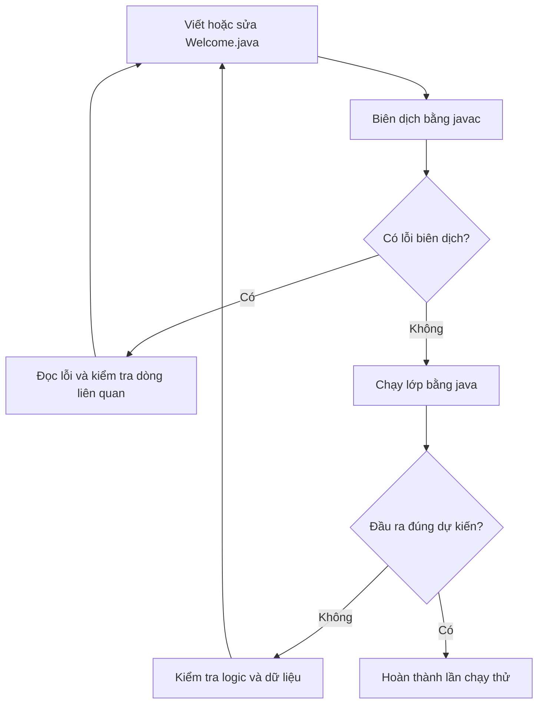
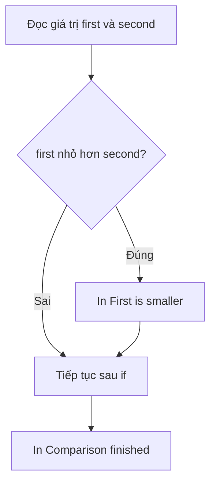
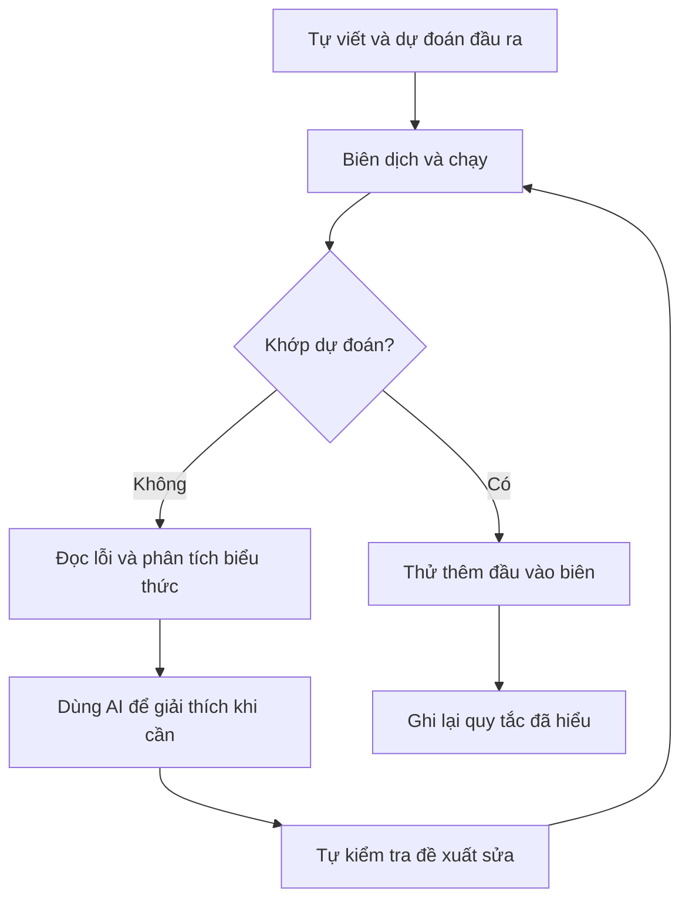

# Java Programming Intro

> **Tóm tắt Chương 2 - Intro to Java Programming**  
> **Sách:** *Java for Programmers with Generative AI*, Fifth Edition - Paul Deitel & Harvey Deitel.  
> **Nguồn:** [Bản sách trên Google Drive](https://drive.google.com/file/d/1mUZMJUcLtwbPsG_KYHecBefNETR1M6_d/view).  
> Bản ghi chú tiếng Việt bám theo các mục 2.1-2.9. Ví dụ được diễn giải và viết lại để ôn tập. Các đoạn câu lệnh rời được đặt trong `main`; `import` đặt ở đầu tệp, sau `package` nếu có.

## 1. Mục tiêu của chương

Sau chương 1 về môi trường Java, chương 2 bắt đầu viết các chương trình nhỏ: in thông báo, đọc hai số nguyên, tính toán, so sánh số và dùng các phương thức có sẵn của `String`.

| Mục sách | Nội dung | Kỹ năng cần có |
| --- | --- | --- |
| 2.1 | Giới thiệu và objects-natural | Dùng lớp thư viện trước khi tự thiết kế lớp phức tạp |
| 2.2, 2.2.1-2.2.2 | Chương trình đầu tiên, biên dịch và thực thi | Nhận diện lớp, `main`, câu lệnh, tệp `.java` và `.class` |
| 2.3 | Thay đổi cách in thông báo | Phân biệt `print`, `println` và escape sequence |
| 2.4 | Xuất có định dạng | Sử dụng format string và `printf` |
| 2.5 | Đọc và cộng số nguyên | Dùng `Scanner`, biến và phép gán |
| 2.6 | Số học | Áp dụng toán tử, chia nguyên và độ ưu tiên |
| 2.7 | Ra quyết định | Viết điều kiện và câu lệnh `if` |
| 2.8 | Case study `String` | Gọi phương thức, so nội dung và nối chuỗi |
| 2.9 | Tổng kết | Kết hợp nhập → xử lý → xuất trong chương trình nhỏ |

**Objects-natural** nghĩa là sử dụng những đối tượng đã có, như `Scanner`, `System.out` và `String`, để làm việc hữu ích trước khi đi sâu vào tự xây dựng lớp ở các chương sau.

## 2. Cấu trúc chương trình Java đầu tiên

Lưu chương trình sau vào `Welcome.java`:

```java
public class Welcome {
    public static void main(String[] args) {
        System.out.println("Welcome to Java Programming!");
    }
}
```

Kết quả:

```text
Welcome to Java Programming!
```

| Thành phần | Vai trò |
| --- | --- |
| `public class Welcome` | Khai báo lớp tên `Welcome` |
| `{ ... }` ngoài cùng | Thân lớp |
| `public static void main(String[] args)` | Điểm vào của dạng ứng dụng được dùng trong sách |
| `{ ... }` bên trong `main` | Thân phương thức |
| `System.out` | Đối tượng xuất chuẩn |
| `println(...)` | Gọi phương thức in rồi xuống dòng |
| Chuỗi trong `"..."` | Đối số của lời gọi phương thức |
| `;` cuối lệnh in | Kết thúc câu lệnh đó |

Ở giai đoạn này, cần nhận diện và viết đúng mẫu `main` của sách; chưa cần hiểu sâu mọi từ khoá. `void` cho biết phương thức không trả một giá trị cho nơi gọi. Các phiên bản Java có thể hỗ trợ thêm dạng chương trình khác, nhưng ghi chú dùng nhất quán mẫu trên.

### Quy tắc cú pháp quan trọng

- Tệp chứa lớp công khai `Welcome` phải có tên `Welcome.java`, đúng cả chữ hoa/thường.
- Java phân biệt hoa/thường: `System` khác `system`, `main` khác `Main`.
- Các dấu `{` và `}` phải ghép cặp đúng.
- Không viết số thứ tự dòng của sách vào tệp nguồn.
- Không thêm `;` sau đầu khai báo lớp hoặc phương thức trong mẫu trên.
- Thụt lề nhất quán để nhìn rõ cấu trúc, dù thụt lề không tự tạo ra một block.

## 3. Comment, khoảng trắng và tên định danh

### Các dạng comment

```java
// Comment đến hết dòng.

/* Comment truyền thống,
   có thể kéo dài nhiều dòng. */

/** Comment tài liệu được công cụ javadoc sử dụng. */
```

Comment giúp giải thích mục đích và quyết định trong mã; chúng không trở thành thao tác thực thi. Quên đóng `/* ... */` có thể gây lỗi biên dịch hoặc khiến mã bị hiểu thành comment.

Khoảng trắng giữa các thành phần mã giúp chương trình dễ đọc. Không được suy ra rằng có thể xoá hoặc thêm khoảng trắng ở mọi chỗ: tên định danh không được tách tuỳ ý, và khoảng trắng **bên trong literal chuỗi** là dữ liệu.

### Tên định danh

| Ví dụ | Nhận xét |
| --- | --- |
| `Welcome`, `firstNumber`, `sum` | Các tên hợp lệ, dễ đọc |
| `number1` | Có thể chứa chữ số sau ký tự đầu |
| `1number` | Không hợp lệ vì bắt đầu bằng chữ số |
| `first number` | Không hợp lệ vì có dấu cách |
| `class` | Không dùng làm tên biến vì là từ khoá |

Quy ước: lớp thường dùng `UpperCamelCase`, biến và phương thức dùng `lowerCamelCase`. Không cần ghi nhớ toàn bộ danh sách từ khoá ngay trong buổi đầu; cần tránh dùng từ dành riêng làm tên của mình.

## 4. Biên dịch, chạy và đọc thông báo lỗi

Nếu `Welcome.java` không khai báo package, chạy trong thư mục chứa tệp:

```bash
javac Welcome.java
java Welcome
```

- `javac` biên dịch mã nguồn; khi thành công tạo `Welcome.class`.
- `java Welcome` khởi chạy theo tên lớp, không viết `java Welcome.class`.
- Sửa mã nguồn thì cần biên dịch lại trước khi chạy lớp đã biên dịch.



Compiler chỉ ra vị trí nó phát hiện vấn đề, không phải lúc nào cũng chỉ đúng nơi bạn bắt đầu viết sai. Nếu dòng báo lỗi trông hợp lệ, kiểm tra các dòng trước đó, đặc biệt dấu `;`, dấu nháy và dấu ngoặc.

### Liên hệ cấu trúc package của thư mục học

Nếu bạn viết `Welcome.java` với khai báo:

```java
package week1.monday.jfp;
```

thì một cách biên dịch/chạy thủ công, từ thư mục gốc `month1_introduction_problemsolving`, là:

```bash
javac -d out src/main/java/week1/monday/jfp/Welcome.java
java -cp out week1.monday.jfp.Welcome
```

Các lệnh này giả định tên lớp, đường dẫn và package khớp nhau; không áp dụng nguyên xi cho mọi tệp. Trong IDE hoặc dự án dùng công cụ build, có thể dùng cấu hình chạy tương ứng của dự án.

## 5. `print`, `println` và ký tự đặc biệt

| Phương thức | Hành vi |
| --- | --- |
| `System.out.print(...)` | In dữ liệu, không tự thêm xuống dòng |
| `System.out.println(...)` | In dữ liệu rồi xuống dòng |
| `System.out.println()` | Chỉ xuống dòng |
| `System.out.printf(...)` | In theo format string; xuống dòng khi được chỉ định |

```java
System.out.print("Welcome to ");
System.out.println("Java!");
System.out.println("Next line");
```

```text
Welcome to Java!
Next line
```

Một câu lệnh cũng có thể tạo nhiều dòng:

```java
System.out.println("Welcome\nto\nJava");
```

| Escape sequence trong literal Java | Nội dung được biểu diễn |
| --- | --- |
| `\n` | Ký tự xuống dòng |
| `\t` | Tab |
| `\\` | Một dấu gạch chéo ngược |
| `\"` | Một dấu nháy kép |

```java
System.out.println("Path: C:\\Java");
System.out.println("He said: \"Hello\"");
```

Các escape được diễn giải thành dữ liệu ký tự khi xử lý literal Java; chúng không phải quy tắc chỉ dành riêng cho `println`.

### Theo dõi vị trí in để dự đoán đúng đầu ra

```java
System.out.print("#");
System.out.println("###");
System.out.println("#####");
System.out.print("####");
System.out.println("##");
```

```text
####
#####
######
```

Sau mỗi `print`, đầu ra tiếp theo nối ngay vào dòng đang có. Bài tập này cũng minh hoạ vì sao cần kiểm chứng dự đoán của AI bằng việc chạy chương trình.

## 6. `printf`: format string và đối số

```java
System.out.printf("%s%n%s%n", "Welcome to", "Java Programming!");
```

Đối số đầu tiên là **format string**. Các format specifier được thay lần lượt bằng giá trị phù hợp từ những đối số tiếp theo.

| Specifier | Công dụng trong chương | Ví dụ |
| --- | --- | --- |
| `%s` | Biểu diễn chuỗi | `"Java"` |
| `%d` | Số nguyên thập phân | `117` |
| `%b` | Hiển thị giá trị boolean trong các ví dụ điều kiện | `true` hoặc `false` |
| `%n` | Xuống dòng theo nền tảng | Không nhận thêm đối số |
| `%%` | In một dấu phần trăm | Không nhận thêm đối số |

```java
int total = 117;
System.out.printf("Sum is %d%n", total);
System.out.printf("Language: %s; ready: %b%n", "Java", true);
```

`printf` không tự xuống dòng chỉ vì đã kết thúc lời gọi. `System.out.print("%n")` in nguyên ký tự `%n`, vì `print` không diễn giải format string.

Số lượng và kiểu đối số phải tương thích với định dạng. Ví dụ `%d` nhận chuỗi `"hello"` sẽ không tự biến chuỗi đó thành số nguyên.

## 7. Biến, kiểu dữ liệu và phép gán

Biến có tên và kiểu; kiểu quyết định loại giá trị có thể lưu và các phép xử lý phù hợp.

```java
int firstNumber = 45;
int secondNumber = 72;
int sum = firstNumber + secondNumber;
```

Có thể khai báo rồi gán riêng:

```java
int number;
number = 10;
number = number + 5; // number trở thành 15
```

**`=` là phép gán:** tính vế phải trước, sau đó lưu kết quả vào biến ở vế trái. Nó không phải dấu khẳng định hai vế bằng nhau như trong đại số.

Biến cục bộ phải được gán giá trị trước khi đọc. Đừng giả định `int number;` bên trong `main` tự có giá trị 0.

### Các kiểu được nhắc tới

| Kiểu | Loại giá trị | Ví dụ |
| --- | --- | --- |
| `int` | Số nguyên | `-22`, `0`, `72` |
| `long` | Số nguyên với miền biểu diễn lớn hơn `int` | `10_000_000_000L` |
| `float`, `double` | Số thực dấu phẩy động, có thể có sai số biểu diễn | `3.4`, `0.0` |
| `char` | Một đơn vị mã UTF-16 | `'A'`, `'7'`, `'\n'` |
| `boolean` | Giá trị logic | `true`, `false` |
| `byte`, `short` | Các kiểu số nguyên với miền biểu diễn nhỏ hơn | Học kỹ hơn ở các phần sau |
| `String` | Chuỗi, là kiểu tham chiếu | `"Java"` |

Tám kiểu nguyên thuỷ là `boolean`, `byte`, `short`, `int`, `long`, `char`, `float`, `double`; `String` không nằm trong nhóm này.

`int` có miền từ `-2_147_483_648` đến `2_147_483_647`. Có thể dùng `_` giữa các chữ số thích hợp để tăng độ dễ đọc, như `60_000_000`; không viết dấu phẩy phân nhóm trong literal số Java.

## 8. `Scanner`: nhập hai số nguyên và tính tổng

Chương dùng `Scanner` trong package `java.util`, đọc từ đầu vào chuẩn `System.in`.

Lưu ví dụ sau vào `Addition.java` nếu không dùng package:

```java
import java.util.Scanner;

public class Addition {
    public static void main(String[] args) {
        Scanner input = new Scanner(System.in);

        System.out.print("Enter first integer: ");
        int number1 = input.nextInt();

        System.out.print("Enter second integer: ");
        int number2 = input.nextInt();

        int sum = number1 + number2;
        System.out.printf("Sum is %d%n", sum);
    }
}
```

Với hai số `45` và `72`, kết quả là `117`.

| Dòng hoặc biểu thức | Ý nghĩa |
| --- | --- |
| `import java.util.Scanner;` | Cho phép dùng tên ngắn `Scanner` trong tệp |
| `new Scanner(System.in)` | Tạo đối tượng đọc dữ liệu từ đầu vào chuẩn |
| `Scanner input` | Biến tham chiếu tới đối tượng `Scanner` |
| `input.nextInt()` | Đọc token tiếp theo dưới dạng `int` |
| `int sum = number1 + number2;` | Tính tổng rồi lưu vào biến |
| `%d` trong `printf` | Chọn biểu diễn số nguyên thập phân |

Nếu có `package`, thứ tự ở đầu tệp là **package → import → khai báo lớp**. Không đặt `import` trong `main`. `System` và `String` thuộc `java.lang`, được Java cho phép dùng mà không cần khai báo import riêng.

Ví dụ giả định đầu vào là số nguyên hợp lệ trong miền `int`. Token như `abc` hoặc số ngoài miền có thể làm `nextInt()` ném `InputMismatchException`; nhập không đủ dữ liệu cũng là trường hợp cần được xử lý trong chương trình hoàn chỉnh. Xử lý ngoại lệ sẽ được học sâu hơn ở các chương sau.

Đây là lời gọi phương thức trên một đối tượng: biến `input` là nơi bạn dùng tham chiếu; `nextInt` là hành vi mà đối tượng cung cấp. Bạn không cần tự triển khai toàn bộ việc đọc và phân tích ký tự.

## 9. Số học: toán tử và chia nguyên

| Phép toán | Java | Ví dụ | Kết quả |
| --- | --- | --- | --- |
| Cộng | `+` | `7 + 4` | `11` |
| Trừ | `-` | `7 - 4` | `3` |
| Nhân | `*` | `7 * 4` | `28` |
| Chia nguyên | `/` | `7 / 4` | `1` |
| Phần dư | `%` | `7 % 4` | `3` |

### Chia nguyên không làm tròn

```java
System.out.println(17 / 5);  // 3
System.out.println(-17 / 5); // -3: bỏ phần lẻ theo hướng về 0
System.out.println(17 % 5);  // 2
```

Nếu cả hai toán hạng là số nguyên, phép chia cho kết quả nguyên. Gán kết quả đó vào `double` sau đó không khôi phục phần lẻ:

```java
double wrongAverage = 5 / 2;   // 2.0
double average = 5 / 2.0;      // 2.5
```

Đây là lưu ý bổ sung để tránh lỗi khi áp dụng công thức. Phép chia hoặc lấy phần dư **số nguyên** với mẫu 0 gây `ArithmeticException`; không suy rộng cùng hành vi cho mọi phép toán dấu phẩy động.

Phần dư dùng để kiểm tra tính chia hết:

```java
int number = 12;
if (number % 2 == 0) {
    System.out.println("Even");
}
```

Với số âm, kiểm tra số lẻ bằng `number % 2 != 0` tổng quát hơn so với yêu cầu kết quả luôn bằng 1.

## 10. Độ ưu tiên, ngoặc và biểu thức

Trong các phép toán của chương:

1. Ngoặc giúp xác định nhóm cần tính.
2. `*`, `/`, `%` ưu tiên hơn `+`, `-`.
3. `*`, `/`, `%` cùng mức ưu tiên và kết hợp từ trái sang phải.
4. `+`, `-` cùng mức ưu tiên và kết hợp từ trái sang phải.
5. Giá trị tính được mới được lưu bằng phép gán.

```java
int a = 2 + 3 * 4;   // 14
int b = (2 + 3) * 4; // 20
int c = 20 / 5 * 2;  // 8, tương đương (20 / 5) * 2
```

Phân tích ví dụ của sách:

```java
int x = 2 % 2 + 2 * 2 - 2 / 2;
```

| Bước rút gọn | Biểu thức |
| --- | --- |
| `2 % 2` bằng 0 | `0 + 2 * 2 - 2 / 2` |
| `2 * 2` bằng 4 | `0 + 4 - 2 / 2` |
| `2 / 2` bằng 1 | `0 + 4 - 1` |
| Cộng, trừ và gán | `x = 3` |

Phân biệt **độ ưu tiên/kết hợp của toán tử** với **thứ tự đánh giá toán hạng**; những ví dụ đơn giản trên không thay thế toàn bộ quy tắc cho biểu thức có lời gọi phương thức hoặc tác dụng phụ.

Viết phép nhân rõ ràng: công thức `a(b + c)` phải thành `a * (b + c)`. Toán tử `^` không phải luỹ thừa trong Java.

## 11. Điều kiện và `if`

Điều kiện tạo giá trị `boolean`, tức `true` hoặc `false`.

| Toán tử | Ý nghĩa |
| --- | --- |
| `==` | Bằng nhau |
| `!=` | Khác nhau |
| `<` | Nhỏ hơn |
| `>` | Lớn hơn |
| `<=` | Nhỏ hơn hoặc bằng |
| `>=` | Lớn hơn hoặc bằng |

```java
int first = 10;
int second = 20;

if (first < second) {
    System.out.println("First is smaller");
}
System.out.println("Comparison finished");
```



Nếu điều kiện đúng, thực hiện block; nếu sai, bỏ qua block. Phần sau `if` tiếp tục chạy trong cả hai trường hợp nếu không có thao tác khác làm thay đổi luồng.

### Nhiều `if` độc lập có thể cùng thực hiện

```java
int a = 7;
int b = 7;

if (a == b) {
    System.out.println("Equal");
}
if (a <= b) {
    System.out.println("Less than or equal");
}
if (a >= b) {
    System.out.println("Greater than or equal");
}
```

Cả ba điều kiện đều đúng. Đây không phải chuỗi lựa chọn chỉ cho chạy một nhánh. Chương 3 sẽ phát triển thêm các cấu trúc lựa chọn và lặp.

### Bẫy dấu chấm phẩy

```java
// Sai về logic: dấu ; kết thúc if bằng một câu lệnh rỗng.
if (a < b); {
    System.out.println("This block runs regardless of a < b");
}
```

Sửa bằng cách bỏ `;` ngay sau `if (...)`:

```java
if (a < b) {
    System.out.println("a is smaller");
}
```

Dùng `>=`, không dùng `=>`; dùng `<=`, không dùng `=<`. Điều kiện `if` phải là boolean, không phải một số nguyên. Nên luôn dùng `{}` để tránh nhầm khi bổ sung nhiều câu lệnh.

## 12. Case study `String`: dùng đối tượng có sẵn

```java
String first = "happy";
String second = " birthday";
String combined = "";
```

Dấu cách ở đầu `" birthday"` là một phần dữ liệu, nên độ dài của chuỗi đó là 9.

| Phương thức | Công dụng | Ví dụ |
| --- | --- | --- |
| `length()` | Độ dài theo đơn vị UTF-16 | `"happy".length()` bằng 5 |
| `equals(other)` | So nội dung, phân biệt hoa/thường | `"happy".equals("happy")` là `true` |
| `isEmpty()` | Kiểm tra độ dài bằng 0 | `"".isEmpty()` là `true` |
| `startsWith(prefix)` | Kiểm tra tiền tố | `"happy".startsWith("ha")` là `true` |
| `endsWith(suffix)` | Kiểm tra hậu tố | `" birthday".endsWith("ay")` là `true` |

Trong các ví dụ ASCII của chương, mỗi ký tự tương ứng một đơn vị độ dài; với một số emoji hoặc tổ hợp ký tự Unicode, số đơn vị UTF-16 không luôn bằng số ký tự nhìn thấy.

```java
if (combined.isEmpty()) {
    combined = first + second;
}
System.out.println(combined);          // happy birthday
System.out.println(combined.length()); // 14
```

`main` đóng vai trò **driver program**: tạo hoặc sử dụng đối tượng rồi gọi phương thức để thử chức năng. Bạn đã làm việc với đối tượng mà chưa cần biết chi tiết triển khai của `String`.

### Không nhầm chuỗi rỗng, dấu cách và `null`

| Giá trị | Ý nghĩa |
| --- | --- |
| `""` | Chuỗi có độ dài 0 |
| `" "` | Chuỗi có một dấu cách, không rỗng |
| `null` | Tham chiếu không trỏ tới đối tượng chuỗi |

Gọi `isEmpty()` trên `null` gây lỗi; `isEmpty()` không tự kiểm tra tham chiếu null.

### So chuỗi bằng `equals`, không dùng `==` cho nội dung

```java
String a = "Java";
String b = new String("Java");
System.out.println(a.equals(b)); // true: nội dung giống nhau
System.out.println(a == b);      // false: tham chiếu khác nhau
```

Chuỗi bất biến: phép nối không sửa đối tượng chuỗi cũ mà cho kết quả để gán hoặc sử dụng. Trọng tâm chương 2 là gọi các phương thức đơn giản; chương 7 sẽ giải thích chuỗi chi tiết hơn.

Cũng cần nhớ `+` vừa có thể là cộng số vừa có thể là nối chuỗi:

```java
System.out.println("Sum: " + 2 + 3);   // Sum: 23
System.out.println("Sum: " + (2 + 3)); // Sum: 5
```

## 13. Quy trình tư duy cho bài nhập - xử lý - xuất

Ví dụ tính tổng có thể phân tích trước khi viết mã:

| Thành phần | Câu hỏi | Trong chương trình cộng |
| --- | --- | --- |
| Input | Cần đọc dữ liệu nào? | Hai số nguyên |
| Process | Tính hoặc quyết định thế nào? | Cộng hai giá trị |
| Output | Người dùng cần thấy gì? | Tổng được gắn nhãn rõ ràng |
| Assumptions | Giả định nào đang có? | Đầu vào đúng kiểu, kết quả nằm trong miền phù hợp |

Cách kiểm tra ví dụ cộng:

| Đầu vào | Tổng mong đợi | Mục đích |
| --- | --- | --- |
| `45`, `72` | `117` | Trường hợp sách minh hoạ |
| `0`, `0` | `0` | Giá trị 0 |
| `-5`, `8` | `3` | Kết hợp âm/dương |
| `-3`, `-7` | `-10` | Hai số âm |

Biên dịch thành công mới chứng minh mã vượt qua kiểm tra của compiler, chưa chứng minh tính toán đúng với mọi đầu vào. Cộng hai `int` cũng có thể tràn miền biểu diễn; ví dụ nhập hợp lệ không có nghĩa mọi kết quả toán học đều lưu vừa `int`.

## 14. Những lỗi thường gặp

| Lỗi | Hậu quả / hướng sửa |
| --- | --- |
| Tên tệp khác lớp `public` | Đặt tên khớp `ClassName.java` |
| Sai hoa/thường trong `System`, `String`, `Scanner` | Dùng đúng định danh |
| Thiếu `;`, `}` hoặc dấu nháy | Kiểm tra dòng báo lỗi và vài dòng trước |
| Đặt `import` trong lớp/phương thức | Đưa ra trước khai báo lớp |
| Quên gán biến cục bộ trước khi đọc | Gán giá trị ở mọi đường đi cần sử dụng |
| Cho rằng `printf` tự xuống dòng | Thêm `%n` khi cần |
| Dùng `%d` với dữ liệu không tương thích | Chọn specifier và đối số phù hợp |
| Dùng `/` số nguyên rồi mới gán vào `double` | Bảo đảm phép chia là số thực nếu cần phần lẻ |
| Dùng `=` thay `==` | Phân biệt gán và so sánh; không phải mọi phép gán trong điều kiện đều bị compiler từ chối |
| Viết `if (condition);` | Bỏ dấu `;` sau điều kiện |
| Cho rằng nhiều `if` độc lập chỉ có một nhánh chạy | Kiểm tra từng điều kiện riêng |
| Dùng `==` so nội dung chuỗi | Dùng `equals` |
| Tưởng `" "` là chuỗi rỗng | Nó có độ dài 1 |
| Đổi mã nhưng chạy bytecode cũ | Biên dịch lại hoặc dùng cấu hình build của dự án |

## 15. Ôn tập bằng thực hành và generative AI

Bài tập AI cuối chương tập trung vào thêm comment, cải thiện comment và so sánh mã tự viết với mã do AI tạo ra. Sách yêu cầu chạy và kiểm chứng kết quả.

Gợi ý thực hành dựa trên chương:

1. Viết một chương trình in ba dòng bằng `println`, rồi tạo cùng đầu ra bằng một `printf`.
2. Dự đoán và kiểm tra ví dụ kết hợp `print`/`println` ở mục 5.
3. Sửa chương trình cộng để đọc ba số nguyên; thử cả số âm và 0.
4. Tính giá trị của `2 % 2 + 2 * 2 - 2 / 2` bằng tay rồi đối chiếu chương trình.
5. Nhập hai số và hiển thị các quan hệ đúng bằng sáu toán tử so sánh.
6. Tạo chuỗi lời chào bằng tên người dùng và thử `length`, `equals`, `isEmpty`, `startsWith`, `endsWith`.
7. Cố ý xoá một dấu `;` hoặc `}` trong bản thực hành, đọc lỗi rồi sửa lại.

Prompt gợi ý:

```text
Tôi đang học chương 2 của Java for Programmers with Generative AI.
Hãy giải thích và kiểm tra chương trình Java dưới đây.
Chỉ dùng biến, Scanner, print/println/printf, phép toán,
if và các phương thức String cơ bản đã được giới thiệu.
Nêu đầu ra dự kiến, các giả định đầu vào và ba ca kiểm chứng.
Nếu sửa mã, giải thích nguyên nhân trước khi đưa bản sửa.
```



Đừng chấp nhận comment chỉ vì nghe có vẻ đúng; comment phải phù hợp với hành vi thực của mã. Khi so sánh hai lời giải, xem cả độ đúng, khả năng đọc và việc có dùng đúng phạm vi kiến thức đang học hay không.

## 16. Ghi nhớ cuối chương

- Một chương trình cơ bản có lớp, phương thức `main` và các câu lệnh được đặt trong block phù hợp.
- `print`, `println`, `printf` khác nhau về cách hiển thị và xuống dòng.
- `Scanner` giúp đọc dữ liệu; biến phải có kiểu và được gán trước khi đọc.
- `=` gán giá trị; `==` so sánh; `String.equals` so nội dung chuỗi.
- Chia hai số nguyên loại bỏ phần lẻ; ngoặc và độ ưu tiên quyết định cách nhóm phép tính.
- `if` thực hiện block khi điều kiện đúng; dấu `;` thừa sau điều kiện là bẫy logic quan trọng.
- Các đối tượng Java API có thể làm công việc đáng kể chỉ với vài câu lệnh gọi phương thức.
- Biên dịch, chạy và đối chiếu kết quả là bước cần thiết khi học với hoặc không có AI.

**Tiếp theo:** chương 3 mở rộng câu lệnh điều khiển, gồm lựa chọn và vòng lặp, để quyết định thứ tự cũng như số lần thực hiện công việc.
