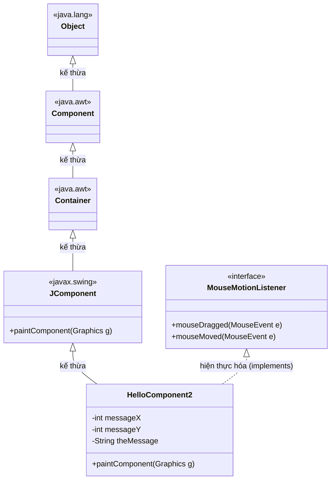
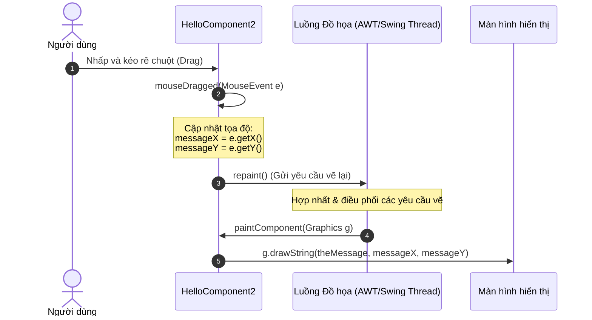

# Chương 2: A First Application (Ứng dụng Đầu tiên)

Chương 2 đóng vai trò là phần hướng dẫn thực hành nhập môn ("trial by fire") giúp lập trình viên nhanh chóng tiếp cận mã nguồn Java thực tế. Thay vì chỉ dừng lại ở các chương trình dòng lệnh khô khan, chương này dẫn dắt người đọc xây dựng ứng dụng đồ họa (GUI) tăng dần mức độ phức tạp: từ in chuỗi ký tự đơn giản, hiển thị cửa sổ, tùy biến thành phần giao diện, đến xử lý tương tác chuột thời gian thực.

---

## 1. Công cụ và Môi trường Phát triển (Java Tools & Environment)

* **JDK (Java Development Kit):** Nền tảng chứa trình biên dịch (`javac`), trình thông dịch/máy ảo (`java`), công cụ đóng gói (`jar`) và môi trường tương tác (`jshell`). Cuốn sách khuyến nghị sử dụng bản phân phối OpenJDK miễn phí như **Amazon Corretto** (hỗ trợ LTS).
* **Môi trường IDE:** Mặc dù có thể làm việc hoàn toàn bằng dòng lệnh và trình soạn thảo văn bản, việc sử dụng IDE như **IntelliJ IDEA Community Edition** (hoặc VS Code) giúp tăng tốc độ phát triển nhờ các tính năng: tô sáng cú pháp, gợi ý lỗi biên dịch, quản lý project, tích hợp terminal và gỡ lỗi (debug).
* **Quy trình chạy chương trình truyền thống:**
  1. Biên dịch: `javac TenFile.java` $\rightarrow$ sinh ra tệp `TenFile.class` (Bytecode).
  2. Thực thi: `java TenFile` $\rightarrow$ JVM nạp và chạy phương thức `main()`.

---

## 2. Quá trình Tiến hóa của Ứng dụng HelloJava

Ứng dụng được tác giả phát triển qua 4 phiên bản tăng dần tính năng:

### Giai đoạn 1: Console kinh điển (`HelloJava` ban đầu)
Chỉ gồm 5 dòng mã lệnh cơ bản để in văn bản ra console:
```java
public class HelloJava {
    public static void main(String[] args) {
        System.out.println("Hello, Java!");
    }
}
```

### Giai đoạn 2: Cửa sổ đồ họa đầu tiên (`JFrame` & `JLabel`)
Chuyển đổi giao diện sang thư viện Swing:
* Dùng `JFrame` đại diện cho cửa sổ chính.
* Dùng `JLabel` đóng vai trò hiển thị nhãn chữ ở giữa cửa sổ (`JLabel.CENTER`).
* Đưa nhãn vào khung thông qua phương thức `frame.add(label)`.
* Cấu hình kích thước (`setSize(300, 150)`) và kích hoạt hiển thị (`setVisible(true)`).

### Giai đoạn 3: Tách lớp và Kế thừa (`HelloComponent`)
* Thay thế nhãn dựng sẵn `JLabel` bằng thành phần tự định nghĩa: `HelloComponent`.
* `HelloComponent` kế thừa từ `JComponent` và ghi đè (override) phương thức `paintComponent(Graphics g)` để tự vẽ dòng chữ tại tọa độ xác định $(x=125, y=95)$ bằng `g.drawString(...)`.

### Giai đoạn 4: Tương tác và Sự kiện (`HelloJava2: The Sequel`)
* Nâng cấp thành phần thành `HelloComponent2`, cho phép người dùng nhấp và kéo rê dòng chữ quanh màn hình bằng chuột.
* Khai báo các **biến thể hiện (instance variables)**: `messageX`, `messageY`, `theMessage`.
* Định nghĩa **Constructor (Hàm khởi tạo)** để nhận chuỗi ký tự truyền vào hoặc từ tham số dòng lệnh (`args[0]`).
* Triển khai xử lý sự kiện thông qua Interface `MouseMotionListener`.
* Thêm lệnh `frame.setDefaultCloseOperation(JFrame.EXIT_ON_CLOSE)` giúp ứng dụng dừng hoàn toàn khi đóng cửa sổ.

---

## 3. Các Khái niệm Lập trình Hướng đối tượng Cốt lõi

### Lớp (Class) và Đối tượng (Object / Instance)
* **Lớp (Class):** Bản thiết kế (blueprint/mold) định nghĩa dữ liệu (biến/fields) và hành vi (phương thức/methods).
* **Đối tượng (Object / Instance):** Thực thể sống cụ thể được dập ra từ khuôn mẫu lớp trong bộ nhớ máy tính.
* **Toán tử `new`:** Dùng để cấp phát bộ nhớ trên Heap và khởi tạo đối tượng thông qua hàm dựng (Constructor).

### Phương thức `main()`
* Điểm khởi đầu bắt buộc của mọi ứng dụng Java độc lập:
  $$\text{public static void main(String[] args)}$$
* `public`: Cho phép JVM truy cập từ bên ngoài.
* `static`: Cho phép JVM gọi trực tiếp phương thức mà không cần tạo trước một thể hiện của lớp chứa nó.
* `String[] args`: Mảng chứa các tham số dòng lệnh do người dùng truyền vào khi khởi chạy.

### Biến thể hiện (Instance Variables) vs Biến cục bộ (Local Variables)
* **Biến thể hiện:** Nằm bên trong cặp ngoặc nhọn của lớp nhưng ngoài mọi phương thức; thuộc về từng đối tượng cụ thể; tự động nhận giá trị mặc định ($0$ với số, `null` với tham chiếu, `false` với boolean).
* **Biến cục bộ:** Nằm trong thân phương thức hoặc khối lệnh `{}`; bắt buộc phải gán giá trị khởi tạo trước khi sử dụng.

### Kế thừa (Inheritance)
* Thiết lập mối quan hệ **"is-a"** (là một loại của).
* Java chỉ hỗ trợ **Đơn kế thừa lớp (Single Inheritance)**: Một lớp chỉ có thể `extends` trực tiếp một lớp cha duy nhất. Mọi lớp trong Java nếu không khai báo cha đều ngầm định kế thừa từ `java.lang.Object`.



### Giao diện (Interface)
* Là một bản hợp đồng quy định các hành vi (phương thức) mà một lớp bắt buộc phải định nghĩa nếu muốn triển khai.
* Một lớp có thể triển khai **nhiều giao diện cùng lúc** (`implements InterfaceA, InterfaceB, ...`), giúp bù đắp sự thiếu vắng của đa kế thừa lớp.

---

## 4. Kiến trúc Giao diện, Sự kiện và Chu trình Vẽ lại

### Gói thư viện (Packages) & Import
* `java.lang`: Gói cơ bản, được JVM tự động nạp (chứa `String`, `System`, `Object`).
* `java.awt`: Thư viện giao diện đồ họa gốc thế hệ đầu (chứa `Graphics`, `Color`, hệ thống tọa độ).
* `java.awt.event`: Chứa các lớp sự kiện và giao diện lắng nghe (`MouseEvent`, `MouseMotionListener`).
* `javax.swing`: Thư viện giao diện người dùng phong phú hiện đại hơn (chứa `JFrame`, `JLabel`, `JComponent`).
* Cú pháp `import java.awt.*` không có tính đệ quy (không bao gồm gói con `java.awt.event`).

### Mô hình Xử lý Sự kiện (Event-Driven Model)
Khi người dùng tương tác với thiết bị ngoại vi, hệ thống phát sinh đối tượng `MouseEvent`. Để nhận sự kiện, đối tượng phải đăng ký lắng nghe thông qua `addMouseMotionListener(this)`.

### Cơ chế Vẽ lại gián tiếp (`repaint()` vs `paintComponent()`)
Lập trình viên không bao giờ gọi trực tiếp `paintComponent()`. Thay vào đó, chương trình chỉ gọi `repaint()`. 

**Lý do:**
1. Tránh cạnh tranh tài nguyên với luồng đồ họa hệ thống (AWT Event Thread).
2. JVM có thể gom nhiều yêu cầu vẽ dồn dập (ví dụ khi kéo chuột liên tục) thành một lần vẽ tối ưu duy nhất, ngăn hiện tượng giật/lag giao diện.



---

## 5. Câu hỏi Ôn tập Chương 2 (kèm Đáp án)

1. **Lệnh nào dùng để biên dịch một file mã nguồn Java?**
   * *Đáp án:* Lệnh `javac` (ví dụ: `javac HelloJava.java`).
2. **Làm thế nào JVM biết điểm bắt đầu thực thi khi chạy một lớp Java?**
   * *Đáp án:* JVM tìm kiếm và thực thi phương thức có chữ ký chuẩn `public static void main(String[] args)`.
3. **Một lớp mới có thể kế thừa (extends) nhiều hơn một lớp cha không?**
   * *Đáp án:* **Không**. Java áp dụng nguyên tắc đơn kế thừa đối với lớp (single inheritance).
4. **Một lớp mới có thể triển khai (implements) nhiều hơn một interface không?**
   * *Đáp án:* **Có**. Java cho phép một lớp hiện thực hóa không giới hạn số lượng interface.
5. **Lớp nào đại diện cho cửa sổ chính trong một ứng dụng đồ họa Swing tiêu chuẩn?**
   * *Đáp án:* Lớp `javax.swing.JFrame`.