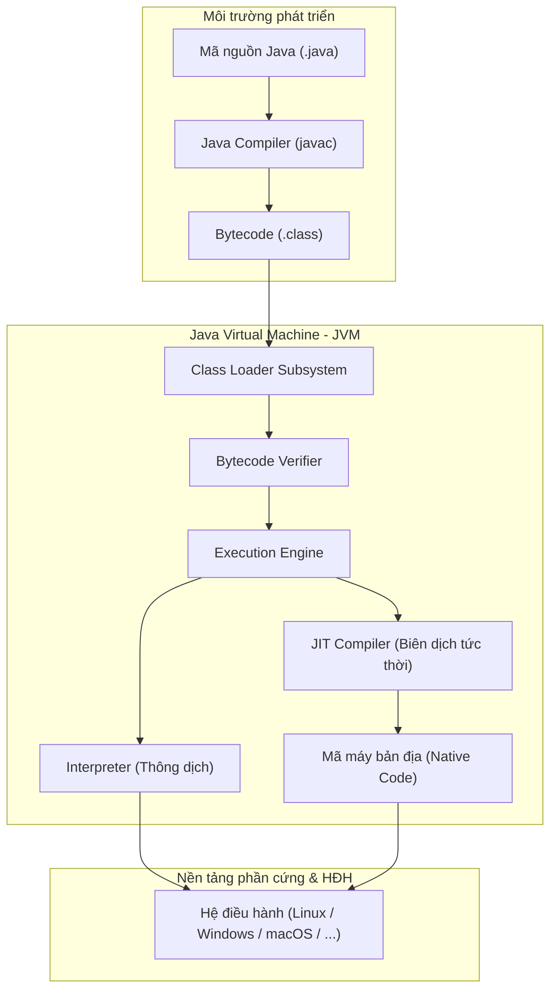
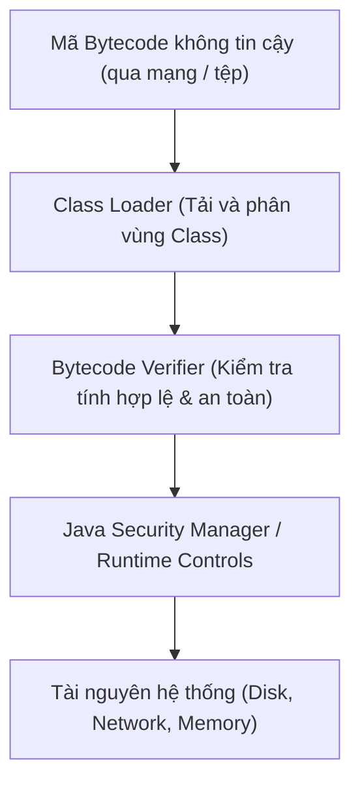

# Chương 1: A Modern Language (Ngôn ngữ Hiện đại)

Chương 1 của cuốn sách *Learning Java (6th Edition)* cung cấp một cái nhìn toàn diện về lịch sử, triết lý thiết kế và nền tảng kiến trúc giúp Java duy trì vị thế là một trong những ngôn ngữ lập trình phổ biến và mạnh mẽ nhất thế giới qua hơn ba thập kỷ.

---

## 1. Nguồn gốc và Sự phát triển (Origins & Evolution)

- **Khởi nguồn (1990):** Dự án do Bill Joy (nhà đồng sáng lập Sun Microsystems) khởi xướng tại Sun Aspen Smallworks với triết lý: giải quyết các bài toán phức tạp bằng phần mềm đơn giản, độc lập kiến trúc phần cứng.
- **Mục tiêu ban đầu:** Thiết kế cho các thiết bị nhúng và mạng máy tính, nhưng đã bùng nổ khi Internet và World Wide Web phát triển.
- **Sự phát triển vượt bậc:** 
  - Hầu hết các ông lớn công nghệ (Microsoft, Intel, IBM,...) đều nhanh chóng mua bản quyền và hỗ trợ Java.
  - Phân nhánh thành Java Standard Edition (Java SE) và Java Enterprise Edition (trước đây là J2EE, nay đổi tên thành Jakarta EE).
  - Từ Java 9, chu kỳ phát hành được cố định định kỳ **6 tháng một lần**, đem lại tốc độ đổi mới nhanh chóng với các bản hỗ trợ dài hạn (LTS - Long Term Support) như Java 17, Java 21.

---

## 2. Máy ảo Java (Java Virtual Machine - JVM)

Trọng tâm của hệ sinh thái Java là máy ảo JVM, mang lại khẩu hiệu nổi tiếng: *"Write Once, Run Anywhere"* (Viết một lần, chạy mọi nơi).

### Cơ chế hoạt động:
1. **Mã nguồn (`.java`)** được trình biên dịch `javac` dịch thành định dạng nhị phân phổ quát gọi là **Bytecode** (`.class`).
2. **Bytecode** không phụ thuộc vào bất kỳ phần cứng cụ thể nào.
3. Khi thực thi, **JVM** trên hệ điều hành tương ứng sẽ thông dịch hoặc sử dụng cơ chế **JIT (Just-In-Time) Compiler** để biên dịch bytecode thành mã máy bản địa (native machine code) theo thời gian thực, đạt hiệu năng gần tương đương mã C/C++.
4. **Project Leyden:** Dự án mới của OpenJDK nhằm giảm thời gian khởi động (startup time) và tối ưu dung lượng của ứng dụng Java.

### Sơ đồ kiến trúc thực thi của Java:

---

## 3. So sánh Java với các ngôn ngữ khác

Java được xây dựng dựa trên ba trụ cột then chốt: **Khả chuyển (Portability)**, **Tốc độ (Speed)**, và **Bảo mật (Security)**.

| Tiêu chí | C / C++ | Smalltalk / Lisp | Java |
| :--- | :--- | :--- | :--- |
| **Cú pháp** | Cú pháp gốc, hỗ trợ con trỏ trực tiếp | Cú pháp hướng đối tượng động | Thừa hưởng cú pháp C/C++ nhưng lược bỏ phần phức tạp |
| **Quản lý bộ nhớ** | Thủ công (dễ lỗi rò rỉ, tràn bộ nhớ) | Tự động (Garbage Collection) | Quản lý tự động qua **Garbage Collector (GC)** |
| **Độ an toàn (Security)** | Thấp (truy cập bộ nhớ tự do) | Trung bình | Rất cao (Verifier, Sandbox, kiểm soát kiểu chặt chẽ) |
| **Khả chuyển** | Kém (phải biên dịch lại cho từng HĐH) | Tốt (mô hình bytecode) | Hoàn hảo (JVM chuẩn hóa trên mọi nền tảng) |
| **Hiệu năng** | Cực nhanh (Native) | Chậm hơn | Rất nhanh nhờ JIT Compilation |

---

## 4. An toàn trong thiết kế (Safety of Design)

Java được thiết kế để bảo vệ lập trình viên khỏi những sai lầm phổ biến nhất trong phát triển phần mềm:

1. **Đơn giản hóa (Simplify):**
   - Loại bỏ đa kế thừa lớp (tránh vấn đề "Diamond Problem"). Thay vào đó, Java hỗ trợ **đơn kế thừa lớp (Single Inheritance)** và cho phép kế thừa nhiều **Giao diện (Interfaces)**.
   - Loại bỏ file header (`.h`), hệ thống gói (Package) tự quản lý thông tin kiểu dữ liệu đầy đủ.
2. **Kiểm tra kiểu tĩnh và liên kết phương thức (Type Safety):**
   - Bắt lỗi sai kiểu ngay tại thời điểm biên dịch, giảm thiểu lỗi crash lúc ứng dụng đang chạy.
3. **Quản lý bộ nhớ an toàn (Memory Management):**
   - **Không có con trỏ tùy tiện:** Thay thế con trỏ bằng **Reference (Tham chiếu an toàn)** có định kiểu chặt chẽ.
   - **Garbage Collection (GC):** Tự động thu hồi bộ nhớ của các đối tượng không còn được tham chiếu.
   - **Mảng thực sự (First-class Arrays):** Tự kiểm tra biên kích thước, loại bỏ nguy cơ tràn bộ đệm (buffer overflow).
4. **Xử lý lỗi thanh lịch (Error Handling):**
   - Cơ chế xử lý ngoại lệ hướng đối tượng (`try`, `catch`, `finally`, `throw`, `throws`).
   - Phân định rõ giữa Checked Exception (buộc phải xử lý) và Unchecked Exception.
5. **Đa luồng tích hợp sẵn (Built-in Threads):**
   - Hỗ trợ đa luồng trực tiếp ở cấp ngôn ngữ thông qua từ khóa `synchronized` và mô hình màn hình khóa (Monitor).
   - Thư viện `java.util.concurrent` hỗ trợ xử lý tác vụ phức tạp, thread pool.
   - **Virtual Threads (Project Loom):** Được giới thiệu thử nghiệm từ Java 19 và hoàn thiện trong Java 21, cho phép tạo hàng triệu luồng siêu nhẹ mà không làm quá tải hệ điều hành.
6. **Khả năng mở rộng (Scalability):**
   - Cấu trúc Package và hệ thống Module (giới thiệu từ Java 9) giúp đóng gói thư viện, kiểm soát tính hiển thị và tái sử dụng mã nguồn.

---

## 5. An toàn trong triển khai thực thi (Safety of Implementation)

Java không chỉ ngăn lập trình viên tự gây lỗi mà còn ngăn chặn mã độc bên ngoài can thiệp vào hệ thống thông qua mô hình an ninh nhiều lớp:

- **Bytecode Verifier:** Trước khi thực thi, JVM kiểm tra cấu trúc mã nhị phân để đảm bảo:
  - Mã tuân thủ đúng quy tắc đặc tả JVM.
  - Không có hành vi truy cập sai kiểu dữ liệu hoặc vi phạm vùng nhớ stack.
  - Các tham chiếu phương thức và trường dữ liệu đều hợp lệ.
- **Class Loaders:** 
  - Đảm bảo các lớp hệ thống nền tảng (như `java.lang.String`) được bảo vệ an toàn và không thể bị thay thế trái phép bởi mã nguồn của bên thứ ba.
  - Tạo ranh giới độc lập (namespace) giữa các module/thành phần ứng dụng khác nhau.
- **Bảo mật người dùng và ứng dụng (Application & User-Level Security):**
  - Cung cấp cơ chế phân quyền tài nguyên có thể tinh chỉnh khi chạy mã từ nguồn không đáng tin cậy.

---

## 6. Lộ trình phát triển Java (Java Road Map)

- **Quá khứ (Java 1.0 - Java 20):** 
  - Khởi đầu với Applet và AWT.
  - Mở rộng mạnh mẽ với JDBC (kết nối CSDL), RMI (gọi phương thức từ xa), Java Servlets (nền tảng của Web Java).
  - Bổ sung Collections Framework (Java 1.2), Generics (Java 5), Lambdas & Streams (Java 8), Modules (Java 9).
- **Hiện tại (Java 21 LTS - Trọng tâm của sách):**
  - Đạt độ chín muồi cao, tích hợp **Virtual Threads**, Record Patterns, Pattern Matching cho `switch`.
  - Hỗ trợ đồng thời cả lập trình hướng đối tượng (OOP) truyền thống và lập trình hàm (Functional Programming).
- **Tương lai:**
  - Tiếp tục là xương sống cho các dịch vụ đám mây (Cloud computing), dịch vụ web và hạ tầng dữ liệu lớn (Big Data).
  - Mở rộng qua nền tảng di động với Android OS và ảnh hưởng sâu rộng tới ngôn ngữ C# / .NET.

---

## 7. Câu hỏi ôn tập chương 1 (kèm giải đáp)

1. **Công ty nào hiện đang bảo trì và phát triển Java?**
   - *Trả lời:* Tập đoàn **Oracle** (sau khi mua lại Sun Microsystems vào năm 2009).
2. **Bộ công cụ phát triển mã nguồn mở chính thức của Java tên là gì?**
   - *Trả lời:* **OpenJDK**.
3. **Kể tên hai thành phần chính đóng vai trò cốt lõi trong việc thực thi an toàn bytecode của Java?**
   - *Trả lời:* **Class Loader** và **Bytecode Verifier**.