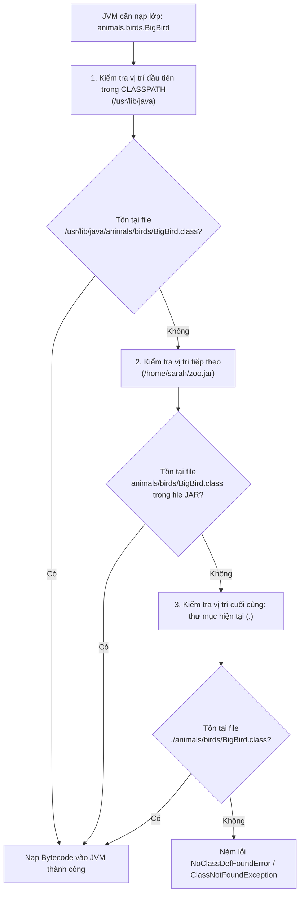
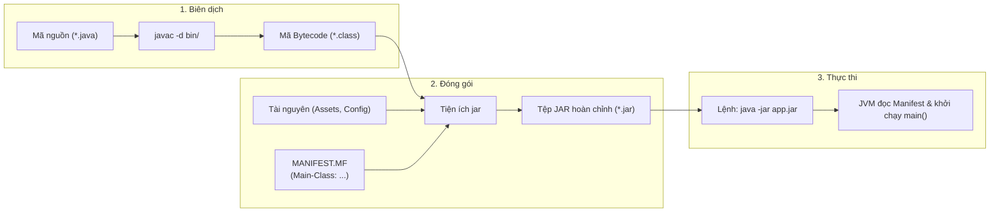

# Chương 3: Tools of the Trade (Công cụ Lập trình Java)

Chương 3 tập trung vào các công cụ nền tảng cốt lõi đi kèm bộ công cụ phát triển JDK (Java Development Kit). Dù phần lớn lập trình viên hiện đại làm việc trên các IDE (như IntelliJ IDEA, Eclipse, VS Code), việc hiểu tường tận các tiện ích dòng lệnh (`javac`, `java`, `jar`, `jshell`) và cơ chế quản lý tài nguyên (`CLASSPATH`, System Properties) là điều kiện tiên quyết để làm chủ môi trường thực thi của Java.

---

## 1. Môi trường phát triển JDK (JDK Environment)

Sau khi cài đặt JDK, hệ điều hành cần được cấu hình để có thể tìm và gọi các công cụ lập trình từ bất kỳ vị trí dòng lệnh nào:

* **Biến môi trường `JAVA_HOME`:** Trỏ tới thư mục gốc cài đặt JDK.
* **Biến môi trường `PATH`:** Cần được gắn thêm thư mục con `$JAVA_HOME/bin` (trên Linux/macOS) hoặc `%JAVA_HOME%\bin` (trên Windows). Thư mục này chứa toàn bộ các file thực thi như `javac`, `java`, `jar`, `javap`, `jshell`.

---

## 2. Máy ảo Java và Thực thi Ứng dụng (The Java VM & Running Applications)

Máy ảo Java (JVM) là một ứng dụng phần mềm triển khai runtime system để thông dịch và thực thi mã bytecode Java.

### 2.1. Cú pháp khởi chạy ứng dụng
```bash
java [tùy_chọn] TenLop [tham_số_1 tham_số_2 ...]
```

### 2.2. Phương thức khởi động `main()`
Khi thực thi một lớp, JVM sẽ tìm kiếm phương thức khởi đầu với chữ ký (signature) quy chuẩn:
```java
public static void main(String[] args)
```
* **`public`:** Có thể được truy cập từ bên ngoài lớp bởi runtime của JVM.
* **`static`:** Có thể được gọi trực tiếp mà không cần khởi tạo thực thể (instance) của lớp trước.
* **`void`:** Không trả về giá trị sau khi kết thúc.
* **`String[] args`:** Mảng chứa các tham số dòng lệnh được truyền vào khi chạy.

### 2.3. System Properties (Thuộc tính Hệ thống)
Là cơ chế truyền các tham số cấu hình mang tính di động cao cho JVM mà không cần đưa vào mảng đối số `args`.
* **Cú pháp truyền qua CLI:** Sử dụng cờ `-Dname=value`.
  ```bash
  java -Denv=production -DdbPort=5432 com.example.MyApp
  ```
* **Truy xuất trong mã nguồn:** Thông qua phương thức tĩnh `System.getProperty()`:
  ```java
  String environment = System.getProperty("env");
  ```

---

## 3. Quản lý Lớp và Thư viện: Classpath & Modules

### 3.1. Bản chất của `CLASSPATH`
`CLASSPATH` là danh sách các đường dẫn (thư mục hoặc file nén `.jar`) mà trình biên dịch (`javac`) và trình thông dịch (`java`) dùng để tìm kiếm các lớp phụ thuộc được nạp vào bộ nhớ.

* **Dấu phân cách đường dẫn:**
  * **Unix / macOS:** Sử dụng dấu hai chấm (`:`), ví dụ: `/usr/lib/java:/home/user/lib/app.jar:.`
  * **Windows:** Sử dụng dấu chấm phẩy (`;`), ví dụ: `C:\java\classes;C:\lib\app.jar;.`
* **Thư mục hiện tại (`.`):** Thường được đặt ở cuối danh sách để Java tìm các lớp trong thư mục làm việc hiện thời.
* **Ký tự đại diện (Wildcards):** Dùng `*` để đại diện cho toàn bộ các file `.jar` trong một thư mục (ví dụ: `lib/*`).
* **Cờ dòng lệnh:** Có thể ghi đè biến môi trường `CLASSPATH` bằng cờ `-cp` hoặc `-classpath`:
  ```bash
  java -cp "lib/*:." com.example.Main
  ```

### 3.2. Sơ đồ cơ chế phân giải Classpath (Classpath Lookup Process)



### 3.3. Hệ thống Modules (Java 9+)
Được giới thiệu từ Java 9 (JPMS - Java Platform Module System), module cung cấp khả năng đóng gói mức cao hơn package, giúp kiểm soát phạm vi truy cập nghiêm ngặt và tối ưu hóa hiệu năng ứng dụng lớn. Dù vậy, mô hình classpath truyền thống vẫn được hỗ trợ song song cho các ứng dụng thông thường.

---

## 4. Trình biên dịch Java (`javac`)

`javac` đảm nhiệm việc chuyển đổi mã nguồn Java (`.java`) thành bytecode nhị phân (`.class`).

### 4.1. Cú pháp và cờ chỉ định vị trí đầu ra (`-d`)
```bash
javac -d classes/ src/com/example/MyClass.java
```
Cờ `-d` tự động tạo cây thư mục tương ứng với khai báo `package` của file Java và lưu file `.class` vào đúng vị trí đó.

### 4.2. Cơ chế biên dịch phụ thuộc thông minh
Trình biên dịch `javac` có khả năng theo dõi mốc thời gian sửa đổi (timestamps) giữa mã nguồn `.java` và mã nhị phân `.class`:
* Nếu Lớp A gọi Lớp B, `javac` sẽ tự động tìm kiếm và biên dịch `B.java` nếu file `B.class` chưa tồn tại hoặc cũ hơn file nguồn `B.java`.

---

## 5. Thử nghiệm mã tức thì với JShell (REPL)

Được bổ sung từ Java 9, **JShell** là một công cụ REPL (*Read-Evaluate-Print Loop*) cho phép lập trình viên chạy thử nghiệm các đoạn mã Java ngắn (snippets) ngay trên dòng lệnh mà không cần tạo file, khai báo class hay viết hàm `main()`.

```
jshell> int x = 10;
x ==> 10

jshell> x * 5
$2 ==> 50

jshell> javax.swing.JFrame frame = new javax.swing.JFrame("Test JShell");
frame ==> javax.swing.JFrame[... title=Test JShell ...]

jshell> frame.setSize(300, 200); frame.setVisible(true);
```

### Một số lệnh điều khiển quan trọng trong JShell:
* `/help`: Xem hướng dẫn sử dụng.
* `/list`: Liệt kê các đoạn mã (snippets) đã nhập trong phiên làm việc.
* `/vars`: Hiển thị tất cả các biến đã khai báo cùng giá trị hiện tại.
* `/methods`: Liệt kê các hàm/phương thức đã định nghĩa.
* `/exit`: Thoát khỏi JShell.

---

## 6. Đóng gói và Phân phối Ứng dụng: JAR Files & Tiện ích `jar`

Tệp lưu trữ Java (**JAR - Java ARchive**) sử dụng định dạng nén ZIP chuẩn để gói gọn các lớp mã máy (`.class`), tài nguyên đi kèm (hình ảnh, âm thanh, file cấu hình) và metadata vào một tệp duy nhất.

### 6.1. File Manifest (`META-INF/MANIFEST.MF`)
Manifest là file văn bản chứa thông tin cấu hình của kho lưu trữ JAR. Để tạo một **Executable JAR** (file JAR có thể tự chạy), tệp Manifest bắt buộc phải có thuộc tính `Main-Class`:
```manifest
Manifest-Version: 1.0
Main-Class: com.example.MyApp
```

### 6.2. Sơ đồ quy trình từ Mã nguồn đến Thực thi file JAR



### 6.3. Bảng cú pháp tiện ích `jar` (tương tự lệnh `tar` trên Unix)

| Lệnh | Ý nghĩa | Mô tả chi tiết |
| :--- | :--- | :--- |
| `jar -cvf app.jar -C bin/ .` | **C**reate, **V**erbose, **F**ile | Tạo file archive mới `app.jar` chứa toàn bộ nội dung thư mục `bin/`. |
| `jar -tvf app.jar` | **T**able of contents, **V**erbose, **F**ile | Liệt kê danh sách các file và thư mục bên trong `app.jar` mà không giải nén. |
| `jar -xvf app.jar [path]` | E**x**tract, **V**erbose, **F**ile | Trích xuất toàn bộ (hoặc một file/đường dẫn cụ thể) ra thư mục hiện tại. |
| `jar -cvfe app.jar com.pkg.Main -C bin/ .` | Tạo Executable JAR | Chỉ định trực tiếp lớp chính (`Main-Class`) thông qua cờ `-e`. |

### 6.4. Nạp tài nguyên trong file JAR
Mã Java có thể nạp ảnh, file text đóng gói trong JAR thông qua Class Loader mà không cần quan tâm vị trí vật lý của file:
```java
InputStream in = getClass().getResourceAsStream("/images/logo.png");
```

---

## 7. Câu hỏi ôn tập chương 3 (Review Questions & Answers)

1. **Câu lệnh nào cho phép bạn truy cập vào các thành phần Swing trong ứng dụng?**
   * *Đáp án:* Câu lệnh `import javax.swing.*;` (hoặc import từng lớp cụ thể như `import javax.swing.JFrame;`).

2. **Biến môi trường nào quyết định nơi Java tìm kiếm các file class khi biên dịch hoặc thực thi?**
   * *Đáp án:* Biến môi trường **`CLASSPATH`**.

3. **Tùy chọn nào được dùng để xem nội dung bên trong file JAR mà không cần giải nén nó?**
   * *Đáp án:* Các tùy chọn `tvf` (ví dụ: `jar -tvf MyApp.jar` hoặc `jar tvf MyApp.jar`).

4. **Khai báo nào bắt buộc phải có trong file `MANIFEST.MF` để một file JAR có thể thực thi trực tiếp?**
   * *Đáp án:* Khai báo **`Main-Class`** chỉ định tên đầy đủ (fully qualified name) của lớp chứa hàm `main()`.

5. **Công cụ nào cho phép bạn thử nghiệm mã Java một cách tương tác theo mô hình REPL?**
   * *Đáp án:* Công cụ **`jshell`**.