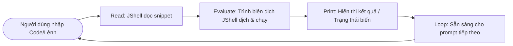
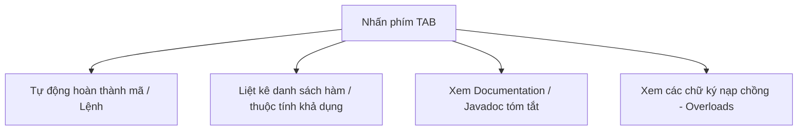
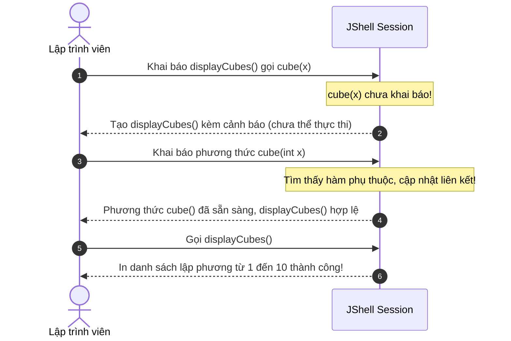
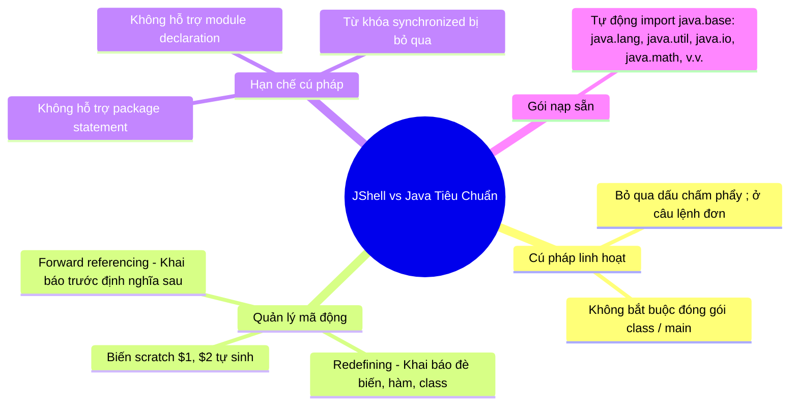

# JShell for Java: Hướng Dẫn & Tóm Tắt Toàn Diện (Appendix A)

> **Tài liệu tham khảo:** *Java for Programmers with Generative AI (5th Edition)* - Paul Deitel & Harvey Deitel  
> **Chủ đề:** Phụ lục A - Khám phá tính năng lập trình tương tác với JShell (Java REPL).

---

## 1. Giới thiệu tổng quan về JShell (A.1)

**JShell** (được giới thiệu từ Java 9) là môi trường dòng lệnh tương tác dạng **REPL** (*Read - Evaluate - Print - Loop*) của Java. 

### Lợi ích cốt lõi:
- **Tương tác như Python:** Loại bỏ hoàn toàn mã mẫu (boilerplate code) như `public class` hay `public static void main(String[] args)`.
- **Thử nghiệm nhanh (Rapid Prototyping):** Viết và kiểm tra nhanh các hàm, thuật toán hoặc thư viện mới trước khi ghép vào dự án lớn.
- **Hỗ trợ học tập:** Giúp người học làm quen ngay với cú pháp, toán tử, kiểu dữ liệu mà không bị phân tâm bởi cấu trúc lớp phức tạp.



---

## 2. Bắt đầu và Các Thao tác Cơ bản (A.2 - A.3)

### 2.1. Khởi động và Thoát
- **Khởi động:** Mở Terminal / Command Prompt và gõ:
  ```bash
  jshell
  ```
- **Thoát:** Nhập lệnh `/exit` hoặc bấm `Ctrl + D` (Linux/macOS).

### 2.2. Snippet vs. JShell Command
- **Code Snippets:** Biểu thức, câu lệnh Java hợp lệ. Trong JShell, dấu chấm phẩy (`;`) ở cuối dòng là tùy chọn đối với câu lệnh đơn lẻ.
- **JShell Commands:** Bắt đầu bằng dấu gạch chéo `/` (ví dụ: `/help`, `/vars`, `/list`), dùng để điều khiển phiên làm việc.

### 2.3. Biến Tường minh & Biến Tự động (Scratch Variables)
- **Khai báo tường minh:**
  ```java
  int x = 10;
  String message = "Hello, JShell!";
  ```
- **Khai báo ngầm định (Scratch Variables):** Khi nhập một biểu thức không gán cho biến nào, JShell tự động tạo các biến tạm có tiền tố `$` (`$1`, `$2`, `$3`...):
  ```java
  jshell> 25 * 4
  $1 ==> 100

  jshell> $1 + 50
  $2 ==> 150
  ```

### 2.4. Khối lệnh đa dòng (Multiline Statements)
JShell tự động nhận diện khi một câu lệnh hoặc khối mã chưa hoàn chỉnh và chuyển dấu nhắc từ `jshell>` sang `...>` cho đến khi gặp dấu đóng ngoặc hoặc kết thúc hợp lệ.

---

## 3. Khám phá & Trợ giúp Thông minh (A.5 - A.6)

JShell tích hợp tính năng **Auto-Completion (Tab Completion)** rất mạnh mẽ:



- **Gợi ý thành viên:** Gõ tên lớp/đối tượng kèm dấu chấm rồi nhấn `Tab`:
  ```java
  jshell> Math. [nhấn Tab]
  E                 IEEEremainder(   PI                TAU
  abs(              acos(            addExact(         asin( ...
  ```
- **Xem nạp chồng (Overloads):** Khi mở ngoặc hàm và nhấn `Tab`, JShell hiển thị toàn bộ tham số của từng phương thức nạp chồng:
  ```java
  jshell> Math.max( [nhấn Tab]
  Signatures:
  double Math.max(double a, double b)
  float Math.max(float a, float b)
  int Math.max(int a, int b)
  long Math.max(long a, long b)
  ```
- **Xem tài liệu (Javadoc):** Nhấn `Tab` thêm lần nữa khi đang đứng ở phương thức để đọc mô tả chi tiết trực tiếp trong console.

---

## 4. Định nghĩa Phương thức & Tham chiếu Trước (A.7)

### Cơ chế Forward Referencing (Tham chiếu trước)
Khác với Java tiêu chuẩn (bắt buộc mọi phương thức phải được định nghĩa trước khi sử dụng), JShell cho phép viết phương thức gọi đến một phương thức khác **chưa tồn tại**. JShell tạo một bản ghi phương thức ở trạng thái chờ và cập nhật ngay khi hàm phụ trợ được định nghĩa.



---

## 5. Lớp, Đối tượng & Ngoại lệ (A.4, A.8)

### 5.1. Định nghĩa Class & Tái định nghĩa (Redefining)
- Bạn có thể khai báo class ngay trong phiên JShell mà không cần lưu vào file `.java`.
- **Cơ chế Shadowing/Replacement:** Khi khai báo lại một lớp hoặc hàm có cùng tên, JShell sẽ ghi đè định nghĩa mới lên định nghĩa cũ mà không cần khởi động lại phiên.

### 5.2. Quản lý Ngoại lệ (Exception Handling)
Trong Java thông thường, một ngoại lệ không được bắt (*uncaught exception*) sẽ làm ứng dụng sập (*crash*). Trong JShell:
- Ngoại lệ được hiển thị kèm stack trace chi tiết.
- Phiên làm việc **vẫn tiếp tục bình thường**, trạng thái các biến trước đó được bảo toàn.

---

## 6. Các Lệnh JShell Nòng Cốt (Summary of Commands - A.11)

Mọi lệnh điều khiển bắt đầu bằng `/`. Có thể gõ viết tắt (ví dụ `/v` thay cho `/vars`).

| Lệnh | Ý nghĩa & Ứng dụng |
| :--- | :--- |
| `/help [lệnh]` | Hiển thị hướng dẫn tổng quát hoặc chi tiết về một lệnh cụ thể. |
| `/list [all]` | Liệt kê các snippet đã nhập trong phiên (hoặc tất cả các snippet bao gồm khởi tạo). |
| `/vars` | Hiển thị danh sách tất cả các biến đang hoạt động cùng giá trị hiện tại. |
| `/methods` | Hiển thị các phương thức tự tạo đã khai báo. |
| `/classes` | Hiển thị danh sách các class/interface/record/enum đã khai báo. |
| `/imports` | Xem danh sách các package được tự động import sẵn. |
| `/edit <id>` | Mở cửa sổ soạn thảo đồ họa (JShell Edit Pad) hoặc trình soạn thảo bên ngoài. |
| `/drop <id>` | Xóa bỏ một biến, phương thức hoặc snippet theo ID/tên. |
| `/save <file>` | Lưu toàn bộ snippet hợp lệ trong phiên ra file text (ví dụ: `snippets.jsh`). |
| `/open <file>` | Đọc và nạp các đoạn mã hoặc file mã nguồn bên ngoài vào phiên làm việc. |
| `/reload` | Đặt lại trạng thái và thực thi lại toàn bộ mã từ đầu phiên. |
| `/reset` | Đặt lại phiên làm việc, xóa bỏ toàn bộ biến, hàm và class đã khai báo. |
| `/set feedback` | Chỉnh chế độ phản hồi: `normal`, `concise`, `verbose`, `silent`. |
| `/exit` | Kết thúc phiên JShell. |

---

## 7. Các Đặc Điểm Khác Biệt của JShell so với Java Tiêu Chuẩn (A.13)



---

## 8. Tích hợp Trong Công cụ & IDE (A.14 - A.15)

JShell không chỉ chạy độc lập ở CLI mà còn được nhúng trực tiếp vào các IDE phổ biến:
- **IntelliJ IDEA:** *Tools -> JShell Console* (hỗ trợ gợi ý mã, highlight cú pháp tương đương editor chính thức).
- **Eclipse:** Hỗ trợ JShell qua các perspective tương tác.
- **Visual Studio Code:** Hỗ trợ thông qua tiện ích mở rộng Java Interactive.

### Lời khuyên thực hành từ Deitel:
> Sử dụng JShell cho mục đích **thử nghiệm vi mô** (micro-experimentation), xác thực các API mới, hoặc chạy thử logic của các biểu thức Lambda/Stream trước khi gắn vào mã nguồn dự án thực tế.