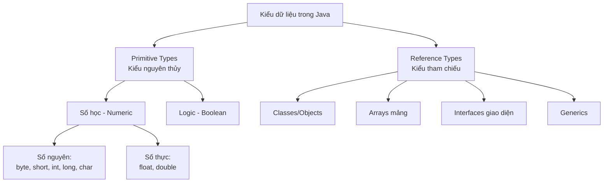
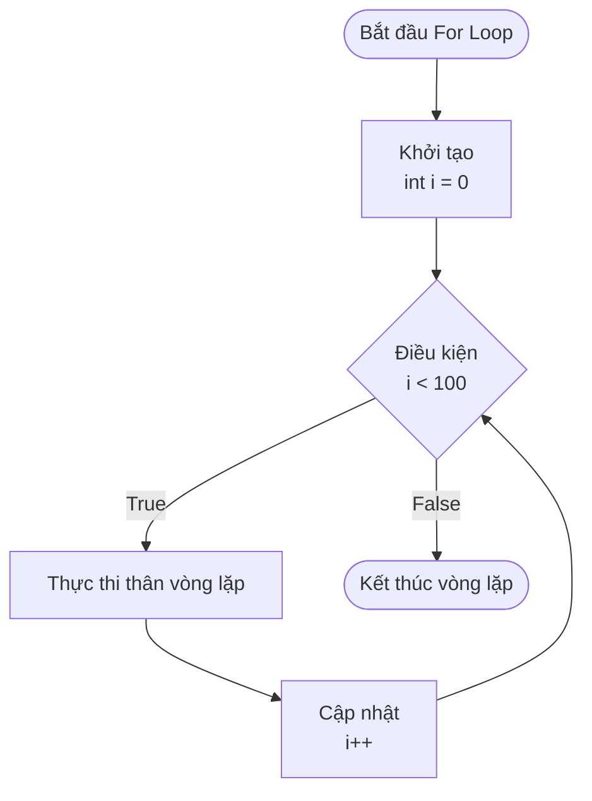
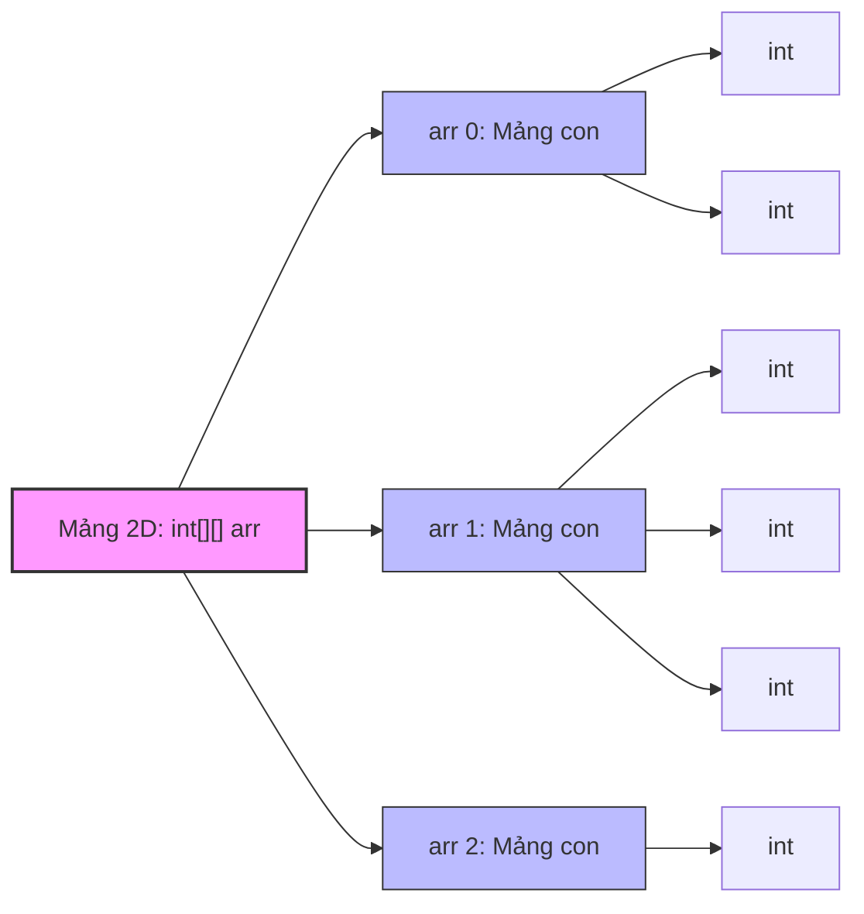

# Tóm tắt Chương 4: The Java Language

Chương 4 giới thiệu các khối xây dựng cơ bản (building blocks) cấu thành nên ngôn ngữ lập trình Java. Các tính năng cốt lõi này tương đồng với ngôn ngữ C/C++ nhưng được thiết kế để an toàn và nhất quán hơn.

---

## 1. Mã hóa văn bản, Chú thích và Chú giải (Text Encoding, Comments & Annotations)

*   **Mã hóa (Text Encoding):** Java sử dụng bộ mã hóa **UTF-8** theo mặc định, hỗ trợ Unicode nên có thể sử dụng các ký tự quốc tế, thậm chí cả emoji trong mã nguồn. 
*   **Chú thích (Comments):** Trình biên dịch sẽ bỏ qua nội dung này.
    *   Chú thích một dòng: `// comment`
    *   Chú thích nhiều dòng: `/* comment */`
    *   Chú thích Javadoc (dùng để tạo tài liệu): `/** comment */`
*   **Chú giải (Annotations):** Ký hiệu bắt đầu bằng `@` (ví dụ `@SuppressWarnings`, `@Override`), dùng để cung cấp metadata (siêu dữ liệu) cho trình biên dịch hoặc các công cụ IDE mà không ảnh hưởng tới logic của code.

---

## 2. Kiểu dữ liệu (Types)

Java là ngôn ngữ định kiểu tĩnh (statically typed), mọi biến đều phải được khai báo kiểu dữ liệu. Kiểu dữ liệu trong Java được chia thành 2 nhóm chính:

### 2.1. Kiểu nguyên thủy (Primitive Types)
Lưu trữ giá trị trực tiếp và được truyền theo giá trị (passed by value):
*   **Boolean:** `boolean` (true/false)
*   **Ký tự:** `char` (16-bit Unicode)
*   **Số nguyên có dấu:** `byte` (8-bit), `short` (16-bit), `int` (32-bit), `long` (64-bit)
*   **Số thực:** `float` (32-bit), `double` (64-bit)

### 2.2. Kiểu tham chiếu (Reference Types)
Lưu trữ địa chỉ trỏ tới đối tượng trong bộ nhớ, được truyền theo tham chiếu (passed by reference):
*   Bao gồm: Lớp (Class), Mảng (Array), Giao diện (Interface).
*   Ví dụ: `String`, `Object`, `int[]`,...

**Đặc biệt về Strings:** 
Trong Java, String là một đối tượng (Reference type) nhưng có một số đặc quyền giống primitive type. String **không thể thay đổi (immutable)**. Khi thao tác nối chuỗi bằng toán tử `+`, Java tự động tạo ra một đối tượng String mới.

---

## 3. Khai báo Biến và Hằng số (Variables and Constants)

*   **Biến (Variables):** Lưu trữ thông tin có thể thay đổi. Ví dụ: `int size = 5;`
*   **Hằng số (Constants):** Lưu trữ giá trị không đổi, được đánh dấu bằng từ khóa `final`. Ví dụ: `final double PI = 3.14159;`

---

## 4. Các cấu trúc Điều khiển và Biểu thức (Statements and Expressions)

*   **Statements (Câu lệnh):** Đại diện cho một hành động (gán biến, vòng lặp, kiểm tra điều kiện).
*   **Expressions (Biểu thức):** Tạo ra một giá trị (phép toán, gọi hàm).

### 4.1. Cấu trúc rẽ nhánh (Conditionals)
*   **if/else:** Kiểm tra điều kiện boolean.
*   **switch:** Hỗ trợ kiểm tra biến nguyên thủy, String và Enum. Từ Java 14, hỗ trợ **Switch Expressions** sử dụng dấu `->` ngắn gọn hơn.

### 4.2. Vòng lặp (Loops)
Hỗ trợ lặp lại các khối mã. 

*   **while / do-while:** Lặp theo điều kiện boolean (do-while đảm bảo chạy ít nhất 1 lần).
*   **for:** Vòng lặp truyền thống bao gồm: `(khởi_tạo; điều_kiện; cập_nhật)`.
*   **Enhanced for loop (for-each):** Dùng để lặp qua mảng hoặc collections. `for(Kiểu biến : tập_hợp)`
*   **break / continue:** `break` thoát khỏi vòng lặp hoàn toàn, `continue` bỏ qua lần lặp hiện tại và chuyển sang lần lặp kế tiếp. Hỗ trợ kèm "label" (nhãn) để nhảy ra khỏi vòng lặp lồng nhau.

### 4.3. Toán tử (Operators)
Cung cấp đầy đủ toán tử như C/C++: số học (`+, -, *, /, %`), tăng/giảm (`++, --`), logic (`&&, ||, !`), so sánh (`==, !=, <, >`), và các phép gán.

---

## 5. Mảng (Arrays)

Mảng trong Java là một kiểu đối tượng bậc 1 (first-class objects) dùng để lưu trữ một tập hợp các giá trị cùng kiểu (kiểu nguyên thủy hoặc tham chiếu).

*   **Đặc điểm:** Mảng có kích thước cố định sau khi khởi tạo.
*   **Khởi tạo:** `int[] numbers = new int[5];` hoặc khởi tạo ẩn danh (anonymous array) `new int[] {1, 2, 3}`.
*   **Mảng đa chiều (Multidimensional Arrays):** Java hỗ trợ mảng của mảng. Điều này cho phép tạo các mảng không đồng đều (như mảng hình tam giác) chứ không bắt buộc phải là ma trận hình chữ nhật.

*(Sơ đồ minh họa mảng 2D trong Java có thể chứa các mảng con với kích thước độ dài khác nhau)*

---
**Tóm lược:** Chương 4 xây dựng nền tảng vững chắc để hiểu cách Java biểu diễn và xử lý dữ liệu thông qua kiểu dữ liệu tĩnh nghiêm ngặt và cú pháp hướng đối tượng lai C++. Việc nắm vững các "part of speech" (thành phần ngôn ngữ) này rất quan trọng trước khi bước vào thiết kế lớp và lập trình hướng đối tượng ở Chương 5.