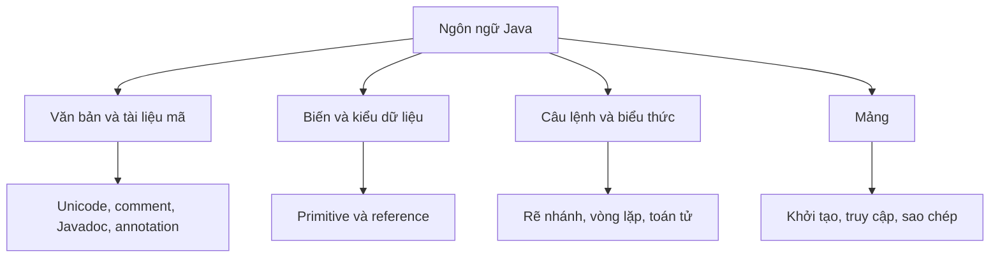
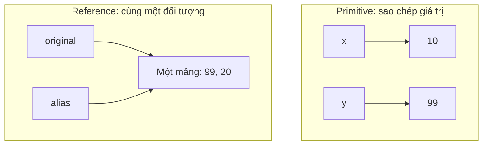
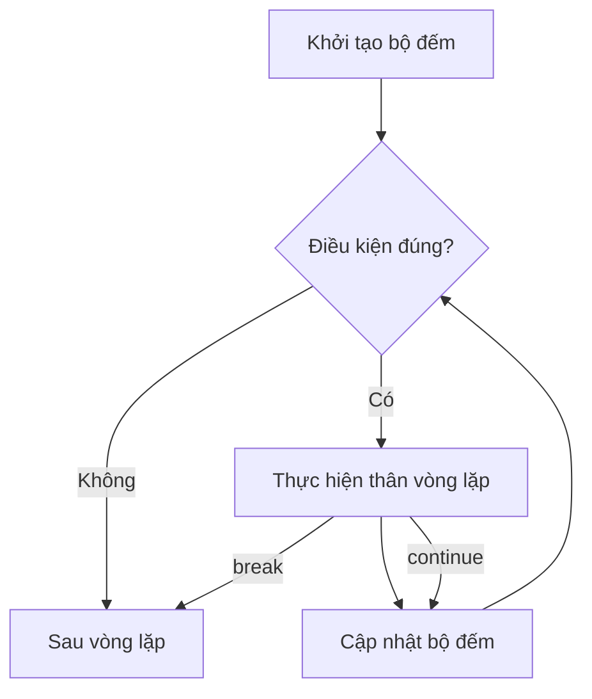
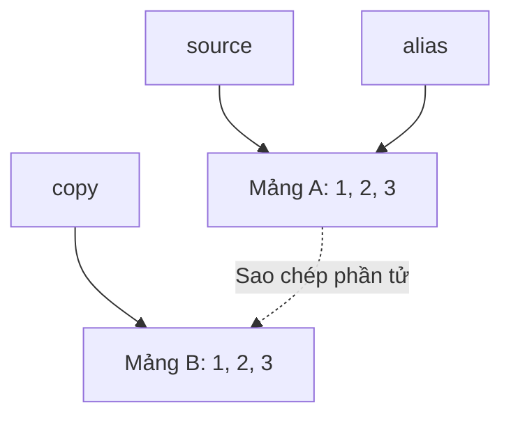
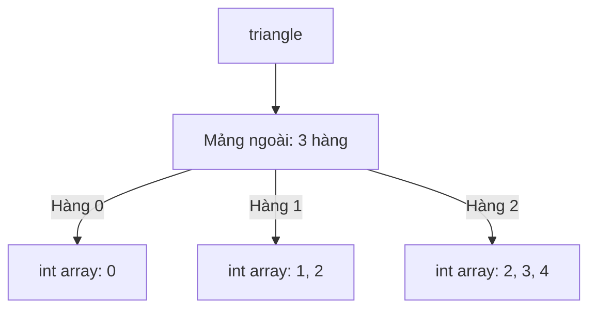
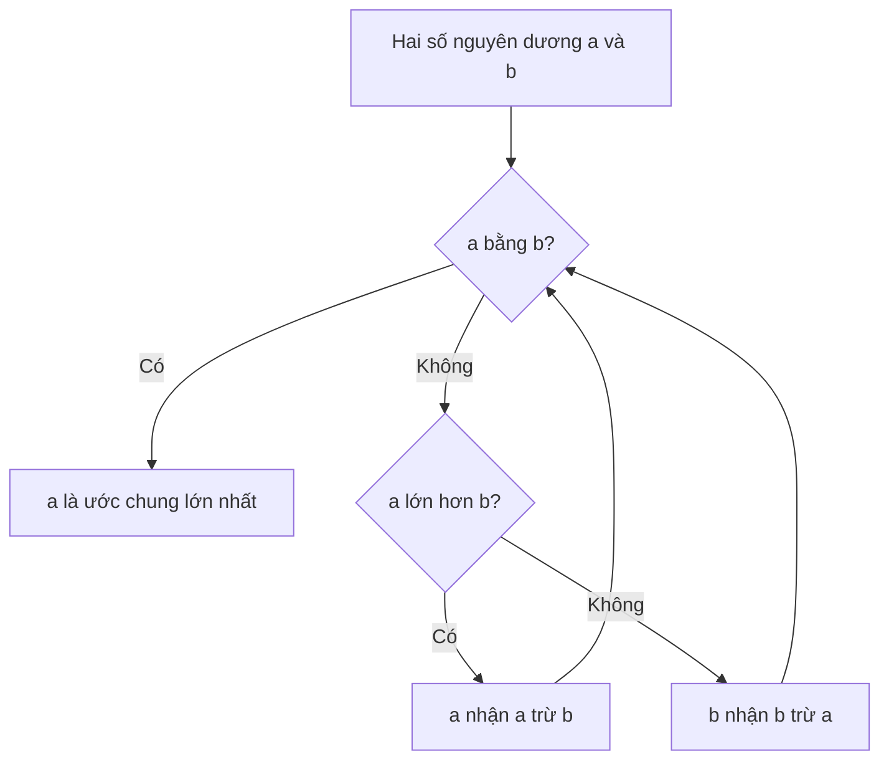

# Chương 4 — The Java Language

> **Tài liệu:** *Learning Java: An Introduction to Real-World Programming with Java*, Sixth Edition — Marc Loy, Patrick Niemeyer, Daniel Leuck; O’Reilly, 2023.  
> **Phạm vi:** Chương 4, trang in **85–132**.  
> **Nguồn:** [Bản PDF trong Google Drive](https://drive.google.com/file/d/1G5Lfx7FbPYdRyE1L3dYaVLcjQW4r-9Ks/view).  
> **Cách đọc:** Bản tóm tắt bằng tiếng Việt; ví dụ được biên soạn lại để minh họa. Phần ôn tập cuối ghi chú là bài luyện thêm, không chép nguyên văn bài tập sách.

## 1. Mục tiêu và bản đồ nội dung

Chương này trình bày những thành phần dùng để chuyển một thuật toán thành chương trình Java: biểu diễn dữ liệu, khai báo biến, tính toán, lựa chọn nhánh, lặp và tổ chức dữ liệu trong mảng. Chương 5 tiếp tục với lớp và đối tượng; chương 4 chủ yếu giúp đọc và viết đúng các khối mã cơ bản.



## 2. Văn bản, chú thích và metadata — trang 86–90

### 2.1. Unicode và ký tự

Java hỗ trợ Unicode trong dữ liệu văn bản và tên định danh. Cần phân biệt **mã hóa tệp** như UTF-8 với cách Java biểu diễn ký tự khi thao tác trên `char` và `String`.

- `char` lưu **một đơn vị mã UTF-16 16 bit**. Một ký tự hiển thị có thể cần nhiều hơn một `char`.
- `String` biểu diễn chuỗi văn bản; ký tự ngoài vùng BMP, chẳng hạn nhiều emoji, cần một cặp surrogate trong UTF-16.
- Unicode escape thông thường có dạng `\u` theo sau bởi **bốn chữ số hexadecimal**, ví dụ `\u0041` là `A`.
- Việc hiển thị đúng còn phụ thuộc terminal, font và môi trường chạy.

```java
char initial = 'J';
char letterA = '\u0041';
String greeting = "Xin chào Java";
String emoji = "\uD83D\uDE00";
System.out.println(greeting + " " + emoji);
```

**Ghi nhớ:** `char` dùng nháy đơn, `String` dùng nháy kép. Không đồng nhất số đơn vị UTF-16 mà `String.length()` trả về với số ký tự người đọc nhìn thấy.

### 2.2. Ba dạng chú thích

| Dạng | Cú pháp | Mục đích |
| --- | --- | --- |
| Chú thích dòng | `// ...` | Giải thích ngắn đến hết dòng |
| Chú thích khối | `/* ... */` | Giải thích nhiều dòng; không lồng khối cùng loại |
| Javadoc | `/** ... */` | Mô tả API để công cụ tạo tài liệu |

Comment thông thường không trở thành câu lệnh được thực thi. Javadoc có thể được công cụ đọc để sinh tài liệu HTML hoặc trợ giúp trong IDE.

```java
/**
 * Tính diện tích hình vuông.
 * @param side độ dài cạnh
 * @return diện tích tương ứng
 */
static double squareArea(double side) {
    return side * side;
}
```

Những tag thường gặp: `@param`, `@return`, `@throws` hoặc `@exception`, `@see`, `@author`, `@version`, `@since`, `@deprecated`. Tag phù hợp phụ thuộc thành phần được mô tả.

### 2.3. Annotation khác Javadoc

Annotation nằm **trong mã, ngoài comment** và cung cấp metadata cho compiler, công cụ hoặc framework. Một số annotation có thể được giữ lại để đọc khi chạy, tùy chính sách retention.

Ví dụ `@Override` giúp compiler kiểm tra phương thức có thực sự ghi đè một phương thức được kế thừa hay không. `@SuppressWarnings` yêu cầu bỏ qua một số cảnh báo được chỉ định; nó không làm mã sai trở thành hợp lệ.

> **Chú ý khi đối chiếu PDF:** Tên annotation đúng là `@Override`, không phải `@Overrides` như một số chỗ trong phần diễn giải của bản sách.

## 3. Biến, hằng và kiểu dữ liệu — trang 91–101

### 3.1. Khai báo và khởi tạo

Biến có tên, kiểu và giá trị. Java kiểm tra kiểu tại thời điểm biên dịch; phép gán tiếp theo phải tương thích với kiểu đã khai báo.

```java
int completedLessons = 3;
completedLessons = 4;

double radius = 2.0;
double area = Math.PI * radius * radius;

final int MAX_ATTEMPTS = 3;
```

Dùng hằng có tên giúp diễn đạt ý nghĩa của giá trị và tập trung nơi sửa cấu hình. `final` ngăn gán lại biến sau khi đã được gán hợp lệ. Với biến tham chiếu, `final` **không tự làm đối tượng được tham chiếu trở thành bất biến**.

| Vị trí | Nếu chưa khởi tạo |
| --- | --- |
| Field của lớp hoặc đối tượng | Có giá trị mặc định: số là `0`, `boolean` là `false`, `char` là `\u0000`, reference là `null` |
| Biến cục bộ trong phương thức | Phải được gán trên mọi đường đi dẫn tới lần đọc; compiler kiểm tra |
| Phần tử của mảng mới tạo | Có giá trị mặc định tương ứng với kiểu phần tử |

### 3.2. Tám kiểu primitive

| Kiểu | Đặc điểm | Ví dụ |
| --- | --- | --- |
| `boolean` | `true` hoặc `false` | `boolean active = true;` |
| `byte` | Số nguyên có dấu 8 bit, −128 đến 127 | `byte level = 10;` |
| `short` | Số nguyên có dấu 16 bit | `short year = 2026;` |
| `int` | Số nguyên có dấu 32 bit | `int count = 100_000;` |
| `long` | Số nguyên có dấu 64 bit | `long total = 40_000_000_000L;` |
| `float` | Số thực 32 bit, khoảng 6–7 chữ số có nghĩa | `float rate = 1.25F;` |
| `double` | Số thực 64 bit, khoảng 15–16 chữ số có nghĩa | `double distance = 12.5;` |
| `char` | Đơn vị mã UTF-16 không dấu 16 bit | `char grade = 'A';` |

Kích thước các kiểu số được Java quy định, giúp chương trình có hành vi nhất quán giữa nền tảng. Số thực nhị phân có độ chính xác hữu hạn; không nên kỳ vọng mọi phân số thập phân đều được lưu chính xác. Sách giới thiệu `BigInteger` và `BigDecimal` như lựa chọn khi cần số nguyên rất lớn hoặc kiểm soát độ chính xác thập phân.

### 3.3. Literal và chuyển kiểu số

```java
int decimal = 75;
int binary = 0b1001011;
int octal = 0113;
int hexadecimal = 0x4B;
long population = 8_000_000_000L;
double speed = 3.0e8;
float ratio = 0.75F;
```

Bốn biến đầu cùng có giá trị 75. Tiền tố `0` làm literal nguyên trở thành dạng bát phân; tránh thêm số 0 ở đầu một giá trị thập phân. Dấu `_` giúp phân nhóm chữ số, không thay đổi giá trị. Literal nguyên thông thường là `int`; literal số thực thông thường là `double`.

**Chuyển kiểu mở rộng** thường được thực hiện tự động. **Chuyển kiểu thu hẹp** thường cần cast và có thể mất thông tin.

```java
int small = 100;
long larger = small;
int truncated = (int) 3.9;   // 3: bỏ phần thập phân
byte wrapped = (byte) 130;  // -126: không còn giữ giá trị ban đầu
```

Một ngoại lệ hay gặp: hằng nguyên nằm trong phạm vi có thể gán trực tiếp như `byte b = 42;`. Ngược lại, `int n = 42; byte b = n;` không hợp lệ nếu không cast. Ngoài ra, phép tính giữa các toán hạng `byte`/`short` thường được nâng lên `int`.

### 3.4. Kiểu reference và ý nghĩa phép gán

Các biến kiểu lớp, interface và mảng giữ tham chiếu đến đối tượng hoặc `null`. Gán biến reference sao chép **giá trị tham chiếu**, không nhân bản đối tượng.

```java
int[] original = {10, 20};
int[] alias = original;
alias[0] = 99;
System.out.println(original[0]); // 99

int x = 10;
int y = x;
y = 99;
System.out.println(x);           // 10
```



**Java luôn truyền đối số theo giá trị.** Với reference, giá trị được sao chép chính là tham chiếu. Phương thức có thể sửa trạng thái đối tượng thông qua tham chiếu đó, nhưng gán lại tham số không làm biến của bên gọi trỏ sang đối tượng khác.

Kiểu của biến cũng quyết định đối tượng nào có thể gán vào. Một đối tượng thuộc lớp con có thể được dùng qua kiểu lớp cha; chi tiết kế thừa được trình bày ở chương sau.

### 3.5. Suy luận kiểu với `var`

```java
var name = "Quang"; // compiler suy ra String
var lessons = 5;    // compiler suy ra int
```

`var` dành cho khai báo biến cục bộ có initializer phù hợp. Nó không tạo biến kiểu động: `lessons = "five";` vẫn sai. Không thể suy ra kiểu chỉ từ `var value = null;`.

### 3.6. `String` là đối tượng

Literal chuỗi được Java hỗ trợ trực tiếp. Dấu `+` nối chuỗi khi một toán hạng là chuỗi.

```java
String title = "Java";
String message = title + " lesson " + 4;
System.out.println("Total: " + 2 + 3);   // Total: 23
System.out.println("Total: " + (2 + 3)); // Total: 5
```

Với reference, `==` kiểm tra hai tham chiếu có cùng trỏ đến một đối tượng hay không. Khi cần so sánh nội dung chuỗi, dùng `equals()`, chẳng hạn `"Java".equals(title)`.

## 4. Câu lệnh, biểu thức và phạm vi — trang 102–103

- **Câu lệnh (statement)** mô tả một bước thực hiện, ví dụ khai báo biến, gán, rẽ nhánh hoặc lặp.
- **Biểu thức (expression)** được đánh giá để tính giá trị hoặc thực hiện tác động, ví dụ `2 + 3`, `name.length()`, `new Object()`.
- Lời gọi phương thức trả `void` thực hiện công việc nhưng không cung cấp giá trị để gán cho biến.
- Khối `{ ... }` nhóm câu lệnh và giới hạn phạm vi biến cục bộ.

```java
int total = 0;
{
    int bonus = 5;
    total = total + bonus;
}
System.out.println(total); // 5
// System.out.println(bonus); // Sai: bonus nằm ngoài phạm vi
```

Ưu tiên toán tử quyết định cách nhóm phép tính; Java xác định thứ tự đánh giá các toán hạng từ trái sang phải. Dùng ngoặc và tách câu lệnh khi biểu thức có nhiều tác động phụ để người đọc không phải tự mô phỏng từng bước.

## 5. Điều khiển luồng — trang 104–113

### 5.1. `if` / `else`

Điều kiện phải là biểu thức boolean. Một chuỗi `if` / `else if` thực hiện nhánh đầu tiên có điều kiện đúng; `else` xử lý trường hợp còn lại.

```java
int score = 75;
if (score >= 80) {
    System.out.println("Giỏi");
} else if (score >= 50) {
    System.out.println("Đạt");
} else {
    System.out.println("Cần ôn tập");
}
```

Nên dùng dấu `{}` ngay cả khi nhánh chỉ có một câu lệnh để giảm lỗi khi bổ sung mã.

### 5.2. `switch`: dạng câu lệnh và biểu thức

Trong dạng cổ điển `case ...:`, chương trình có thể chạy tiếp sang nhánh sau nếu không gặp `break` hoặc một lệnh kết thúc luồng khác. Đây là **fall-through**.

```java
int day = 2;
switch (day) {
    case 1:
        System.out.println("Đọc bài");
        break;
    case 2:
        System.out.println("Làm bài tập");
        break;
    default:
        System.out.println("Ôn tập");
}
```

`switch` expression trả về giá trị. Dạng `->` không tự chạy tiếp sang nhánh kế tiếp; có thể gom nhiều nhãn bằng dấu phẩy. Biểu thức phải bao phủ các trường hợp có thể xảy ra, thường bằng `default`.

```java
String activity = switch (day) {
    case 1, 2 -> "Học kiến thức mới";
    case 3, 4 -> "Thực hành";
    default -> "Ôn tập";
};
```

### 5.3. Chọn vòng lặp

| Vòng lặp | Kiểm tra điều kiện | Khi nên dùng |
| --- | --- | --- |
| `while` | Trước thân vòng lặp | Lặp đến khi trạng thái thay đổi; có thể chạy 0 lần |
| `do ... while` | Sau thân vòng lặp | Cần thực hiện ít nhất 1 lần |
| `for` | Trước mỗi lượt | Có bộ đếm hoặc cần chỉ số |
| Enhanced `for` | Duyệt từng phần tử | Đọc phần tử của mảng hoặc `Iterable` khi không cần chỉ số |

```java
int count = 3;
while (count > 0) {
    System.out.println(count);
    count--;
}

int attempt = 0;
do {
    attempt++;
} while (attempt < 3);

for (int i = 0; i < 3; i++) {
    System.out.println(i);
}

int[] values = {2, 4, 6};
for (int value : values) {
    System.out.println(value);
}
```



Sơ đồ mô tả `for` thông thường: `continue` vẫn đi qua bước cập nhật trước lần kiểm tra tiếp theo.

### 5.4. `break`, `continue` và mã không thể tới

- `break`: thoát vòng lặp hoặc `switch` gần nhất phù hợp.
- `continue`: bỏ phần còn lại của lượt hiện tại. Với `while`, quay lại kiểm tra điều kiện; với `do ... while`, đi đến phép kiểm tra ở cuối.
- Dạng có nhãn có thể tác động tới vòng lặp bên ngoài; dùng tiết chế để giữ luồng dễ hiểu.
- Compiler từ chối một số câu lệnh không thể tới, chẳng hạn câu lệnh đặt ngay sau `return` vô điều kiện trong cùng khối.

**Lưu ý:** Quy tắc kiểm tra reachability có ngoại lệ cho `if`; không nên kết luận mọi nhánh `if (false)` đều gây lỗi biên dịch chỉ vì không chạy.

## 6. Toán tử và các biểu thức quan trọng — trang 114–120

| Nhóm | Toán tử | Ý nghĩa chính |
| --- | --- | --- |
| Số học | `+ - * / %` | Tính toán; `%` lấy phần dư |
| Tăng, giảm | `++ --` | Thay đổi giá trị một đơn vị |
| So sánh | `< <= > >= == !=` | Sinh kết quả boolean |
| Logic | `! && \|\|` | Phủ định, AND, OR; hai toán tử cuối có đoản mạch |
| Bit | `~ & \| ^ << >> >>>` | Thao tác từng bit và dịch bit |
| Gán | `= += -= *= ...` | Gán hoặc tính rồi gán |
| Điều kiện | `condition ? a : b` | Chọn một trong hai biểu thức |
| Kiểm tra kiểu | `instanceof` | Kiểm tra tương thích kiểu tại runtime |

Không có toán tử lũy thừa trong Java: `^` là XOR. Dùng ngoặc để làm rõ ý định khi phối hợp nhiều nhóm toán tử.

### 6.1. Những kết quả dễ nhầm

```java
int a = 18 - 7 * 2;          // 4
int b = (18 - 7) * 2;        // 22
int whole = 7 / 2;           // 3
double stillWhole = 7 / 2;   // 3.0: phép chia nguyên đã diễn ra trước
double fraction = 7 / 2.0;   // 3.5
int remainder = -7 % 3;      // -1

int n = 5;
int before = n++;            // before = 5, n = 6
int after = ++n;             // n = 7, after = 7
```

`>>` dịch phải có mở rộng bit dấu; `>>>` dịch phải và chèn bit 0. Hai phép này khác nhau rõ nhất với số nguyên âm.

### 6.2. `null` và đoản mạch

`null` biểu thị không có đối tượng được tham chiếu. Truy cập field hoặc gọi instance method qua `null` gây `NullPointerException`.

```java
String name = null;
boolean hasName = name != null && !name.isEmpty();
```

Khi vế trái của `&&` là `false`, Java bỏ qua vế phải. Vì vậy ví dụ này không gọi `isEmpty()` trên `null`. Với `||`, nếu vế trái là `true`, vế phải không được đánh giá. Các toán tử boolean `&` và `|` không có cơ chế bỏ qua này.

### 6.3. Truy cập thành viên, gọi phương thức và tạo đối tượng

```java
String word = "Java language";
int length = word.length();
int partLength = word.substring(0, 4).length();
Object object = new Object();
```

Dấu `.` chọn thành viên của lớp hoặc đối tượng. Có thể nối các lời gọi nếu kết quả trung gian có phương thức phù hợp. `new` tạo một đối tượng và cho ra tham chiếu đến đối tượng đó.

`System.out.println(...)` tạo tác động là in dữ liệu, nhưng trả `void`; không thể viết `int x = System.out.println(...);`.

### 6.4. `instanceof`

```java
Object item = "Java";
boolean isString = item instanceof String; // true
boolean isArray = item instanceof int[];   // false
boolean absent = null instanceof String;  // false
```

Toán tử này có thể kiểm tra kiểu lớp, interface hoặc mảng. Một số phép kiểm tra giữa các kiểu chắc chắn không tương thích bị compiler từ chối ngay.

## 7. Mảng — trang 120–129

### 7.1. Khai báo khác với tạo mảng

Mảng là đối tượng chứa dãy phần tử có cùng kiểu phần tử và **độ dài cố định**. Khai báo một biến `int[]` chưa tạo vùng chứa các phần tử.

```java
int[] scores;                // Chỉ khai báo biến reference
scores = new int[3];         // Tạo mảng: [0, 0, 0]
scores[0] = 80;

int[] primes = {2, 3, 5, 7};
String[] names = new String[2]; // [null, null]
names[0] = "Quang";
```

Tạo `new String[2]` chỉ tạo hai ô tham chiếu; không tạo sẵn hai đối tượng `String`. Độ dài thuộc về đối tượng mảng, không phải một phần của kiểu: mảng độ dài 3 và 10 đều có thể có kiểu `int[]`.

### 7.2. Chỉ số và duyệt mảng

- Chỉ số hợp lệ: `0` đến `array.length - 1`.
- Mảng có field `length`, không phải phương thức `length()`.
- Truy cập ngoài phạm vi gây `ArrayIndexOutOfBoundsException`.
- Gọi `array.length` khi `array == null` gây `NullPointerException`.

```java
int[] scores = {80, 90, 70};
int total = 0;
for (int i = 0; i < scores.length; i++) {
    total += scores[i];
}
double average = (double) total / scores.length; // 80.0
```

Trong ví dụ này mảng chắc chắn có phần tử; với dữ liệu tổng quát cần xử lý riêng mảng rỗng trước khi tính trung bình. Nếu cần thay đổi giá trị các ô, dùng chỉ số; gán lại biến primitive của enhanced `for` không cập nhật ô mảng.

### 7.3. Gán reference khác sao chép phần tử

```java
int[] source = {1, 2, 3};
int[] alias = source;
int[] copy = java.util.Arrays.copyOf(source, source.length);
int[] expanded = java.util.Arrays.copyOf(source, 5);
int[] slice = java.util.Arrays.copyOfRange(source, 1, 3);
```

| Biến | Kết quả ban đầu | Quan hệ với `source` |
| --- | --- | --- |
| `alias` | `[1, 2, 3]` | Cùng đối tượng mảng |
| `copy` | `[1, 2, 3]` | Mảng mới |
| `expanded` | `[1, 2, 3, 0, 0]` | Mảng mới, phần thêm được khởi tạo mặc định |
| `slice` | `[2, 3]` | Mảng mới; chỉ số đầu gồm, chỉ số cuối loại trừ |

Có thể sao chép một đoạn vào mảng đích đã có bằng `System.arraycopy(source, sourceStart, destination, destinationStart, count)`.



Với mảng chứa đối tượng, các cách trên sao chép **tham chiếu phần tử**; chúng không tự nhân bản các đối tượng bên trong. Muốn “tăng độ dài”, tạo mảng mới rồi gán biến sang mảng mới, thay vì thay đổi độ dài của mảng cũ.

### 7.4. Mảng không đặt tên riêng

Có thể tạo mảng ngay tại nơi dùng bằng `new Type[] { ... }`:

```java
System.out.println(java.util.Arrays.toString(new int[] {2, 4, 6}));
```

Dạng `{2, 4, 6}` đứng riêng chỉ dùng được trong ngữ cảnh initializer của khai báo mảng; khi cần một biểu thức mảng tại lời gọi phương thức, dùng đầy đủ `new int[] {2, 4, 6}`.

### 7.5. Mảng nhiều chiều là mảng chứa mảng

```java
int[][] grid = new int[2][3];
grid[1][2] = 9;

int[][] triangle = new int[3][];
for (int row = 0; row < triangle.length; row++) {
    triangle[row] = new int[row + 1];
    for (int col = 0; col < triangle[row].length; col++) {
        triangle[row][col] = row + col;
    }
}
```

`new int[3][]` tạo mảng ngoài gồm ba tham chiếu đang là `null`. Phải khởi tạo từng hàng trước khi đọc hay ghi phần tử trong hàng. Các hàng có thể có độ dài khác nhau.



## 8. Ghép kiến thức thành thuật toán

Sách dùng thuật toán Euclid để minh họa cách phối hợp biến, điều kiện, vòng lặp và phép gán. Phiên bản sau giữ ý tưởng **trừ lặp lại** của chương; điều kiện đầu vào là hai số nguyên dương.

```java
public class Euclid {
    public static void main(String[] args) {
        int a = 2701;
        int b = 222;
        int originalA = a;
        int originalB = b;

        while (a != b) {
            if (a > b) {
                a -= b;
            } else {
                b -= a;
            }
        }

        System.out.println("GCD(" + originalA + ", " + originalB + ") = " + a);
    }
}
```

Kết quả: `GCD(2701, 222) = 37`. Hai biến lưu đầu vào ban đầu giúp in thông tin đúng sau khi thuật toán đã thay đổi `a` và `b`.



Không áp dụng nguyên xi phiên bản này cho số 0 hoặc số âm; cần quy định và xử lý đầu vào trước.

## 9. Những lỗi nên nhận ra ngay

| Lỗi | Vì sao / cách sửa |
| --- | --- |
| Dùng biến cục bộ trước khi gán | Khởi tạo trước mọi đường đi tới lần đọc |
| Nhầm `=` và `==` | `=` là gán; `==` là so sánh |
| So sánh nội dung chuỗi bằng `==` | Dùng `equals()` |
| Cho rằng `var` làm kiểu thay đổi | Kiểu vẫn được cố định khi biên dịch |
| Quên `break` trong `case ...:` | Có thể chạy tiếp nhánh sau |
| Vòng lặp không làm thay đổi điều kiện | Dễ lặp vô hạn |
| Dùng `i <= array.length` | Chỉ số cuối là `length - 1`; thường dùng `<` |
| Viết `array.length()` | Dùng `array.length` |
| Nghĩ `new MyType[5]` tạo 5 đối tượng `MyType` | Nó tạo mảng 5 ô tham chiếu `null` |
| Nghĩ `b = a` tạo bản sao mảng | Dùng phương thức sao chép nếu cần mảng độc lập |
| Chỉ cast sau phép chia nguyên | Ép kiểu một toán hạng trước khi chia |
| Nhầm `final` với đối tượng bất biến | `final` ngăn gán lại biến reference |

## 10. Ôn tập và thực hành

### 10.1. Tự kiểm tra

1. Vì sao `int` phù hợp cho nhiều bộ đếm nhưng `long` cần thiết khi giá trị vượt khoảng hai tỷ?
2. `char` và `String` khác nhau thế nào? Vì sao một emoji có thể chiếm hai đơn vị UTF-16?
3. Phân biệt field chưa khởi tạo và biến cục bộ chưa khởi tạo.
4. Vì sao `int[] b = a;` cho phép thay đổi quan sát được qua cả `a` lẫn `b`?
5. `while` và `do ... while` khác nhau ở lần chạy đầu thế nào?
6. `continue` trong `for` có bỏ qua phần cập nhật bộ đếm không?
7. So sánh `array.length` với `text.length()`.
8. Sau `new String[3]`, các phần tử đang chứa gì?

**Đáp án ngắn:** (1) `long` có phạm vi lớn hơn; (2) `char` là một đơn vị UTF-16, `String` là chuỗi; (3) field có mặc định, local phải được gán trước khi đọc; (4) hai biến cùng tham chiếu một mảng; (5) `do` chạy thân ít nhất một lần; (6) không; (7) field mảng và phương thức chuỗi; (8) `null`.

### 10.2. Bài luyện thêm theo nội dung chương

| Bài | Đề bài | Tiêu chí hoàn thành |
| --- | --- | --- |
| 1 — Kiểu và phép tính | Khai báo giá trị thập phân, nhị phân và hexadecimal cùng bằng 42; tính `7 / 2` và `7 / 2.0` | In đúng ba số 42 và giải thích hai kết quả phép chia |
| 2 — Điều kiện và vòng lặp | In các số lẻ giảm dần từ 19 đến 1; tính tổng | In 10 số; tổng bằng 100 |
| 3 — Thống kê mảng | Với `{8, 6, 10, 7, 9}`, tính tổng, min, max, trung bình; đếm phần tử từ 8 trở lên | Tổng 40, min 6, max 10, trung bình 8.0, đếm 3 |
| 4 — Gán và sao chép | Tạo mảng gốc, một alias và một bản sao bằng `Arrays.copyOf`; thay phần tử của alias rồi của bản sao | Quan sát mảng gốc đổi qua alias nhưng không đổi qua bản sao |
| 5 — Euclid | Chạy lớp Euclid với `(2701, 222)`, `(48, 18)`, `(17, 13)` | Kết quả lần lượt 37, 6, 1; giữ và in được đầu vào ban đầu |
| 6 — Mảng tam giác | Tạo 5 hàng; hàng `r` dài `r + 1`; ô `(r,c)` bằng `r + c`; in mỗi hàng trên một dòng | Hàng cuối là `4 5 6 7 8`; không có truy cập ngoài phạm vi |

### 10.3. Checklist sau khi học

- [ ] Phân biệt được primitive, reference và `null`.
- [ ] Biết khai báo, khởi tạo và giới hạn phạm vi biến.
- [ ] Giải thích được sự khác nhau giữa copy giá trị và copy reference.
- [ ] Dùng được `if`, `switch`, `while`, `do ... while`, `for`, enhanced `for`.
- [ ] Hiểu ưu tiên toán tử, phép chia nguyên và đoản mạch.
- [ ] Tạo, duyệt và sao chép được mảng một chiều.
- [ ] Hiểu mảng nhiều chiều là mảng chứa mảng.
- [ ] Tự chạy được ví dụ Euclid và mảng tam giác.

## 11. Tra cứu lại trong sách

| Nội dung | Trang in |
| --- | --- |
| Text Encoding | 86–88 |
| Comments, Javadoc, Annotations | 88–91 |
| Variables and Constants | 91–93 |
| Primitive Types | 94–98 |
| Reference Types, Strings | 98–102 |
| Statements: nhánh và vòng lặp | 103–113 |
| Expressions: toán tử, phương thức, `instanceof` | 114–120 |
| Arrays | 120–129 |
| Tổng kết và bài tập gốc của chương | 129–132 |

Số trang trên là **số trang in của sách**, không phải chỉ số trang của trình đọc PDF. Các phần về Unicode, annotation, truyền tham số và reachability được diễn đạt rõ hơn để tránh những cách hiểu nhầm từ một số câu trong nguồn.
