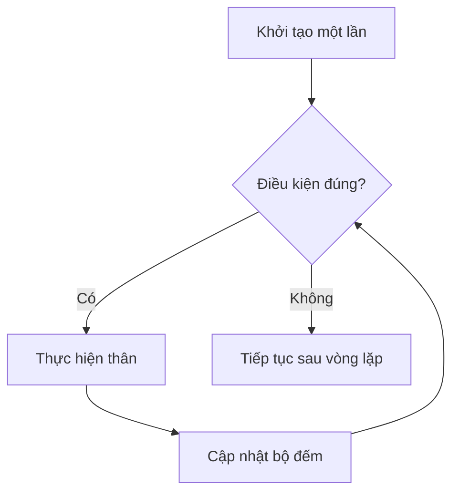
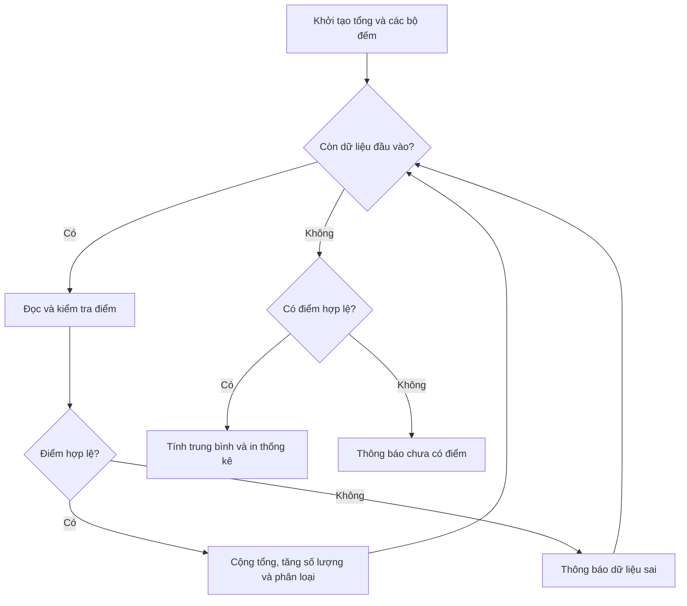
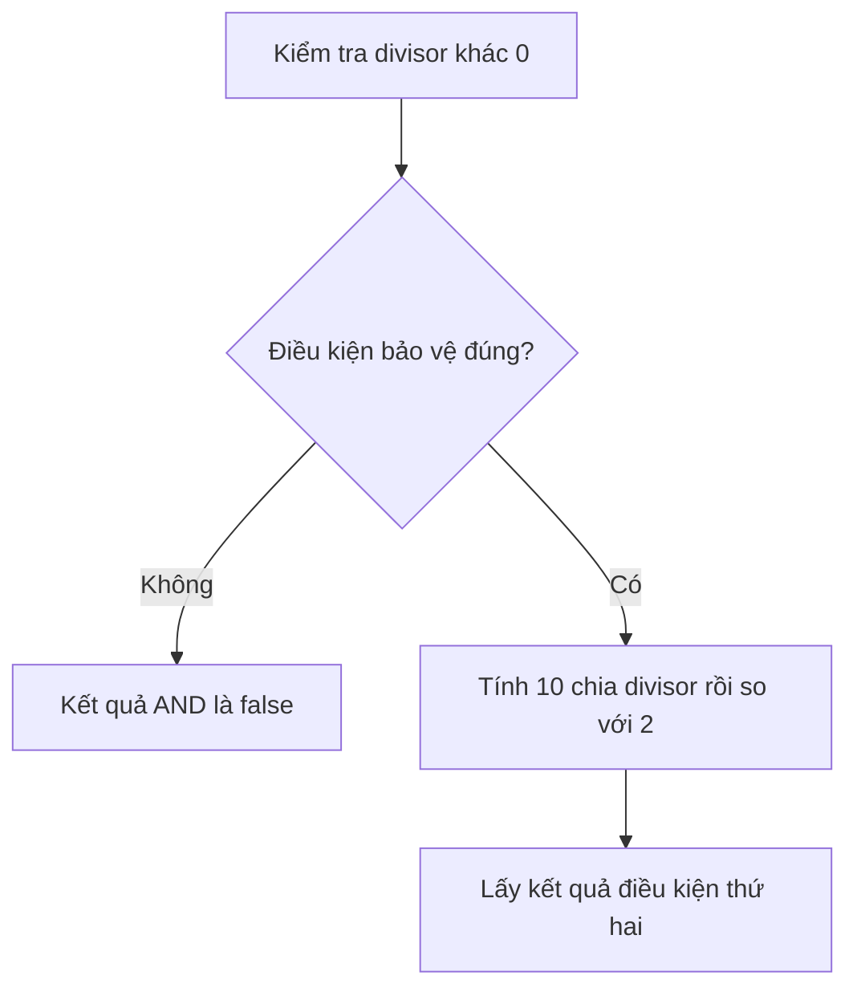

# More Control Statement

> **Tóm tắt Chương 4 - Control Statements: Part 2**  
> **Sách:** *Java for Programmers with Generative AI*, Fifth Edition - Paul Deitel & Harvey Deitel.  
> **Nguồn:** [Bản sách trên Google Drive](https://drive.google.com/file/d/1mUZMJUcLtwbPsG_KYHecBefNETR1M6_d/view).  
> Ghi chú tiếng Việt theo các mục 4.1-4.12. Ví dụ được viết lại để ôn tập; các phần bổ sung kiểm tra đầu vào được ghi rõ. Câu lệnh rời đặt trong `main`, còn `import` đặt ở đầu tệp.

## 1. Mục tiêu và bản đồ chương

Sau `if`, `if…else` và `while` ở chương 3, chương 4 bổ sung các cấu trúc điều khiển, cách kết hợp điều kiện và ứng dụng tính lãi kép. Phần cuối chuyển từ phép tính bằng `double` sang `BigDecimal` để minh hoạ biểu diễn số thập phân chính xác và chính sách làm tròn.

| Mục sách | Nội dung | Cần nắm |
| --- | --- | --- |
| 4.1-4.2 | Lặp theo bộ đếm | Biến đếm, giá trị đầu, cập nhật, điều kiện tiếp tục |
| 4.3-4.4 | `for` và các dạng bước nhảy | Thứ tự thực thi, phạm vi biến, cận vòng lặp |
| 4.5 | Cộng các số chẵn 2-20 | Biến đếm khác biến tích luỹ |
| 4.6 | Tính lãi kép | Công thức, `Math.pow`, định dạng số |
| 4.7 | `do…while` | Kiểm tra sau thân, chạy ít nhất một lần |
| 4.8 | `switch` | `case`, `default`, `break`, fall-through |
| 4.9 | `break` và `continue` | Thoát cấu trúc hoặc kết thúc lượt hiện tại |
| 4.10.1-4.10.7 | Toán tử logic | AND, OR, XOR, NOT và short-circuit |
| 4.11 | Case study `BigDecimal` | Khởi tạo chính xác, phép toán, HALF_EVEN |
| 4.12 | Tổng kết | Chọn cấu trúc phù hợp và kiểm chứng kết quả |

## 2. Bốn thành phần của vòng lặp có bộ đếm

Một vòng lặp có bộ đếm cần:

1. **Biến điều khiển:** theo dõi tiến trình, chẳng hạn `counter`.
2. **Giá trị ban đầu:** điểm bắt đầu đếm.
3. **Bước cập nhật:** tăng hoặc giảm sau mỗi lượt.
4. **Điều kiện tiếp tục:** quyết định có thực hiện lượt kế tiếp hay không.

```java
int counter = 1;
while (counter <= 5) {
    System.out.printf("%d ", counter);
    ++counter;
}
// 1 2 3 4 5
```

Nên dùng số nguyên làm bộ đếm thông thường. Sai số của số thực có thể làm các phép kiểm tra kết thúc dựa trên giá trị thập phân không diễn ra như dự định.

**Off-by-one:** nếu đổi `<= 5` thành `< 5`, chương trình chỉ in 1-4. Khi kiểm tra vòng lặp, luôn xác định giá trị đầu, giá trị cuối và số lượt thân chạy.

## 3. `for`: tập trung thông tin điều khiển vào phần đầu

```java
for (int i = 1; i <= 5; ++i) {
    System.out.printf("%d ", i);
}
```

Dạng tổng quát:

```java
for (initialization; condition; update) {
    // body
}
```

Thứ tự là **khởi tạo một lần → kiểm tra điều kiện → thân → cập nhật → kiểm tra lại**. Nếu điều kiện sai ngay từ đầu, thân không chạy.



### Theo dõi một ví dụ ngắn

Với `for (int i = 1; i <= 3; ++i)`:

| Bước | `i` | Diễn biến |
| --- | --- | --- |
| Khởi tạo | 1 | Chỉ thực hiện một lần |
| Lượt 1 | 1 | Kiểm tra đúng, chạy thân, tăng thành 2 |
| Lượt 2 | 2 | Kiểm tra đúng, chạy thân, tăng thành 3 |
| Lượt 3 | 3 | Kiểm tra đúng, chạy thân, tăng thành 4 |
| Kết thúc | 4 | Kiểm tra sai, không chạy thân |

Thân chạy ba lần nhưng điều kiện được kiểm tra bốn lần.

### Phạm vi biến và các phần có thể bỏ

- Biến khai báo trong phần đầu `for` thuộc phạm vi câu lệnh `for`, không dùng được sau vòng lặp. Muốn đọc biến sau đó thì khai báo trước vòng lặp.
- Ba biểu thức có thể được bỏ, nhưng vẫn cần hai dấu `;` phân cách.
- Bỏ điều kiện nghĩa là điều kiện tiếp tục luôn đúng; `for (;;)` cần cơ chế thoát nếu không muốn chạy mãi.
- Với bước cập nhật đứng riêng, `++i`, `i++`, `i += 1` đều tăng i một đơn vị. Khi giá trị biểu thức được sử dụng trong biểu thức lớn hơn, tiền tố và hậu tố có thể khác nhau.
- Không đặt `;` ngay sau `for (...)` nếu muốn block sau đó là thân vòng lặp.

Sách thường dùng `for` cho lặp theo bộ đếm và `while` cho lặp theo dữ liệu hoặc điều kiện khác. Đây là lựa chọn giúp mã rõ ý, không phải giới hạn bắt buộc của cú pháp.

## 4. Bước nhảy, đếm giảm và cộng dồn

| Phần đầu vòng lặp | Dãy giá trị |
| --- | --- |
| `for (int i = 1; i <= 5; ++i)` | 1, 2, 3, 4, 5 |
| `for (int i = 5; i >= 1; --i)` | 5, 4, 3, 2, 1 |
| `for (int i = 2; i <= 10; i += 2)` | 2, 4, 6, 8, 10 |
| `for (int i = 20; i >= 2; i -= 2)` | 20, 18, …, 2 |
| `for (int i = 2; i <= 20; i += 3)` | 2, 5, 8, 11, 14, 17, 20 |

Ví dụ số lẻ giảm từ 19 về 1:

```java
for (int i = 19; i >= 1; i -= 2) {
    System.out.println(i);
}
```

Dùng `i += 2` ở đây sẽ đi ngược mục tiêu đếm giảm. Với `int`, không nên đơn giản kết luận chương trình sẽ in số tăng mãi: cuối cùng còn có thể xảy ra tràn số. Điều cần sửa là hướng cập nhật không đưa biến tới cận kết thúc mong muốn.

Tránh điều kiện như `i != 10` khi bước nhảy có thể bỏ qua đúng giá trị 10. Chẳng hạn bắt đầu từ 1 rồi tăng 2 sẽ đi qua các số lẻ; dùng cận `<`/`<=` hoặc `>`/`>=` phù hợp thường rõ ràng hơn.

### Tổng các số chẵn từ 2 đến 20

```java
int total = 0;
for (int number = 2; number <= 20; number += 2) {
    total += number;
}
System.out.println(total); // 110
```

`number` xác định giá trị đang xét; `total` giữ kết quả tích luỹ. Khởi tạo `total` trước vòng lặp để không đặt lại tổng ở mỗi lượt. Tổng các số lẻ 1-99 tương tự là **2500**.

## 5. Tính lãi kép bằng `for`

Bài toán sách: tiền gốc 1.000,00, lãi suất năm 5%, giữ toàn bộ lãi trong tài khoản và tính số tiền cuối mỗi năm trong 10 năm.

\[
a = p(1+r)^n
\]

| Ký hiệu | Ý nghĩa |
| --- | --- |
| `p` | Tiền gốc |
| `r` | Lãi suất năm, 5% được viết thành 0.05 |
| `n` | Số năm |
| `a` | Số tiền cuối năm thứ n |

```java
double principal = 1000.00;
double rate = 0.05;

for (int year = 1; year <= 10; ++year) {
    double amount = principal * Math.pow(1.0 + rate, year);
    System.out.printf("%4d%,20.2f%n", year, amount);
}
```

- `Math.pow(base, exponent)` tính luỹ thừa; `^` không phải toán tử luỹ thừa Java.
- `Math` thuộc `java.lang`, nên không cần import riêng.
- `%4d`: in số nguyên với độ rộng tối thiểu 4 ký tự.
- `%,20.2f`: độ rộng tối thiểu 20, dấu phân nhóm theo locale, hiển thị 2 chữ số thập phân.
- `%-20s`: ví dụ căn trái một chuỗi trong trường rộng tối thiểu 20.
- Độ rộng tối thiểu không cắt bỏ giá trị dài hơn; định dạng số còn phụ thuộc locale.

Đoạn `double` phục vụ minh hoạ vòng lặp và công thức. Nó mở đường cho phần `BigDecimal`, vì nhiều số thập phân không có biểu diễn nhị phân hữu hạn chính xác.

**Hiển thị khác với dữ liệu lưu:** in số thành hai chữ số thập phân không làm biến tự đổi thành giá trị đã làm tròn đó. Cộng từng số đã làm tròn và làm tròn tổng cuối cùng có thể cho hai kết quả khác nhau.

## 6. `do…while`: kiểm tra sau thân

```java
int counter = 1;
do {
    System.out.printf("%d ", counter);
    ++counter;
} while (counter <= 5);
```

Điểm khác biệt là thân được chạy trước khi kiểm tra điều kiện tiếp tục.

| Cấu trúc | Kiểm tra điều kiện | Số lượt tối thiểu | Trường hợp thường dùng |
| --- | --- | --- | --- |
| `while` | Trước thân | 0 | Lặp theo dữ liệu hoặc điều kiện |
| `for` thông thường | Trước thân | 0 | Bộ đếm với cận và bước rõ ràng |
| `do…while` | Sau thân | 1 | Hiện menu hoặc thao tác cần làm ít nhất một lần |

Dấu `;` sau `while (condition)` trong `do…while` **là bắt buộc**, khác dấu `;` thừa sau phần đầu `for` hoặc `while` thông thường.

Nếu `counter = 20` ngay từ đầu, một `do…while` với thân in `counter` vẫn in 20 một lần trước khi kiểm tra cận. Hãy chọn cấu trúc theo ý nghĩa công việc, không chỉ vì các cấu trúc trông giống nhau.

## 7. `switch`: lựa chọn theo giá trị

Chương dùng cú pháp `case ...:` để phân loại điểm chữ. Phép chia nguyên `grade / 10` biến khoảng điểm thành nhóm:

| Điểm hợp lệ | `grade / 10` | Loại |
| --- | --- | --- |
| 90-100 | 9 hoặc 10 | A |
| 80-89 | 8 | B |
| 70-79 | 7 | C |
| 60-69 | 6 | D |
| 0-59 | 0-5 | F |

```java
int grade = 85; // giả định đã kiểm tra thuộc 0-100
String letter;

switch (grade / 10) {
    case 10:
    case 9:
        letter = "A";
        break;
    case 8:
        letter = "B";
        break;
    case 7:
        letter = "C";
        break;
    case 6:
        letter = "D";
        break;
    default:
        letter = "F";
}
System.out.println(letter); // B
```

### `case`, `break`, `default` và fall-through

1. Tính biểu thức điều khiển `grade / 10`.
2. Chọn vị trí bắt đầu thực hiện theo nhãn `case` khớp.
3. Tiếp tục chạy các câu lệnh theo luồng cho đến khi thoát `switch`.
4. Nếu không có nhãn khớp, chạy `default` khi nó được khai báo.

Trong cú pháp dấu hai chấm, thiếu `break` có thể làm chạy xuyên xuống những nhánh sau, gọi là **fall-through**. Hai nhãn `case 10:` và `case 9:` dùng chung phần xử lý là một fall-through có chủ ý.

`default` không tự kiểm tra đầu vào. Nếu không xác thực 0-100, điểm 110 không được phân loại đúng chỉ nhờ cấu trúc trên. Nếu không có `default` và không có nhãn khớp, chương trình tiếp tục sau `switch`.

Trong phạm vi chương, các ví dụ tập trung vào kiểu nguyên nhỏ/`int`, `char`, `String` và nhắc tới hằng `enum`. Các dạng `switch` mở rộng, nhãn `->` và `switch` expression được trình bày ở các chương sau. Không suy rộng giới hạn của mẫu minh hoạ này cho mọi phiên bản và tính năng Java.

## 8. Case study thống kê điểm đến EOF

Ứng dụng trong sách đọc các điểm đến khi kết thúc đầu vào, cộng tổng, đếm số điểm và cập nhật bộ đếm A/B/C/D/F. Sau đó mới in báo cáo.



Sơ đồ bổ sung bước validation để làm rõ cách xử lý dữ liệu sai. `hasNext()` chỉ xác nhận còn token, không bảo đảm token đó là số nguyên. Phiên bản viết lại dưới đây dùng `hasNextInt()` để phân biệt trước khi đọc số:

```java
import java.util.Scanner;

public class GradeReport {
    public static void main(String[] args) {
        Scanner input = new Scanner(System.in);
        int total = 0;
        int count = 0;
        int a = 0, b = 0, c = 0, d = 0, f = 0;

        while (input.hasNext()) {
            if (!input.hasNextInt()) {
                System.out.println("Invalid token: " + input.next());
                continue;
            }

            int grade = input.nextInt();
            if (grade < 0 || grade > 100) {
                System.out.println("Grade outside 0-100: " + grade);
                continue;
            }

            total += grade;
            ++count;
            switch (grade / 10) {
                case 10:
                case 9:
                    ++a;
                    break;
                case 8:
                    ++b;
                    break;
                case 7:
                    ++c;
                    break;
                case 6:
                    ++d;
                    break;
                default:
                    ++f;
            }
        }

        if (count == 0) {
            System.out.println("No valid grades");
        } else {
            double average = (double) total / count;
            System.out.printf("Count: %d%nTotal: %d%nAverage: %.2f%n",
                count, total, average);
            System.out.printf("A: %d%nB: %d%nC: %d%nD: %d%nF: %d%n",
                a, b, c, d, f);
        }
    }
}
```

Đoạn viết lại bổ sung xử lý token không phải số nguyên và điểm ngoài miền; ví dụ gốc của sách giả định người dùng nhập hợp lệ. `input.next()` phải tiêu thụ token sai trước khi `continue`, nếu không cùng token có thể bị kiểm tra lặp mãi.

EOF không phải một điểm đặc biệt như sentinel `-1`. Trong terminal, thường dùng `Ctrl+D` trên macOS/Linux hoặc `Ctrl+Z` rồi Enter trên Windows; cách nhập có thể khác trong console của IDE. Khi đọc từ tệp, hết nội dung tệp là EOF.

Với bộ điểm `99, 92, 45, 57, 63, 71, 76, 85, 90, 100`, báo cáo có tổng **778**, trung bình **77.80**, A: **4**, B: **1**, C: **2**, D: **1**, F: **2**. Các bộ đếm cộng lại phải bằng `count`.

## 9. `break` và `continue`

| Lệnh | Tác dụng | Điểm tiếp tục |
| --- | --- | --- |
| `break` không nhãn | Thoát vòng lặp hoặc `switch` gần nhất bao quanh nó | Câu lệnh sau cấu trúc vừa thoát |
| `continue` trong `for` | Bỏ phần thân còn lại của lượt hiện tại | Phần cập nhật của `for`, rồi kiểm tra điều kiện |
| `continue` trong `while` | Bỏ phần thân còn lại | Kiểm tra điều kiện `while` |
| `continue` trong `do…while` | Bỏ phần thân còn lại | Kiểm tra điều kiện ở cuối |

```java
for (int i = 1; i <= 10; ++i) {
    if (i == 5) {
        break;
    }
    System.out.printf("%d ", i);
}
// 1 2 3 4
```

Đổi `break` thành `continue` trong ví dụ trên sẽ in `1 2 3 4 6 7 8 9 10`: chỉ bỏ việc in 5, không kết thúc vòng lặp.

**Hai điểm dễ nhầm:**

- `break` trong một `switch` nằm trong vòng lặp thường chỉ thoát `switch`, không thoát vòng lặp bao ngoài.
- Nếu `continue` trong `while` bỏ qua bước cập nhật biến điều khiển thì vòng lặp có thể không tiến triển. Hãy kiểm tra mọi đường đi trong thân.

Sách khuyến khích ưu tiên mã đơn giản, đúng và dễ hiểu; chỉ tối ưu khi thực sự cần.

## 10. Toán tử logic và bảng chân trị

| Toán tử trên boolean | Ý nghĩa | Khi nào đánh giá vế phải? |
| --- | --- | --- |
| `&&` | AND: cả hai vế đúng | Chỉ khi vế trái đúng |
| `\|\|` | OR: ít nhất một vế đúng | Chỉ khi vế trái sai |
| `&` | AND không đoản mạch | Không bỏ qua vế phải chỉ vì đã biết kết quả logic |
| `\|` | OR không đoản mạch | Không bỏ qua vế phải chỉ vì đã biết kết quả logic |
| `^` | XOR: đúng khi hai vế khác nhau | Không có quy tắc đoản mạch |
| `!` | NOT: đảo giá trị | Một toán hạng |

Các hàng về `&`, `|`, `^` mô tả đánh giá bình thường; nếu việc đánh giá một toán hạng ném ngoại lệ thì phép tính có thể dừng tại đó. Với toán hạng nguyên, các toán tử này còn có vai trò thao tác bit; phần này tập trung vào boolean.

| A | B | AND | OR | XOR |
| --- | --- | --- | --- | --- |
| false | false | false | false | false |
| false | true | false | true | true |
| true | false | false | true | true |
| true | true | true | true | false |

`!true` bằng `false`; `!false` bằng `true`. `&&` và `&` có cùng bảng kết quả logic nhưng khác cách đánh giá; tương tự `||` và `|`.

### Short-circuit: chỉ đánh giá khi cần

```java
int divisor = 0;
boolean result = divisor != 0 && 10 / divisor == 2;
System.out.println(result); // false, không thực hiện phép chia
```



Đặt điều kiện bảo vệ trước biểu thức phụ thuộc. Đổi `&&` thành `&` ở ví dụ này sẽ đánh giá phép chia nguyên cho 0 và gây ngoại lệ.

Với `||`, vế trái đúng thì không cần đánh giá vế phải. Ví dụ kiểm tra dữ liệu không hợp lệ:

```java
if (grade < 0 || grade > 100) {
    System.out.println("Invalid grade");
}
```

`&&` có độ ưu tiên cao hơn `||`; `!` có độ ưu tiên cao và thường cần ngoặc khi đảo một phép so sánh. Viết `!(grade == sentinel)` hoặc rõ hơn là `grade != sentinel`.

Tránh đặt thao tác tăng biến hoặc gán biến trong điều kiện nếu nó khiến luồng xử lý khó hiểu. Đặc biệt, phép gán boolean có thể vẫn biên dịch trong `if`, nên không mặc định viết nhầm `=` thành `==` luôn bị compiler bắt.

## 11. `BigDecimal`: biểu diễn số thập phân chính xác

Xử lý tiền đặt ra hai vấn đề riêng:

1. **Biểu diễn:** `double` chỉ xấp xỉ nhiều số thập phân.
2. **Làm tròn:** kết quả chính xác vẫn có thể có phần nhỏ hơn đơn vị cần ghi nhận; cần quy tắc và thời điểm làm tròn.

```java
import java.math.BigDecimal;

BigDecimal precise = new BigDecimal("123.02");
BigDecimal fromDouble = new BigDecimal(123.02);
```

Dòng đầu lấy đúng các chữ số từ chuỗi. Dòng sau chuyển giá trị `double` đã xấp xỉ sang `BigDecimal`; chuyển kiểu sau đó không tự khôi phục số thập phân mà người viết dự định.

### Phép toán bằng phương thức

| Toán học | API |
| --- | --- |
| `a + b` | `a.add(b)` |
| `a × b` | `a.multiply(b)` |
| Luỹ thừa nguyên | `a.pow(n)` |
| Hằng 1 | `BigDecimal.ONE` |
| Làm tròn về 2 chữ số thập phân | `a.setScale(2, roundingMode)` |

`BigDecimal` bất biến: các phương thức trả kết quả để dùng hoặc gán lại.

```java
BigDecimal amount = new BigDecimal("10.00");
amount = amount.add(new BigDecimal("2.50")); // 12.50
```

Không dùng toán tử `+` để thay thế `add`. Trong ví dụ cộng, nhân và luỹ thừa nguyên ở chương này, các giá trị được giữ chính xác đến bước làm tròn chỉ định. Không suy ra mọi phép toán số thập phân đều có kết quả hữu hạn hoặc không bao giờ cần chính sách làm tròn.

### Lãi kép với `BigDecimal`

```java
import java.math.BigDecimal;
import java.math.RoundingMode;

public class ExactInterest {
    public static void main(String[] args) {
        BigDecimal principal = new BigDecimal("1000.00");
        BigDecimal rate = new BigDecimal("0.05");
        BigDecimal growth = BigDecimal.ONE.add(rate);

        for (int year = 1; year <= 10; ++year) {
            BigDecimal amount = principal.multiply(growth.pow(year));
            BigDecimal displayed = amount.setScale(2, RoundingMode.HALF_EVEN);
            System.out.printf("%2d %s%n", year, displayed.toPlainString());
        }
    }
}
```

Mỗi năm được tính từ tiền gốc bằng công thức. Kết quả làm tròn để in không được đưa trở lại công thức của năm sau. Một nghiệp vụ ghi nhận và làm tròn lãi từng kỳ có thể yêu cầu cách tính khác; thời điểm làm tròn cũng là một phần của quy tắc.

## 12. HALF_UP và HALF_EVEN

- **HALF_UP:** chọn mức gần nhất; nếu đúng giữa hai mức thì chọn hướng ra xa 0.
- **HALF_EVEN:** chọn mức gần nhất; nếu đúng giữa hai mức thì chọn mức có chữ số cuối được giữ là số chẵn, còn gọi là banker's rounding.

| Giá trị chính xác | HALF_UP, 2 chữ số | HALF_EVEN, 2 chữ số |
| --- | --- | --- |
| 1157.625 | 1157.63 | 1157.62 |
| 1157.635 | 1157.64 | 1157.64 |
| 1157.645 | 1157.65 | 1157.64 |
| 1157.655 | 1157.66 | 1157.66 |

Quy tắc “chọn chẵn” áp dụng khi **đúng điểm giữa**. Ví dụ 1.2451 gần 1.25 hơn 1.24, nên HALF_EVEN với hai chữ số cho 1.25; không chỉ nhìn thấy chữ số thứ ba là 5 rồi bỏ qua phần phía sau.

Bản lãi kép dùng `double` trong sách in năm 3 là 1157.63, còn bản `BigDecimal` chỉ định HALF_EVEN in 1157.62. Cần phân biệt kiểu biểu diễn, phép định dạng và quy tắc làm tròn: **`double` không có chính sách làm tròn tiền mặc định, và `BigDecimal` cũng không tự động luôn dùng HALF_EVEN**. Quy tắc phải được hiểu theo thao tác cụ thể.

`BigDecimal` cần nhiều tài nguyên hơn kiểu nguyên thuỷ; lợi ích ở đây là kiểm soát biểu diễn thập phân và các phép tính phù hợp nghiệp vụ, không phải mọi phép toán đều nhanh hơn.

## 13. Lỗi thường gặp và cách kiểm chứng

| Lỗi | Hướng kiểm tra/sửa |
| --- | --- |
| Sai `<`/`<=` ở cận cuối | Viết ra giá trị đầu/cuối và số lượt mong muốn |
| Đếm giảm nhưng dùng `+=` | Sửa hướng cập nhật và phép so sánh |
| Dùng `!=` khi bộ đếm có thể nhảy qua cận | Dùng điều kiện giới hạn phù hợp |
| Đặt lại tổng trong mỗi lượt | Khởi tạo biến tích luỹ trước vòng lặp |
| Có `;` sau phần đầu `for` | Bỏ dấu `;` tạo thân rỗng ngoài ý muốn |
| Quên `;` cuối `do…while` | Bổ sung dấu bắt buộc |
| Quên `break` trong `case ...:` | Kiểm tra fall-through có chủ ý không |
| Tưởng `break` trong `switch` thoát cả vòng lặp | Xác định cấu trúc gần nhất mà nó thoát |
| `continue` bỏ qua bước cập nhật trong `while` | Kiểm tra tiến triển trên mọi đường đi |
| Dùng `&` thay `&&` cho điều kiện bảo vệ | Cân nhắc tác động của việc đánh giá vế phải |
| `hasNext()` rồi coi token chắc chắn là số | Kiểm tra kiểu hoặc xử lý lỗi khi đọc |
| Tính trung bình khi chưa có điểm | Kiểm tra `count > 0` |
| Dùng `new BigDecimal(double)` để lấy chữ số dự định | Khởi tạo từ chuỗi thập phân chính xác |
| Bỏ kết quả của `setScale` hoặc `add` | Dùng hoặc gán giá trị trả về |

### Các trường hợp nên thử

| Ví dụ | Kết quả cần đối chiếu |
| --- | --- |
| Cộng số chẵn 2-20 | 110 |
| Cộng số lẻ 1-99 | 2500 |
| In số lẻ giảm từ 19 | Kết thúc ở 1 sau 10 lượt |
| EOF ngay, chưa nhập điểm | Thông báo không có điểm hợp lệ |
| Điểm 59, 60, 69, 70, 79, 80, 89, 90, 100 | Phân loại đúng tại mọi ranh giới |
| Điểm -1, 101 hoặc token `abc` trong `GradeReport` | Thông báo sai, không cộng vào thống kê |
| `divisor = 0` với điều kiện dùng `&&` | Kết quả false, không chia cho 0 |
| Lãi kép chính xác năm 3 | 1157.625 trước làm tròn; HALF_EVEN cho 1157.62 |
| Lãi kép chính xác năm 10 | Hiển thị 1628.89 với hai chữ số |

Các phép tính mẫu dùng miền dữ liệu vừa các kiểu đã chọn. Nếu mở rộng số lượng điểm hoặc phạm vi đầu vào rất lớn, cần đánh giá lại khả năng tràn số của biến tổng và bộ đếm.

## 14. Thực hành và dùng generative AI

Gợi ý dựa trên các hoạt động trong chương:

1. Viết `for` đếm tăng, giảm và tăng theo bước 3; dự đoán dãy trước khi chạy.
2. Giải thích tại sao `for (int i = 19; i >= 1; i += 2)` không đạt mục tiêu in giảm 19-1, rồi sửa.
3. Viết menu `do…while` hiện ít nhất một lần, kết thúc bằng lựa chọn 0.
4. Viết một `switch` thiếu `break`, dự đoán rồi kiểm tra fall-through.
5. So sánh cùng một vòng lặp khi dùng `break`, `continue` và một `if` bỏ qua thao tác in.
6. Tự tạo bảng chân trị bằng `%b`, rồi minh hoạ short-circuit bằng điều kiện bảo vệ.
7. Chạy `GradeReport` với các giá trị sát ranh giới và dữ liệu sai.
8. Chạy `ExactInterest`, thay HALF_EVEN bằng HALF_UP và giải thích năm nào khác nhau.

Prompt gợi ý:

```text
Tôi đang học chương 4 của Java for Programmers with Generative AI.
Hãy phân tích đoạn mã này bằng for, do/while, switch và toán tử logic.
Theo dõi biến trước/sau mỗi lượt và chỉ rõ nơi break/continue chuyển tới.
Nếu có lỗi, giải thích nguyên nhân trước khi sửa.
Đưa ca kiểm chứng tại cận đầu/cuối, dữ liệu rỗng và một đầu vào sai.
Chỉ dùng kiến thức đã xuất hiện tới chương này.
```

AI có thể giúp giải thích và đề xuất mã, nhưng kết quả cần được biên dịch, chạy và đối chiếu. Với tính tiền, phải kiểm tra cả dữ liệu chính xác lẫn thời điểm và chế độ làm tròn.

## 15. Ghi nhớ cuối chương

- `for` khởi tạo một lần; sau thân thường đi qua bước cập nhật rồi kiểm tra lại.
- `do…while` chạy thân trước, nên thực hiện ít nhất một lần.
- `switch` với dấu hai chấm cần chú ý `break` và fall-through.
- `break` thoát cấu trúc gần nhất phù hợp; `continue` kết thúc lượt hiện tại và đi tới điểm tiếp tục của vòng lặp.
- `&&`/`||` đoản mạch; `&`/`|` trên boolean không có quy tắc bỏ qua vế phải như vậy.
- Các điều kiện bảo vệ phải được đặt trước phép xử lý phụ thuộc.
- Biểu diễn thập phân chính xác và chính sách làm tròn là hai vấn đề riêng cần kiểm soát khi tính tiền.

**Tiếp theo:** chương 5 giới thiệu phương thức tự viết, phạm vi khai báo, nạp chồng và cơ chế gọi/trả về phương thức.
