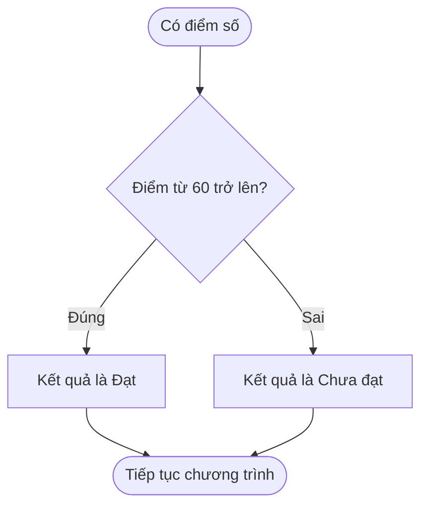
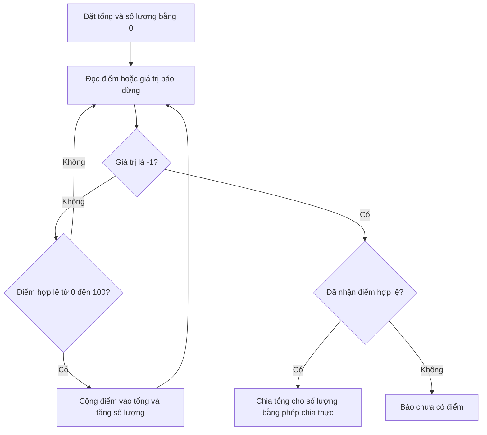
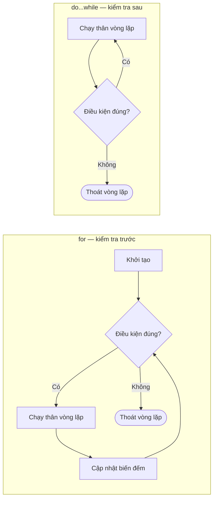

# Control Statement

Ghi chú tiếng Việt cho chương 3 và 4 của *Java for Programmers with Generative AI*, ấn bản 5, Paul Deitel và Harvey Deitel. [Bản PDF trên Google Drive](https://drive.google.com/file/d/1mUZMJUcLtwbPsG_KYHecBefNETR1M6_d/view?usp=drivesdk)

Java thực thi các câu lệnh **tuần tự** theo thứ tự viết. Câu lệnh **rẽ nhánh** chọn đoạn mã để chạy, còn câu lệnh **lặp** chạy lại một đoạn mã khi điều kiện tiếp tục còn đúng. Có thể đặt các cấu trúc này nối tiếp hoặc lồng vào nhau.

## Chương 3 — Rẽ nhánh và vòng lặp `while`

### Rẽ nhánh với `if` và `if...else` (§3.2–3.4)

- `if` chạy một khối khi điều kiện có giá trị `true`. `if...else` chọn một trong hai khối.
- Chuỗi `if...else if...else` kiểm tra từ trên xuống và chạy nhánh đầu tiên có điều kiện đúng. Khi xếp loại điểm bằng các ngưỡng `>=`, hãy đặt ngưỡng cao trước.
- `else` ghép với `if` gần nhất chưa có `else`. Dùng `{ }` để thể hiện rõ các khối, nhất là khi lồng nhiều điều kiện.
- Toán tử ba ngôi `?:` chọn **giá trị** cho một biểu thức. Ví dụ `String result = score >= 60 ? "Đạt" : "Chưa đạt";`.



### Hai cách điều khiển `while` (§3.5–3.8)

`while` kiểm tra điều kiện **trước** mỗi lượt, nên thân vòng lặp có thể chạy 0 lần. Với vòng lặp đếm, xác định rõ biến đếm, giá trị ban đầu, điều kiện tiếp tục và bước cập nhật.

| Cách điều khiển | Khi dùng | Ví dụ trong chương |
| --- | --- | --- |
| Biến đếm | Biết trước số lượt | Đọc đúng 10 điểm để tính trung bình |
| Giá trị báo dừng (*sentinel*) | Chưa biết số lượt, đầu vào có dấu hiệu kết thúc | Dùng `-1` để kết thúc nhập điểm trong miền `0..100` |

Giá trị báo dừng nằm ngoài miền dữ liệu hợp lệ và được kiểm tra trước khi cộng vào tổng. Khi nhận `-1` ngay lần đọc đầu, số điểm là 0. Kiểm tra số lượng trước khi tính trung bình và kiểm tra kiểu lẫn miền giá trị của dữ liệu nhập.



Ví dụ về **cấu trúc lồng nhau** (§3.8) dùng vòng lặp để đọc kết quả thi của 10 sinh viên. Một `if...else` bên trong tăng bộ đếm đỗ hoặc trượt. Sau vòng lặp, một `if` riêng kiểm tra số người đỗ có vượt 8 hay không.

### Phép toán và kiểu dữ liệu (§3.6–3.7, §3.9–3.12)

- **Chia số nguyên** bỏ phần lẻ về phía 0. `17 / 2` cho `8`, còn `(double) 17 / 2` cho `8.5`. Ép kiểu một toán hạng **trước** phép chia. Dùng `%.2f` với `printf` để hiển thị hai chữ số sau dấu thập phân.
- **Gán kết hợp** cập nhật biến tại chỗ. Với hai biến `int`, `total += grade` tương đương `total = total + grade`. Các phép thường gặp khác gồm `-=`, `*=`, `/=` và `%=`.
- **Tăng và giảm** có dạng tiền tố và hậu tố. Với `i = 3`, `++i` cho giá trị biểu thức là `4`, còn `i++` cho `3`. Nếu xét riêng từng biểu thức từ cùng giá trị ban đầu, cả hai đều để lại `i = 4`. Quy tắc tương tự áp dụng cho `--`.
- **Tám kiểu nguyên thủy** gồm `boolean`, `byte`, `short`, `int`, `long`, `char`, `float` và `double`. Đặc tả Java quy định phạm vi các kiểu số. Khi phép cộng `int` bị tràn, Java giữ 32 bit thấp của kết quả. Ví dụ `Integer.MAX_VALUE + 1` cho `Integer.MIN_VALUE`. [Đặc tả Java SE 23, §4.2.2](https://docs.oracle.com/javase/specs/jls/se23/html/jls-4.html#jls-4.2.2)
- **`BigInteger`** thuộc `java.math`, dùng cho số nguyên vượt phạm vi `long`. Có thể tạo giá trị từ chuỗi và dùng `add`, `subtract` hoặc `multiply` để nhận kết quả mới. Sách lấy số nguyên lớn trong mật mã làm ví dụ.

## Chương 4 — Vòng lặp, `switch` và điều kiện kết hợp

### `for` và `do...while` (§4.2–4.7)

| Cấu trúc | Thứ tự thực hiện | Trường hợp điển hình |
| --- | --- | --- |
| `for` | Khởi tạo một lần, sau đó kiểm tra, chạy thân, cập nhật và quay lại kiểm tra | Duyệt theo biến đếm hoặc bước nhảy |
| `while` | Kiểm tra trước, rồi chạy thân nếu đúng | Đọc dữ liệu đến khi gặp dấu hiệu kết thúc |
| `do...while` | Chạy thân trước, rồi kiểm tra để quyết định lặp tiếp | Thao tác cần thực hiện ít nhất một lần, chẳng hạn hiển thị menu |



Ví dụ §4.5 cộng các số chẵn từ 2 đến 20. Điều kiện `n <= 20` giữ lại mốc 20 và bước `n += 2` đi thẳng tới số chẵn tiếp theo.

```java
int sum = 0;
for (int n = 2; n <= 20; n += 2) {
    sum += n;
}
System.out.println(sum); // 110
```

Nên dùng kiểu số nguyên cho biến đếm để tránh sai số tích lũy. Cú pháp `do { ... } while (condition);` có dấu chấm phẩy ở cuối.

### `switch`, `break` và `continue` (§4.8–4.9)

- `switch` đối chiếu giá trị biểu thức với các nhãn `case`. Khi không có nhãn khớp, nó chạy `default` nếu có.
- Với dạng `case ...:` trong chương, luồng có thể chạy xuyên xuống nhánh tiếp theo (*fall-through*) nếu chưa gặp `break` hoặc cuối khối. Có thể tận dụng điều này để gom nhiều nhãn cho cùng một xử lý.
- Ví dụ của sách dùng `switch (grade / 10)` với điểm nguyên hợp lệ từ 0 đến 100. Hai nhãn `10` và `9` chung nhóm A, `8` là B, `7` là C, `6` là D và `default` là F. Vòng lặp đọc dữ liệu tới cuối luồng, còn `switch` tăng bộ đếm của nhóm tương ứng.
- `break` không nhãn thoát ngay khỏi vòng lặp hoặc `switch` bao gần nhất. Nếu `switch` nằm trong vòng lặp, `break` của nhánh thoát khỏi `switch` và vòng lặp vẫn có thể tiếp tục.
- `continue` không nhãn bỏ phần còn lại của lượt hiện tại trong vòng lặp gần nhất. Với `for`, luồng đến bước cập nhật rồi kiểm tra điều kiện. Với `while` và `do...while`, luồng đến bước kiểm tra điều kiện.

### Toán tử logic (§4.10)

| Toán tử | Ý nghĩa với toán hạng `boolean` | Cách đánh giá |
| --- | --- | --- |
| `!` | Phủ định | Đảo `true` và `false` |
| `&&` | Đúng khi cả hai cùng đúng | Bỏ qua vế phải nếu vế trái sai |
| `\|\|` | Đúng khi ít nhất một vế đúng | Bỏ qua vế phải nếu vế trái đúng |
| `&`, `\|` | AND và OR | Đánh giá cả hai vế |
| `^` | Đúng khi hai vế khác nhau | Đánh giá cả hai vế |

Ví dụ, trong `count > 0 && total / count >= 60`, Java bỏ qua phép chia khi `count` bằng 0. Nếu cần xét cả phần lẻ của trung bình, dùng `(double) total / count`.

### Lãi kép và `BigDecimal` (§4.6, §4.11)

Vòng `for` tính số dư mỗi năm theo công thức `vốn × (1 + lãi suất)^số năm`. Ví dụ đầu dùng `double` và `Math.pow`. Phần sau dùng `BigDecimal` từ chuỗi để giữ chính xác giá trị thập phân và chọn quy tắc làm tròn khi cần.

```java
import java.math.BigDecimal;
import java.math.RoundingMode;

class InterestExample {
    public static void main(String[] args) {
        BigDecimal principal = new BigDecimal("1000.00");
        BigDecimal rate = new BigDecimal("0.05");
        BigDecimal amount = principal.multiply(BigDecimal.ONE.add(rate).pow(3));

        System.out.println(amount); // 1157.62500000
        System.out.println(amount.setScale(2, RoundingMode.HALF_EVEN)); // 1157.62
    }
}
```

`HALF_EVEN` chọn chữ số chẵn cuối cùng khi giá trị nằm đúng giữa hai kết quả làm tròn. Ví dụ trên chỉ làm tròn lúc hiển thị. Trong bài toán tiền tệ, làm tròn từng khoản và làm tròn sau khi cộng tổng có thể cho hai kết quả khác nhau.

## Tự kiểm tra

1. Nếu nhập `-1` ngay từ đầu, vòng `while` tính điểm xử lý bao nhiêu điểm? **0 điểm và bỏ qua phép chia.**
2. Trong vòng `for`, sau khi gặp `continue`, bước nào chạy tiếp? **Cập nhật biến đếm, rồi kiểm tra điều kiện.**
3. Nếu thiếu `break` sau `case 8:` trong ví dụ xếp loại thì điểm 85 ảnh hưởng đến những bộ đếm nào? **Cả B và C, vì luồng chạy sang `case 7:` trước khi gặp `break`.**
