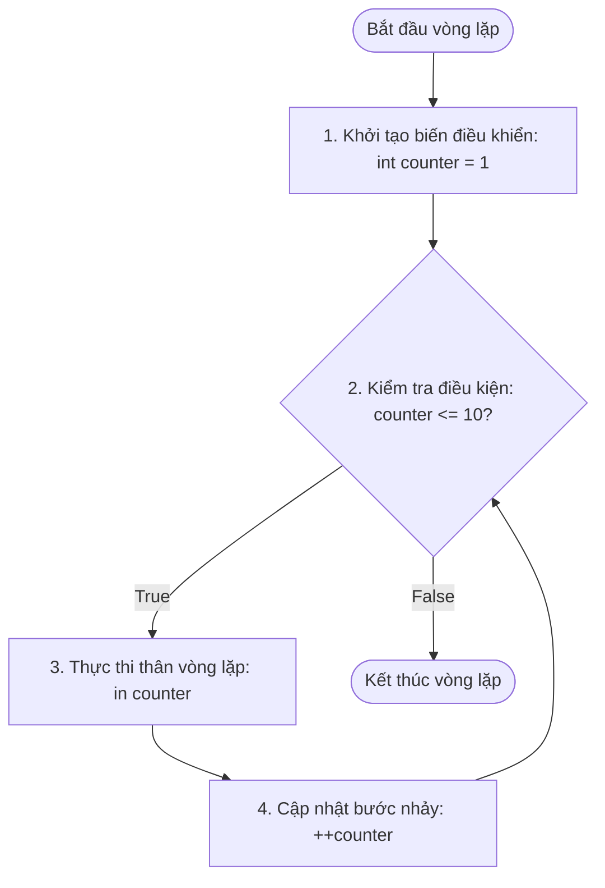
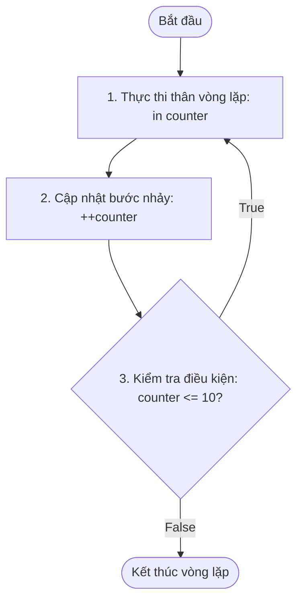
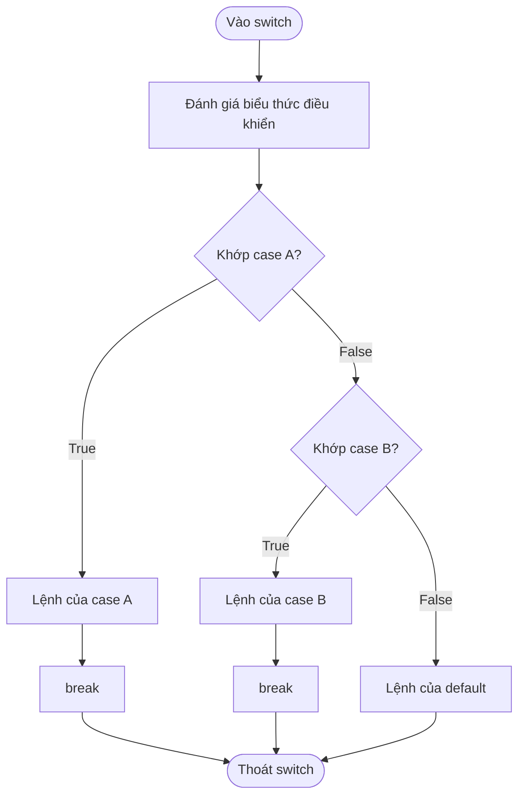

# GHI CHÚ BÀI GIẢNG: CHƯƠNG 4 – CONTROL STATEMENTS: PART 2
*(Nguồn tham chiếu: Giáo trình "Java for Programmers with Generative AI, 5th Edition" – Mục 4.1 đến 4.12)*

---

## 1. Mục tiêu học tập và kiến thức tiên quyết (Learning Objectives & Prerequisites)

### Mục tiêu học tập (Learning Objectives)
* **Vòng lặp đếm (Counter-controlled iteration):** Nắm vững cấu trúc và nguyên lý của vòng lặp `for` (Mục 4.2, 4.3).
* **Vòng lặp kiểm tra sau (Post-test iteration):** Sử dụng thành thạo câu lệnh lặp `do … while` cho các tác vụ cần thực thi ít nhất một lần (Mục 4.7).
* **Rẽ nhánh đa lựa chọn (Multiple selection):** Áp dụng câu lệnh `switch` truyền thống để kiểm tra nhiều giá trị rời rạc (Mục 4.8).
* **Điều khiển luồng cưỡng bức (Flow interruption):** Sử dụng câu lệnh `break` và `continue` để ngắt hoặc bỏ qua bước lặp (Mục 4.9).
* **Toán tử logic (Logical operators):** Tạo lập các điều kiện phức hợp với `&&`, `||`, `&`, `|`, `^`, `!` và hiểu cơ chế đánh giá ngắn mạch (*short-circuit evaluation*) (Mục 4.10).
* **Chuyên đề tính toán chính xác (Objects-Natural Case Study):** Hiểu rõ lỗi sai số biểu diễn của số thực (`float`/`double`) và làm chủ lớp `BigDecimal` cùng quy tắc làm tròn ngân hàng (*banker's rounding*) trong các ứng dụng tài chính (Mục 4.11).

### Kiến thức tiên quyết (Prerequisites)
* **Cú pháp Java cơ bản & Biến:** Kiểu dữ liệu nguyên thủy (`int`, `double`, `boolean`), khai báo biến, biểu thức số học và độ ưu tiên toán tử (Chương 2).
* **Cấu trúc điều khiển cơ bản (Chương 3):** Khái niệm luồng điều khiển (*flow of control*), câu lệnh rẽ nhánh đơn/đôi (`if`, `if … else`), toán tử điều kiện ba ngôi (`?:`) và vòng lặp `while`.

---

## 2. Các khái niệm quan trọng và định nghĩa chính xác (Key Concepts & Definitions)

1. **Lặp kiểm soát bằng biến đếm (Counter-Controlled Iteration / Definite Iteration):** Kỹ thuật lặp trong đó số lần thực thi được xác định trước. Gồm 4 thành phần thiết yếu:
   * *Biến điều khiển (Control variable/Loop counter)*.
   * *Giá trị khởi tạo (Initial value)*.
   * *Điều kiện tiếp tục vòng lặp (Loop-continuation condition)*.
   * *Bước tăng/giảm (Increment/Decrement)*.
2. **Câu lệnh lặp `for` (for Iteration Statement):** Cấu trúc lặp tích hợp cả 4 thành phần kiểm soát trên vào một dòng tiêu đề (*for header*), giúp mã nguồn súc tích và tránh sót bước tăng.
3. **Lỗi lệch một (Off-by-One Error):** Lỗi logic phổ biến khi vòng lặp thực hiện thừa hoặc thiếu đúng 1 lần lặp, thường do nhầm lẫn giữa toán tử quan hệ `<=` và `<` hoặc giá trị biên.
4. **Phạm vi của biến điều khiển (Scope of Control Variable):** Biến khai báo bên trong tiêu đề vòng lặp `for` chỉ tồn tại và được truy cập trong thân vòng lặp đó; biến sẽ bị hủy khi vòng lặp kết thúc.
5. **Câu lệnh lặp `do … while` (do…while Iteration Statement):** Cấu trúc lặp kiểm tra điều kiện sau (*post-test*). Thân vòng lặp luôn được thực thi ít nhất một lần trước khi kiểm tra điều kiện lặp.
6. **Câu lệnh `switch` đa lựa chọn (switch Multiple-Selection Statement):** Cấu trúc chọn một trong nhiều nhánh thực thi dựa trên giá trị của biểu thức điều khiển kiểu số nguyên (`byte`, `short`, `int`, `char`), `String` hoặc `enum`.
7. **Hiện tượng trôi nhánh (Fall-Through):** Trong `switch`, nếu một `case` khớp và không có lệnh `break`, chương trình sẽ tiếp tục thực thi các khối lệnh của các `case` tiếp theo cho đến khi gặp `break` hoặc hết cấu trúc `switch`.
8. **Đánh giá ngắn mạch (Short-Circuit Evaluation):** Cơ chế tối ưu hóa khi Java tính toán biểu thức logic:
   * Với `&&` (*Conditional AND*): Nếu toán hạng bên trái là `false`, toàn bộ biểu thức chắc chắn là `false`, Java dừng ngay và không đánh giá toán hạng bên phải.
   * Với `||` (*Conditional OR*): Nếu toán hạng bên trái là `true`, toàn bộ biểu thức chắc chắn là `true`, Java dừng ngay và không đánh giá toán hạng bên phải.
9. **Lỗi sai số biểu diễn (Representational Error):** Máy tính lưu trữ số thực dấu phẩy động (`float`, `double`) dưới dạng nhị phân với số bit hữu hạn, do đó một số giá trị thập phân (như `0.1` hay `123.02`) chỉ là xấp xỉ chứ không chính xác tuyệt đối.
10. **Làm tròn ngân hàng (Banker's Rounding / Round-Half-to-Even):** Thuật toán làm tròn giúp triệt tiêu độ lệch thống kê: khi chữ số cần bỏ bằng 5, làm tròn về số chẵn gần nhất (ví dụ: `1157.625` làm tròn thành `1157.62`, nhưng `1157.635` làm tròn thành `1157.64`).

---

## 3. Giải thích nguyên lý hoạt động từng bước (Step-by-Step Mechanics)

### A. Nguyên lý vòng lặp `for`
*Cú pháp chuẩn:*
```java
for (initialization; loopContinuationCondition; increment) {
    statement(s)
}
```
* **Bước 1 (Khởi tạo - Initialization):** Biến điều khiển được khai báo và gán giá trị ban đầu. Bước này chỉ chạy **duy nhất 1 lần** khi bắt đầu vòng lặp.
* **Bước 2 (Kiểm tra điều kiện - Condition Check):** Đánh giá `loopContinuationCondition`. Nếu kết quả là `false`, vòng lặp kết thúc ngay lập tức; điều khiển chuyển tới lệnh kế tiếp sau vòng lặp. Nếu là `true`, chuyển sang Bước 3.
* **Bước 3 (Thực thi - Body Execution):** Toàn bộ các câu lệnh trong thân vòng lặp được thực thi.
* **Bước 4 (Cập nhật bước nhảy - Increment/Decrement):** Thực hiện biểu thức thay đổi giá trị biến điều khiển (ví dụ: `++counter`, `i += 2`).
* **Bước 5 (Lặp lại):** Quay lại Bước 2 để kiểm tra điều kiện.

### B. Nguyên lý vòng lặp `do … while`
*Cú pháp chuẩn:*
```java
do {
    statement(s)
} while (loopContinuationCondition);
```
* **Bước 1:** Trực tiếp thực thi khối lệnh trong thân `do` (không kiểm tra điều kiện trước).
* **Bước 2:** Đánh giá biểu thức `loopContinuationCondition` nằm sau từ khóa `while`.
* **Bước 3:** Nếu điều kiện là `true`, quay lại Bước 1. Nếu là `false`, kết thúc vòng lặp và tiếp tục lệnh kế tiếp trong chương trình.

### C. Nguyên lý cấu trúc `switch` truyền thống
* **Bước 1:** Đánh giá biểu thức điều khiển (*controlling expression*) trong ngoặc đơn sau `switch`.
* **Bước 2:** So sánh giá trị vừa tính với giá trị hằng số ở từng nhãn `case` theo thứ tự từ trên xuống dưới.
* **Bước 3:** Khi tìm thấy `case` khớp, thực thi các câu lệnh thuộc `case` đó.
* **Bước 4:** Nếu gặp lệnh `break`, thoát khỏi khối `switch` ngay lập tức. Nếu không có `break`, tiếp tục thực thi các lệnh của `case` liền kề bên dưới (*fall-through*) bất kể giá trị có khớp hay không.
* **Bước 5:** Nếu không có `case` nào khớp, khối `default` sẽ được thực thi (nếu được khai báo).

---

## 4. Thuật toán, kiến trúc, bảng và sơ đồ quan trọng (UML & Flowcharts)

### Sơ đồ luồng hoạt động (Activity Diagrams)

#### 1. Luồng thực thi vòng lặp `for`


#### 2. Luồng thực thi vòng lặp `do … while`


#### 3. Luồng thực thi cấu trúc `switch` với `break`


---

### Bảng chân trị toán tử logic (Truth Tables)

| Biểu thức 1 (`exp1`) | Biểu thức 2 (`exp2`) | AND điều kiện (`&&`) | OR điều kiện (`\|\|`) | XOR logic (`^`) | Phủ định `!exp1` |
| :---: | :---: | :---: | :---: | :---: | :---: |
| `false` | `false` | `false` | `false` | `false` | `true` |
| `false` | `true` | `false` | `true` | `true` | `true` |
| `true` | `false` | `false` | `true` | `true` | `false` |
| `true` | `true` | `true` | `true` | `false` | `false` |

*Ghi chú về toán tử `&` và `|`:* Giống hệt bảng chân trị của `&&` và `||`, nhưng luôn bắt buộc đánh giá cả 2 vế (không ngắn mạch).

---

## 5. Ví dụ mã nguồn từ giáo trình và giải thích chi tiết (Source Code Examples)

### Ví dụ 1: Tính lãi kép với `for` và `Math.pow` (Fig. 4.4 – `Interest.java`)
Mục 4.6 giải bài toán: Gửi tiết kiệm $1,000 với lãi suất 5%/năm trong 10 năm theo công thức $a = p(1 + r)^n$.

```java
// Fig. 4.4: Interest.java
// Compound-interest calculations with for.
public class Interest {
   public static void main(String[] args) {
      double principal = 1000.00; // Tiền gốc ban đầu
      double rate = 0.05;         // Lãi suất hàng năm (5%)

      // In tiêu đề các cột với định dạng căn lề
      System.out.printf("%s%20s%n", "Year", "Amount on deposit");

      // Vòng lặp tính toán số dư cho từng năm từ 1 đến 10
      for (int year = 1; year <= 10; ++year) {
         // Tính toán số dư mới bằng phương thức tĩnh Math.pow
         double amount = principal * Math.pow(1.0 + rate, year);

         // Hiển thị năm và số dư (định dạng dấu phẩy phân tách và 2 chữ số thập phân)
         System.out.printf("%4d%,20.2f%n", year, amount);
      }
   }
}
```

* **Giải thích từng phần:**
  * `Math.pow(1.0 + rate, year)`: Gọi phương thức `static` `pow` thuộc lớp `Math` (gói `java.lang`) để tính $(1.0 + rate)^{year}$.
  * `%20s`: Định dạng chuỗi hiển thị trong độ rộng trường (*field width*) tối thiểu là 20 ký tự, mặc định căn phải.
  * `%,20.2f`: Cờ `,` (*comma flag*) dùng dấu phẩy phân tách hàng nghìn theo chuẩn ngôn ngữ/quốc gia; `.2` làm tròn số thực đến 2 chữ số thập phân.
* **Kết quả chạy thực tế (Live Output):**
```text
Year   Amount on deposit
   1            1,050.00
   2            1,102.50
   3            1,157.63
   4            1,215.51
   5            1,276.28
   6            1,340.10
   7            1,407.10
   8            1,477.46
   9            1,551.33
  10            1,628.89
```

---

### Ví dụ 2: Đếm điểm chữ bằng `switch` (Fig. 4.6 – `LetterGrades.java`)
Mục 4.8 minh họa việc đọc điểm từ bàn phím cho đến ký tự kết thúc tệp (*End-Of-File - EOF*) và dùng `switch` để phân loại.

```java
// Fig. 4.6: LetterGrades.java
// LetterGrades class uses the switch statement to count letter grades.
import java.util.Scanner;

public class LetterGrades {
   public static void main(String[] args) {
      int total = 0;          // Tổng điểm
      int gradeCounter = 0;   // Số lượng điểm nhập vào
      int aCount = 0;         // Đếm số điểm A
      int bCount = 0;         // Đếm số điểm B
      int cCount = 0;         // Đếm số điểm C
      int dCount = 0;         // Đếm số điểm D
      int fCount = 0;         // Đếm số điểm F

      Scanner input = new Scanner(System.in);

      // Sử dụng tính năng Text Block """...""" để in hướng dẫn nhiều dòng
      System.out.println("""
         Enter the integer grades in the range 0-100.
         Enter the end-of-file indicator to terminate input:
            On macOS/Linux enter <Ctrl> d then press Enter
            On Windows enter <Ctrl> z then press Enter""");

      // Vòng lặp tiếp tục cho đến khi người dùng nhập EOF (Ctrl+D hoặc Ctrl+Z)
      while (input.hasNext()) {
         int grade = input.nextInt(); 
         total += grade;              
         ++gradeCounter;              

         // Rẽ nhánh dựa trên kết quả chia nguyên cho 10
         switch (grade / 10) {
            case 10: // Điểm 90-100 là A
            case 9:
               ++aCount;
               break; // Thoát switch
            case 8:  // Điểm 80-89 là B
               ++bCount;
               break;
            case 7:  // Điểm 70-79 là C
               ++cCount;
               break;
            case 6:  // Điểm 60-69 là D
               ++dCount;
               break;
            default: // Điểm dưới 60 là F
               ++fCount;
               break; 
         }
      }

      // Hiển thị báo cáo kết quả
      System.out.printf("%nGrade Report:%n");
      if (gradeCounter != 0) {
         double average = (double) total / gradeCounter;

         System.out.printf("Total of the %d grades entered is %d%n", gradeCounter, total);
         System.out.printf("Class average is %.2f%n", average);
         System.out.printf("%n%s%n%s%d%n%s%d%n%s%d%n%s%d%n%s%d%n",
            "Number of students who received each grade:",
            "A: ", aCount,
            "B: ", bCount,
            "C: ", cCount,
            "D: ", dCount,
            "F: ", fCount);
      }
      else {
         System.out.println("No grades were entered");
      }
   }
}
```

* **Giải thích từng phần:**
  * `input.hasNext()`: Kiểm tra xem còn dữ liệu trong luồng nhập chuẩn hay không; trả về `false` khi người dùng nhập tín hiệu EOF (`<Ctrl>+z` trên Windows hoặc `<Ctrl>+d` trên Linux/macOS).
  * `switch (grade / 10)`: Biểu thức điều khiển thực hiện phép chia nguyên, biến đổi dải điểm `0..100` thành các giá trị nguyên `0..10`.
  * `case 10:` xếp liền kề `case 9:` không có lệnh xen giữa để gộp chung logic xử lý cho điểm A.
  * `break;`: Ngăn chặn rơi tự do sang `case` kế tiếp.
* **Kết quả chạy thực tế (Live Output):**
```text
Enter the integer grades in the range 0-100.
Enter the end-of-file indicator to terminate input:
   On macOS/Linux enter <Ctrl> d then press Enter
   On Windows enter <Ctrl> z then press Enter
99
92
45
57
63
71
76
85
90
100
^Z

Grade Report:
Total of the 10 grades entered is 778
Class average is 77.80

Number of students who received each grade:
A: 4
B: 1
C: 2
D: 1
F: 2
```

---

### Ví dụ 3: Tính toán tài chính chuẩn xác với `BigDecimal` (Fig. 4.10 – `BigDecimalInterest.java`)
Mục 4.11 viết lại bài toán lãi kép nhằm giải quyết triệt để lỗi sai số dấu phẩy động và làm tròn ngân hàng.

```java
// Fig. 4.10: BigDecimalInterest.java
// Compound-interest example with BigDecimal objects.
import java.math.BigDecimal;
import java.math.RoundingMode;

public class BigDecimalInterest {
   public static void main(String[] args) {
      // Khởi tạo các đối tượng BigDecimal bằng chuỗi ký tự (String)
      BigDecimal principal = new BigDecimal("1000.00");
      BigDecimal rate = new BigDecimal("0.05");

      System.out.printf("Initial principal: %7s%n", principal);
      System.out.printf("    Interest rate: %7s%n", rate);

      System.out.printf("%s%17s %s%n", "Year", "Rounded Amount", "Precise Stored Amount");

      for (int year = 1; year <= 10; ++year) {
         // Tính toán: principal * (1 + rate)^year
         BigDecimal amount = principal.multiply(
            BigDecimal.ONE.add(rate).pow(year));

         // In giá trị làm tròn bằng RoundingMode.HALF_EVEN và giá trị chính xác chưa làm tròn
         System.out.printf("%4d%17s %s%n", year,
            amount.setScale(2, RoundingMode.HALF_EVEN), amount);
      }
   }
}
```

* **Giải thích từng phần:**
  * `new BigDecimal("1000.00")`: Phải dùng chuỗi ký tự để tránh lỗi biểu diễn dấu phẩy động của số thực nhị phân.
  * `BigDecimal.ONE.add(rate).pow(year)`: Sử dụng hằng số có sẵn `BigDecimal.ONE` (giá trị 1) cộng với `rate`, sau đó gọi `.pow(year)` với tham số nguyên.
  * `principal.multiply(...)`: Nhân đối tượng gốc với hệ số lũy thừa.
  * `amount.setScale(2, RoundingMode.HALF_EVEN)`: Đặt độ chính xác hiển thị là 2 chữ số thập phân và áp dụng giải thuật làm tròn chẵn lẻ (*Banker's rounding*).
* **So sánh đầu ra năm thứ 3:**
  * Ở Fig. 4.4 (dùng `double`): hiển thị `1,157.63` (làm tròn lên do sai số hoặc thuật toán half-up).
  * Ở Fig. 4.10 (dùng `BigDecimal`): giá trị lưu trữ chính xác là `1157.62500000`. Theo cơ chế làm tròn về số chẵn gần nhất, chữ số kế trước là 2 (chẵn) nên làm tròn xuống thành `1157.62`.

---

## 6. Các lỗi phổ biến và cách phòng tránh (Common Programming Errors)

1. **Lỗi lệch một (Off-by-One Error) trong điều kiện lặp:**
   * *Nguyên nhân:* Nhầm lẫn giữa `<=` và `<`. Ví dụ muốn lặp 10 lần nhưng viết `counter < 10` (chỉ lặp 9 lần).
   * *Cách tránh:* Luôn kiểm tra kỹ giá trị khởi tạo và giá trị biên cuối cùng của biến đếm.
2. **Đặt dấu chấm phẩy ngay sau tiêu đề vòng lặp:**
   * *Nguyên nhân:* Viết `for (int i = 0; i < 10; ++i);`. Dấu `;` tạo ra một câu lệnh rỗng (*empty statement*), khiến khối mã lệnh bên dưới chỉ thực thi đúng 1 lần sau khi vòng lặp đã chạy xong.
   * *Cách tránh:* Không bao giờ đặt dấu `;` ngay sau dấu ngoặc đơn đóng của tiêu đề `for` hoặc `while`.
3. **Vòng lặp vô tận (Infinite Loop) do bước nhảy không hợp lệ:**
   * *Nguyên nhân:* Dùng toán tử `!=` với bước nhảy lớn hơn 1 (ví dụ: `counter = 1; counter != 10; counter += 2;`). Giá trị `counter` sẽ nhảy qua 9 lên 11 và không bao giờ bằng 10.
   * *Cách tránh:* Luôn ưu tiên dùng toán tử quan hệ `<=` hoặc `>=` trong điều kiện tiếp tục vòng lặp.
4. **Quên câu lệnh `break` trong cấu trúc `switch`:**
   * *Nguyên nhân:* Bỏ sót `break` làm luồng chương trình rơi tự do (*fall-through*) xuống các `case` bên dưới.
   * *Cách tránh:* Luôn kết thúc mỗi nhánh `case` bằng lệnh `break` (trừ trường hợp chủ ý gom nhóm nhiều `case` có cùng hành vi).
5. **Dùng kiểu số thực (`double`, `float`) để tính toán tiền tệ:**
   * *Nguyên nhân:* Hiểu nhầm số thực dấu phẩy động biểu diễn tuyệt đối. Thực tế sẽ sinh ra các số lẻ như `14.234 + 18.673 = 32.907` (làm tròn thành `32.91` thay vì `32.90` như con người kỳ vọng).
   * *Cách tránh:* Luôn sử dụng lớp `BigDecimal` (gói `java.math`) cho các bài toán thương mại, tài chính, kế toán.
6. **Khởi tạo `BigDecimal` bằng giá trị `double`:**
   * *Nguyên nhân:* Viết `new BigDecimal(123.02)` sẽ lưu giá trị nội bộ là `123.01999999999999602...`.
   * *Cách tránh:* Luôn khởi tạo `BigDecimal` bằng chuỗi: `new BigDecimal("123.02")` hoặc dùng `BigDecimal.valueOf(123.02)`.

---

## 7. So sánh các cấu trúc và phương pháp liên quan (Comparative Analysis)

### A. So sánh các cấu trúc lặp: `for` vs `while` vs `do … while`

| Tiêu chí so sánh | `for` | `while` | `do … while` |
| :--- | :--- | :--- | :--- |
| **Vị trí kiểm tra điều kiện** | Trước khi vào thân (*Pre-test*) | Trước khi vào thân (*Pre-test*) | Sau khi chạy xong thân (*Post-test*) |
| **Số lần lặp tối thiểu** | 0 lần | 0 lần | **1 lần** |
| **Ngữ cảnh sử dụng tối ưu** | Lặp đếm xác định (*Definite iteration*) | Lặp biến canh, không rõ số lần (*Sentinel-controlled*) | Thực thi tác vụ cần hiển thị trước (menu console, nhập kiểm tra dữ liệu) |
| **Phạm vi biến điều khiển** | Cục bộ trong vòng lặp (nếu khai báo ở tiêu đề) | Thường khai báo trước vòng lặp | Khai báo trước vòng lặp |

### B. So sánh `if … else` lồng nhau vs `switch`

| Tiêu chí | `if … else` lồng nhau | `switch` truyền thống |
| :--- | :--- | :--- |
| **Kiểu điều kiện** | Kiểm tra biểu thức logic bất kỳ (dải giá trị, điều kiện phức hợp với `&&`, `||`) | Chỉ so sánh bằng (`==`) với các hằng số nguyên, ký tự, chuỗi hoặc `enum` |
| **Khả năng kiểm tra dải giá trị** | Tự nhiên và linh hoạt (`grade >= 90`) | Không hỗ trợ trực tiếp, phải quy đổi (như `grade / 10`) |
| **Độ trong sáng của mã** | Dễ bị rối nếu lồng quá sâu | Rõ ràng, trực quan khi ánh xạ các giá trị rời rạc |

### C. So sánh `double` vs `BigDecimal`

| Tiêu chí | Kiểu nguyên thủy `double` | Lớp đối tượng `BigDecimal` |
| :--- | :--- | :--- |
| **Bản chất lưu trữ** | Kiểu nguyên thủy (64-bit nhị phân IEEE 754) | Đối tượng tham chiếu (độ chính xác tùy ý trong bộ nhớ) |
| **Độ chính xác** | Xấp xỉ, có sai số biểu diễn | **Tuyệt đối chính xác** theo từng chữ số |
| **Hiệu năng & Bộ nhớ** | Cực nhanh, tốn ít bộ nhớ | Chậm hơn, tốn nhiều bộ nhớ hơn |
| **Toán tử tính toán** | Dùng toán tử số học thông thường (`+`, `-`, `*`, `/`) | Phải gọi phương thức (`.add()`, `.multiply()`, v.v.) |
| **Ứng dụng phù hợp** | Đồ họa, mô phỏng khoa học, game | Kế toán, ngân hàng, thương mại điện tử |

---

## 8. 10 Câu hỏi ôn tập kèm đáp án chi tiết (Review Questions & Answers)

**Câu 1:** Bốn thành phần cốt lõi của một vòng lặp kiểm soát bằng biến đếm (*counter-controlled iteration*) là gì?  
*Đáp án:* 1) Biến điều khiển; 2) Giá trị khởi tạo; 3) Bước tăng/giảm; 4) Điều kiện tiếp tục vòng lặp.

**Câu 2:** Sự khác biệt cốt lõi nhất giữa vòng lặp `while` và vòng lặp `do … while` là gì?  
*Đáp án:* `while` kiểm tra điều kiện trước khi thực thi thân vòng lặp (có thể không chạy lần nào), trong khi `do … while` kiểm tra điều kiện sau khi thực thi thân (chắc chắn chạy ít nhất một lần).

**Câu 3:** Hiện tượng *Off-by-one error* xảy ra khi nào? Nêu ví dụ.  
*Đáp án:* Xảy ra khi vòng lặp lặp thừa hoặc thiếu 1 lần do dùng sai toán tử so sánh hoặc giá trị chặn cuối. Ví dụ: cần lặp từ 1 đến 10 nhưng điều kiện viết `counter < 10` thay vì `counter <= 10`.

**Câu 4:** Biến khai báo trong tiêu đề của vòng lặp `for (int i = 0; ...)` có phạm vi (*scope*) như thế nào?  
*Đáp án:* Phạm vi của nó bị giới hạn chỉ bên trong thân của vòng lặp `for`. Bên ngoài vòng lặp, biến này không tồn tại.

**Câu 5:** Điều gì sẽ xảy ra nếu một vòng lặp `for` bị bỏ trống biểu thức điều kiện: `for (int i = 1; ; ++i)`?  
*Đáp án:* Java mặc định coi điều kiện lặp luôn luôn là `true`, tạo thành một vòng lặp vô tận (*infinite loop*).

**Câu 6:** Hiện tượng trôi nhánh (*fall-through*) trong câu lệnh `switch` là gì? Làm thế nào để ngăn chặn?  
*Đáp án:* Là hiện tượng khi một `case` khớp lệnh, nếu không có lệnh `break`, chương trình sẽ tiếp tục thực thi các lệnh của tất cả các `case` bên dưới. Ngăn chặn bằng cách đặt câu lệnh `break;` ở cuối mỗi khối `case`.

**Câu 7:** Biểu thức điều khiển của cấu trúc `switch` truyền thống trong Java chấp nhận những kiểu dữ liệu nào?  
*Đáp án:* Các kiểu số nguyên nguyên thủy (`byte`, `short`, `int`, `char` - nhưng **không** hỗ trợ `long`), đối tượng chuỗi ký tự `String`, và kiểu liệt kê `enum`.

**Câu 8:** Nêu sự khác nhau giữa lệnh `break` và lệnh `continue` khi được đặt trong thân vòng lặp.  
*Đáp án:* `break` ngắt và thoát hẳn khỏi cấu trúc lặp hiện tại; `continue` bỏ qua phần còn lại của thân vòng lặp trong lần lặp đó và chuyển ngay tới bước cập nhật/kiểm tra để bắt đầu lần lặp tiếp theo.

**Câu 9:** Thế nào là cơ chế đánh giá ngắn mạch (*short-circuit evaluation*) của toán tử `&&` và `||`?  
*Đáp án:* Java chỉ đánh giá vế phải khi chưa thể xác định được kết quả từ vế trái. Nếu vế trái của `&&` là `false` hoặc vế trái của `||` là `true`, vế phải sẽ bị bỏ qua hoàn toàn.

**Câu 10:** Tại sao các ứng dụng tài chính ngân hàng tuyệt đối không được dùng kiểu `double` mà phải dùng `BigDecimal`?  
*Đáp án:* Kiểu `double` là số thực dấu phẩy động nhị phân gây ra sai số biểu diễn không thể triệt tiêu. `BigDecimal` lưu trữ số học thập phân chính xác tuyệt đối từng chữ số và hỗ trợ các giải thuật làm tròn khắt khe như Banker's Rounding.

---

## 9. 5 Bài tập thực hành tăng dần độ khó (Practice Exercises)

### Bài tập 1: Cơ bản – Bảng cửu chương (Vòng lặp `for`)
* **Mô tả:** Viết chương trình nhập vào một số nguyên dương $N$ ($1 \le N \le 9$). Sử dụng vòng lặp `for` để in ra bảng cửu chương của $N$.
* **Gợi ý:** Tiêu đề `for (int i = 1; i <= 10; ++i)` và in theo định dạng `%d x %d = %d%n`.

### Bài tập 2: Cơ bản – Kiểm tra dữ liệu đầu vào (Vòng lặp `do … while`)
* **Mô tả:** Viết chương trình yêu cầu người dùng nhập điểm môn học (từ 0 đến 100). Nếu người dùng nhập sai, dùng vòng lặp `do … while` buộc người dùng phải nhập lại cho đến khi hợp lệ mới in ra thông báo thành công.
* **Gợi ý:** Điều kiện lặp lại của `while` là `score < 0 || score > 100`.

### Bài tập 3: Trung bình – Menu điều khiển máy rút tiền đơn giản (`switch` & `while`)
* **Mô tả:** Tạo một menu tương tác trên console gồm: 
  1. Tra cứu số dư; 2. Nạp tiền; 3. Rút tiền; 4. Thoát.
  Dùng vòng lặp kiểm tra lựa chọn, sử dụng cấu trúc `switch` để xử lý từng tính năng và lệnh `break` để thoát chương trình khi chọn 4.

### Bài tập 4: Nâng cao – Lọc số nguyên tố kết hợp điều khiển luồng (`for`, `break`, `continue`)
* **Mô tả:** In ra tất cả các số nguyên tố trong khoảng từ 2 đến 100.
* **Gợi ý:** Sử dụng 2 vòng lặp `for` lồng nhau. Vòng ngoài duyệt qua từng số, vòng trong kiểm tra ước số. Nếu tìm thấy một ước số bất kỳ, lập tức dùng `break` để ngắt vòng trong nhằm tối ưu hóa hiệu năng.

### Bài tập 5: Chuyên sâu – Tính lãi suất tiết kiệm kỳ hạn bậc thang (`BigDecimal`)
* **Mô tả:** Một khách hàng gửi vào ngân hàng 500,000,000 VNĐ. Nếu gửi từ năm 1-3 lãi suất 5.5%/năm, năm 4-5 lãi suất 6.2%/năm, từ năm 6-10 lãi suất 7.0%/năm. 
  Viết chương trình dùng `BigDecimal` và vòng lặp `for` (10 năm) để in ra số dư cuối từng năm với làm tròn `RoundingMode.HALF_EVEN`.

---

## 10. Mini Project: Hệ thống Mô phỏng Sổ Tiết kiệm & Tín dụng Cá nhân (Personal Savings & Credit Interest Simulator)

### Kịch bản bài toán (Specifications)
Hệ thống cho phép người dùng:
1. Thiết lập số tiền gửi ban đầu và thời gian gửi (theo năm).
2. Mô phỏng bảng dự toán lãi kép hàng năm với lãi suất cố định, làm tròn tiền tệ theo chuẩn ngân hàng (*Banker's rounding*).
3. Áp dụng chính sách khuyến mại: Nếu gửi từ 5 năm trở lên **VÀ** số tiền từ 100 triệu trở lên, cộng thêm 0.5% lãi suất ưu đãi mỗi năm.

### Mã nguồn hoàn chỉnh (Full Live Code)

```java
import java.math.BigDecimal;
import java.math.RoundingMode;
import java.util.Scanner;

public class PersonalFinanceApp {
   public static void main(String[] args) {
      Scanner scanner = new Scanner(System.in);
      int choice;

      // Vòng lặp do...while duy trì Menu điều khiển cho đến khi người dùng chọn Thoát
      do {
         System.out.println("""
            ==================================================
                 HỆ THỐNG QUẢN LÝ TÀI CHÍNH CÁ NHÂN (DEITEL CH4)
            ==================================================
            1. Mô phỏng Sổ tiết kiệm Lãi kép (BigDecimal)
            2. Kiểm tra điều kiện Gói vay Tín dụng (Toán tử Logic)
            3. Thoát chương trình
            Vui lòng chọn chức năng (1-3):""");

         choice = scanner.nextInt();

         switch (choice) {
            case 1:
               System.out.print("Nhập số tiền gửi ban đầu (VNĐ): ");
               String principalStr = scanner.next();
               System.out.print("Nhập lãi suất cơ bản hàng năm (ví dụ 0.06 cho 6%): ");
               String rateStr = scanner.next();
               System.out.print("Nhập số năm gửi tiết kiệm: ");
               int years = scanner.nextInt();

               BigDecimal principal = new BigDecimal(principalStr);
               BigDecimal rate = new BigDecimal(rateStr);
               BigDecimal bonusRate = new BigDecimal("0.005"); // Thưởng 0.5%
               BigDecimal threshold = new BigDecimal("100000000.00"); // 100 triệu

               // Kiểm tra điều kiện hưởng ưu đãi bằng toán tử logic điều kiện &&
               if ((years >= 5) && (principal.compareTo(threshold) >= 0)) {
                  rate = rate.add(bonusRate);
                  System.out.println(">> Đủ điều kiện nhận Ưu đãi VIP: Cộng thêm 0.5% lãi suất/năm!");
               }

               System.out.printf("%nLãi suất áp dụng: %s%n", rate);
               System.out.printf("%s%25s %30s%n", "Năm", "Số dư làm tròn (VNĐ)", "Số dư chính xác");

               // Vòng lặp for tính toán số dư từng năm
               for (int year = 1; year <= years; ++year) {
                  // Công thức: principal * (1 + rate)^year
                  BigDecimal totalAmount = principal.multiply(
                     BigDecimal.ONE.add(rate).pow(year));

                  // Làm tròn ngân hàng (HALF_EVEN) đến 2 chữ số thập phân
                  BigDecimal rounded = totalAmount.setScale(2, RoundingMode.HALF_EVEN);
                  System.out.printf("%4d%,25.2f %30s%n", year, rounded, totalAmount);
               }
               System.out.println();
               break;

            case 2:
               System.out.print("Nhập độ tuổi của bạn: ");
               int age = scanner.nextInt();
               System.out.print("Nhập thu nhập hàng tháng (triệu VNĐ): ");
               double income = scanner.nextDouble();
               System.out.print("Có nợ xấu ngân hàng không? (true/false): ");
               boolean hasBadCredit = scanner.nextBoolean();

               // Đánh giá điều kiện phức hợp với ngắn mạch
               if (!hasBadCredit && (age >= 22 && age <= 60) && (income >= 15.0)) {
                  System.out.println(">> KẾT QUẢ: Bạn ĐỦ ĐIỀU KIỆN xét duyệt gói vay tín chấp tiêu chuẩn.");
               } else {
                  System.out.println(">> KẾT QUẢ: Rất tiếc, hồ sơ KHÔNG THỎA MÃN các tiêu chí tín dụng.");
               }
               System.out.println();
               break;

            case 3:
               System.out.println("Cảm ơn bạn đã sử dụng hệ thống!");
               break;

            default:
               System.out.println("Lựa chọn không hợp lệ. Vui lòng nhập lại (1 - 3).\n");
               break;
         }
      } while (choice != 3);
   }
}
```
