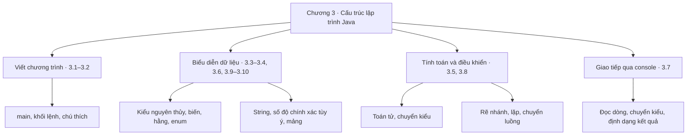
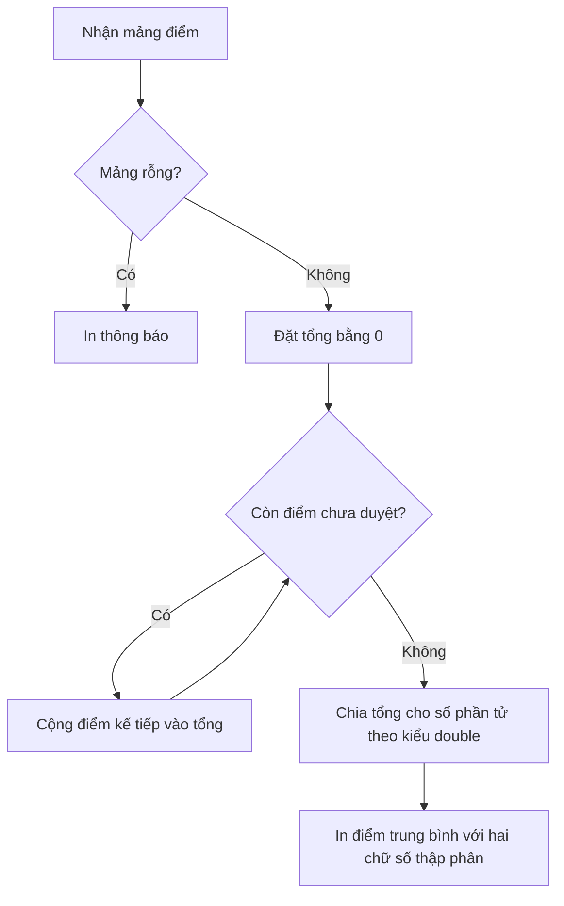

# Chương 3 — Cấu trúc lập trình cơ bản trong Java

Tóm tắt chương **Fundamental Programming Structures in Java** của Cay S. Horstmann. Các ví dụ dùng cú pháp Java 25 theo ấn bản 14. [Core Java, Volume I: Fundamentals, ấn bản 14, chương 3](https://drive.google.com/file/d/11yYRkppN12CR5WpKGiPQ3CDo_WjL3HvN/view)

## Bản đồ chương



## 3.1–3.2 · Chương trình đầu tiên và chú thích

Chương trình bắt đầu ở phương thức `main`. Java phân biệt chữ hoa và chữ thường. Dấu `{ }` gom các câu lệnh thành một khối, còn dấu `;` kết thúc nhiều loại câu lệnh, chẳng hạn lời gọi phương thức và phép gán.

```java
void main() {
    IO.println("Xin chào, Java!");
}
```

Lưu ví dụ thành `Hello.java` và chạy `java Hello.java` với JDK 25. Java 25 cho phép viết tệp nguồn gọn với lớp được khai báo ngầm. Dạng truyền thống dùng lớp khai báo tường minh, `public static void main(String[] args)` và `System.out.println`.

| Chú thích | Công dụng |
| --- | --- |
| `// ...` | Ghi chú đến hết dòng |
| `/* ... */` | Ghi chú một đoạn, có thể trải nhiều dòng |
| `/** ... */` | Chú thích tài liệu cho công cụ Javadoc |

## 3.3–3.4 · Kiểu dữ liệu, biến và hằng

| Nhóm | Kiểu nguyên thủy | Điểm cần nhớ |
| --- | --- | --- |
| Số nguyên có dấu | `byte`, `short`, `int`, `long` | Lần lượt 8, 16, 32 và 64 bit. Số nguyên viết trực tiếp có thể dùng hậu tố `L` để chỉ kiểu `long`. |
| Số dấu phẩy động | `float`, `double` | Lần lượt 32 và 64 bit. Literal như `3.14` mặc định là `double`, còn `3.14F` là `float`. Các phép tính có thể sinh sai số làm tròn. |
| Đơn vị mã UTF-16 | `char` | Một `char` có 16 bit. Một số điểm mã Unicode, chẳng hạn nhiều emoji, cần hai đơn vị mã. |
| Logic | `boolean` | Chỉ có `true` và `false`. Điều kiện trong `if` và vòng lặp phải cho giá trị logic. |

- **Biến cục bộ** cần được gán giá trị trước khi đọc. Có thể khai báo kiểu rõ ràng như `int count = 0;` hoặc dùng `var count = 0;` để trình biên dịch suy ra kiểu từ giá trị khởi tạo.
- **Hằng** dùng `final` để chỉ cho phép gán một lần. Hằng dùng chung ở cấp lớp thường khai báo bằng `static final`.
- **Kiểu liệt kê** giới hạn tập giá trị có thể chọn. Với `enum Level { LOW, MEDIUM, HIGH }`, một biến `Level` có thể nhận hằng `Level.HIGH`.

## 3.5 · Toán tử và chuyển kiểu

- **Số học.** Hai toán hạng nguyên cho kết quả chia nguyên, nên `7 / 2` cho `3`, `7 % 2` cho `1`, còn `7 / 2.0` cho `3.5`. Lớp `Math` cung cấp các hàm và hằng như `Math.sqrt`, `Math.round` và `Math.PI`.
- **Chuyển kiểu.** Java tự chuyển nhiều kiểu số trong biểu thức. Một số phép chuyển mở rộng như `long` sang `double` vẫn có thể mất độ chính xác. Ép `(int) 3.9` cho `3` vì phần lẻ bị cắt về phía 0. Phép gán gộp như `n += 1` cập nhật giá trị. `++n` cho giá trị sau khi tăng, còn `n++` cho giá trị trước khi tăng.
- **Logic và điều kiện.** `&&` và `||` chỉ đánh giá vế phải khi cần. Chẳng hạn `i >= 0 && i < a.length && a[i] > 0` kiểm tra chỉ số trước khi truy cập mảng. Toán tử `điều_kiện ? a : b` chọn một trong hai giá trị.
- **Chọn nhiều giá trị.** Biểu thức `switch` trả về một giá trị và phải bao quát các trường hợp. Với lựa chọn bằng số nguyên hoặc chuỗi, dùng `default` để xử lý giá trị còn lại. Với `enum`, có thể bỏ `default` nếu đã liệt kê mọi hằng.
- **Thao tác bit.** `&`, `|`, `^`, `~` làm việc trên các bit của số nguyên. `<<`, `>>`, `>>>` dịch bit, trong đó `>>` giữ bit dấu và `>>>` điền 0 từ trái. Dùng ngoặc để thể hiện rõ thứ tự tính khi phối hợp nhiều toán tử.

## 3.6 · Chuỗi

`String` là kiểu tham chiếu và có tính bất biến. Ví dụ, `s.toUpperCase()` trả về kết quả và giữ nguyên nội dung của `s`. Dùng `+` để nối chuỗi và `StringBuilder.append()` để ghép nhiều đoạn trong vòng lặp, rồi lấy kết quả bằng `toString()`.

| Tác vụ | Cú pháp và ý nghĩa |
| --- | --- |
| So sánh nội dung | `a.equals(b)`. Phép `a == b` kiểm tra hai tham chiếu có trỏ đến cùng đối tượng hay không. |
| Lấy chuỗi con | `"Java".substring(1, 3)` cho `"av"`. Chỉ số bắt đầu từ 0 và cận cuối được loại khỏi kết quả. |
| Đếm độ dài | `length()` đếm đơn vị mã UTF-16, còn `codePointCount(0, s.length())` đếm điểm mã Unicode. |
| Phân biệt rỗng và vắng | `""` là chuỗi có độ dài 0. `null` biểu thị tham chiếu vắng mặt. Kiểm tra `s != null && !s.isEmpty()` trước khi xử lý chuỗi có nội dung. |
| Viết chuỗi nhiều dòng | Text block dùng dấu `"""` và cần xuống dòng sau dấu mở. |

Khi tra Java API, phân biệt phương thức tĩnh như `String.join(...)` với phương thức đối tượng như `s.substring(...)`.

## 3.7 · Nhập và xuất

- `IO.readln("Nhập tuổi: ")` hiển thị lời nhắc và đọc một dòng dưới dạng `String`. Dùng `Integer.parseInt(...)` hoặc `Double.parseDouble(...)` để chuyển sang kiểu số tương ứng. Dữ liệu sai định dạng có thể gây `NumberFormatException`.
- `IO.print(...)` in trên dòng hiện tại, còn `IO.println(...)` xuống dòng sau khi in. Dùng `"%s: %.2f%n".formatted(name, price)` để ghép tên, số có hai chữ số thập phân và dấu xuống dòng. `String.format(locale, ...)` cho phép chỉ định quy ước định dạng theo vùng.
- Với dạng chương trình truyền thống, có thể đọc bằng `Scanner` từ `System.in` và ghi qua `System.out`.

## 3.8 · Luồng điều khiển

Biến cục bộ có phạm vi trong khối chứa khai báo. Dùng `if / else if / else` để chọn nhánh theo điều kiện. Với nhiều trường hợp của cùng một giá trị, `switch` dạng `case ... ->` chỉ chạy nhánh khớp. Dạng `case ...:` cổ điển có thể chạy tiếp sang nhánh kế nếu thiếu lệnh thoát. Trong biểu thức `switch`, một nhánh dạng khối dùng `yield` để trả về giá trị.

| Cấu trúc | Khi dùng |
| --- | --- |
| `while` | Kiểm tra điều kiện trước mỗi lượt, nên thân có thể chạy 0 lần. |
| `do ... while` | Kiểm tra điều kiện sau khi chạy thân, nên thân chạy ít nhất một lần. |
| `for` | Gom phần khởi tạo, điều kiện và cập nhật, thuận tiện khi lặp theo chỉ số hoặc bộ đếm. |
| `break`, `continue` | `break` thoát vòng lặp hoặc câu lệnh `switch` gần nhất. `continue` bỏ phần còn lại của lượt lặp hiện tại. Trong vòng `for`, nó chuyển tới bước cập nhật. |

## 3.9 · Số độ chính xác tùy ý

- `BigInteger` biểu diễn số nguyên vượt miền giá trị của `long`. `BigDecimal` phù hợp khi cần biểu diễn giá trị thập phân như số tiền.
- Khởi tạo giá trị thập phân từ chuỗi, chẳng hạn `new BigDecimal("0.1")`. Truyền trực tiếp literal `double` vào hàm tạo sẽ mang theo giá trị xấp xỉ nhị phân.
- Tính bằng các phương thức `add`, `subtract`, `multiply`, `divide` và so sánh giá trị bằng `compareTo`. Khi thương có phần thập phân vô hạn, chỉ định độ chính xác hoặc số chữ số thập phân và quy tắc làm tròn phù hợp.

## 3.10 · Mảng

- `int[] scores = {7, 9, 8};` tạo mảng số nguyên có độ dài cố định. Chỉ số hợp lệ chạy từ 0 đến `scores.length - 1`. Mảng tạo bằng `new` có giá trị phần tử mặc định, chẳng hạn 0 với `int`, `false` với `boolean` và `null` với kiểu tham chiếu.
- Dùng `for (int score : scores)` khi chỉ cần đọc lần lượt các giá trị. Dùng vòng `for` có chỉ số khi cần ghi vào một vị trí cụ thể.
- `int[] alias = scores;` chia sẻ cùng một mảng. `Arrays.copyOf(scores, scores.length)` tạo mảng mới. Với mảng chứa tham chiếu, các phần tử của bản sao vẫn có thể trỏ tới cùng đối tượng. `Arrays.sort(scores)` sắp xếp trực tiếp trên mảng được truyền vào.
- `String[] args` trong `main` chứa đối số dòng lệnh. Kiểm tra `args.length` trước khi lấy `args[0]`.
- `int[][]` là mảng của các mảng. Các hàng có thể dài khác nhau, nên khi duyệt cột của hàng `r`, dùng `a[r].length`.

## Ví dụ tổng hợp · Tính điểm trung bình

Vòng `for-each` duyệt mảng điểm và cộng dồn. Chương trình xử lý mảng rỗng trước khi chia và ép sang `double` để giữ phần lẻ.



```java
void main() {
    int[] scores = {7, 9, 9};

    if (scores.length == 0) {
        IO.println("Chưa có điểm.");
        return;
    }

    int sum = 0;
    for (int score : scores) {
        sum += score;
    }

    double average = (double) sum / scores.length;
    IO.print("Điểm trung bình: %.2f%n".formatted(average));
}
```
