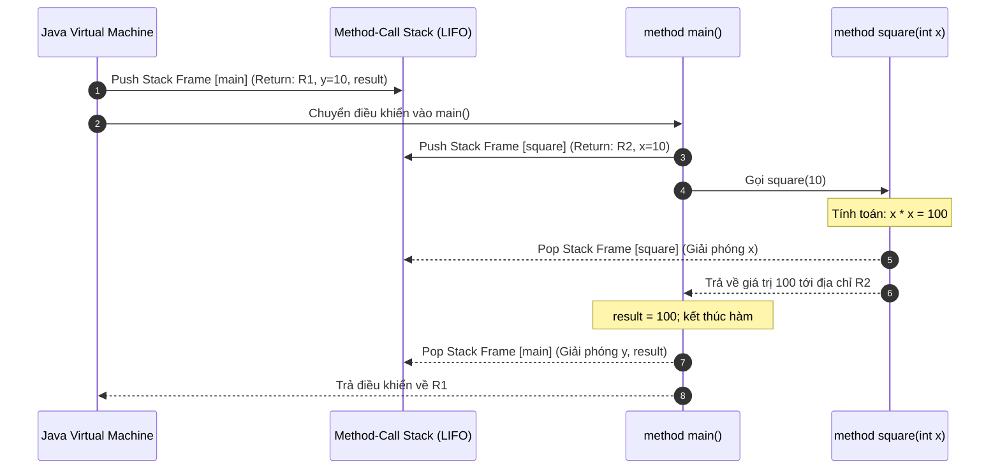
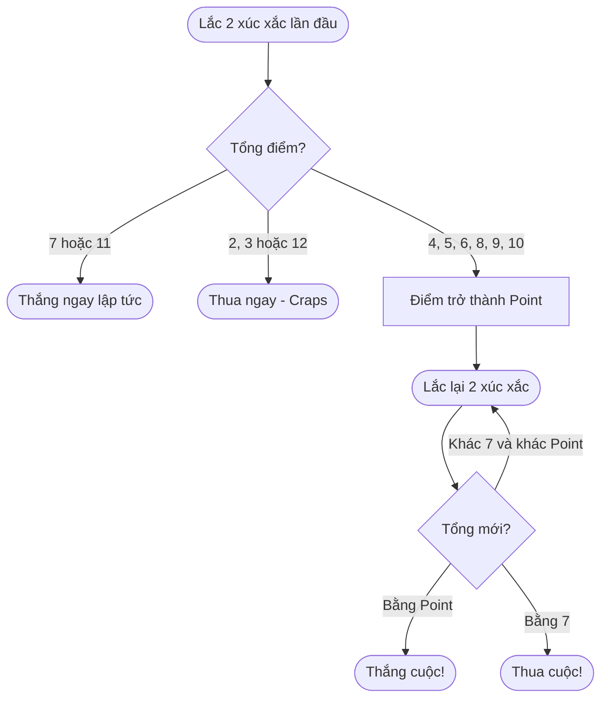

# GHI CHÚ BÀI GIẢNG: CHƯƠNG 5 – METHODS (PHƯƠNG THỨC)
*(Nguồn tham chiếu: Giáo trình "Java for Programmers with Generative AI, 5th Edition" – Paul Deitel & Harvey Deitel, Mục 5.1 đến 5.13)*

---

## 1. Mục tiêu học tập và kiến thức tiên quyết (Learning Objectives & Prerequisites)

### Mục tiêu học tập (Learning Objectives)
*   **Khai báo và gọi phương thức tùy biến (Declaring & Calling Custom Methods):** Hiểu rõ cấu trúc tiêu đề (*header*), thân phương thức (*body*), danh sách tham số (*parameter list*), kiểu trả về (*return type*) và từ khóa `var` cho suy luận kiểu biến cục bộ (*local-variable type inference*) (Mục 5.2, 5.3).
*   **Phương thức và biến tĩnh (static Methods & Fields):** Phân biệt cơ chế hoạt động của phương thức tĩnh (*class methods*) gắn với lớp và phương thức thể hiện (*instance methods*) gắn với đối tượng; nắm vững lớp tiện ích `Math` (Mục 5.2, 5.8).
*   **Mô phỏng ngẫu nhiên & Kiểu liệt kê (Random Simulation & enums):** Tạo số ngẫu nhiên với `RandomGenerator` (Java 17+), phân biệt số ngẫu nhiên tiền định với số ngẫu nhiên phi tiền định trong bảo mật (`SecureRandom`), khai báo và sử dụng kiểu liệt kê `enum` (Mục 5.4, 5.5).
*   **Cải tiến cấu trúc `switch` trong Java hiện đại:** Sử dụng nhãn `case` dạng mũi tên (`->`) súc tích không cần `break`, và biểu thức `switch` (*switch expressions*) gán giá trị trực tiếp cho biến (Mục 5.4, 5.5).
*   **Phạm vi khai báo & Nạp chồng phương thức (Scope & Method Overloading):** Xác định phạm vi của tham số, biến cục bộ, trường dữ liệu của lớp; hiểu cơ chế che khuất (*shadowing*); nạp chồng phương thức dựa trên chữ ký phương thức (*method signature*) (Mục 5.6, 5.7).
*   **Cấu trúc dữ liệu Ngăn xếp lệnh gọi (Method-Call Stack):** Hiểu bản chất LIFO, bản ghi kích hoạt (*activation record / stack frame*), lưu trữ biến cục bộ và nguyên nhân gây lỗi tràn ngăn xếp (*stack overflow*) (Mục 5.10).
*   **Thăng cấp đối số & Ép kiểu (Argument Promotion & Casting):** Quy tắc chuyển đổi kiểu tự động bảo toàn dữ liệu và ép kiểu tường minh làm mất độ chính xác (Mục 5.11).
*   **Chuyên đề Ngày/Giờ (Objects-Natural Case Study):** Thao tác tính toán thời gian chính xác theo vùng địa lý (*locale*) với Java Date/Time API (`java.time`) (Mục 5.12).

### Kiến thức tiên quyết (Prerequisites)
*   Kiểu dữ liệu nguyên thủy (`int`, `double`, `boolean`, `char`), các toán tử số học, quan hệ và logic (Chương 2, 4).
*   Các câu lệnh điều khiển tuần tự, rẽ nhánh (`if`, `if...else`, `switch`) và vòng lặp (`while`, `for`, `do...while`) (Chương 3, 4).
*   Khái niệm ban đầu về lớp (*class*) và đối tượng (*object*) trong Java (Chương 1).

---

## 2. Các khái niệm quan trọng và định nghĩa chính xác (Key Concepts & Definitions)

1.  **Phương thức (Method):** Khối mã lệnh độc lập có tên gọi, được thiết kế để thực hiện một tác vụ chuyên biệt, đóng gói thuật toán và che giấu độ phức tạp khỏi nơi gọi nó (Mục 5.2).
2.  **Chữ ký phương thức (Method Signature):** Sự kết hợp giữa **tên phương thức** và **danh sách tham số** (bao gồm số lượng, kiểu dữ liệu và thứ tự của các tham số). Kiểu trả về **không** thuộc về chữ ký phương thức (Mục 5.7).
3.  **Nạp chồng phương thức (Method Overloading):** Kỹ thuật định nghĩa nhiều phương thức cùng tên trong một lớp nhưng khác nhau về chữ ký phương thức, giúp phục vụ cùng một hành động trên các kiểu dữ liệu hoặc số lượng tham số khác nhau (Mục 5.7).
4.  **Phương thức tĩnh (static Method / Class Method):** Phương thức thuộc về phạm vi toàn lớp, có thể được gọi trực tiếp qua tên lớp mà không cần tạo đối tượng (`ClassName.methodName()`). Một phương thức tĩnh không thể truy cập trực tiếp các biến thể hiện (*instance variables*) hay phương thức thể hiện (*instance methods*) của lớp (Mục 5.2, 5.8).
5.  **Bản ghi kích hoạt / Khung ngăn xếp (Activation Record / Stack Frame):** Cấu trúc dữ liệu được đẩy vào (*push*) ngăn xếp lệnh gọi mỗi khi một phương thức được kích hoạt, chứa địa chỉ trả về (*return address*), tham số và bộ nhớ cho các biến cục bộ của phương thức đó (Mục 5.10).
6.  **Tràn ngăn xếp (Stack Overflow):** Lỗi nghiêm trọng xảy ra khi số lượng bản ghi kích hoạt vượt quá dung lượng bộ nhớ dành riêng cho ngăn xếp lệnh gọi (thường xảy ra do đệ quy vô hạn hoặc chuỗi gọi hàm lồng nhau quá sâu) (Mục 5.10).
7.  **Độ che khuất biến (Variable Shadowing):** Hiện tượng một biến cục bộ hoặc tham số trong phương thức có cùng tên với một trường dữ liệu (*field*) của lớp, làm ẩn trường dữ liệu đó trong phạm vi của khối lệnh (Mục 5.6).
8.  **Nguyên tắc đặc quyền tối thiểu (Principle of Least Privilege):** Nguyên lý công nghệ phần mềm chỉ ra rằng các thực thể (như biến, hàm) chỉ nên được cấp quyền truy cập và phạm vi hiển thị tối thiểu vừa đủ để hoàn thành nhiệm vụ (Mục 5.6).
9.  **Thăng cấp đối số (Argument Promotion / Widening Conversion):** Cơ chế Java tự động chuyển đổi kiểu dữ liệu của đối số sang kiểu rộng hơn mà tham số yêu cầu (ví dụ: chuyển từ `int` sang `double`) mà không làm mất thông tin (Mục 5.11).
10. **Số ngẫu nhiên phi tiền định (Nondeterministic Random Numbers):** Chuỗi số ngẫu nhiên mật mã học không thể dự đoán trước được, tạo ra bởi lớp `SecureRandom`, tránh các lỗ hổng tấn công máy học/dự đoán chuỗi (Mục 5.4).

---

## 3. Giải thích nguyên lý hoạt động từng bước (Step-by-Step Mechanics)

### A. Vòng đời một lệnh gọi phương thức và Ngăn xếp (Call & Return Mechanism)
Khi chương trình thực thi một lệnh gọi phương thức (ví dụ: `int result = square(y);` trong `main`):
1.  **Đánh giá đối số:** Giá trị của các biểu thức đối số được tính toán tuần tự từ trái sang phải.
2.  **Tạo Khung ngăn xếp (Stack Frame):** Một khung ngăn xếp mới được cấp phát và đẩy (*push*) lên đỉnh của *method-call stack*.
3.  **Lưu trữ ngữ cảnh:** Địa chỉ dòng lệnh tiếp theo của phương thức gọi (*return address*) được ghi vào khung ngăn xếp. Bộ nhớ cho các tham số và biến cục bộ của phương thức được gọi được cấp phát.
4.  **Truyền tham trị (Pass-by-Value):** Bản sao giá trị của các đối số được sao chép vào các ô nhớ của tham số tương ứng.
5.  **Chuyển quyền điều khiển:** Bộ đếm chương trình chuyển quyền điều khiển tới câu lệnh đầu tiên trong thân phương thức được gọi.
6.  **Thực thi và Trả về:**
    *   Khi gặp lệnh `return expression;`: Biểu thức kết quả được đánh giá.
    *   Khung ngăn xếp của phương thức được bật ra (*popped*) khỏi ngăn xếp; toàn bộ biến cục bộ bị giải phóng.
    *   Quyền điều khiển quay trở về vị trí địa chỉ trả về, giá trị được trả về thay thế vị trí lời gọi hàm (Mục 5.10).

### B. Cơ chế phân giải nạp chồng phương thức của Trình biên dịch (Overload Resolution)
1.  **Khớp chính xác (Exact Match):** Trình biên dịch tìm phương thức có danh sách tham số trùng khớp hoàn toàn với kiểu của các đối số.
2.  **Khớp qua thăng cấp ngầm định (Promotion Match):** Nếu không có khớp chính xác, trình biên dịch áp dụng bảng quy tắc thăng cấp kiểu nguyên thủy (ví dụ: `byte -> short -> int -> long -> float -> double`) để tìm chữ ký tương thích.
3.  **Lỗi mơ hồ (Ambiguity Error):** Nếu có nhiều hơn một phương thức có thể khớp sau khi thăng cấp mà không có lựa chọn rõ ràng tối ưu nhất, trình biên dịch báo lỗi biên dịch (*ambiguous method call*).

---

## 4. Thuật toán, kiến trúc, bảng và sơ đồ quan trọng (UML, Flowcharts & Diagrams)

### Sơ đồ kiến trúc Ngăn xếp lệnh gọi (Method-Call Stack Architecture)
Minh họa quá trình thực thi từ `JVM` $\rightarrow$ `main` $\rightarrow$ `square` (Mục 5.10):



### Sơ đồ rẽ nhánh logic trò chơi Craps (Mục 5.5)


---

### Bảng thăng cấp kiểu dữ liệu nguyên thủy (Primitive Argument Promotion Table)
*(Nguồn: Mục 5.11)*

| Kiểu dữ liệu gốc | Các kiểu dữ liệu được phép tự động thăng cấp ngầm định |
| :--- | :--- |
| `double` | Không có (là kiểu dấu phẩy động lớn nhất) |
| `float` | `double` |
| `long` | `float`, `double` |
| `int` | `long`, `float`, `double` |
| `char` | `int`, `long`, `float`, `double` |
| `short` | `int`, `long`, `float`, `double` (Lưu ý: `short` không thăng cấp lên `char`) |
| `byte` | `short`, `int`, `long`, `float`, `double` |
| `boolean` | Không thăng cấp (không tương thích với bất kỳ kiểu nào) |

---

## 5. Ví dụ mã nguồn từ giáo trình và giải thích chi tiết (Source Code Examples)

### Ví dụ 1: Tìm giá trị lớn nhất với phương thức tự tạo (Fig. 5.1 – `MaximumFinder.java`)
Minh họa khai báo phương thức tùy biến, tham số, kiểu trả về và từ khóa `var` (Mục 5.2).

```java
// Fig. 5.1: MaximumFinder.java
// Programmer-declared method maximum with three double parameters.
import java.util.Scanner;

public class MaximumFinder {
   public static void main(String[] args) {
      // Dùng từ khóa var để suy luận kiểu biến cục bộ (Scanner)
      var input = new Scanner(System.in);

      // Nhắc người dùng nhập 3 số thực
      System.out.print("Enter three floating-point values separated by spaces: ");
      double number1 = input.nextDouble(); 
      double number2 = input.nextDouble(); 
      double number3 = input.nextDouble(); 

      // Gọi phương thức tĩnh maximum trong cùng một lớp
      double result = maximum(number1, number2, number3);

      // Hiển thị kết quả tìm được
      System.out.println("Maximum is: " + result);
   }

   // Khai báo phương thức tĩnh public trả về số double lớn nhất trong 3 số
   public static double maximum(double x, double y, double z) {
      double maximumValue = x; // Giả định ban đầu x là lớn nhất

      // So sánh với y
      if (y > maximumValue) {
         maximumValue = y;
      }

      // So sánh với z
      if (z > maximumValue) {
         maximumValue = z;
      }

      return maximumValue; // Trả về giá trị lớn nhất tìm được
   }
}
```

*   **Giải thích từng phần:**
    *   `var input = new Scanner(System.in)`: Giới thiệu tính năng *Local-Variable Type Inference* từ Java 10. Trình biên dịch tự suy luận `input` có kiểu `Scanner`.
    *   `public static double maximum(...)`: `public` cho phép gọi từ ngoài lớp; `static` cho phép `main` (hàm tĩnh) gọi trực tiếp mà không cần khởi tạo đối tượng `MaximumFinder`; `double` là kiểu trả về.
    *   *Kỹ thuật tái sử dụng mã (Mục 5.2):* Giáo trình chỉ ra rằng toàn bộ thân hàm `maximum` có thể rút gọn thanh lịch bằng cách tái sử dụng hàm API: `return Math.max(x, Math.max(y, z));`.
*   **Kết quả chạy thực tế (Live Output):**
```text
Enter three floating-point values separated by spaces: 9.35 12.45 10.54
Maximum is: 12.45
```

---

### Ví dụ 2: Mô phỏng trò chơi Craps & Switch Expression (Fig. 5.4 – `Craps.java`)
Minh họa mô phỏng số ngẫu nhiên, kiểu `enum`, hằng số lớp `final static`, và cấu trúc `switch expression` (Mục 5.5).

```java
// Fig. 5.4: Craps.java
// Craps class simulates the dice game craps.
import java.util.random.RandomGenerator;

public class Craps {
   // Khởi tạo bộ sinh số ngẫu nhiên mặc định (Java 17+)
   private static final RandomGenerator randomNumbers = RandomGenerator.getDefault();

   // Khai báo enum chứa các hằng số trạng thái trò chơi
   private enum Status {CONTINUE, WON, LOST}

   // Các hằng số biểu diễn các kết quả xúc xắc đặc biệt
   private static final int SNAKE_EYES = 2;
   private static final int TREY = 3;
   private static final int SEVEN = 7;
   private static final int YO_LEVEN = 11;
   private static final int BOX_CARS = 12;

   public static void main(String[] args) {
      int myPoint = 0; // Điểm Point nếu chưa thắng/thua ở lần lắc đầu
      Status gameStatus; // Trạng thái trò chơi

      int sumOfDice = rollDice(); // Lắc 2 xúc xắc lần 1

      // Cải tiến: Sử dụng switch statement với nhãn mũi tên -> (không lo fall-through)
      switch (sumOfDice) {
         case SEVEN, YO_LEVEN -> gameStatus = Status.WON;
         case SNAKE_EYES, TREY, BOX_CARS -> gameStatus = Status.LOST;
         default -> {
            gameStatus = Status.CONTINUE;
            myPoint = sumOfDice; // Lưu lại điểm point
            System.out.printf("Point is %d%n", myPoint);
         }
      }

      // Vòng lặp lắc tiếp nếu chưa kết thúc
      while (gameStatus == Status.CONTINUE) {
         sumOfDice = rollDice(); // Lắc lại

         // Cải tiến Mục 5.5: Switch expression gán giá trị trực tiếp cho gameStatus
         gameStatus = switch (sumOfDice) {
            case 7 -> Status.LOST;
            default -> (sumOfDice == myPoint) ? Status.WON : Status.CONTINUE;
         };
      }

      // Hiển thị thông báo thắng hoặc thua
      if (gameStatus == Status.WON) {
         System.out.println("Player wins");
      }
      else {
         System.out.println("Player loses");
      }
   }

   // Phương thức gieo xúc xắc và tính tổng
   public static int rollDice() {
      int die1 = randomNumbers.nextInt(1, 7); // Sinh ngẫu nhiên từ 1 đến 6
      int die2 = randomNumbers.nextInt(1, 7);
      int sum = die1 + die2;

      System.out.printf("Player rolled %d + %d = %d%n", die1, die2, sum);
      return sum;
   }
}
```

*   **Giải thích từng phần:**
    *   `RandomGenerator.getDefault()`: Chuẩn API hiện đại trong Java 17 thay thế cho lớp `java.util.Random` cũ.
    *   `case SEVEN, YO_LEVEN ->`: Cú pháp mới cho phép gộp nhiều nhãn bằng dấu phẩy và dùng mũi tên `->`, tự động thoát nhánh mà không cần lệnh `break`.
    *   `gameStatus = switch (sumOfDice) { ... };`: Biểu thức switch (*switch expression*) trả về trực tiếp một giá trị `Status` để gán cho biến `gameStatus`.
*   **Kết quả chạy thực tế (Live Output - Trường hợp xác lập Point):**
```text
Player rolled 5 + 4 = 9
Point is 9
Player rolled 4 + 2 = 6
Player rolled 3 + 6 = 9
Player wins
```

---

### Ví dụ 3: Nạp chồng phương thức (Fig. 5.6 – `MethodOverload.java`)
Minh họa cách trình biên dịch phân biệt các phiên bản phương thức cùng tên dựa vào chữ ký (Mục 5.7).

```java
// Fig. 5.6: MethodOverload.java
// Overloaded method declarations.

public class MethodOverload {
   public static void main(String[] args) {
      System.out.printf("Square of integer 7 is %d%n", square(7));
      System.out.printf("Square of double 7.5 is %f%n", square(7.5));
   }

   // square phiên bản nhận tham số int
   public static int square(int intValue) {
      System.out.printf("%nCalled square with int argument: %d%n", intValue);
      return intValue * intValue;
   }

   // square phiên bản nhận tham số double
   public static double square(double doubleValue) {
      System.out.printf("%nCalled square with double argument: %f%n", doubleValue);
      return doubleValue * doubleValue;
   }
}
```

*   **Kết quả chạy thực tế (Live Output):**
```text
Called square with int argument: 7
Square of integer 7 is 49

Called square with double argument: 7.500000
Square of double 7.5 is 56.250000
```

---

## 6. Các lỗi phổ biến và cách phòng tránh (Common Programming Errors)

1.  **Quên giá trị trả về trong phương thức non-void:**
    *   *Nguyên nhân:* Khai báo phương thức có kiểu trả về (như `int`, `double`) nhưng trong thân không có lệnh `return` hoặc có nhánh `if-else` không dẫn tới lệnh `return`.
    *   *Cách tránh:* Đảm bảo mọi đường dẫn thực thi (*all execution paths*) đều trả về một giá trị tương thích.
2.  **Trả về giá trị trong phương thức kiểu `void`:**
    *   *Nguyên nhân:* Viết lệnh `return value;` trong phương thức khai báo `void`.
    *   *Cách tránh:* Với phương thức `void`, chỉ dùng `return;` (không kèm giá trị) để thoát sớm hoặc để hàm tự kết thúc ở dấu ngoặc nhọn đóng `}`.
3.  **Lầm tưởng kiểu trả về là một phần của chữ ký phương thức:**
    *   *Nguyên nhân:* Khai báo 2 phương thức cùng tên, cùng danh sách tham số nhưng khác kiểu trả về (ví dụ: `int calc(int x)` và `double calc(int x)`).
    *   *Hậu quả:* Lỗi biên dịch (*method is already defined in class*). Trình biên dịch không thể xác định được cần gọi hàm nào nếu kết quả không được gán cho biến.
4.  **Che khuất biến ngoài ý muốn (Accidental Shadowing):**
    *   *Nguyên nhân:* Đặt tên biến cục bộ trùng với tên trường của lớp (*field*), dẫn tới việc cập nhật nhầm biến cục bộ thay vì trường của lớp.
    *   *Cách tránh:* Đặt tên biến rõ nghĩa; nếu cố tình trùng tên (như trong hàm dựng), phải phân biệt bằng từ khóa `this.` (học sâu ở Chương 8).
5.  **Dùng sai bộ sinh số ngẫu nhiên cho các hệ thống bảo mật:**
    *   *Nguyên nhân:* Sử dụng `RandomGenerator` hoặc `Math.random()` cho mật khẩu, mã OTP, hoặc tạo khóa mã hóa.
    *   *Cách tránh:* Các số này là tiền định (*pseudorandom*). Trong bảo mật, bắt buộc phải dùng `java.security.SecureRandom` (Mục 5.4).
6.  **Lỗi thu hẹp dữ liệu không ép kiểu (Narrowing Primitive Conversion):**
    *   *Nguyên nhân:* Truyền đối số kiểu `double` vào hàm yêu cầu tham số kiểu `int`.
    *   *Cách tránh:* Java cấm tự động chuyển đổi thu hẹp làm mất dữ liệu; lập trình viên phải thực hiện ép kiểu tường minh `(int) myDouble`.

---

## 7. So sánh các công nghệ hoặc phương pháp liên quan (Comparative Analysis)

### A. Phương thức tĩnh (`static`) vs. Phương thức thể hiện (`instance method`)

| Tiêu chí | Phương thức tĩnh (`static`) | Phương thức thể hiện (`instance`) |
| :--- | :--- | :--- |
| **Gắn liền với** | Toàn bộ lớp (*Class-level*) | Từng đối tượng cụ thể (*Object-level*) |
| **Cách thức gọi** | `ClassName.methodName()` | `objectReference.methodName()` |
| **Truy cập trường `instance`** | **Không thể** truy cập trực tiếp | Truy cập trực tiếp qua từ khóa `this` |
| **Thời điểm tồn tại** | Ngay khi lớp được nạp vào bộ nhớ | Chỉ khi đối tượng được tạo bằng `new` |
| **Trường hợp điển hình** | Lớp tiện ích toán học (`Math`), hàm chuyển đổi | Các hành vi tác động lên trạng thái đối tượng |

### B. `RandomGenerator` (Java 17+) vs. `SecureRandom`

| Tiêu chí | `java.util.random.RandomGenerator` | `java.security.SecureRandom` |
| :--- | :--- | :--- |
| **Bản chất** | Số giả ngẫu nhiên tiền định (*Deterministic / PRNG*) | Số giả ngẫu nhiên an toàn mật mã (*CSPRNG / Nondeterministic*) |
| **Tốc độ thực thi** | Cực nhanh, hiệu năng cao | Chậm hơn nhiều do thuật toán phức tạp |
| **Khả năng dự đoán** | Có thể bị suy luận nếu biết hạt giống (*seed*) | Không thể suy đoán (*unpredictable*) |
| **Mục đích sử dụng** | Game, mô phỏng khoa học, thuật toán Monte Carlo | Sinh khóa mã hóa, token phiên làm việc, OTP |

### C. `switch statement` truyền thống vs. `switch expression` (Java 14+)

| Tiêu chí | `switch` truyền thống (Chương 4) | `switch expression` (Chương 5) |
| :--- | :--- | :--- |
| **Cú pháp nhãn** | `case VALUE:` | `case VALUE ->` |
| **Hiện tượng trôi nhánh (Fall-through)** | Xảy ra nếu quên lệnh `break;` | **Không bao giờ xảy ra** |
| **Trả về giá trị** | Không trả về giá trị (chỉ là câu lệnh điều khiển) | Có thể trả về giá trị để gán cho biến |
| **Xử lý nhiều giá trị** | Phải viết nhiều dòng `case A: case B:` | Gom nhóm bằng dấu phẩy: `case A, B ->` |

---

## 8. 10 Câu hỏi ôn tập kèm đáp án (Review Questions & Answers)

**Câu 1:** Chữ ký phương thức (*method signature*) trong Java gồm những thành phần nào? Kiểu trả về có nằm trong chữ ký không?  
*Đáp án:* Gồm tên phương thức và danh sách các tham số (số lượng, kiểu dữ liệu, thứ tự). Kiểu trả về **không** thuộc chữ ký phương thức.

**Câu 2:** Tại sao phương thức `main` trong Java bắt buộc phải khai báo là `static`?  
*Đáp án:* Để Java Virtual Machine (JVM) có thể trực tiếp gọi thực thi chương trình thông qua tên lớp mà không cần phải tạo một đối tượng của lớp đó trước.

**Câu 3:** Khung ngăn xếp (*stack frame / activation record*) chứa những thông tin gì?  
*Đáp án:* Chứa địa chỉ trả về (*return address*) của phương thức gọi, giá trị các tham số truyền vào, và bộ nhớ cấp phát cho các biến cục bộ của phương thức.

**Câu 4:** Hiện tượng *Stack Overflow* xảy ra khi nào?  
*Đáp án:* Xảy ra khi số lượng khung ngăn xếp được đẩy vào vượt quá giới hạn dung lượng bộ nhớ dành cho call stack (thường do đệ quy không có điểm dừng).

**Câu 5:** Nêu sự khác nhau giữa việc truyền đối số kiểu nguyên thủy và đối số kiểu tham chiếu vào phương thức?  
*Đáp án:* Java luôn truyền theo giá trị (*pass-by-value*). Với kiểu nguyên thủy, bản sao giá trị được truyền đi, phương thức không thể thay đổi biến gốc. Với kiểu tham chiếu, bản sao địa chỉ tham chiếu được truyền đi, cho phép phương thức thay đổi trạng thái bên trong của đối tượng được trỏ tới.

**Câu 6:** Khi nào hiện tượng che khuất biến (*shadowing*) xảy ra? Làm thế nào để truy cập một biến tĩnh bị che khuất?  
*Đáp án:* Xảy ra khi biến cục bộ hoặc tham số có tên trùng với trường dữ liệu của lớp. Có thể truy cập biến tĩnh bị che khuất bằng cú pháp: `ClassName.variableName`.

**Câu 7:** Điểm vượt trội của cú pháp `case VALUE ->` so với `case VALUE:` trong cấu trúc `switch` là gì?  
*Đáp án:* Nhãn mũi tên `->` tự động ngắt sau khi thực thi xong khối lệnh tương ứng, ngăn chặn hoàn toàn lỗi logic trôi nhánh (*fall-through*) mà không cần viết `break`.

**Câu 8:** Lớp nào được khuyến nghị trong Java 17+ để sinh số ngẫu nhiên cho các ứng dụng mô phỏng hiệu năng cao?  
*Đáp án:* Giao diện/lớp `java.util.random.RandomGenerator` (thông qua phương thức `RandomGenerator.getDefault()`).

**Câu 9:** Từ khóa `var` trong Java (Local-Variable Type Inference) có thể được sử dụng ở những vị trí nào?  
*Đáp án:* Chỉ được dùng cho việc khai báo biến cục bộ bên trong thân phương thức khi biến đó có giá trị khởi tạo ngay lập tức. Không được dùng cho tham số hàm, kiểu trả về hoặc trường của lớp (*fields*).

**Câu 10:** Thăng cấp đối số (*argument promotion*) tuân thủ nguyên tắc an toàn nào?  
*Đáp án:* Nguyên tắc mở rộng kiểu dữ liệu (*widening conversion*), chuyển từ kiểu có phạm vi hẹp/ít bit hơn sang kiểu có phạm vi rộng/nhiều bit hơn mà không làm biến dạng giá trị gốc.

---

## 9. 5 Bài tập thực hành tăng dần độ khó (Practice Exercises)

### Bài tập 1: Cơ bản – Chuyển đổi thang đo nhiệt độ (Phương thức tĩnh & Nạp chồng)
*   **Yêu cầu:** Viết lớp `TemperatureConverter` chứa hai phương thức tĩnh:
    1. `toCelsius(double fahrenheit)`: Trả về nhiệt độ Celsius theo công thức $C = (F - 32) \times 5 / 9$.
    2. `toFahrenheit(double celsius)`: Trả về nhiệt độ Fahrenheit theo công thức $F = C \times 9 / 5 + 32$.
    3. Nạp chồng phương thức `toCelsius(int fahrenheit)` nhận đối số nguyên.

### Bài tập 2: Cơ bản – Tạo chuỗi số ngẫu nhiên theo bước nhảy (RandomGenerator)
*   **Yêu cầu:** Viết phương thức `getRandomStepNumber()` sử dụng `RandomGenerator` để trả về ngẫu nhiên một số thuộc tập hợp: $5, 10, 15, 20, 25, 30$.
*   *Gợi ý:* Sử dụng công thức dịch và co giãn: $5 + 5 \times \text{nextInt}(6)$.

### Bài tập 3: Trung bình – Mô phỏng tung đồng xu 1,000,000 lần (Định luật số lớn)
*   **Yêu cầu:** Viết chương trình mô phỏng tung một đồng xu công bằng 1,000,000 lần. Viết một phương thức `flipCoin()` trả về kiểu liệt kê `enum CoinFace {HEADS, TAILS}`. Đếm và in ra tỷ lệ phần trăm xuất hiện của mỗi mặt.

### Bài tập 4: Nâng cao – Thẩm định tam giác và tính diện tích (Phạm vi & Biến cục bộ)
*   **Yêu cầu:** Viết một lớp chứa:
    1. Phương thức vị từ (*predicate method*) `isValidTriangle(double a, double b, double c)` kiểm tra xem 3 cạnh có thỏa mãn bất đẳng thức tam giác hay không.
    2. Phương thức `calculateArea(double a, double b, double c)` tính diện tích theo công thức Heron: $S = \sqrt{p(p-a)(p-b)(p-c)}$. Nếu không hợp lệ, trả về `-1.0`.

### Bài tập 5: Chuyên sâu – Máy tính khoảng cách thời gian (Java Date/Time API)
*   **Yêu cầu:** Viết phương thức `calculateExactAge(LocalDate birthDate)` sử dụng lớp `java.time.Period` để tính toán chính xác người dùng đã sống được bao nhiêu năm, bao nhiêu tháng, bao nhiêu ngày tính đến ngày hiện tại (`LocalDate.now()`).

---

## 10. Mini Project: Trò chơi Đoán số May mắn & Phân tích Hiệu suất Thuật toán (Lucky Number Simulation & Analytics Engine)

> **Phân định nội dung:** *Dự án dưới đây do giảng viên biên soạn như một bài tập tổng hợp để kết nối toàn bộ kiến thức của Chương 5: Đóng gói các phương thức tùy biến (`public static`), kiểu liệt kê `enum`, bộ sinh số ngẫu nhiên hiện đại `RandomGenerator`, cấu trúc `switch expression`, ngăn xếp lệnh gọi nhiều tầng và tính toán thời gian với `java.time.Duration`.*

### Yêu cầu bài toán (Specifications)
Hệ thống gồm 2 chế độ:
1.  **Chế độ người chơi (Interactive Game):** Người dùng đoán một số bí mật từ 1 đến 100. Chương trình dùng hàm đánh giá kết quả trả về `enum GuessResult {TOO_HIGH, TOO_LOW, CORRECT}`.
2.  **Chế độ mô phỏng Benchmark (Monte Carlo AI Simulation):** Máy tính tự động chạy chiến lược tìm kiếm nhị phân (*binary search*) 100,000 lần cho các số ngẫu nhiên, đo thời gian thực thi bằng `java.time.Instant` và tính số lần đoán trung bình để tìm ra đáp án.

### Mã nguồn hoàn chỉnh (Full Source Code)

```java
import java.time.Duration;
import java.time.Instant;
import java.util.Scanner;
import java.util.random.RandomGenerator;

public class LuckyNumberGame {
   // Bộ sinh số ngẫu nhiên dùng chung toàn lớp
   private static final RandomGenerator rng = RandomGenerator.getDefault();

   // Kiểu liệt kê biểu diễn kết quả mỗi lần đoán
   private enum GuessResult {TOO_HIGH, TOO_LOW, CORRECT}

   public static void main(String[] args) {
      var scanner = new Scanner(System.in);
      int choice;

      do {
         System.out.println("""
            =================================================
                 CHƯƠNG TRÌNH ĐOÁN SỐ & BENCHMARK THUẬT TOÁN
            =================================================
            1. Tự chơi đoán số (Chế độ người dùng)
            2. Chạy mô phỏng máy tính tìm kiếm 100,000 lần (Benchmark)
            3. Thoát
            Chọn tính năng (1-3):""");

         choice = scanner.nextInt();

         // Switch statement kiểu mới dùng nhãn mũi tên ->
         switch (choice) {
            case 1 -> playInteractiveGame(scanner);
            case 2 -> runSimulationBenchmark(100_000);
            case 3 -> System.out.println("Tạm biệt! Cảm ơn bạn đã tham gia.");
            default -> System.out.println("Lựa chọn không hợp lệ!");
         }
      } while (choice != 3);
   }

   // Phương thức phục vụ tương tác người dùng
   public static void playInteractiveGame(Scanner scanner) {
      int secretNumber = generateSecretNumber(1, 100);
      int attempts = 0;
      GuessResult result;

      System.out.println("\n[HỆ THỐNG]: Đã sinh số bí mật trong khoảng [1..100]. Hãy trổ tài!");

      do {
         System.out.print("Nhập số bạn đoán: ");
         int guess = scanner.nextInt();
         ++attempts;

         // Gọi phương thức so khớp logic
         result = evaluateGuess(guess, secretNumber);

         // Switch expression in thông điệp hướng dẫn
         String message = switch (result) {
            case TOO_HIGH -> "Số của bạn LỚN HƠN đáp án!";
            case TOO_LOW  -> "Số của bạn NHỎ HƠN đáp án!";
            case CORRECT  -> "XUẤT SẮC! Bạn đã đoán chính xác!";
         };

         System.out.println(">> " + message);
      } while (result != GuessResult.CORRECT);

      System.out.printf("Bạn đã hoàn thành sau %d lần đoán!%n%n", attempts);
   }

   // Phương thức mô phỏng máy tính tìm kiếm nhị phân và đo thời gian
   public static void runSimulationBenchmark(int totalTrials) {
      System.out.printf("%n[BENCHMARK]: Đang chạy mô phỏng %d lần đoán số...%n", totalTrials);

      Instant start = Instant.now(); // Ghi nhận thời điểm bắt đầu (java.time)
      long totalGuesses = 0;

      for (int i = 0; i < totalTrials; ++i) {
         int target = generateSecretNumber(1, 100);
         totalGuesses += simulateBinarySearch(target, 1, 100);
      }

      Instant finish = Instant.now(); // Ghi nhận thời điểm kết thúc
      long timeElapsedMs = Duration.between(start, finish).toMillis();

      double averageGuesses = (double) totalGuesses / totalTrials;

      System.out.println("---------- KẾT QUẢ BENCHMARK ----------");
      System.out.printf("Tổng số ván chơi mô phỏng : %,d%n", totalTrials);
      System.out.printf("Thời gian thực thi        : %d ms%n", timeElapsedMs);
      System.out.printf("Số lần đoán trung bình    : %.2f lần%n%n", averageGuesses);
   }

   // Sinh số ngẫu nhiên trong đoạn [min, max]
   public static int generateSecretNumber(int min, int max) {
      return rng.nextInt(min, max + 1);
   }

   // Đánh giá kết quả đoán bằng switch/if
   public static GuessResult evaluateGuess(int guess, int target) {
      if (guess > target) {
         return GuessResult.TOO_HIGH;
      }
      else if (guess < target) {
         return GuessResult.TOO_LOW;
      }
      return GuessResult.CORRECT;
   }

   // Thuật toán máy tính mô phỏng tìm kiếm nhị phân
   public static int simulateBinarySearch(int target, int low, int high) {
      int count = 0;
      while (low <= high) {
         ++count;
         int mid = (low + high) / 2;
         if (mid == target) {
            break;
         }
         else if (mid < target) {
            low = mid + 1;
         }
         else {
            high = mid - 1;
         }
      }
      return count;
   }
}
```
