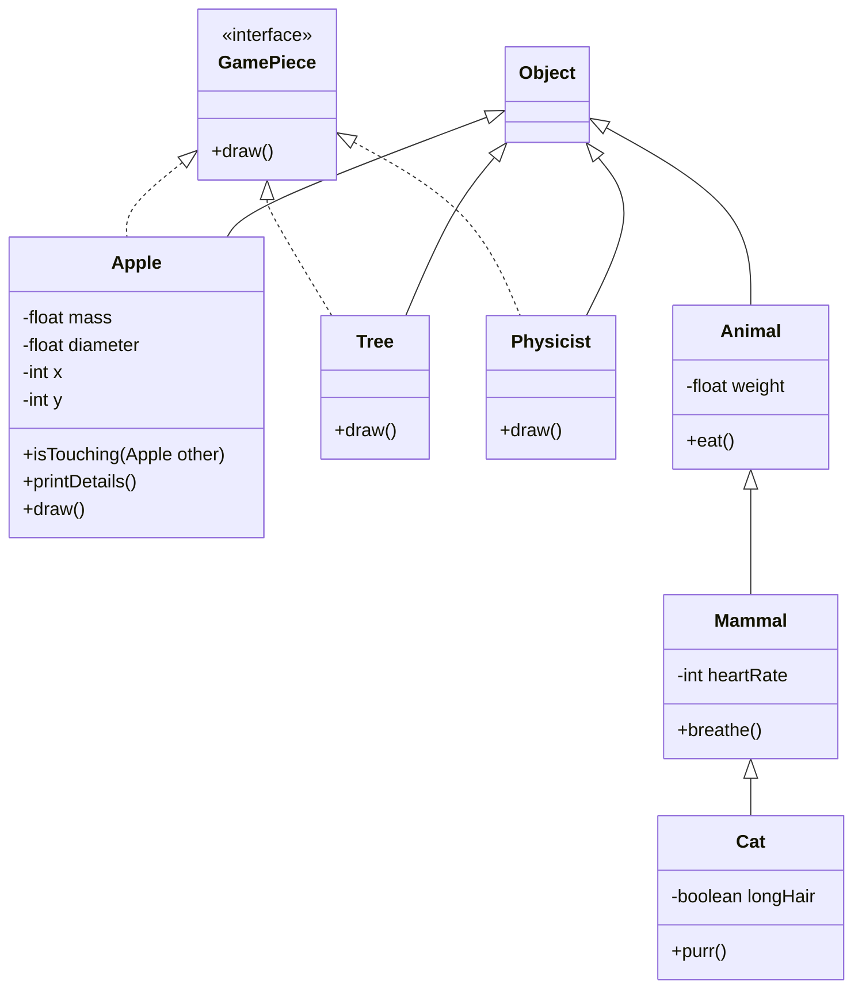

# Tóm tắt Chương 5: Objects in Java (Đối tượng trong Java)

Chương 5 đi sâu vào cốt lõi của ngôn ngữ Java: **Lập trình Hướng đối tượng (Object-Oriented Programming - OOP)**. Nó hướng dẫn cách phân tách một ứng dụng thành các đối tượng độc lập có khả năng tương tác với nhau để giải quyết các vấn đề phức tạp.

## 1. Lớp (Classes) và Đối tượng (Objects)
*   **Lớp (Class)**: Là bản thiết kế (blueprint) chứa dữ liệu (biến/trường) và hành vi (phương thức). Ví dụ: Lớp `Apple`.
*   **Đối tượng (Object)**: Là một thực thể (instance) cụ thể được tạo ra từ bản thiết kế của Lớp.
*   **Khởi tạo**: Sử dụng từ khóa `new` để tạo một đối tượng mới trên bộ nhớ (VD: `Apple a1 = new Apple();`).
*   **Truy cập**: Sử dụng toán tử dấu chấm (`.`) để truy cập vào các trường và phương thức của một đối tượng.

## 2. Thành viên Tĩnh (Static Members)
*   Sử dụng từ khóa `static` cho các biến hoặc phương thức.
*   Các thành viên tĩnh thuộc về **chính lớp đó** chứ không phải thuộc về từng cá thể đối tượng. Chúng được dùng chung cho tất cả các đối tượng của lớp (ví dụ: hằng số trọng lực `gravAccel` dùng chung cho mọi quả táo).

## 3. Phương thức (Methods) và Biến (Variables)
*   **Phương thức**: Các hàm thực thi logic bên trong lớp. Có thể trả về giá trị (hoặc `void`) và nhận các tham số (arguments).
*   **Truyền tham số**: Kiểu nguyên thủy (primitive) được truyền bằng giá trị (pass-by-value), trong khi các đối tượng được truyền bằng tham chiếu (pass-by-reference).
*   **Từ khóa `this`**: Dùng để tham chiếu đến chính đối tượng hiện tại, thường dùng để giải quyết vấn đề che khuất biến (shadowing) khi tham số truyền vào trùng tên với biến instance.

## 4. Khởi tạo và Hủy Đối tượng
*   **Constructors (Hàm tạo)**: Là phương thức đặc biệt cùng tên với lớp, không có kiểu trả về, dùng để thiết lập trạng thái ban đầu của đối tượng khi dùng lệnh `new`. Có thể nạp chồng (overloading) nhiều constructor.
*   **Garbage Collection (Thu gom rác)**: Java tự động quản lý bộ nhớ. Các đối tượng không còn được tham chiếu tới sẽ bị hệ thống tự động dọn dẹp và thu hồi bộ nhớ, giúp tránh rò rỉ bộ nhớ (memory leaks).

## 5. Gói (Packages) và Tầm nhìn (Visibility)
*   **Packages**: Giúp tổ chức và gom nhóm các lớp liên quan lại với nhau (giống như thư mục). Dùng từ khóa `package` để định nghĩa và `import` để mang lớp từ gói khác vào sử dụng.
*   **Bổ nghĩa truy cập (Access Modifiers)**:
    *   `public`: Truy cập tự do từ bất cứ đâu.
    *   `protected`: Chỉ các lớp trong cùng package và các lớp con (subclasses) mới được truy cập.
    *   `default` (không ghi gì): Chỉ các lớp trong cùng package mới được truy cập.
    *   `private`: Khép kín, chỉ được truy cập từ bên trong chính lớp đó.

## 6. Thiết kế Lớp Nâng cao (Advanced Class Design)
*   **Kế thừa (Inheritance)**: Sử dụng từ khóa `extends`. Một lớp con (subclass) sẽ thừa kế các biến và phương thức từ lớp cha (superclass). Java chỉ hỗ trợ đơn kế thừa (một lớp chỉ có một lớp cha).
*   **Lớp trừu tượng (Abstract Classes)**: Khai báo bằng `abstract`. Là lớp khuôn mẫu không thể khởi tạo trực tiếp thành đối tượng. Nó có thể chứa các phương thức trừu tượng (chỉ có khai báo tên, không có phần thân lệnh) buộc lớp con phải viết logic.
*   **Giao diện (Interfaces)**: Khai báo bằng `interface` và triển khai bằng `implements`. Tương tự như một bản hợp đồng, mô tả các hành vi mà một lớp phải có. Một lớp có thể `implements` nhiều giao diện cùng lúc, đây là cách Java bù đắp cho việc thiếu hụt đa kế thừa.
*   **Lớp lồng nhau (Inner & Anonymous Classes)**: Các lớp được định nghĩa bên trong một lớp hoặc một phương thức khác, giúp tăng tính bao đóng và làm gọn code (rất hữu ích khi viết các bộ lắng nghe sự kiện ngắn - event listeners).

---

## Sơ đồ minh họa kiến trúc đối tượng trong game Apple Toss
Dưới đây là sơ đồ Mermaid mô phỏng lại các lớp, giao diện và kế thừa từ ví dụ Game (Apple, Tree, Physicist...) được trình bày trong sách:

