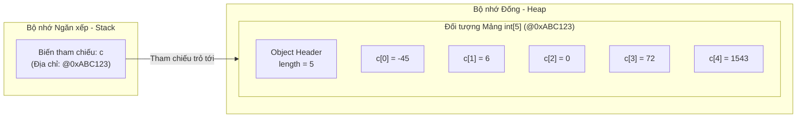

# GHI CHÚ BÀI GIẢNG: CHƯƠNG 6 – ARRAYS AND ARRAYLISTS (MẢNG VÀ ARRAYLIST)
*(Nguồn tham chiếu chính: Giáo trình "Java for Programmers with Generative AI, 5th Edition" – Mục 6.1 đến 6.21)*

---

## 1. Mục tiêu học tập và kiến thức tiên quyết (Learning Objectives & Prerequisites)

### Mục tiêu học tập (Learning Objectives)
*   **Phân biệt kiểu dữ liệu (Data Type Differentiation):** Nắm vững sự khác nhau căn bản giữa kiểu nguyên thủy (*primitive types*) và kiểu tham chiếu (*reference types*) trong bộ nhớ Java (Mục 6.2).
*   **Làm chủ cấu trúc mảng cố định (Built-in Arrays):** Khai báo, khởi tạo và thao tác với mảng một chiều, mảng đa chiều (*multidimensional arrays*) và mảng không đều (*ragged/jagged arrays*) (Mục 6.3 – 6.7, 6.16).
*   **Kỹ thuật duyệt mảng hiện đại:** Áp dụng vòng lặp `for` nâng cao (*enhanced for statement / for-each*) để đọc phần tử an toàn, tránh lỗi biên (Mục 6.13, 6.16).
*   **Cơ chế truyền tham số vào phương thức:** Hiểu bản chất cơ chế truyền theo giá trị (*pass-by-value*) của Java đối với giá trị nguyên thủy so với bản sao tham chiếu đối tượng (*pass-by-value of reference*) (Mục 6.14, 6.15).
*   **Danh sách đối số có độ dài biến đổi (Varargs) & Tham số dòng lệnh:** Sử dụng cú pháp `...` để nhận số lượng đối số tùy ý và xử lý mảng `String[] args` trong hàm `main` (Mục 6.17, 6.18).
*   **Xử lý ngoại lệ biên mảng (Exception Handling Basics):** Bắt và xử lý ngoại lệ `ArrayIndexOutOfBoundsException` bằng khối `try...catch` để tạo ứng dụng chịu lỗi (*fault-tolerant*) (Mục 6.11, 6.12).
*   **Lớp tiện ích `java.util.Arrays`:** Tái sử dụng các thuật toán chuẩn như sắp xếp (`sort`, `parallelSort`), tìm kiếm nhị phân (`binarySearch`), so sánh (`equals`), điền dữ liệu (`fill`) và chuyển chuỗi (`toString`) (Mục 6.19).
*   **Chuyên đề `ArrayList<E>` (Objects-Natural Case Study):** Sử dụng cấu trúc danh sách động trong Java Collection Framework với các cơ chế tự động co giãn dung lượng (*capacity growth*), đóng hộp/mở hộp (*autoboxing/unboxing*) và an toàn kiểu (*type-safety*) (Mục 6.20).

### Kiến thức tiên quyết (Prerequisites)
*   Các kiểu dữ liệu nguyên thủy cơ bản (`int`, `double`, `boolean`, `char`) và toán tử số học/gán phức hợp (Chương 2, 3).
*   Cấu trúc điều khiển luồng: Vòng lặp `while`, `for`, `do...while` và cấu trúc rẽ nhánh `if...else`, `switch` (Chương 3, 4).
*   Khai báo và gọi phương thức tùy biến, phương thức tĩnh `public static` và nạp chồng phương thức (*method overloading*) (Chương 5).

---

## 2. Các khái niệm quan trọng và định nghĩa chính xác (Key Concepts & Definitions)

1.  **Mảng (Array):** Cấu trúc dữ liệu thuần nhất (*homogeneous*), kích thước cố định (*fixed-size*), lưu trữ tập hợp các phần tử có cùng kiểu dữ liệu tại các ô nhớ liên tiếp trong bộ nhớ heap. Mảng trong Java là một **đối tượng** (*object*), do đó biến mảng luôn là biến kiểu tham chiếu (Mục 6.3).
2.  **Chỉ số mảng (Array Index / Subscript):** Số nguyên không âm chỉ định vị trí của phần tử trong mảng. Java áp dụng hệ thống đánh chỉ số bắt đầu từ số 0 (*zero-based indexing*). Với mảng kích thước $N$, các chỉ số hợp lệ nằm trong đoạn $[0, N - 1]$ (Mục 6.3).
3.  **Thuộc tính `length`:** Biến thể hiện hằng số công khai (`public final int length`) gắn liền với mỗi đối tượng mảng, đại diện cho tổng số phần tử của mảng đó. Giá trị này được xác định cố định khi mảng khởi tạo và không thể sửa đổi (Mục 6.3).
4.  **Giá trị mặc định của phần tử mảng (Default Initialization):** Khi toán tử `new` cấp phát mảng, các phần tử tự động nhận giá trị khởi tạo mặc định: `0` cho các kiểu số, `false` cho kiểu `boolean`, và `null` cho các biến kiểu tham chiếu đối tượng (Mục 6.4).
5.  **Khối khởi tạo mảng (Array Initializer):** Cú pháp gộp ngắn gọn dùng dấu ngoặc nhọn `{val1, val2, ...}` để đồng thời khai báo, cấp phát và khởi tạo trực tiếp giá trị cho các phần tử mảng mà không cần dùng từ khóa `new` hay chỉ định độ dài tường minh (Mục 6.6).
6.  **Vòng lặp `for` nâng cao (Enhanced for Statement / For-Each):** Cấu trúc lặp chuyên biệt dùng để duyệt tuần tự qua toàn bộ các phần tử của một mảng hoặc tập hợp collection mà không cần sử dụng biến đếm chỉ số, giúp triệt tiêu hoàn toàn nguy cơ vượt biên chỉ số (Mục 6.13).
7.  **Truyền tham trị đối với tham chiếu (Pass-by-Value of Reference):** Cơ chế của Java khi truyền một đối tượng mảng vào phương thức: JVM sao chép giá trị của biến tham chiếu (địa chỉ bộ nhớ) sang biến tham số. Phương thức được gọi không thể thay đổi đối tượng mà biến ở nơi gọi đang trỏ tới, nhưng có thể đọc và sửa đổi trạng thái bên trong của đối tượng đó (Mục 6.14, 6.15).
8.  **Mảng đa chiều / Mảng răng cưa (Multidimensional / Jagged Arrays):** Trong Java, mảng hai chiều thực chất là "mảng của các mảng một chiều" (*array of arrays*). Các hàng trong mảng hai chiều không bắt buộc phải có cùng độ dài (Mục 6.16).
9.  **Danh sách tham số có độ dài thay đổi (Varargs - Variable-Length Argument Lists):** Tính năng cho phép một phương thức chấp nhận số lượng đối số không cố định cùng kiểu, khai báo bằng dấu ba chấm `...` (ví dụ: `double... numbers`). Bên trong thân phương thức, tham số varargs được xử lý như một mảng chuẩn (Mục 6.17).
10. **Danh sách mảng động (`ArrayList<E>`):** Lớp generic thuộc gói `java.util`, hiện thực giao diện `List`. Khác với mảng thông thường, `ArrayList` có khả năng tự động tăng kích thước (thường tăng xấp xỉ 50% dung lượng hiện tại khi đầy) và chỉ lưu trữ các đối tượng tham chiếu (Mục 6.20).
11. **Đóng hộp và Mở hộp tự động (Autoboxing & Unboxing):** Cơ chế chuyển đổi tự động và trong suốt của trình biên dịch Java giữa các kiểu dữ liệu nguyên thủy (như `int`, `double`) và các lớp bao bọc đối tượng tương ứng (`Integer`, `Double`) khi đưa vào hoặc lấy ra từ generic collection (Mục 6.20).

---

## 3. Giải thích nguyên lý hoạt động từng bước (Step-by-Step Mechanics)

### A. Vòng đời Khởi tạo & Cấp phát Mảng trong Bộ nhớ Heap
```java
int[] c = new int[5];
```
1.  **Bước 1 (Khai báo biến tham chiếu - Stack):** Trình biên dịch ghi nhận biến `c` có kiểu tham chiếu mảng nguyên số `int[]`. Biến `c` được cấp phát trên Stack Frame của phương thức hiện hành.
2.  **Bước 2 (Cấp phát đối tượng - Heap):** Toán tử `new` yêu cầu JVM cấp phát một vùng nhớ liên tục trong bộ nhớ Heap đủ để chứa 5 số nguyên `int` (mỗi số 4 bytes, tổng 20 bytes cộng thêm tiêu đề đối tượng/object header).
3.  **Bước 3 (Khởi tạo mặc định):** JVM tự động điền giá trị nhị phân `0` vào toàn bộ 5 ô nhớ này. Thuộc tính `length` của mảng được gán giá trị `5`.
4.  **Bước 4 (Gán địa chỉ tham chiếu):** Địa chỉ vùng nhớ vừa cấp phát trên Heap được gán cho biến `c` trên Stack. Lúc này `c` chính thức trỏ tới mảng.

---

### B. Cơ chế Duyệt Mảng với Enhanced `for`
```java
for (int grade : grades) {
    total += grade;
}
```
1.  **Bước 1:** Vòng lặp tự động truy xuất thuộc tính `grades.length` để xác định cận trên.
2.  **Bước 2:** Bắt đầu từ chỉ số ngầm định $i = 0$, JVM đọc giá trị `grades[0]` và gán bản sao giá trị đó cho biến cục bộ `grade`.
3.  **Bước 3:** Thực thi thân vòng lặp (cộng `grade` vào `total`).
4.  **Bước 4:** Tự động tăng chỉ số $i$ lên 1 và kiểm tra nếu $i < grades.length$. Nếu đúng, lặp lại Bước 2 với phần tử kế tiếp; nếu bằng `length`, thoát vòng lặp.
*(Lưu ý: Vì `grade` là bản sao của từng phần tử, việc gán giá trị mới cho `grade` trong thân vòng lặp không làm thay đổi dữ liệu trong mảng gốc).*

---

### C. Cơ chế Co giãn Dung lượng của `ArrayList` (Dynamic Resizing)
1.  **Khởi tạo:** `new ArrayList<String>(3)` tạo một mảng nội bộ `elementData` với kích thước ban đầu (*capacity*) bằng 3.
2.  **Thêm phần tử:** Khi gọi `add()`, JVM kiểm tra kích thước hiện tại (*size*) với dung lượng mảng nội bộ (*capacity*).
3.  **Quá ngưỡng (Overflow):** Khi $size == capacity$ mà có thêm phần tử mới đưa vào:
    *   JVM cấp phát một mảng nội bộ mới với kích thước lớn hơn (thường bằng $\approx 1.5 \times$ capacity cũ).
    *   Toàn bộ phần tử từ mảng cũ được sao chép sang mảng mới bằng thuật toán tối ưu cấp thấp (`System.arraycopy`).
    *   Mảng cũ bị thu hồi bởi bộ gom rác (*Garbage Collector*).
    *   Phần tử mới được đặt vào vị trí tiếp theo và cập nhật biến `size`.

---

## 4. Thuật toán, kiến trúc, bảng và sơ đồ quan trọng (Diagrams, Architecture & Tables)

### Sơ đồ cấu trúc Bộ nhớ Mảng (Stack vs. Heap Memory Layout)
Minh họa trực quan biến tham chiếu `c` trỏ tới đối tượng mảng `int[5]` trong heap (Mục 6.2, 6.3):



---

### Sơ đồ kiến trúc Mảng hai chiều trong Java (Array of Arrays Architecture)
Java không lưu trữ mảng hai chiều dạng ma trận khối phẳng liên tục như C/C++, mà tổ chức dạng cây tham chiếu (Mục 6.16):

```mermaid
flowchart TD
    subgraph Stack
        ref["b (int[][])"]
    end

    subgraph Heap
        root["Mảng hàng: b<br/>length = 2"]
        row0["Mảng con b[0]<br/>length = 2<br/>[ 1, 2 ]"]
        row1["Mảng con b[1]<br/>length = 3<br/>[ 3, 4, 5 ]"]
    end

    ref --> root
    root -->|b[0]| row0
    root -->|b[1]| row1
```

---

### Sơ đồ quy trình Xử lý Ngoại lệ Biên Mảng (Exception Handling Flowchart)
Minh họa khối `try...catch` khi gặp chỉ số vượt biên trong Fig. 6.7 (Mục 6.11, 6.12):

```mermaid
flowchart TD
    Start([Truy xuất phần tử: responses[answer]]) --> CheckBound{Chỉ số có nằm trong<br/>[0..length-1]?}
    CheckBound -- Hợp lệ --> Execute[++frequency[value]] --> NormalNext([Tiếp tục vòng lặp])
    CheckBound -- Vượt biên --> ThrowEx[JVM ném: ArrayIndexOutOfBoundsException]
    ThrowEx --> EnterCatch[Nhảy vào khối catch]
    EnterCatch --> PrintErr[In thông báo lỗi: e.toString]
    PrintErr --> ResumeNext([Không làm sập ứng dụng - Tiếp tục bước lặp sau])
```

---

### Bảng tóm tắt các phương thức cốt lõi của lớp `java.util.Arrays` (Mục 6.19)

| Tên phương thức | Cú pháp mẫu | Mục đích & Đặc điểm hoạt động |
| :--- | :--- | :--- |
| `sort` | `Arrays.sort(a)` | Sắp xếp mảng theo thứ tự tăng dần (Dual-Pivot Quicksort cho kiểu nguyên thủy). |
| `parallelSort` | `Arrays.parallelSort(a)` | Sắp xếp song song tận dụng đa lõi CPU cho mảng kích thước cực lớn (Java 8+). |
| `binarySearch` | `Arrays.binarySearch(a, key)` | Tìm kiếm nhị phân trên mảng **đã sắp xếp**. Trả về chỉ số nếu thấy, hoặc số âm nếu không thấy. |
| `equals` | `Arrays.equals(a, b)` | So sánh nội dung hai mảng. Trả về `true` nếu cùng số phần tử và các cặp phần tử bằng nhau. |
| `fill` | `Arrays.fill(a, val)` | Gán toàn bộ hoặc một khoảng phần tử trong mảng bằng một giá trị cố định `val`. |
| `toString` | `Arrays.toString(a)` | Chuyển toàn bộ nội dung mảng thành chuỗi có định dạng `[elem1, elem2, ...]`. |
| `System.arraycopy` | `System.arraycopy(src, spos, dest, dpos, len)` | Sao chép mảng gốc mức độ hệ thống (*native memory copy*), đạt hiệu năng cao nhất. |

---

## 5. Ví dụ mã nguồn từ giáo trình và giải thích chi tiết (Source Code Examples)

### Ví dụ 1: Mô phỏng gieo xúc xắc 60 triệu lần bằng Mảng đếm (Fig. 6.6 – `RollDie.java`)
*Mục 6.10 minh họa cách sử dụng phần tử mảng làm biến đếm tần suất, thay thế toàn bộ cấu trúc `switch` phức tạp trong Chương 5.*

```java
// Fig. 6.6: RollDie.java
// Die-rolling program using arrays instead of switch.
import java.util.random.RandomGenerator;

public class RollDie {
   public static void main(String[] args) {
      var randomNumbers = RandomGenerator.getDefault();
      // Khởi tạo mảng 7 phần tử (bỏ qua phần tử 0 để map trực tiếp mặt 1-6)
      int[] frequency = new int[7]; 

      // Gieo xúc xắc 60,000,000 lần
      for (int roll = 1; roll <= 60_000_000; ++roll) {
         // Giá trị xúc xắc ngẫu nhiên (1..6) được dùng làm chỉ số mảng
         ++frequency[randomNumbers.nextInt(1, 7)];
      }

      System.out.printf("%s%12s%n", "Face", "Frequency");

      // In kết quả tần suất các mặt từ 1 đến 6
      for (int face = 1; face < frequency.length; ++face) {
         System.out.printf("%4d%12d%n", face, frequency[face]);
      }
   }
}
```

*   **Giải thích từng dòng lệnh:**
    *   `int[] frequency = new int[7];`: Khởi tạo mảng có 7 phần tử (từ `frequency[0]` đến `frequency[6]`), tự động mang giá trị 0. Việc bỏ qua chỉ số `0` là một kỹ thuật trực quan hóa giúp số mặt của xúc xắc (1 đến 6) trùng khớp tự nhiên với chỉ số mảng.
    *   `++frequency[randomNumbers.nextInt(1, 7)];`: Biểu thức trong ngoặc vuông sinh số ngẫu nhiên từ 1 đến 6; giá trị này lập tức trở thành chỉ số để toán tử `++` tăng biến đếm tương ứng. Toàn bộ logic 6 nhánh của câu lệnh `switch` được rút gọn thành đúng một dòng lệnh.
    *   `face < frequency.length`: Sử dụng thuộc tính `length` để kiểm soát cận vòng lặp, đảm bảo không bao giờ bị lỗi vượt biên.
*   **Kết quả chạy thực tế (Live Output trích xuất từ sách):**
```text
Face   Frequency
   1    10001418
   2     9999022
   3     9996511
   4    10001187
   5    10002132
   6     9999730
```

---

### Ví dụ 2: Cơ chế Bắt Ngoại lệ Biên Mảng (Fig. 6.7 – `StudentPoll.java`)
*Mục 6.11 & 6.12 minh họa cơ chế kiểm tra biên tự động của JVM và việc sử dụng khối `try...catch` để chương trình không bị sập khi gặp dữ liệu khảo sát sai lệch.*

```java
// Fig. 6.7: StudentPoll.java
// Poll analysis program with exception handling.

public class StudentPoll {
   public static void main(String[] args) {
      // Mảng khảo sát đánh giá 1-5; phần tử cuối cố tình chứa số 14 không hợp lệ
      int[] responses = {1, 2, 5, 4, 3, 5, 2, 1, 3, 3, 1, 4, 3, 3, 3, 2, 3, 3, 2, 14};
      int[] frequency = new int[6]; // Đếm tần suất điểm 1..5

      for (int answer = 0; answer < responses.length; ++answer) {
         try {
            // Khi answer = 19, responses[19] = 14 => frequency[14] sẽ gây ném ngoại lệ
            ++frequency[responses[answer]];
         }
         catch (ArrayIndexOutOfBoundsException e) {
            System.out.println(e); // In chuỗi thông tin của ngoại lệ
            System.out.printf("   responses[%d] = %d%n%n", answer, responses[answer]);
         }
      }

      System.out.printf("%s%10s%n", "Rating", "Frequency");
      // Hiển thị kết quả tổng hợp
      for (int rating = 1; rating < frequency.length; ++rating) {
         System.out.printf("%6d%10d%n", rating, frequency[rating]);
      }
   }
}
```

*   **Giải thích từng dòng lệnh:**
    *   `try { ++frequency[responses[answer]]; }`: Bao bọc thao tác truy xuất mảng tiềm ẩn rủi ro vượt biên. Khi `answer = 19`, `responses[19]` trả về `14`. Mảng `frequency` chỉ có chỉ số từ 0 đến 5.
    *   `catch (ArrayIndexOutOfBoundsException e)`: JVM bắt lỗi vượt biên, đóng gói thành đối tượng `ArrayIndexOutOfBoundsException` và chuyển giao quyền điều khiển vào khối `catch`.
    *   `System.out.println(e)`: Tự động gọi phương thức `toString()` của đối tượng ngoại lệ để in tên lớp và chỉ số gây lỗi. Vòng lặp vẫn tiếp tục thực thi bình thường mà không làm crash chương trình.
*   **Kết quả chạy thực tế (Live Output):**
```text
java.lang.ArrayIndexOutOfBoundsException: Index 14 out of bounds for length 6
   responses[19] = 14

Rating Frequency
     1         3
     2         4
     3         8
     4         2
     5         2
```

---

### Ví dụ 3: Bản chất Truyền Tham trị của Mảng (Fig. 6.9 – `PassArray.java`)
*Mục 6.14 & 6.15 chứng minh việc truyền cả mảng (sao chép tham chiếu) cho phép thay đổi dữ liệu bên trong mảng, trong khi truyền một phần tử nguyên thủy thì giá trị gốc được bảo toàn.*

```java
// Fig. 6.9: PassArray.java
// Passing arrays and individual array elements to methods.

public class PassArray {
   public static void main(String[] args) {
      int[] array = {1, 2, 3, 4, 5};

      System.out.printf("Effects of passing reference to entire array:%n" +
         "The values of the original array are:%n");
      for (int value : array) {
         System.out.printf("   %d", value);
      }

      modifyArray(array); // Truyền tham chiếu mảng vào phương thức
      System.out.printf("%n%nThe values of the modified array are:%n");
      for (int value : array) {
         System.out.printf("   %d", value);
      }

      System.out.printf("%n%nEffects of passing array element value:%n" +
         "array[3] before calling modifyElement: %d%n", array[3]);

      modifyElement(array[3]); // Truyền giá trị nguyên thủy của một phần tử

      System.out.printf("array[3] after modifyElement completes: %d%n", array[3]);
   }

   // Nhân đôi từng phần tử trong mảng thông qua tham chiếu được sao chép
   public static void modifyArray(int[] array2) {
      for (int counter = 0; counter < array2.length; ++counter) {
         array2[counter] *= 2;
      }
   }

   // Cố gắng nhân đôi một phần tử primitive (chỉ sửa trên bản sao biến cục bộ)
   public static void modifyElement(int element) {
      element *= 2;
      System.out.printf("Value of element in modifyElement: %d%n", element);
   }
}
```

*   **Kết quả chạy thực tế (Live Output):**
```text
Effects of passing reference to entire array:
The values of the original array are:
   1   2   3   4   5

The values of the modified array are:
   2   4   6   8  10

Effects of passing array element value:
array[3] before calling modifyElement: 8
Value of element in modifyElement: 16
array[3] after modifyElement completes: 8
```

---

### Ví dụ 4: Khảo sát Lớp Generic `ArrayList<String>` (Fig. 6.14 – `ArrayListCollection.java`)
*Mục 6.20 minh họa sức mạnh của danh sách động, các thao tác thêm, xóa, tìm kiếm và cú pháp suy luận kiểu biến cục bộ `var`.*

```java
// Fig. 6.14: ArrayListCollection.java
// Generic ArrayList<E> collection demonstration.
import java.util.ArrayList;

public class ArrayListCollection {
   public static void main(String[] args) {
      // Khởi tạo ArrayList với dung lượng ban đầu là 3
      var items = new ArrayList<String>(3);

      items.add("red"); // Thêm vào cuối danh sách
      items.add(0, "yellow"); // Chèn "yellow" vào vị trí chỉ số 0

      System.out.print("Display list contents with counter-controlled loop:");
      for (int i = 0; i < items.size(); ++i) {
         System.out.printf(" %s", items.get(i));
      }

      display(items, "%nDisplay list contents with enhanced for loop:");

      items.add("green"); 
      items.add("yellow"); // Cho phép chứa phần tử trùng lặp; vượt dung lượng 3
      display(items, "%nList with two new elements:");

      items.remove("yellow"); // Xóa phần tử "yellow" xuất hiện đầu tiên
      display(items, "%nRemove first instance of yellow:");

      items.remove(1); // Xóa phần tử tại chỉ số 1 ("green")
      display(items, "%nRemove second list element (green):");

      // Kiểm tra sự tồn tại và tìm chỉ số
      System.out.printf("%n\"red\" is %sin the list%n", items.contains("red") ? "" : "not ");
      System.out.printf("\"red\" is located at index: %d%n", items.indexOf("red"));

      items.clear(); // Xóa sạch toàn bộ phần tử
      System.out.printf("Size after clear: %d%n", items.size());
   }

   public static void display(ArrayList<String> items, String header) {
      System.out.printf(header);
      for (String item : items) {
         System.out.printf(" %s", item);
      }
      System.out.printf("%nlist size: %d%n", items.size());
   }
}
```

*   **Kết quả chạy thực tế (Live Output):**
```text
Display list contents with counter-controlled loop: yellow red
Display list contents with enhanced for loop:
 yellow red
list size: 2

List with two new elements:
 yellow red green yellow
list size: 4

Remove first instance of yellow:
 red green yellow
list size: 3

Remove second list element (green):
 red yellow
list size: 2

"red" is in the list
"red" is located at index: 0
Size after clear: 0
```

---

## 6. Các lỗi phổ biến và cách phòng tránh (Common Programming Errors)

1.  **Lỗi vượt biên mảng (`ArrayIndexOutOfBoundsException`):**
    *   *Nguyên nhân:* Nhầm lẫn giữa độ dài mảng $N$ và chỉ số lớn nhất $N-1$, thường gặp khi viết vòng lặp kiểm tra `<=` thay vì `<` (ví dụ: `for (int i = 0; i <= a.length; ++i)`).
    *   *Cách phòng tránh:* Luôn dùng `i < a.length` trong vòng lặp có đếm chỉ số, hoặc chuyển hẳn sang dùng *enhanced for loop* nếu không cần sửa đổi chỉ số.
2.  **Khởi tạo sai kích thước mảng với số âm (`NegativeArraySizeException`):**
    *   *Nguyên nhân:* Khai báo mảng với kích thước âm (ví dụ: `new int[-5]`), thường xảy ra khi kích thước được tính từ biểu thức động chưa qua thẩm định.
    *   *Cách phòng tránh:* Luôn kiểm tra điều kiện dữ liệu đầu vào ($size \ge 0$) trước khi cấp phát bộ nhớ mảng.
3.  **Lầm tưởng về việc thay đổi phần tử trong Enhanced `for` Loop:**
    *   *Nguyên nhân:* Cố tình gán lại giá trị cho biến lặp `for (int x : a) { x *= 2; }` với kỳ vọng mảng `a` sẽ bị thay đổi.
    *   *Hậu quả:* `x` chỉ là một bản sao cục bộ của từng phần tử trên mỗi bước lặp; mảng gốc hoàn toàn giữ nguyên giá trị.
    *   *Cách phòng tránh:* Bắt buộc phải sử dụng vòng lặp `for` truyền thống có chỉ số `a[i] *= 2;` khi cần ghi đè phần tử.
4.  **Lỗi so sánh nội dung mảng bằng toán tử `==` hoặc `a.equals(b)`:**
    *   *Nguyên nhân:* Mảng kế thừa phương thức `equals` mặc định từ lớp `Object`, chỉ so sánh xem hai biến có trỏ cùng một vùng nhớ hay không (so sánh tham chiếu).
    *   *Cách phòng tránh:* Luôn sử dụng phương thức tĩnh `Arrays.equals(a, b)` (hoặc `Arrays.deepEquals` cho mảng đa chiều) để so sánh giá trị nội dung các phần tử.
5.  **Lỗi tìm kiếm nhị phân trên mảng chưa sắp xếp (`Arrays.binarySearch`):**
    *   *Nguyên nhân:* Truyền một mảng có thứ tự lộn xộn vào `Arrays.binarySearch()`.
    *   *Hậu quả:* Kết quả trả về là không xác định (*undefined*), có thể báo không tìm thấy dù phần tử thực sự có mặt trong mảng.
    *   *Cách phòng tránh:* Luôn gọi `Arrays.sort(a)` trước khi thực hiện tìm kiếm nhị phân.
6.  **Nhầm lẫn cú pháp lấy kích thước: `.length` vs. `.length()` vs. `.size()`:**
    *   *Mảng tích hợp (Built-in Array):* Dùng thuộc tính **`.length`** (không có ngoặc đơn).
    *   *Chuỗi ký tự (`String`):* Dùng phương thức **`.length()`** (có ngoặc đơn).
    *   *Bộ sưu tập danh sách (`ArrayList`):* Dùng phương thức **`.size()`**.

---

## 7. So sánh các công nghệ hoặc phương pháp liên quan (Comparative Analysis)

### A. Mảng cố định (`Array`) vs. Danh sách mảng động (`ArrayList<E>`)

| Tiêu chí kỹ thuật | Mảng tích hợp (`Built-in Array`) | Danh sách động (`ArrayList<E>`) |
| :--- | :--- | :--- |
| **Kích thước (Size)** | Cố định tuyệt đối sau khi cấp phát | Tự động co giãn linh hoạt (*Dynamically resizable*) |
| **Kiểu dữ liệu hỗ trợ** | Chứa cả kiểu nguyên thủy (`int`, `double`...) và kiểu đối tượng | Chỉ chứa kiểu đối tượng (cần cơ chế Box/Unbox cho primitive) |
| **Hiệu năng & Bộ nhớ** | Tối ưu tuyệt đối về tốc độ truy xuất và dung lượng RAM | Tốn thêm chi phí bộ nhớ cho con trỏ đối tượng và mảng dư |
| **Cú pháp truy xuất** | `a[index]` (đọc) / `a[index] = val` (ghi) | `list.get(index)` (đọc) / `list.set(index, val)` (ghi) |
| **Hỗ trợ thuật toán API** | Dùng các phương thức tĩnh của `java.util.Arrays` | Tích hợp sẵn nhiều phương thức (`add`, `remove`, `contains`...) |

### B. Vòng lặp đếm truyền thống (`for`) vs. Vòng lặp nâng cao (`enhanced for`)

| Tiêu chí | Vòng lặp đếm chỉ số (`Counter for`) | Vòng lặp nâng cao (`Enhanced for`) |
| :--- | :--- | :--- |
| **Mục đích tối ưu** | Khi cần sửa phần tử, lặp bước nhảy, duyệt ngược | Khi chỉ cần đọc tuần tự toàn bộ dữ liệu |
| **Truy cập chỉ số (Index)** | Có sẵn biến chỉ số (`i`) để tính toán | **Không thể** biết phần tử hiện tại đang ở chỉ số nào |
| **Khả năng sửa mảng** | Sửa đổi trực tiếp giá trị phần tử (`a[i] = val`) | **Không thể** sửa đổi giá trị phần tử mảng nguyên thủy |
| **Độ an toàn** | Tiềm ẩn nguy cơ lỗi lệch một (*Off-by-one*) | An toàn tuyệt đối, không bao giờ vượt biên |

### C. Mảng hai chiều Java vs. Mảng hai chiều ma trận phẳng trong C/C++

| Tiêu chí | Java (`Array of Arrays`) | C/C++ (`Contiguous 2D Array`) |
| :--- | :--- | :--- |
| **Tổ chức bộ nhớ** | Không liên tục; mỗi hàng là một đối tượng mảng riêng lẻ trên Heap | Một khối bộ nhớ đơn liên tục trải dài trên Stack/Heap |
| **Mảng răng cưa (Ragged)** | Hỗ trợ tự nhiên: các hàng có thể có số cột khác nhau | Khó hiện thực trực tiếp dạng mảng tĩnh phẳng |
| **Chi phí tham chiếu** | Cần giải tham chiếu 2 lần (*pointer indirection*) | Tính toán địa chỉ tuyến tính trực tiếp theo công thức $row \times C + col$ |

---

## 8. 10 Câu hỏi ôn tập kèm đáp án chi tiết (Review Questions & Answers)

**Câu 1:** Mảng trong ngôn ngữ Java là kiểu nguyên thủy hay kiểu tham chiếu? Giải thích ý nghĩa của việc này đối với việc quản lý bộ nhớ.  
*Đáp án (Mục 6.2, 6.3):* Mảng trong Java luôn là **kiểu tham chiếu** (*reference type*). Bản thân đối tượng mảng luôn được cấp phát trong bộ nhớ Heap, còn biến mảng chỉ lưu trữ địa chỉ tham chiếu trỏ tới đối tượng đó.

**Câu 2:** Giá trị mặc định của các phần tử trong mảng kiểu số, kiểu boolean và kiểu chuỗi khi vừa được cấp phát bằng từ khóa `new` là gì?  
*Đáp án (Mục 6.4):* Số nguyên nhận `0`, số thực nhận `0.0`, kiểu `boolean` nhận `false`, và kiểu chuỗi/đối tượng nhận `null`.

**Câu 3:** Cho biết sự khác nhau giữa thuộc tính `length` của mảng, phương thức `length()` của `String` và phương thức `size()` của `ArrayList`?  
*Đáp án (Mục 6.3, 6.20):* `length` là thuộc tính công khai cố định của mảng đối tượng; `length()` là phương thức của lớp `String` trả về số ký tự; `size()` là phương thức của `ArrayList` trả về số lượng phần tử thực tế hiện có.

**Câu 4:** Khi nào thì vòng lặp `enhanced for` không thể thay thế được vòng lặp `for` truyền thống có biến đếm?  
*Đáp án (Mục 6.13):* Khi cần: 1) Sửa đổi giá trị của các phần tử trong mảng; 2) Cần sử dụng chỉ số vị trí để in ấn hoặc tính toán; 3) Duyệt mảng theo bước nhảy khác 1 hoặc duyệt ngược từ cuối về đầu.

**Câu 5:** Điều gì sẽ xảy ra nếu lập trình viên cố tình truy xuất vào chỉ số `array[array.length]`? Cơ chế nào của Java xử lý tình huống này?  
*Đáp án (Mục 6.11, 6.12):* Do chỉ số hợp lệ lớn nhất là `length - 1`, hành vi này vi phạm kiểm tra biên và JVM sẽ ném ra ngoại lệ `ArrayIndexOutOfBoundsException`. Nếu có khối `try...catch`, ngoại lệ sẽ được xử lý; nếu không, chương trình sẽ kết thúc đột ngột kèm thông báo lỗi.

**Câu 6:** Khi truyền một mảng `int[] a` vào phương thức `public static void modify(int[] arr)`, tại sao việc gán `arr[0] = 99` lại làm thay đổi giá trị của `a[0]` ở hàm gọi?  
*Đáp án (Mục 6.14, 6.15):* Vì Java truyền tham số theo cơ chế truyền bản sao tham chiếu (*pass-by-value of the reference*). Cả `a` và `arr` đều cùng giữ bản sao địa chỉ trỏ tới duy nhất một đối tượng mảng trên Heap.

**Câu 7:** Tại sao Java không cho phép truyền mảng đối tượng theo kiểu sao chép toàn bộ nội dung (*pass-by-value of the object itself*)?  
*Đáp án (Mục 6.15):* Vì lý do hiệu năng và tối ưu hóa tài nguyên. Việc sao chép toàn bộ một mảng có thể chứa hàng triệu phần tử sẽ gây lãng phí dung lượng bộ nhớ Heap và tốn rất nhiều chu kỳ xử lý của CPU.

**Câu 8:** Cú pháp danh sách tham số biến đổi `double... numbers` trong phương thức có quy tắc ràng buộc nào về vị trí trong danh sách tham số?  
*Đáp án (Mục 6.17):* Tham số dạng varargs (`...`) chỉ được phép xuất hiện **duy nhất một lần** trong danh sách tham số và bắt buộc phải nằm ở **vị trí cuối cùng**.

**Câu 9:** Để tìm kiếm một phần tử trong mảng bằng `Arrays.binarySearch()`, mảng đầu vào bắt buộc phải thỏa mãn điều kiện tiên quyết nào? Nếu vi phạm thì hậu quả là gì?  
*Đáp án (Mục 6.19):* Mảng bắt buộc phải được **sắp xếp theo thứ tự tăng dần** trước khi gọi hàm. Nếu mảng chưa sắp xếp, kết quả trả về là không xác định (*undefined*).

**Câu 10:** Dung lượng (*capacity*) và kích thước (*size*) của một `ArrayList` khác nhau như thế nào? Cơ chế tăng trưởng dung lượng mặc định khi mảng nội bộ bị đầy là bao nhiêu?  
*Đáp án (Mục 6.20):* *Capacity* là số lượng phần tử mà mảng nội bộ hiện tại có thể chứa mà không cần cấp phát lại; *Size* là số lượng phần tử thực tế đang được lưu trữ. Khi đầy, `ArrayList` tự động mở rộng dung lượng thêm khoảng 50% so với dung lượng cũ.

---

## 9. 5 Bài tập thực hành tăng dần độ khó (Practice Exercises)

### Bài tập 1: Cơ bản – Tìm giá trị Min, Max và Trung bình của Mảng (Mảng 1 chiều & Enhanced for)
*   **Mô tả:** Khởi tạo một mảng số nguyên `int[] numbers` gồm 10 giá trị ngẫu nhiên trong khoảng $[1..100]$. Sử dụng vòng lặp `enhanced for` để duyệt mảng, tìm ra giá trị nhỏ nhất, giá trị lớn nhất và tính giá trị trung bình chính xác của mảng.
*   **Mục tiêu rèn luyện:** Cú pháp khởi tạo mảng, duyệt bằng `for-each`, ép kiểu số thực khi tính trung bình.

### Bài tập 2: Cơ bản – Loại bỏ phần tử trùng lặp sử dụng `ArrayList` (Collections & Boxing)
*   **Mô tả:** Viết phương thức `removeDuplicates(int[] arr)` nhận vào một mảng số nguyên có nhiều giá trị trùng lặp. Phương thức sử dụng `ArrayList<Integer>` kết hợp phương thức `contains()` để gom các phần tử duy nhất, sau đó in ra danh sách kết quả.
*   **Mục tiêu rèn luyện:** Thao tác với generic `ArrayList`, cơ chế autoboxing giữa `int` và `Integer`.

### Bài tập 3: Trung bình – Đảo ngược Mảng tại chỗ & Phân tích thuật toán (Mảng & Hoán vị)
*   **Mô tả:** Viết phương thức `reverseArray(int[] arr)` nhận vào một mảng và đảo ngược toàn bộ thứ tự các phần tử của mảng đó **ngay tại chỗ** (*in-place*, không tạo mảng phụ mới). Sử dụng thuật toán 2 con trỏ chạy từ 2 đầu mảng và hoán đổi giá trị với biến tạm `temp`.
*   **Mục tiêu rèn luyện:** Thao tác chỉ số biên mảng, thuật toán hoán đổi phần tử, tư duy tối ưu bộ nhớ.

### Bài tập 4: Nâng cao – Quản lý bảng điểm sinh viên với Mảng răng cưa (Ragged Array)
*   **Mô tả:** Một trường đại học có 3 lớp học với sĩ số khác nhau: Lớp 1 có 4 sinh viên, Lớp 2 có 2 sinh viên, Lớp 3 có 5 sinh viên. Hãy:
    1. Khởi tạo mảng hai chiều răng cưa `double[][] classGrades` tương ứng.
    2. Viết phương thức nhập điểm cho từng sinh viên.
    3. Viết phương thức tính và in ra điểm trung bình của từng lớp và điểm trung bình toàn khóa.
*   **Mục tiêu rèn luyện:** Khởi tạo mảng jagged với độ dài hàng khác nhau, lồng vòng lặp `for` xử lý `array[row].length`.

### Bài tập 5: Chuyên sâu – Trộn 2 mảng đã sắp xếp không dùng hàm Sort (Thuật toán Merge)
*   **Mô tả:** Cho 2 mảng số nguyên `a` và `b` đã được sắp xếp tăng dần. Không được gộp mảng rồi gọi hàm `Arrays.sort()`, hãy viết thuật toán trộn (*merge algorithm*) hai mảng này thành mảng thứ ba `c` có độ dài `a.length + b.length` sao cho mảng `c` vẫn giữ nguyên thứ tự sắp xếp với độ phức tạp thời gian tối ưu $O(N + M)$.
*   **Mục tiêu rèn luyện:** Kỹ thuật con trỏ kép (*two-pointer technique*), tư duy nền tảng của thuật toán Merge Sort.

---

## 10. Mini Project: Hệ thống Quản trị & Phân tích Đánh giá Dịch vụ Khách hàng (Customer Service Analytics & Sentiment Engine)

> **Phân định nội dung:** *Dự án thực hành tổng hợp dưới đây được thiết kế bởi giảng viên nhằm kết hợp hoàn hảo toàn bộ kiến thức của Chương 6: Mảng tích hợp một chiều, mảng hai chiều đại diện cho ma trận tiêu chí, cấu trúc danh sách động `ArrayList`, xử lý ngoại lệ biên an toàn `try...catch`, kỹ thuật duyệt `enhanced for` và các tiện ích chuẩn từ `java.util.Arrays`.*

### Yêu cầu bài toán (Specifications)
Hệ thống xử lý khảo sát đánh giá chất lượng dịch vụ của chuỗi nhà hàng gồm:
1.  **Dữ liệu khảo sát thô:** Một danh sách động `ArrayList<Integer>` thu thập các điểm đánh giá từ 1 đến 5 sao từ khách hàng (có khả năng lẫn các mã lỗi do nhập sai từ người dùng).
2.  **Mô-đun phân tích thống kê:**
    *   Tự động lọc và bắt ngoại lệ nếu điểm số vượt ngoài khoảng $[1..5]$ bằng mảng đếm tần suất.
    *   Vẽ biểu đồ phân bố điểm (*Text-based Bar Chart*) trực quan bằng ký tự `*` kết hợp phương thức `String.repeat()`.
3.  **Mô-đun ma trận tiêu chí (Mảng 2 chiều):**
    *   Lưu trữ điểm đánh giá 3 tiêu chí: Phục vụ, Món ăn, Không gian của từng chi nhánh.
    *   Tìm kiếm và sắp xếp điểm hiệu năng của các chi nhánh bằng `Arrays.sort()` và `Arrays.binarySearch()`.

### Mã nguồn hoàn chỉnh (Full Live Code)

```java
import java.util.ArrayList;
import java.util.Arrays;
import java.util.Scanner;

public class CustomerServiceAnalyticsApp {
   public static void main(String[] args) {
      System.out.println("====================================================");
      System.out.println("  HỆ THỐNG PHÂN TÍCH KHẢO SÁT KHÁCH HÀNG (DEITEL CH6)");
      System.out.println("====================================================\n");

      // 1. Khởi tạo danh sách động ArrayList thu thập dữ liệu thô
      var rawFeedbacks = new ArrayList<Integer>();
      // Giả lập dữ liệu khách hàng nhập vào (có lẫn điểm ngoại lai 9 và -1)
      int[] sampleInput = {5, 4, 5, 3, 2, 5, 4, 1, 9, 3, 4, 5, 2, 4, 3, -1, 5, 4, 5};
      for (int score : sampleInput) {
         rawFeedbacks.add(score);
      }

      System.out.printf(">> Tổng số lượng phản hồi thu thập: %d%n", rawFeedbacks.size());

      // 2. Thống kê tần suất điểm hợp lệ (1-5) và bắt ngoại lệ cho điểm sai
      int[] frequency = new int[6]; // Bỏ qua index 0, dùng index 1..5
      int invalidCount = 0;

      for (int score : rawFeedbacks) {
         try {
            // Nếu score < 0 hoặc score > 5, truy xuất frequency[score] sẽ ném ngoại lệ
            if (score < 1 || score > 5) {
               throw new ArrayIndexOutOfBoundsException("Điểm không nằm trong thang 1-5: " + score);
            }
            ++frequency[score];
         }
         catch (ArrayIndexOutOfBoundsException e) {
            ++invalidCount;
            System.out.printf("[CẢNH BÁO BẢO VỆ DỮ LIỆU]: %s%n", e.getMessage());
         }
      }

      // 3. Trực quan hóa dữ liệu bằng biểu đồ cột (Bar Chart Visualization)
      System.out.println("\n----------------- BIỂU ĐỒ HÀI LÒNG KHÁCH HÀNG -----------------");
      for (int rating = 1; rating < frequency.length; ++rating) {
         System.out.printf("%2d sao (%3d lượt): %s%n", 
            rating, frequency[rating], "*".repeat(frequency[rating]));
      }
      System.out.printf("Số lượng phản hồi sai lệch bị cô lập: %d%n%n", invalidCount);

      // 4. Ma trận đánh giá đa chiều: 3 Chi nhánh x 3 Tiêu chí (Phục vụ, Món ăn, Không gian)
      System.out.println("----------------- ĐÁNH GIÁ CHI TIẾT CHI NHÁNH -----------------");
      String[] branches = {"Chi nhánh Ba Đình", "Chi nhánh Hoàn Kiếm", "Chi nhánh Cầu Giấy"};
      double[][] criteriaScores = {
         {4.5, 4.8, 4.2}, // Ba Đình
         {4.0, 4.1, 3.9}, // Hoàn Kiếm
         {4.8, 4.9, 4.7}  // Cầu Giấy
      };

      // Mảng lưu trữ điểm trung bình tổng hợp của từng chi nhánh
      double[] branchAverages = new double[branches.length];

      for (int i = 0; i < criteriaScores.length; ++i) {
         double sum = 0.0;
         // Duyệt từng cột tiêu chí của hàng hiện tại
         for (double score : criteriaScores[i]) {
            sum += score;
         }
         branchAverages[i] = sum / criteriaScores[i].length;
         System.out.printf("%-22s: Điểm trung bình = %.2f%n", branches[i], branchAverages[i]);
      }

      // 5. Tận dụng lớp tiện ích java.util.Arrays để phân tích bảng xếp hạng
      double[] sortedAverages = branchAverages.clone(); // Sao chép mảng
      Arrays.sort(sortedAverages); // Sắp xếp tăng dần

      System.out.printf("%n>> Điểm hiệu năng thấp nhất: %.2f%n", sortedAverages[0]);
      System.out.printf(">> Điểm hiệu năng cao nhất  : %.2f%n", sortedAverages[sortedAverages.length - 1]);

      // Kiểm tra sự tồn tại của mốc chuẩn 4.80 bằng tìm kiếm nhị phân
      int searchIndex = Arrays.binarySearch(sortedAverages, 4.80);
      if (searchIndex >= 0) {
         System.out.println(">> Đạt chuẩn chất lượng tối ưu (có chi nhánh đạt đúng mốc 4.80).");
      }
      else {
         System.out.println(">> Chưa có chi nhánh nào đạt chuẩn mốc 4.80.");
      }

      System.out.println("\nHoàn tất phân tích dữ liệu thành công!");
   }
}
```

---

*Tài liệu ghi chú này được biên soạn bám sát cấu trúc của giáo trình Paul Deitel, phục vụ công tác giảng dạy, ôn thi chứng chỉ Oracle Certified Professional Java SE Developer và nghiên cứu chuyên sâu.*
