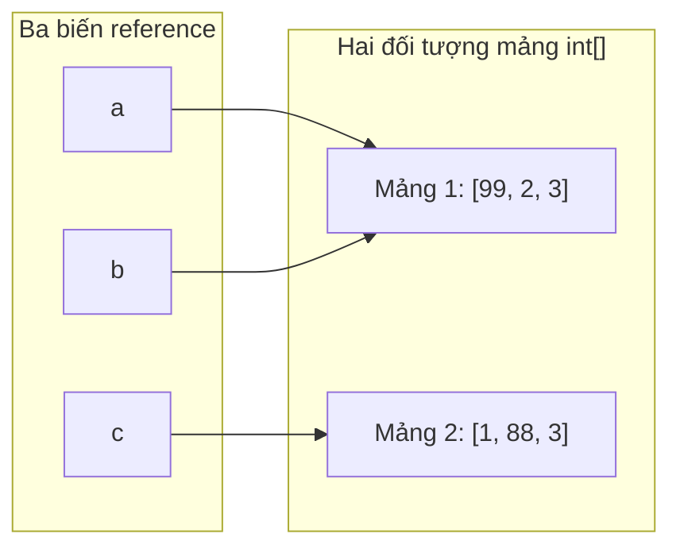
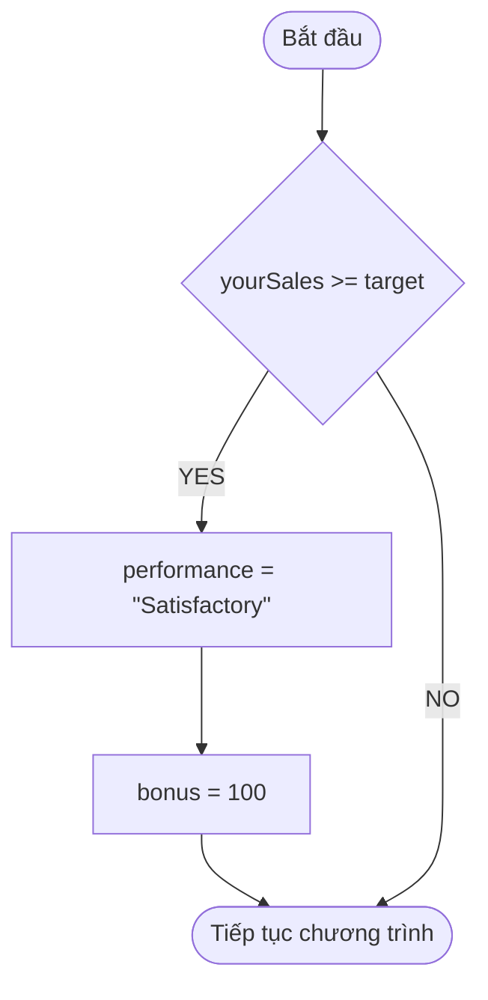
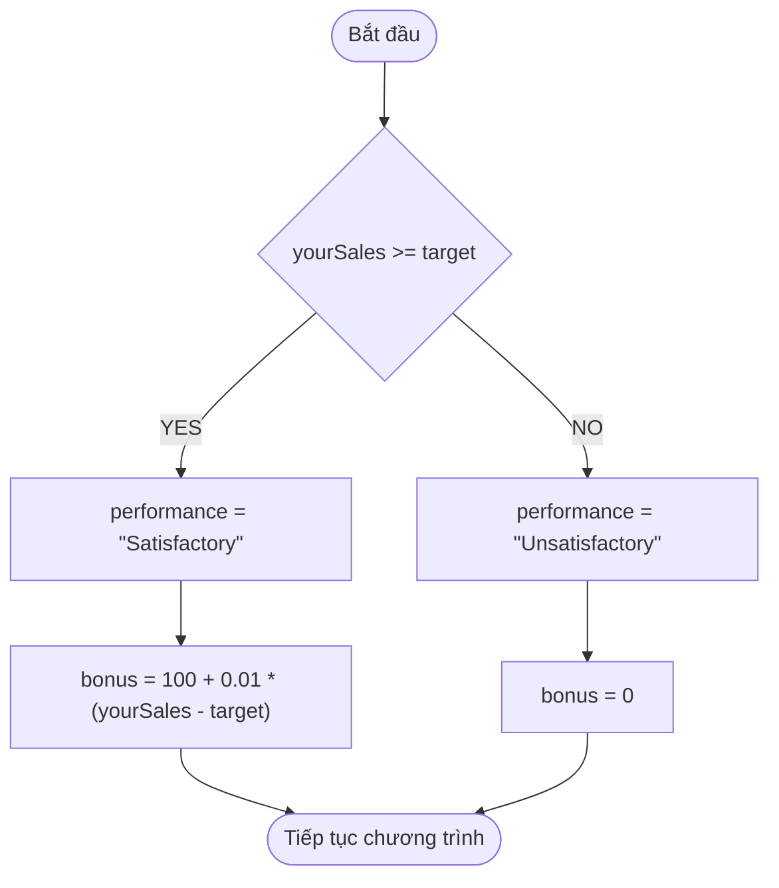
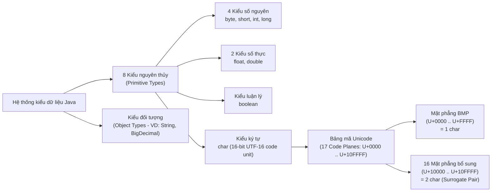
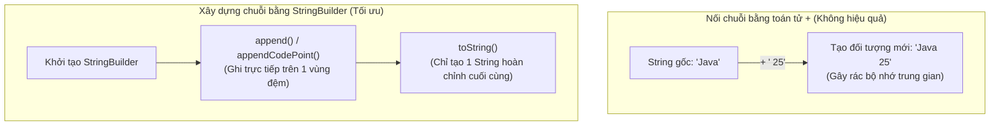

# Chương 3: Các cấu trúc lập trình cơ bản trong Java (Fundamental Programming Structures in Java)

> **Lưu ý từ Giảng viên về tài liệu nguồn (Source Transparency Notice):**
> 1. **Về trích dẫn vị trí:** Bản trích xuất tài liệu nguồn (*Core Java, Volume I* – ấn bản cập nhật hỗ trợ cú pháp hiện đại như `void main()` và `IO.println()`) không chứa số trang vật lý. Do đó, mọi ý chính trong tài liệu này đều được dẫn chiếu chính xác theo **Số mục (Section)**, **Bảng (Table)**, **Hình vẽ (Figure)** và **Đoạn mã (Listing)** nguyên bản.
> 2. **Về tính toàn vẹn của dữ liệu nguồn:** Một số đoạn trong tài liệu nguồn bị khuyết hoặc cắt ngang ở lề phải do quá trình trích xuất dữ liệu, cụ thể:
>    - **Bị cắt lề phải:** Giá trị tối đa của kiểu `long` trong *Bảng 3.1*; dòng mô tả kiểu `double` trong *Bảng 3.2*; chữ số thập lục phân cuối cùng của một số ký tự thoát trong *Bảng 3.3*.
>    - **Bị lược bớt nội dung chi tiết:** *Mục 3.3.5* (kiểu `boolean`), phần cú pháp chi tiết của *Mục 3.4.4* (`enum`), phần đầu *Mục 3.5* (các toán tử số học/quan hệ), các *Mục 3.6.4 – 3.6.8* (so sánh chuỗi, kiểm tra rỗng, các phương thức API `String`), *Mục 3.7* (nhập liệu từ `Scanner`/`IO`), các *Mục 3.8.3 – 3.8.6* (vòng lặp `while`, `do-while`, `for` truyền thống, `switch`), *Mục 3.9* (các phương thức chi tiết của `BigInteger`/`BigDecimal`), và các *Mục 3.10.1 – 3.10.2, 3.10.4 – 3.10.5* (khai báo mảng và mảng đa chiều).
> 3. **Nguyên tắc phân tách:** Toàn bộ nội dung rút ra từ sách được gắn nhãn **`[Giáo trình]`**. Mọi phần giải thích mở rộng, thông số kỹ thuật hoàn chỉnh cho các bảng bị cắt, bài tập thực hành và đồ án nhỏ do giảng viên thiết kế đều được gắn nhãn rõ ràng là **`[Kiến thức bổ sung]`**.

---

## 1. Mục tiêu học tập (Learning Objectives) và Kiến thức tiên quyết (Prerequisites)

### 1.1. Kiến thức tiên quyết (Prerequisites)
* **`[Giáo trình - Mở đầu Chương 3]`**: Người học cần đã cài đặt thành công Bộ công cụ phát triển Java (Java Development Kit - JDK) và biên dịch, thực thi được chương trình mẫu từ Chương 2.
* **`[Kiến thức bổ sung]`**: Nắm vững tư duy thuật toán cơ bản, hiểu biết nền tảng về hệ đếm nhị phân (binary), hệ thập lục phân (hexadecimal) và biết sử dụng cơ bản một môi trường phát triển tích hợp (Integrated Development Environment - IDE) hoặc dòng lệnh (terminal).

### 1.2. Mục tiêu học tập (Learning Objectives)
Sau khi hoàn thành Chương 3, sinh viên có khả năng:
1. **`[Giáo trình - Mục 3.1]`**: Hiểu cấu trúc giải phẫu của một chương trình Java tối giản, quy tắc phân biệt chữ hoa/chữ thường (case sensitivity), khối lệnh (block) và 3 loại chú thích (comments).
2. **`[Giáo trình - Mục 3.3]`**: Phân loại và sử dụng chính xác 8 kiểu dữ liệu nguyên thủy (primitive types), hiểu rõ kích thước lưu trữ độc lập nền tảng (platform-independent) và cơ chế mã hóa ký tự Unicode/UTF-16.
3. **`[Giáo trình - Mục 3.4]`**: Khai báo, khởi tạo biến (variables), sử dụng suy luận kiểu biến cục bộ (`var`), định nghĩa hằng số (`final`) và nắm bắt ý tưởng về kiểu liệt kê (`enum`).
4. **`[Giáo trình - Mục 3.5, 3.9]`**: Nắm vững cơ chế hoạt động của toán tử (operators), quy tắc ép kiểu (casting), dịch bit (bit shift) và sử dụng các lớp số lớn (`BigInteger`, `BigDecimal`) khi cần độ chính xác tùy ý.
5. **`[Giáo trình - Mục 3.6, 3.7]`**: Thao tác thành thạo với chuỗi bất biến (`String`), xây dựng chuỗi hiệu năng cao với `StringBuilder`, viết chuỗi đa dòng với Text Blocks (`"""`), và định dạng dữ liệu đầu ra (formatted output).
6. **`[Giáo trình - Mục 3.8, 3.10]`**: Kiểm soát luồng thực thi (control flow) thông qua cấu trúc rẽ nhánh (`if/else`, `switch`), vòng lặp (bao gồm vòng lặp nâng cao `for-each`), hiểu rõ phạm vi khối (block scope) và các thao tác tiện ích trên mảng (`java.util.Arrays`).

---

## 2. Các khái niệm quan trọng và Định nghĩa chính xác

| Khái niệm (Concept) | Định nghĩa chính xác & Nguồn trích dẫn |
| :--- | :--- |
| **Phương thức (Method)** | **`[Giáo trình - Mục 3.1]`**: Là thuật ngữ trong Java dùng để chỉ một hàm (function) — một khối mã thực hiện một tác vụ cụ thể. Mọi chương trình Java đều phải có một phương thức `main`. |
| **Khối lệnh (Block / Compound statement)** | **`[Giáo trình - Mục 3.1, 3.8.1]`**: Là một tập hợp gồm nhiều câu lệnh Java được bao quanh bởi cặp dấu ngoặc nhọn `{ }`. Khối lệnh xác định phạm vi hoạt động (scope) của các biến khai báo bên trong nó. |
| **Ngôn ngữ định kiểu mạnh (Strongly typed language)** | **`[Giáo trình - Mục 3.3]`**: Là ngôn ngữ mà mọi biến đều bắt buộc phải có một kiểu dữ liệu (type) được khai báo tường minh (hoặc suy luận tĩnh tại thời điểm biên dịch). |
| **Kiểu nguyên thủy (Primitive types)** | **`[Giáo trình - Mục 3.3]`**: Java có đúng 8 kiểu nguyên thủy: 4 kiểu số nguyên (`byte`, `short`, `int`, `long`), 2 kiểu số thực dấu phẩy động (`float`, `double`), 1 kiểu ký tự (`char`) và 1 kiểu luận lý (`boolean`). Các lớp số lớn không phải là kiểu nguyên thủy mà là đối tượng (objects). |
| **Điểm mã (Code point)** | **`[Giáo trình - Mục 3.3.4]`**: Là một giá trị số nguyên gắn liền với một ký tự trong bảng mã Unicode. Trong chuẩn Unicode, điểm mã được viết ở hệ thập lục phân với tiền tố `U+` (ví dụ: `U+0041` là chữ cái Latin `'A'`), có giá trị từ `U+0000` đến `U+10FFFF`. |
| **Mặt phẳng mã (Code plane)** | **`[Giáo trình - Mục 3.3.4]`**: Tập hợp các điểm mã Unicode được chia thành 17 mặt phẳng, mỗi mặt phẳng chứa $65,536$ ký tự. Mặt phẳng đầu tiên (`U+0000` đến `U+FFFF`) gọi là **Mặt phẳng đa ngôn ngữ cơ bản (Basic Multilingual Plane - BMP)**; 16 mặt phẳng còn lại (`U+10000` đến `U+10FFFF`) chứa các **ký tự bổ sung (supplementary characters)**. |
| **Đơn vị mã (Code unit)** | **`[Giáo trình - Mục 3.3.4]`**: Trong chuẩn mã hóa UTF-16 mà Java sử dụng, mỗi đơn vị mã là một giá trị 16-bit (tương ứng với 1 kiểu `char`). Ký tự thuộc BMP dùng 1 đơn vị mã; ký tự bổ sung dùng một cặp 2 đơn vị mã liên tiếp nằm trong **vùng thay thế (surrogates area)**: `\uD800`–`\uDBFF` cho đơn vị thứ nhất và `\uDC00`–`\uDFFF` cho đơn vị thứ hai. |
| **Định danh (Identifier)** | **`[Giáo trình - Mục 3.4.1]`**: Tên đặt cho biến, phương thức hoặc lớp. Được cấu tạo từ chữ cái Unicode, chữ số, ký hiệu tiền tệ (`$`, `€`, `¥`) và dấu nối (`_`), không được bắt đầu bằng chữ số, không chứa khoảng trắng hay ký tự đặc biệt như `+`, `©`, và có độ dài không giới hạn. |
| **Hằng số (Constant)** | **`[Giáo trình - Mục 3.4.3]`**: Là biến được khai báo với từ khóa `final`, chỉ cho phép gán giá trị đúng một lần duy nhất và không thể thay đổi về sau. Quy ước đặt tên hằng số bằng chữ in hoa toàn bộ (ví dụ: `CM_PER_INCH`). |
| **Tính bất biến (Immutability)** | **`[Giáo trình - Mục 3.6.3]`**: Các đối tượng thuộc lớp `String` trong Java là bất biến — bạn không thể sửa đổi từng ký tự riêng lẻ bên trong một chuỗi đã tạo trên bộ nhớ, mà chỉ có thể thay đổi biến tham chiếu để trỏ sang một đối tượng `String` mới. |
| **Khối văn bản (Text Block)** | **`[Giáo trình - Mục 3.6.10]`**: Tính năng ra mắt từ Java 15 cho phép khai báo chuỗi ký tự trải dài trên nhiều dòng, bắt đầu bằng `"""` kèm một dấu xuống dòng và kết thúc bằng `"""`. |

---

## 3. Giải thích nguyên lý hoạt động từng bước

### 3.1. Cơ chế biên dịch và thực thi một chương trình Java đơn giản (`[Giáo trình - Mục 3.1]`)
1. **Kiểm tra từ vựng và phân biệt hoa/thường:** Trình biên dịch Java (`javac`) phân biệt nghiêm ngặt chữ hoa và chữ thường. Nếu viết `Main` thay vì `main`, chương trình sẽ không thể khởi chạy. Khoảng trắng (whitespace) và phong cách đặt dấu ngoặc nhọn (như phong cách Kernighan & Ritchie) không ảnh hưởng đến trình biên dịch.
2. **Xác định điểm vào (Entry point):** Máy ảo Java (JVM) tìm kiếm phương thức `main` để bắt đầu thực thi. Trong ấn bản tài liệu nguồn này, Java hỗ trợ cú pháp rút gọn `void main() { ... }` mà không cần khai báo bao bọc lớp tường minh.
3. **Thực thi khối lệnh:** Các câu lệnh bên trong cặp `{ ... }` được thực thi tuần tự từ trên xuống dưới. Lệnh `IO.println(...)` gọi phương thức `println` được định nghĩa sẵn trong lớp `IO` để xuất chuỗi ký tự ra bảng điều khiển (console).
4. **Bỏ qua chú thích:** Các chú thích đơn dòng (`//`), chú thích khối (`/* ... */`) và chú thích tài liệu (`/** ... */`) bị trình biên dịch bỏ qua khi sinh mã bytecode.

### 3.2. Nguyên lý tiền xử lý chuỗi thoát Unicode (`[Giáo trình - Mục 3.3.3]`)
Trình biên dịch Java xử lý các chuỗi thoát Unicode (`\uXXXX`) theo quy trình 2 bước tách biệt:
1. **Bước 1 – Thay thế thô trước khi phân tích cú pháp (Pre-parsing substitution):** Ngay khi đọc tệp mã nguồn, trình biên dịch tìm mọi chuỗi `\u` theo sau bởi 4 chữ số thập lục phân (hoặc nhiều chữ `u` như `\uuu00E9`) và thay thế trực tiếp bằng ký tự tương ứng, **bất kể nó nằm trong chuỗi, mã lệnh hay chú thích**.
   - *Ví dụ:* `void main()\u007BIO.println("Hello, World!");\u007D` hợp lệ vì `\u007B` biến thành `{` và `\u007D` biến thành `}` trước khi trình phân tích cú pháp (parser) kiểm tra cấu trúc.
2. **Bước 2 – Phân tích cú pháp (Parsing):** Sau khi thay thế xong, trình biên dịch mới kiểm tra tính hợp lệ của các token ngôn ngữ.

### 3.3. Nguyên lý lưu trữ `String` và đếm độ dài ký tự UTF-16 (`[Giáo trình - Mục 3.3.4, 3.6.3]`)
1. **Lưu trữ nội bộ tối ưu:** Về mặt khái niệm, `String` là chuỗi các giá trị `char` (mã hóa UTF-16). Tuy nhiên, để tiết kiệm bộ nhớ, JVM có thể lưu trữ ngầm dưới dạng mảng `byte[]` nếu chuỗi chỉ chứa các đơn vị mã 1-byte (Compact Strings), và dùng mảng `char[]` cho các chuỗi phức tạp hơn.
2. **Ánh xạ điểm mã sang đơn vị mã:**
   - Ký tự trong BMP (`U+0000` – `U+FFFF`) chiếm 1 `char` (16 bit).
   - Ký tự bổ sung (`U+10000` – `U+10FFFF`) được tách thành 2 `char` (cặp surrogate). Ví dụ: biểu tượng cốc bia `🍺` (`U+1F37A`) được lưu thành `\uD83C` và `\uDF7A`.
   - Biểu tượng tổ hợp (như cờ hải tặc `🏴‍☠️`) gồm 4 điểm mã (`U+1F3F4`, `U+200D`, `U+2620`, `U+FE0F`), chiếm tới 5 đơn vị `char`.
3. **Tính toán `length()` và `charAt(n)`:** Phương thức `s.length()` trả về **tổng số đơn vị mã `char`**, không phải số lượng ký tự mà mắt người nhìn thấy. Do đó, với chuỗi `"Ahoy 🏴‍☠️"` (5 ký tự ASCII + 5 đơn vị `char` cho cờ hải tặc), `greeting.length()` trả về giá trị `$10$`.

### 3.4. Nguyên lý cấp phát bộ nhớ khi nối chuỗi vs `StringBuilder` (`[Giáo trình - Mục 3.6.1, 3.6.9]`)
1. **Khi dùng toán tử `+`:** Vì `String` là bất biến (immutable), mỗi lần thực hiện nối chuỗi `s1 + s2`, JVM phải cấp phát một đối tượng `String` hoàn toàn mới trên vùng nhớ Heap, sao chép nội dung cũ và mới vào đó. Nếu thực hiện trong vòng lặp, việc này gây tốn thời gian và lãng phí bộ nhớ nghiêm trọng.
2. **Khi dùng `StringBuilder`:**
   - Bước 1: Khởi tạo một bộ đệm khả biến (mutable buffer) `StringBuilder`.
   - Bước 2: Gọi `append(...)` hoặc `appendCodePoint(...)` để ghi thêm dữ liệu trực tiếp vào bộ đệm hiện có mà không tạo đối tượng `String` trung gian.
   - Bước 3: Khi hoàn tất, gọi phương thức `toString()` một lần duy nhất để xuất ra đối tượng `String` kết quả.

### 3.5. Nguyên lý phạm vi khối (Block Scope) (`[Giáo trình - Mục 3.8.1]`)
1. Mỗi cặp dấu ngoặc nhọn `{ ... }` tạo ra một khung phạm vi (scope) mới.
2. Biến cục bộ được khai báo bên trong khối nào chỉ tồn tại từ dòng khai báo cho đến dấu đóng ngoặc `}` của khối đó.
3. Khi lồng một khối con vào trong khối cha, khối con được phép truy cập biến của khối cha, nhưng **tuyệt đối không được khai báo một biến mới trùng tên với biến đã có ở khối cha** (Java cấm cơ chế che khuất biến cục bộ - variable shadowing để ngăn ngừa lỗi logic).

---

### 3.6. Thực hành thứ Ba: trung bình bằng `double` và cập nhật mảng primitive (`[Kiến thức bổ sung]`)

Mã chạy: [GradeAverageDemo.java](tuesday/GradeAverageDemo.java) và [IncrementGradesDemo.java](tuesday/IncrementGradesDemo.java). Các ví dụ dùng mảng cố định, không rỗng `int[] grades = {2, 3, 5};`.

**Hai cách tính trung bình:**

```java
// Cách 1: cộng bằng int theo index, ép kiểu trước phép chia.
int sum = 0;
for (int i = 0; i < grades.length; i++) {
    sum += grades[i];
}
double averageByIndex = (double) sum / grades.length;

// Cách 2: cộng bằng double với enhanced-for.
double doubleSum = 0.0;
for (int grade : grades) {
    doubleSum += grade;
}
double averageByForEach = doubleSum / grades.length;
```

Cả hai cho `10.0 / 3 = 3.3333333333333335`, giá trị `double` xấp xỉ của phân số `10/3`. Nếu viết `double average = sum / grades.length;`, phép chia hai `int` cho `3` trước rồi mới chuyển thành `3.0`. Viết `(double) (sum / grades.length)` cũng đã quá muộn.

**Gán vào biến enhanced-for và cập nhật bằng index:**

```java
for (int grade : grades) {
    grade = grade + 1; // Chỉ sửa bản sao giá trị int.
}
System.out.println(Arrays.toString(grades)); // [2, 3, 5]

for (int i = 0; i < grades.length; i++) {
    grades[i] = grades[i] + 1; // Ghi trực tiếp vào ô mảng.
}
System.out.println(Arrays.toString(grades)); // [3, 4, 6]
```

Đoạn in mảng cần `import java.util.Arrays;`. Mỗi lượt enhanced-for có thể hiểu là lấy `int grade = grades[i]`: `grade` là biến cục bộ chứa bản sao giá trị, không phải bí danh của ô mảng. Sau phép gán, biến lần lượt có giá trị `3`, `4`, `6`, nhưng mảng vẫn là `[2, 3, 5]`. Trong chương trình minh họa, `Arrays.equals(grades, before)` xác nhận mảng không đổi; sau vòng lặp index, `Arrays.equals(grades, new int[]{3, 4, 6})` xác nhận kết quả mong đợi. Cả hai kiểm tra đều in `true`.

Chạy từ thư mục gốc dự án (Java hỗ trợ chạy trực tiếp tệp nguồn):

```shell
java month2_array_list_statistics/src/main/java/week5/tuesday/GradeAverageDemo.java
java month2_array_list_statistics/src/main/java/week5/tuesday/IncrementGradesDemo.java
```

---

### 3.7. Đếm điểm dưới trung bình bằng hai lượt duyệt (`[Kiến thức bổ sung]`)

Mã chạy: [CountBelowAverageDemo.java](tuesday/CountBelowAverageDemo.java), dùng mảng không rỗng `int[] grades = {2, 3, 7};`.

1. Lượt đầu cộng các điểm bằng `double`: `sum = 12.0`, sau đó tính `average = sum / grades.length = 4.0`.
2. Lượt sau kiểm tra `grade < average`: `2` và `3` thỏa mãn, `7` không thỏa mãn, nên `count = 2`. Điểm bằng trung bình không được tính.

Hai vòng lặp chỉ đọc phần tử, không gán vào `grades[i]`, không sắp xếp mảng. Chương trình chụp bản sao bằng `clone()` trước khi tính và kiểm tra bằng `Arrays.equals(grades, before)` sau khi tính: kết quả `true`, mảng vẫn là `[2, 3, 7]`. Thuật toán tính và đếm có thời gian `O(n)`, bộ nhớ phụ `O(1)`; bản sao `O(n)` chỉ phục vụ kiểm tra mảng không đổi.

Chạy từ thư mục gốc dự án:

```shell
java month2_array_list_statistics/src/main/java/week5/tuesday/CountBelowAverageDemo.java
```

Kết quả:

```text
Điểm: [2, 3, 7]
Trung bình: 4.0
Số điểm dưới trung bình: 2
Mảng đầu vào không đổi: true
```

---

### 3.8. Thực hành thứ Tư: reference và sao chép mảng (`[Kiến thức bổ sung]`)

Mã chạy: [ArrayReferenceCopyDemo.java](wednesday/ArrayReferenceCopyDemo.java).

```java
int[] a = {1, 2, 3};
int[] b = a;
int[] c = Arrays.copyOf(a, a.length);

b[0] = 99; // a và b cùng thành [99, 2, 3]; c vẫn [1, 2, 3].
c[1] = 88; // c thành [1, 88, 3]; a và b vẫn [99, 2, 3].
```

Cần `import java.util.Arrays;`. Biến mảng giữ reference (tham chiếu) đến đối tượng mảng. Phép gán `b = a` sao chép reference nên `a` và `b` cùng truy cập một vùng mảng. `Arrays.copyOf(a, a.length)` tạo vùng mảng mới và sao chép các giá trị `int`; sửa phần tử của một mảng không ảnh hưởng mảng kia.

| Thời điểm | `a` | `b` | `c` |
| :--- | :--- | :--- | :--- |
| Sau khởi tạo | `[1, 2, 3]` | `[1, 2, 3]` | `[1, 2, 3]` |
| Sau `b[0] = 99` | `[99, 2, 3]` | `[99, 2, 3]` | `[1, 2, 3]` |
| Sau `c[1] = 88` | `[99, 2, 3]` | `[99, 2, 3]` | `[1, 88, 3]` |

**Ba reference và hai vùng mảng sau cả hai phép sửa:**



Ngay sau khởi tạo, `a == b` là `true`, `a == c` là `false`, nhưng `Arrays.equals(a, c)` là `true`. Toán tử `==` so sánh reference, còn `Arrays.equals` so sánh nội dung các phần tử. Sau khi sửa `b[0]`, nội dung `a` và `c` khác nhau.

Chạy từ thư mục gốc dự án để xem ba trạng thái:

```shell
java month2_array_list_statistics/src/main/java/week5/wednesday/ArrayReferenceCopyDemo.java
```

---

### 3.9. Tổng cột và chính sách ma trận chữ nhật (`[Kiến thức bổ sung]`)

Mã chạy: [ColumnSumDemo.java](wednesday/ColumnSumDemo.java), phương thức `sumColumns(int[][] matrix)`.

Với `{{1, 2}, {3, 4}}`, tổng cột 0 là `1 + 3 = 4`, tổng cột 1 là `2 + 4 = 6`, nên kết quả là `[4, 6]`.

Java cho phép mỗi dòng của `int[][]` có độ dài khác nhau. Ví dụ này áp dụng chính sách **chỉ nhận ma trận chữ nhật**:

- Mọi dòng phải khác `null` và có cùng số cột với dòng đầu. Kiểm tra tất cả các dòng trước khi cộng.
- Nếu thêm dòng rỗng vào ma trận hai cột (`{{1, 2}, {3, 4}, {}}`), ném `IllegalArgumentException` vì dòng 2 có 0 cột thay vì 2. Không bỏ qua dòng, không tự điền số 0 cho ô thiếu.
- Ma trận không có dòng (`new int[][]{}`) trả về `[]`. Nếu tất cả các dòng đều rỗng (`{{}, {}}`), ma trận có 0 cột và trả về `[]`. Dòng đầu rỗng nhưng dòng sau có phần tử vẫn bị từ chối.
- Ma trận `null` hoặc có dòng `null` bị từ chối bằng `IllegalArgumentException`.

Sau bước kiểm tra, tạo `int[] sums = new int[columns]` rồi duyệt hai vòng lặp lồng nhau:

```java
for (int row = 0; row < matrix.length; row++) {
    for (int column = 0; column < columns; column++) {
        sums[column] += matrix[row][column];
    }
}
```

Chỉ ghi vào mảng kết quả mới, không sửa ma trận đầu vào. Với `r` dòng và `c` cột, thời gian là `O(r + r*c)`, bộ nhớ cho kết quả là `O(c)`.

Chạy từ thư mục gốc dự án:

```shell
java month2_array_list_statistics/src/main/java/week5/wednesday/ColumnSumDemo.java
```

Kết quả:

```text
[[1, 2], [3, 4]] → [4, 6]
[[1, 2], [3, 4], []] → Từ chối: Ma trận không chữ nhật: dòng 2 có 0 cột, cần 2.
[[], [3, 4]] → Từ chối: Ma trận không chữ nhật: dòng 1 có 2 cột, cần 0.
[[], []] → []
[] → []
```

---

## 4. Thuật toán, Kiến trúc, Bảng và Sơ đồ quan trọng

### 4.1. Các bảng thông số kỹ thuật chuẩn trong Java

#### Bảng 3.1: Các kiểu số nguyên trong Java (`[Giáo trình - Mục 3.3.1]`)
| Kiểu (Type) | Kích thước lưu trữ | Miền giá trị (Bao gồm hai đầu mút) |
| :--- | :--- | :--- |
| `byte` | $1\text{ byte}$ ($8\text{ bit}$) | $-128$ đến $127$ (tức $-2^7$ đến $2^7 - 1$) |
| `short` | $2\text{ bytes}$ ($16\text{ bit}$) | $-32,768$ đến $32,767$ (tức $-2^{15}$ đến $2^{15} - 1$) |
| `int` | $4\text{ bytes}$ ($32\text{ bit}$) | $-2,147,483,648$ đến $2,147,483,647$ (hơn $2\text{ tỷ}$) |
| `long` | $8\text{ bytes}$ ($64\text{ bit}$) | $-9,223,372,036,854,775,808$ đến $9,223,372,036,854,775,807^*$ |

> *\*Ghi chú: Giá trị dương tối đa của `long` trong tài liệu nguồn bị cắt mất 3 chữ số cuối (`...854,7`); con số đầy đủ $9,223,372,036,854,775,807$ ($2^{63}-1$) được bổ sung theo chuẩn bù hai 64-bit (`[Kiến thức bổ sung]`).*

#### Bảng 3.2: Các kiểu số thực dấu phẩy động (`[Giáo trình - Mục 3.3.2]` & `[Kiến thức bổ sung]`)
| Kiểu (Type) | Kích thước lưu trữ | Miền giá trị & Độ chính xác | Nguồn |
| :--- | :--- | :--- | :--- |
| `float` | $4\text{ bytes}$ ($32\text{ bit}$) | Xấp xỉ $\pm 3.40282347 \times 10^{38}$ ($6\text{–}7$ chữ số có nghĩa) | `[Giáo trình - Bảng 3.2]` |
| `double` | $8\text{ bytes}$ ($64\text{ bit}$) | Xấp xỉ $\pm 1.79769313486231570 \times 10^{308}$ ($15$ chữ số có nghĩa) | `[Kiến thức bổ sung]` *(Dòng này bị cắt trong bản trích xuất giáo trình)* |

#### Bảng 3.3: Chuỗi thoát cho các ký tự đặc biệt (`[Giáo trình - Mục 3.3.3]`)
| Chuỗi thoát (Escape Sequence) | Tên ký tự (Name) | Giá trị Unicode | Ghi chú sử dụng |
| :--- | :--- | :--- | :--- |
| `\b` | Backspace | `\u0008` | Xóa lùi 1 ký tự |
| `\t` | Tab | `\u0009` | Dấu tab ngang |
| `\n` | Line feed | `\u000A` | Xuống dòng |
| `\r` | Carriage return | `\u000D` | Về đầu dòng |
| `\f` | Form feed | `\u000C` | Sang trang |
| `\"` | Double quote | `\u0022` | Dấu ngoặc kép |
| `\'` | Single quote | `\u0027` | Dấu ngoặc đơn |
| `\\` | Backslash | `\u005C` | Dấu gạch chéo ngược |
| `\s` | Space | `\u0020` | Giữ khoảng trắng cuối dòng trong Text Blocks |
| `\` *(cuối dòng)* | Line continuation | — | Chỉ dùng trong Text Blocks để nối dòng hiện tại với dòng kế tiếp |

#### Bảng 3.4: Các ký tự chuyển đổi định dạng xuất (`[Giáo trình - Mục 3.7]`)
| Ký tự định dạng | Kiểu dữ liệu | Ví dụ kết quả | Ghi chú |
| :--- | :--- | :--- | :--- |
| `%a` hoặc `%A` | Số thực hệ thập lục phân | `0x1.0p0` | Định dạng float hexa |
| `%s` hoặc `%S` | Chuỗi (`String`) hoặc đối tượng | `Hello` | Gọi `formatTo` (nếu cài đặt `Formattable`) hoặc `toString()` |
| `%c` hoặc `%C` | Ký tự (`char`) | `H` | Xuất 1 ký tự |
| `%b` hoặc `%B` | Luận lý (`boolean`) | `true` | Xuất `true` hoặc `false` |
| `%h` hoặc `%H` | Mã băm (Hash code) | `4262` | Giá trị hash ở dạng hexa |
| `%tx` hoặc `%Tx` | Ngày giờ kiểu cũ | — | *Lỗi thời (Legacy) — nên dùng gói `java.time`* |
| `%%` | Ký hiệu phần trăm | `%` | In ra ký tự `%` |
| `%n` | Ký tự xuống dòng | — | Tự động thích ứng theo hệ điều hành (`\n` hoặc `\r\n`) |

#### Bảng 3.5: Các phương thức tĩnh quan trọng của lớp `java.util.Arrays` (`[Giáo trình - Mục 3.10]`)
| Chữ ký phương thức (Method Signature) | Phiên bản JDK | Chức năng & Thuật toán |
| :--- | :--- | :--- |
| `static T[] copyOf(T[] a, int end)` | JDK 6 | Trả về mảng mới cùng kiểu với `a`, độ dài `end`. Nếu `end > a.length`, phần dư được điền `0`, `false` hoặc `null`. |
| `static T[] copyOfRange(T[] a, int start, int end)` | JDK 6 | Sao chép đoạn phần tử từ chỉ số `start` đến `end - 1` sang mảng mới có độ dài `end - start`. |
| `static void sort(T[] a)` | JDK 1.2 | Sắp xếp mảng tăng dần tại chỗ sử dụng thuật toán **QuickSort đã được tinh chỉnh (tuned QuickSort)**. |
| `static void fill(T[] a, T v)` | JDK 1.2 | Gán tất cả các phần tử trong mảng `a` bằng giá trị `v`. |
| `static boolean equals(T[] a, T[] b)` | JDK 1.2 | Trả về `true` nếu hai mảng có cùng độ dài và mọi cặp phần tử ở vị trí tương ứng bằng nhau. |

---

### 4.2. Sơ đồ minh họa (Mermaid Diagrams)

#### Sơ đồ 1: Lưu đồ câu lệnh điều kiện `if` (`[Giáo trình - Hình 3.7, Mục 3.8.2]`)


#### Sơ đồ 2: Lưu đồ câu lệnh điều kiện `if / else` (`[Giáo trình - Hình 3.8, Mục 3.8.2]`)


#### Sơ đồ 3: Kiến trúc hệ thống kiểu dữ liệu & Mã hóa Unicode trong Java (`[Giáo trình - Mục 3.3, 3.3.4, 3.9]`)


#### Sơ đồ 4: So sánh cơ chế bộ nhớ giữa `String` và `StringBuilder` (`[Giáo trình - Mục 3.6.3, 3.6.9]`)


---

## 5. Ví dụ code có giải thích từng phần và kết quả mong đợi

### Ví dụ 1: Chương trình Java cơ bản đầu tiên (`[Giáo trình - Listing 3.1, Mục 3.1]`)
Đây là đoạn mã nguyên bản xuất hiện trong sách (`FirstSample.java`), minh họa cú pháp Java hiện đại với phương thức `main` rút gọn và lớp `IO`:

```java
/**
 * This is the first sample program in Core Java Chapter 3
 */
void main() {
    IO.println("We will not use 'Hello, World!'");
}
```
* **Giải thích từng phần:**
  * **Dòng 1–3 (`/** ... */`):** Chú thích tài liệu (documentation comment), dùng để sinh tài liệu API tự động (sẽ học kỹ ở Chương 4).
  * **Dòng 4 (`void main() {`):** Khai báo điểm bắt đầu thực thi của chương trình và mở khối lệnh bằng `{`.
  * **Dòng 5 (`IO.println(...);`):** Gọi phương thức `println` của lớp `IO` để in chuỗi ký tự trong ngoặc kép ra màn hình và xuống dòng. Dấu chấm phẩy `;` kết thúc câu lệnh.
  * **Dòng 6 (`}`):** Đóng khối lệnh của phương thức `main`.
* **Kết quả mong đợi (Expected Output):**
  ```text
  We will not use 'Hello, World!'
  ```

---

### Ví dụ 2: Hằng số, Chuỗi UTF-16, Phương thức `String` và Text Blocks (`[Giáo trình - Tổng hợp các đoạn mã nguyên bản từ Mục 3.3.3, 3.4.3, 3.6.1, 3.6.3, 3.6.10]`)

```java
void main() {
    // 1. Hằng số với từ khóa final (Mục 3.4.3)
    final double CM_PER_INCH = 2.54;
    double paperWidth = 8.5;
    double paperHeight = 11;
    IO.println("Paper size in centimeters: "
        + paperWidth * CM_PER_INCH + " by " + paperHeight * CM_PER_INCH);

    // 2. Các phương thức tiện ích của String (Mục 3.6.1)
    String all = String.join(" / ", "S", "M", "L", "XL");
    String repeated = "Java".repeat(3);
    IO.println(all);
    IO.println(repeated);

    // 3. Độ dài đơn vị mã UTF-16 với ký tự tổ hợp (Mục 3.6.3)
    String greeting = "Ahoy 🏴‍☠️";
    int n = greeting.length();
    IO.println("Length in char code units: " + n);

    // 4. Khối văn bản đa dòng - Text Block (Mục 3.6.10)
    String multiLine = """
        Hello
        World
        """;
    IO.print(multiLine);
}
```
* **Giải thích từng phần:**
  * `final double CM_PER_INCH = 2.54;`: Khai báo hằng số kiểu `double`; nếu gán lại giá trị cho `CM_PER_INCH`, trình biên dịch sẽ báo lỗi.
  * `String.join(" / ", ...)`: Nối nhiều chuỗi con bằng dấu phân cách `" / "`.
  * `"Java".repeat(3)`: Lặp lại chuỗi `"Java"` 3 lần liên tiếp.
  * `greeting.length()`: Đếm số lượng giá trị `char` (16-bit code units). Chuỗi `"Ahoy "` có 5 ký tự, biểu tượng cờ hải tặc `🏴‍☠️` gồm 4 điểm mã chiếm 5 đơn vị `char`, tổng cộng `n = 10`.
  * `""" ... """`: Khối văn bản tự động giữ nguyên định dạng xuống dòng sau `Hello` và `World` mà không cần viết ký tự thoát `\n`.
* **Kết quả mong đợi (Expected Output):**
  ```text
  Paper size in centimeters: 21.59 by 27.94
  S / M / L / XL
  JavaJavaJava
  Length in char code units: 10
  Hello
  World
  ```

---

### Ví dụ 3: Ứng dụng tổng hợp `BigDecimal`, Mảng và Vòng lặp `for-each` (`[Kiến thức bổ sung - Minh họa các mục bị cắt trong giáo trình 3.8, 3.9, 3.10]`)
> *Lưu ý: Đoạn mã dưới đây do giảng viên biên soạn nhằm minh họa cách kết hợp `BigDecimal` (Mục 3.9), `Arrays.sort` (Mục 3.10) và vòng lặp `for-each` (Mục 3.10.3).*

```java
import java.math.BigDecimal;
import java.math.RoundingMode;
import java.util.Arrays;

void main() {
    // Tính toán tiền tệ chính xác bằng BigDecimal (tránh sai số của double)
    BigDecimal price = new BigDecimal("19.99");
    BigDecimal taxRate = new BigDecimal("0.08");
    BigDecimal total = price.add(price.multiply(taxRate))
                            .setScale(2, RoundingMode.HALF_UP);
    IO.println("Exact Total Price: $" + total);

    // Sắp xếp mảng bằng Arrays.sort và duyệt bằng vòng lặp for-each
    int[] scores = {85, 92, 78, 96, 88};
    Arrays.sort(scores); // Sắp xếp tăng dần bằng tuned QuickSort

    IO.print("Sorted scores: ");
    for (int score : scores) { // Vòng lặp enhanced for (for-each)
        IO.print(score + " ");
    }
    IO.println();
}
```
* **Giải thích từng phần:**
  * `new BigDecimal("19.99")`: Khởi tạo số thập phân chính xác tuyệt đối từ chuỗi (tránh truyền `double` vào constructor vì bản thân hằng số `double` đã có sai số nhị phân).
  * `Arrays.sort(scores)`: Gọi thuật toán QuickSort tinh chỉnh của thư viện chuẩn để sắp xếp mảng tại chỗ.
  * `for (int score : scores)`: Duyệt qua từng phần tử của mảng `scores` mà không cần quản lý biến chỉ số `i`.
* **Kết quả mong đợi (Expected Output):**
  ```text
  Exact Total Price: $21.59
  Sorted scores: 78 85 88 92 96 
  ```

---

## 6. Các lỗi phổ biến và Cách tránh (Common Pitfalls & Best Practices)

1. **Lỗi phân biệt chữ hoa/chữ thường (`[Giáo trình - Mục 3.1]`):**
   * *Lỗi:* Viết `Main()` thay vì `main()` hoặc `string` thay vì `String`.
   * *Cách tránh:* Luôn tuân thủ quy ước đặt tên chuẩn của Java (camelCase cho biến/phương thức, PascalCase cho lớp).
2. **Lỗi lồng chú thích khối `/* ... */` (`[Giáo trình - Caution, Mục 3.1]`):**
   * *Lỗi:* Dùng `/* ... */` để vô hiệu hóa tạm thời một đoạn mã lớn mà bên trong đoạn mã đó đã có sẵn một cặp `/* ... */`. Vì chú thích khối không lồng nhau, dấu `*/` đầu tiên gặp phải sẽ đóng luôn chú thích ngoài, gây lỗi cú pháp cho phần còn lại.
   * *Cách tránh:* Dùng chú thích đơn dòng `//` (hoặc phím tắt comment của IDE) khi muốn vô hiệu hóa tạm thời một vùng mã.
3. **Bẫy tiền xử lý chuỗi thoát Unicode `\uXXXX` (`[Giáo trình - Caution, Mục 3.3.3]`):**
   * *Lỗi:* Viết `"\u0022+\u0022"` với kỳ vọng tạo chuỗi `"+"` (thực tế biến thành `""+""` là chuỗi rỗng), hoặc viết đường dẫn Windows trong chú thích như `// look inside c:\users` (gây lỗi biên dịch vì `\u` không theo sau bởi 4 chữ số hexa) hoặc `// \u000A is a newline` (biến thành xuống dòng giữa chừng làm hỏng chú thích).
   * *Cách tránh:* Tuyệt đối không viết chuỗi ký tự `\u` tùy tiện trong chú thích hoặc chuỗi nếu không có ý định biểu diễn mã Unicode 4 chữ số hexa.
4. **Dùng biến cục bộ chưa khởi tạo (`[Giáo trình - Mục 3.4.2]`):**
   * *Lỗi:* Khai báo `int vacationDays;` rồi đọc giá trị ngay `IO.println(vacationDays);`. Khác với trường dữ liệu của lớp (được gán mặc định `0`, `false`, `null`), biến cục bộ trong phương thức **không có giá trị mặc định** và sẽ bị trình biên dịch báo lỗi.
   * *Cách tránh:* Khởi tạo giá trị ngay tại thời điểm khai báo (`int vacationDays = 12;`) và đặt khai báo gần nơi sử dụng đầu tiên nhất.
5. **Nối `char` với số nguyên bằng toán tử `+` (`[Giáo trình - Caution, Mục 3.6.1]`):**
   * *Lỗi:* Viết `':' + 8080` với kỳ vọng ra chuỗi `":8080"`. Thực tế Java chuyển `':'` thành mã Unicode $58$ và thực hiện phép cộng số học $58 + 8080 = 8138$.
   * *Cách tránh:* Luôn dùng dấu ngoặc kép `":" + 8080` để đảm bảo ít nhất một toán hạng là `String`.
6. **Sai số làm tròn số thực dấu phẩy động (`[Giáo trình - Mục 3.3.2, 3.9]`):**
   * *Lỗi:* Dùng `float` hoặc `double` cho các tính toán tài chính, tiền tệ (nơi cần biểu diễn chính xác các phân số thập phân như $0.1$ hay $1/3$).
   * *Cách tránh:* Chuyển sang sử dụng lớp `BigDecimal` trong gói `java.math`.
7. **Thao tác sai trên ký tự bổ sung và ký tự tổ hợp Unicode (`[Giáo trình - Mục 3.3.4, Caution Mục 3.6.9]`):**
   * *Lỗi:* Dùng `charAt(i)` hoặc `StringBuilder.reverse()` trên chuỗi chứa emoji tổ hợp (như cờ hải tặc `🏴‍☠️`), làm xé lẻ các điểm mã/đơn vị mã và phá hỏng ký tự hiển thị.
   * *Cách tránh:* Sử dụng các phương thức làm việc theo điểm mã (`codePointAt`, `codePoints()`) thay vì chỉ số `char` thuần túy khi xử lý văn bản đa ngôn ngữ hoặc emoji.
8. **Khai báo trùng tên biến trong khối lồng nhau (`[Giáo trình - Mục 3.8.1]`):**
   * *Lỗi:* Khai báo `int n = 1;` ở khối ngoài và tiếp tục khai báo `int n = 2;` ở khối `{ ... }` bên trong.
   * *Cách tránh:* Đặt tên biến phân biệt rõ ràng ở từng cấp độ khối lệnh.
9. **Mất mát dữ liệu ngầm định trong phép gán kết hợp (`[Giáo trình - Mục 3.5]`):**
   * *Lỗi:* Nếu `x` là kiểu `int`, câu lệnh `x += 3.5;` tự động ép kiểu thành `(int)(x + 3.5)` mà không hề cảnh báo mặc định.
   * *Cách tránh:* Bật cờ kiểm tra của trình biên dịch `javac -Xlint:lossy-conversions` (có từ Java 20) để phát hiện sớm các phép ép kiểu gây mất dữ liệu.
10. **Lỗi hiển thị font UTF-8 trên Windows Terminal (`[Giáo trình - Caution, Mục 3.7]`):**
    * *Lỗi:* Chạy chương trình chứa ký tự tiếng Việt hoặc emoji trên Command Prompt cũ của Windows bị lỗi font chữ.
    * *Cách tránh:* Chạy lệnh `chcp 65001` trước khi thực thi trên Windows Terminal (với Java 18+), hoặc thêm tham số `-Dfile.encoding=utf-8` với các phiên bản Java cũ hơn.

---

## 7. So sánh các công nghệ và phương pháp liên quan

### 7.1. Java so với C/C++ về nền tảng ngôn ngữ (`[Giáo trình - Mục 3.3.1, 3.5, 3.8, 3.8.1]`)
| Tiêu chí so sánh | Ngôn ngữ Java | Ngôn ngữ C / C++ |
| :--- | :--- | :--- |
| **Kích thước kiểu số nguyên** | **Cố định, độc lập nền tảng** (`int` luôn là 4 bytes, `long` luôn là 8 bytes trên mọi CPU/HĐH). | **Phụ thuộc nền tảng (Implementation-dependent):** `int` có thể là 16 hoặc 32 bit, `long` có thể là 32 hoặc 64 bit tùy bộ xử lý. |
| **Số nguyên không dấu (`unsigned`)** | **Không hỗ trợ** kiểu `unsigned` trực tiếp (dùng phương thức tĩnh hỗ trợ như `Byte.toUnsignedInt()`). | Có đầy đủ `unsigned int`, `unsigned long`, v.v. |
| **Toán tử dịch phải `>>`** | **Luôn là dịch số học (arithmetic shift)** — giữ nguyên bit dấu. | Không đảm bảo (trình biên dịch tự chọn dịch số học hoặc dịch logic tùy hiệu năng). |
| **Che khuất biến trong khối lồng nhau** | **Bị cấm** (gây lỗi biên dịch). | Được phép (biến khối trong che khuất biến khối ngoài). |
| **Lệnh nhảy `goto`** | **Không sử dụng** (`goto` là từ khóa dự trữ; dùng `break label;` để thoát vòng lặp lồng nhau). | Có hỗ trợ lệnh `goto`. |

### 7.2. So sánh các lớp xử lý chuỗi: `String` vs `StringBuilder` vs `StringBuffer` (`[Giáo trình - Mục 3.6.3, 3.6.9]`)
| Đặc điểm | `String` | `StringBuilder` | `StringBuffer` |
| :--- | :--- | :--- | :--- |
| **Tính chất dữ liệu** | Bất biến (Immutable) | Khả biến (Mutable) | Khả biến (Mutable) |
| **An toàn đa luồng (Thread-safety)** | Có (do bất biến) | **Không** (chỉ dùng trong đơn luồng) | **Có** (đồng bộ hóa - synchronized) |
| **Hiệu năng nối chuỗi lặp lại** | **Kém** (sinh nhiều đối tượng rác trên Heap) | **Cao nhất** (tối ưu cho 1 luồng) | Trung bình (chậm hơn `StringBuilder` do chi phí khóa luồng) |
| **Trường hợp sử dụng** | Lưu trữ hằng chuỗi, khóa Map, tham số truyền đi. | Ghép chuỗi động trong vòng lặp trên một luồng. | Ghép chuỗi động được chia sẻ giữa nhiều luồng (legacy). |

### 7.3. So sánh các chuẩn mã hóa Unicode: UTF-16 vs UTF-8 vs UTF-32 (`[Giáo trình - Mục 3.3.4]`)
| Chuẩn mã hóa | Đơn vị lưu trữ | Đặc điểm & Phạm vi ứng dụng |
| :--- | :--- | :--- |
| **UTF-16** | $16\text{ bit}$ ($1$ hoặc $2$ `char` code units) | Được dùng bên trong `String` của Java; cân bằng giữa tốc độ truy xuất chỉ số và bộ nhớ. |
| **UTF-8** | $8\text{ bit}$ ($1$ đến $4\text{ bytes}$) | Phổ biến nhất trên Internet và lưu trữ tệp tin; tương thích ngược hoàn toàn với ASCII 1-byte. |
| **UTF-32** | $32\text{ bit}$ cố định ($4\text{ bytes}$) | Mỗi điểm mã chiếm đúng 32 bit (11 bit cao luôn bằng 0); truy xuất cực nhanh nhưng rất lãng phí bộ nhớ. |

### 7.4. Cú pháp `void main()` (Java 25) vs `public static void main(String[] args)` (`[Giáo trình - Mục 3.1]` & `[Kiến thức bổ sung]`)
* **`[Giáo trình - Mục 3.1]`**: Sử dụng cú pháp mới `void main() { ... }` cùng lớp tiện ích `IO.println(...)` giúp người mới học tập trung vào logic lập trình mà không bị choáng ngợp bởi các từ khóa hướng đối tượng (`public`, `static`, `String[] args`).
* **`[Kiến thức bổ sung]`**: Trong các hệ thống doanh nghiệp lớn hoặc các phiên bản Java trước đây (như Java 8, 11, 17, 21 tiêu chuẩn), phương thức khởi chạy được viết đầy đủ bên trong một lớp công khai: `public class App { public static void main(String[] args) { System.out.println(...); } }`. Cả hai cú pháp đều hoàn toàn tương thích trên JDK hiện đại.

---

## 8. 10 Câu hỏi ôn tập kèm đáp án

1. **Câu hỏi:** Tại sao Java được gọi là ngôn ngữ định kiểu mạnh (strongly typed language) và điều này ảnh hưởng thế nào đến việc khai báo biến?
   * **Đáp án:** Vì mọi biến trong Java bắt buộc phải có một kiểu dữ liệu xác định tại thời điểm biên dịch (khai báo tường minh như `int x;` hoặc suy luận tĩnh từ giá trị khởi tạo qua từ khóa `var`). Trình biên dịch sẽ kiểm tra nghiêm ngặt tính tương thích kiểu của mọi phép gán và biểu thức (`[Giáo trình - Mục 3.3, 3.4.2]`).
2. **Câu hỏi:** Kể tên đầy đủ 8 kiểu dữ liệu nguyên thủy (primitive types) trong Java và phân loại chúng theo nhóm chức năng. Lớp `BigInteger` có phải là kiểu nguyên thủy không?
   * **Đáp án:** 8 kiểu nguyên thủy gồm: 4 kiểu số nguyên (`byte`, `short`, `int`, `long`), 2 kiểu số thực dấu phẩy động (`float`, `double`), 1 kiểu ký tự (`char`) và 1 kiểu luận lý (`boolean`). `BigInteger` **không** phải kiểu nguyên thủy mà là một kiểu đối tượng (object) thuộc gói `java.math` (`[Giáo trình - Mục 3.3, 3.9]`).
3. **Câu hỏi:** Ưu điểm lớn nhất của các kiểu dữ liệu số trong Java so với C/C++ khi chuyển đổi phần mềm giữa các kiến trúc phần cứng 32-bit và 64-bit là gì?
   * **Đáp án:** Trong Java, kích thước lưu trữ và miền giá trị của tất cả các kiểu số nguyên thủy là cố định và độc lập với nền tảng phần cứng/hệ điều hành (ví dụ `int` luôn là 4 bytes). Ngược lại, trong C/C++, kích thước `int` và `long` phụ thuộc vào bộ xử lý, dễ gây lỗi tràn số (integer overflow) khi chuyển nền tảng (`[Giáo trình - Mục 3.3.1]`).
4. **Câu hỏi:** Đoạn chú thích sau có hợp lệ trong Java không? Giải thích tại sao:
   `// Đường dẫn thư mục: C:\users\admin\docs`
   * **Đáp án:** **Không hợp lệ (gây lỗi biên dịch).** Vì chuỗi thoát Unicode `\u` được trình biên dịch xử lý thô trước khi phân tích cú pháp, ngay cả bên trong chú thích. Khi gặp `\users`, trình biên dịch nhận diện `\u` nhưng 4 ký tự tiếp theo (`sers`) không phải là chữ số thập lục phân hợp lệ nên báo lỗi cú pháp (`[Giáo trình - Caution, Mục 3.3.3]`).
5. **Câu hỏi:** Giải thích sự khác biệt giữa Điểm mã (Code point) và Đơn vị mã (Code unit) trong Java. Tại sao `"Ahoy 🏴‍☠️".length()` lại trả về `10`?
   * **Đáp án:** Điểm mã (`U+...`) là mã số định danh của ký tự trong bảng mã Unicode, còn đơn vị mã là đơn vị lưu trữ 16-bit (`char`) trong chuẩn UTF-16. Các ký tự ngoài mặt phẳng BMP (ký tự bổ sung) cần 2 đơn vị mã `char` (cặp surrogate). Biểu tượng cờ hải tặc `🏴‍☠️` được tổ hợp từ 4 điểm mã, chiếm tổng cộng 5 giá trị `char`, cộng với 5 ký tự `"Ahoy "` tạo thành độ dài `10` đơn vị mã (`[Giáo trình - Mục 3.3.4, 3.6.3]`).
6. **Câu hỏi:** Điều gì xảy ra khi thực hiện biểu thức `':' + 8080` trong Java? Kết quả thuộc kiểu dữ liệu gì và có giá trị bao nhiêu?
   * **Đáp án:** Biểu thức trả về kiểu **`int`** với giá trị là **`8138`**. Vì `':'` là hằng ký tự (`char`) có giá trị Unicode là $58$ chứ không phải chuỗi (`String`), nên toán tử `+` thực hiện phép cộng số học: $58 + 8080 = 8138$ (`[Giáo trình - Caution, Mục 3.6.1]`).
7. **Câu hỏi:** Khi nào nên dùng từ khóa `var` để khai báo biến, và có những hạn chế nào đối với `var`?
   * **Đáp án:** Nên dùng `var` khi kiểu dữ liệu của biến cục bộ có thể suy luận rõ ràng từ giá trị khởi tạo ở vế phải (ví dụ: `var greeting = "Hello";`). Hạn chế: `var` **chỉ** dùng được cho biến cục bộ bên trong phương thức (có giá trị khởi tạo ngay), không dùng được cho tham số phương thức hoặc trường dữ liệu (fields) của lớp (`[Giáo trình - Mục 3.4.2]`).
8. **Câu hỏi:** Phân biệt sự khác nhau giữa biến cục bộ (local variable) và trường dữ liệu của đối tượng (instance field) khi không được khởi tạo tường minh.
   * **Đáp án:** Biến cục bộ trong phương thức **bắt buộc** phải được gán giá trị tường minh trước khi sử dụng, nếu không trình biên dịch sẽ báo lỗi. Ngược lại, trường dữ liệu của lớp nếu không khởi tạo sẽ tự động nhận giá trị mặc định (`0` cho số, `false` cho boolean, `null` cho tham chiếu đối tượng) (`[Giáo trình - Mục 3.4.2]`).
9. **Câu hỏi:** Tại sao phương thức `StringBuilder.reverse()` hoạt động đúng với biểu tượng cốc bia `🍺` (`U+1F37A`), nhưng lại thất bại với biểu tượng cờ hải tặc `🏴‍☠️`?
   * **Đáp án:** Vì cốc bia `🍺` chỉ là một ký tự bổ sung đơn lẻ được mã hóa bởi 1 cặp surrogate (2 `char`), và `StringBuilder.reverse()` có cơ chế nhận diện để giữ nguyên thứ tự cặp surrogate này. Tuy nhiên, cờ hải tặc `🏴‍☠️` được cấu tạo từ **4 điểm mã riêng biệt** nối với nhau bằng ký tự nối không độ rộng (`U+200D`), nên việc đảo ngược thứ tự các điểm mã sẽ phá vỡ cấu trúc tổ hợp của biểu tượng (`[Giáo trình - Mục 3.3.4, Caution Mục 3.6.9]`).
10. **Câu hỏi:** Trong Java, nếu muốn thoát ra khỏi một vòng lặp lồng nhau nhiều cấp mà không dùng `goto`, ta sử dụng cơ chế gì? Và tại sao không thể khai báo biến trùng tên trong một khối lệnh `{ }` lồng bên trong khối lệnh khác?
    * **Đáp án:** Để thoát vòng lặp lồng nhau, Java cung cấp câu lệnh `break` có gắn nhãn (**labeled `break`**). Về phạm vi khối (block scope), Java cấm khai báo biến trùng tên trong khối lồng nhau nhằm tránh lỗi lập trình vô ý che khuất biến bên ngoài (`[Giáo trình - Mục 3.8, 3.8.1]`).

---

## 9. 5 Bài tập thực hành tăng dần độ khó (`[Kiến thức bổ sung - Thiết kế bởi Giảng viên]`)

> *Ghi chú: Các bài tập dưới đây được giảng viên biên soạn bám sát kiến thức Chương 3 để sinh viên rèn luyện kỹ năng thực hành.*

### Bài 1 (Mức độ: Dễ – Kiểu nguyên thủy, Hằng số và Phép toán)
* **Yêu cầu:** Viết chương trình chuyển đổi nhiệt độ từ độ Fahrenheit ($F$) sang độ Celsius ($C$) theo công thức $C = \frac{5}{9}(F - 32)$. Khai báo các hệ số chuyển đổi bằng hằng số `final`. In kết quả ra màn hình với định dạng làm tròn 2 chữ số thập phân bằng `String.format`.
* **Gợi ý:** Cẩn thận với phép chia số nguyên `5 / 9` trong Java (sẽ cho kết quả bằng `0`); hãy dùng `5.0 / 9.0`.
* **Ví dụ đầu vào / đầu ra:** Với $F = 98.6 \rightarrow$ Kết quả: `98.60 F = 37.00 C`.

### Bài 2 (Mức độ: Trung bình – Khám phá Unicode, Code Point và UTF-16 Code Unit)
* **Yêu cầu:** Nhập hoặc khởi tạo một chuỗi chứa cả ký tự tiếng Việt có dấu, ký tự BMP và emoji (ví dụ: `"Xin chào Java 25! 🚀🏴‍☠️"`). Viết chương trình in ra:
  1. Tổng số đơn vị mã `char` (`length()`).
  2. Tổng số điểm mã Unicode thực tế (`codePointCount(0, str.length())`).
  3. Liệt kê từng điểm mã dưới dạng mã thập lục phân `U+XXXX`.
* **Gợi ý:** Sử dụng `str.codePoints().forEach(cp -> ...)` và `Integer.toHexString(cp).toUpperCase()`.

### Bài 3 (Mức độ: Trung bình khá – Cấu trúc điều khiển `if/else`, Vòng lặp và Phạm vi khối)
* **Yêu cầu:** Viết chương trình mô phỏng bài toán tính lãi kép tiết kiệm hưu trí. Cho trước số tiền gửi hàng năm, lãi suất cố định hàng năm (hằng số `final`) và số tiền mục tiêu cần đạt. Sử dụng vòng lặp để tính xem sau bao nhiêu năm người dùng sẽ đạt được mục tiêu, đồng thời in bảng số dư từng năm. Lưu ý quản lý biến đúng phạm vi khối (block scope).
* **Gợi ý:** Khai báo biến đếm `years = 0` và `balance = 0.0` bên ngoài vòng lặp, biến lãi suất năm `interest` bên trong khối lệnh của vòng lặp.

### Bài 4 (Mức độ: Khá – Xây dựng chuỗi tối ưu với `StringBuilder` và Text Blocks)
* **Yêu cầu:** Cho một mảng tên các ngôn ngữ lập trình `String[] langs = {"Java", "Python", "C++", "Rust", "Go"};`. Hãy dùng `StringBuilder` (không dùng toán tử `+` trong vòng lặp) để tạo một bảng định dạng HTML hoặc Markdown liệt kê danh sách ngôn ngữ kèm số thứ tự và độ dài chuỗi, sau đó kết hợp với **Text Block (`"""`)** để in ra một báo cáo hoàn chỉnh.
* **Gợi ý:** Sử dụng phương thức `append()` và `String.format()` bên trong vòng lặp.

### Bài 5 (Mức độ: Nâng cao – Số lớn `BigDecimal` và Thao tác mảng `java.util.Arrays`)
* **Yêu cầu:** Xây dựng chương trình quản lý danh mục đầu tư gồm $N$ khoản giao dịch có giá trị lớn và lẻ đến hàng phần nghìn (ví dụ: `"1250000000.456"`, `"987654321.125"`, ...).
  1. Lưu trữ các giá trị bằng mảng `BigDecimal[]`.
  2. Sử dụng `Arrays.sort()` để sắp xếp các khoản giao dịch theo thứ tự tăng dần.
  3. Sao chép 3 khoản giao dịch lớn nhất sang một mảng mới bằng `Arrays.copyOfRange()`.
  4. Tính tổng giá trị của 3 khoản giao dịch lớn nhất này với độ chính xác tuyệt đối bằng `BigDecimal.add()`.

---

### Bài ôn 1: Histogram điểm và kiểm tra mốc biên (`[Kiến thức bổ sung]`)

Mã chạy: [GradeHistogramDemo.java](GradeHistogramDemo.java).

Phân loại điểm vào bốn khoảng sau. Dấu `[` hoặc `]` bao gồm mốc, dấu `)` loại trừ mốc phải.

| Chỉ số cột | Khoảng điểm | Điểm mẫu thuộc cột | Số lượng |
| :--- | :--- | :--- | :--- |
| 0 | `[0,5)` | `0`, `4.9` | 2 |
| 1 | `[5,6.5)` | `5` | 1 |
| 2 | `[6.5,8)` | `6.5` | 1 |
| 3 | `[8,10]` | `8`, `10` | 2 |

**Chính sách từ chối:** Điểm ngoài `[0,10]` (như `-1`, `11`), `NaN` và vô cực bị từ chối bằng `IllegalArgumentException` trong `bucketIndex`. Vòng lặp bắt lỗi từng điểm, báo giá trị bị từ chối rồi bỏ qua để tiếp tục tính các điểm hợp lệ. Không ép điểm sai vào cột đầu/cuối, không sửa mảng đầu vào.

Sau khi kiểm tra tính hợp lệ, chuỗi `if / else if / else` dùng các mốc `< 5`, `< 6.5`, `< 8`, còn lại vào cột cuối. Vì chỉ chọn một nhánh, mỗi điểm hợp lệ tăng đúng một cột và tăng `validCount` một lần. Do đó, sau mỗi lượt duyệt:

```text
counts[0] + counts[1] + counts[2] + counts[3] == validCount
```

Với `[0,4.9,5,6.5,8,10]`, histogram là `[2,1,1,2]`, tổng là `6`. Chương trình thêm `-1` và `11` vào dữ liệu để minh họa từ chối: vẫn có `6` điểm hợp lệ, `2` điểm bị từ chối và histogram không đổi. Mảng rỗng hoặc toàn điểm sai có bốn cột bằng `0`. Thời gian `O(n)`, bộ nhớ phụ `O(1)` vì luôn có bốn cột.

Chạy từ thư mục gốc dự án:

```shell
java month2_array_list_statistics/src/main/java/week5/GradeHistogramDemo.java
```

Các dòng kết quả chính:

```text
Histogram: [2, 1, 1, 2]
Số điểm hợp lệ: 6
Số điểm bị từ chối: 2
Tổng các cột: 6
Tổng các cột bằng số điểm hợp lệ: true
```

---

### Bài ôn 2: Đối chiếu thống kê giữa mảng và `ArrayList` (`[Kiến thức bổ sung]`)

Mã chạy: [GradeStatisticsComparisonDemo.java](GradeStatisticsComparisonDemo.java). Bộ 10 ca đối chiếu: [GradeStatisticsComparisonTest.java](tests/GradeStatisticsComparisonTest.java).

Tạo một bộ 20 điểm cố định rồi thêm từng giá trị vào `ArrayList<Double>`, đảm bảo hai bản có cùng giá trị và thứ tự:

```text
[0, 1, 2, 3, 4, 4.9, 5, 5.5, 6, 6.4, 6.5, 7, 7.5, 7.9, 8, 8.5, 9, 9.5, 10, 10]
```

Hai phương thức `analyze(double[])` và `analyze(ArrayList<Double>)` duyệt trực tiếp cấu trúc tương ứng để tính min, max, tổng và histogram; trung bình bằng tổng chia số điểm hợp lệ. Bản mảng dùng index và `length`, bản danh sách dùng enhanced-for và unboxing `Double`. Cả hai dùng quy tắc khoảng của Bài ôn 1 qua `GradeHistogramDemo.bucketIndex`, không sửa dữ liệu đầu vào và tạo kết quả mới mỗi lần gọi.

**Quy ước:** Điểm hữu hạn thuộc `[0,10]` là hợp lệ; điểm sai bị bỏ qua và tăng `rejectedCount`. Nếu không có điểm hợp lệ, min/max/average là `Double.NaN`, histogram là `[0,0,0,0]`; không chia cho 0. Container `null` bị từ chối bằng `NullPointerException`; phần tử `null` trong danh sách được tính là một điểm bị từ chối.

**10 ca đối chiếu đã chạy đạt:** Mỗi hàng là kết quả kỳ vọng chung cho cả mảng và danh sách. Histogram theo thứ tự `[0,5)`, `[5,6.5)`, `[6.5,8)`, `[8,10]`; các trung bình dài được ghi xấp xỉ.

| Ca | Dữ liệu / thao tác | Hợp lệ / từ chối | Min | Max | Average | Histogram |
| :--- | :--- | :--- | :--- | :--- | :--- | :--- |
| 01 | 20 điểm ở trên | 20 / 0 | 0 | 10 | 6.085 | `[6,4,4,6]` |
| 02 | Rỗng | 0 / 0 | NaN | NaN | NaN | `[0,0,0,0]` |
| 03 | `[0]` | 1 / 0 | 0 | 0 | 0 | `[1,0,0,0]` |
| 04 | `[10]` | 1 / 0 | 10 | 10 | 10 | `[0,0,0,1]` |
| 05 | 20 điểm đều bằng 7 | 20 / 0 | 7 | 7 | 7 | `[0,0,20,0]` |
| 06 | `[0,4.9,5,6.5,8,10]` | 6 / 0 | 0 | 10 | 5.7333333333 | `[2,1,1,2]` |
| 07 | `[-1,0,5,10,11]` | 3 / 2 | 0 | 10 | 5 | `[1,1,0,1]` |
| 08 | `[-1,11,NaN,-Infinity,+Infinity]` | 0 / 5 | NaN | NaN | NaN | `[0,0,0,0]` |
| 09 | Từ ca 01, thêm điểm 10 rồi tính lại | 21 / 0 | 0 | 10 | 6.2714285714 | `[6,4,4,7]` |
| 10 | Từ ca 09, xóa index 0 (điểm 0) rồi tính lại | 20 / 0 | 1 | 10 | 6.585 | `[5,4,4,7]` |

Thêm vào bản mảng cần `Arrays.copyOf` để tăng độ dài rồi gán phần tử cuối; danh sách dùng `add(10.0)`. Xóa phần tử đầu ở bản mảng dùng `Arrays.copyOfRange`; danh sách dùng `remove(0)` (xóa theo index). Sau mỗi thao tác, gọi lại cả hai phương thức thống kê.

Mỗi ca kiểm tra cả hai bản với kết quả kỳ vọng độc lập, rồi đối chiếu trực tiếp hai bản. Số lượng và histogram phải khớp chính xác; số thực dùng sai số tuyệt đối `1e-9`, xử lý riêng `NaN`. Hai bất biến được kiểm tra cho từng bản:

```text
tổng histogram == validCount
validCount + rejectedCount == số phần tử đầu vào
```

Bộ đối chiếu còn chụp đầu vào trước mỗi lần tính để kiểm tra dữ liệu không bị sửa. Nếu sai, chương trình ném `AssertionError` và thoát với mã lỗi; không cần bật `-ea`.

Biên dịch và chạy từ thư mục gốc dự án (JDK 25, không cần thư viện test):

```shell
javac -encoding UTF-8 -d month2_array_list_statistics/target/review-classes \
  month2_array_list_statistics/src/main/java/week5/GradeHistogramDemo.java \
  month2_array_list_statistics/src/main/java/week5/GradeStatisticsComparisonDemo.java \
  month2_array_list_statistics/src/main/java/week5/tests/GradeStatisticsComparisonTest.java
java -cp month2_array_list_statistics/target/review-classes week5.GradeStatisticsComparisonDemo
java -cp month2_array_list_statistics/target/review-classes week5.tests.GradeStatisticsComparisonTest
```

Dòng kết quả cuối: `Đạt 10/10 ca đối chiếu.`

---

## 10. Mini Project: Hệ thống Tính lương & Xuất Phiếu lương Tự động (Console Payroll & Payslip Generator) (`[Kiến thức bổ sung - Thiết kế bởi Giảng viên]`)

### 10.1. Bối cảnh và Mục tiêu dự án
Trong các hệ thống tài chính – nhân sự, việc tính toán tiền lương, thuế thu nhập và bảo hiểm đòi hỏi **độ chính xác thập phân tuyệt đối** (không được phép có sai số làm tròn của `double`), đồng thời phải xử lý tốt tên nhân viên chứa ký tự Unicode đa quốc gia và xuất báo cáo rõ ràng. Mini project này tổng hợp toàn bộ kiến thức cốt lõi của Chương 3 để giải quyết bài toán thực tế này.

### 10.2. Kiến trúc và Yêu cầu kỹ thuật
Sinh viên xây dựng một chương trình Java chạy trên console thực hiện các chức năng sau:
1. **Định nghĩa hằng số nghiệp vụ (`final` - Mục 3.4.3):**
   - `TAX_THRESHOLD`: Ngưỡng chịu thuế thu nhập cá nhân (ví dụ: `11000000`).
   - `TAX_RATE_LOW` (`0.05` - 5%) và `TAX_RATE_HIGH` (`0.10` - 10%).
   - `INSURANCE_RATE` (`0.105` - 10.5% bảo hiểm bắt buộc).
2. **Cấu trúc lưu trữ dữ liệu bằng Mảng (Arrays - Mục 3.10):**
   - Lưu danh sách tên nhân viên (`String[]`, bao gồm tên tiếng Việt có dấu và tên quốc tế có ký tự đặc biệt).
   - Lưu mức lương cơ bản (`BigDecimal[]` - Mục 3.9) và số giờ làm thêm (`int[]` - Mục 3.3.1).
3. **Thuật toán tính toán lương & rẽ nhánh điều khiển (`if / else` - Mục 3.8.2 & `BigDecimal` - Mục 3.9):**
   - Với mỗi nhân viên:
     - $\text{Lương làm thêm} = \left(\frac{\text{Lương cơ bản}}{176}\right) \times 1.5 \times \text{Số giờ làm thêm}$ (sử dụng `BigDecimal.divide` với `RoundingMode.HALF_UP`).
     - $\text{Tổng thu nhập (Gross)} = \text{Lương cơ bản} + \text{Lương làm thêm}$.
     - $\text{Bảo hiểm} = \text{Lương cơ bản} \times \text{INSURANCE\_RATE}$.
     - Dùng cấu trúc `if / else if / else` kiểm tra thu nhập chịu thuế để áp mức thuế suất tương ứng.
     - $\text{Thực lĩnh (Net)} = \text{Gross} - \text{Bảo hiểm} - \text{Thuế}$.
4. **Thống kê & Sắp xếp (`java.util.Arrays` & `for-each` - Mục 3.10.3):**
   - Sao chép mảng lương thực lĩnh bằng `Arrays.copyOf()`, sắp xếp bằng `Arrays.sort()` để tìm mức lương cao nhất, thấp nhất và tính tổng quỹ lương toàn công ty bằng vòng lặp `for-each`.
5. **Xuất Phiếu lương bằng `StringBuilder` và `Text Blocks` (Mục 3.6.9, 3.6.10, 3.7):**
   - Sử dụng `StringBuilder` kết hợp khung mẫu `Text Block` (`"""`) và `String.format()` để kết xuất phiếu lương thẳng hàng, sắc nét cho từng nhân viên.

### 10.3. Lộ trình triển khai gợi ý (Milestones)
* **Giai đoạn 1:** Khai báo các hằng số `final` và khởi tạo dữ liệu mẫu cho 5 nhân viên (kiểm tra hiển thị UTF-8 trên terminal).
* **Giai đoạn 2:** Viết logic tính lương và thuế bằng `BigDecimal`, kiểm thử chéo kết quả với máy tính cầm tay để đảm bảo không lệch 1 đồng.
* **Giai đoạn 3:** Tích hợp `StringBuilder` + `Text Block` để định dạng bảng phiếu lương và dùng `Arrays.sort` + `for-each` để xuất báo cáo tổng hợp cuối kỳ.

### 10.4. Tiêu chí đánh giá (Rubric)
| Tiêu chí | Trọng số | Yêu cầu đạt chuẩn |
| :--- | :---: | :--- |
| **Độ chính xác tính toán** | $35\%$ | Sử dụng `BigDecimal` khởi tạo từ `String` cho mọi phép tính tiền tệ; không dùng `float`/`double` gây sai số. |
| **Quản lý biến & Hằng số** | $20\%$ | Dùng `final` cho mọi tham số cấu hình; phạm vi khối (block scope) chặt chẽ; không có biến dư thừa. |
| **Xử lý chuỗi & Định dạng** | $25\%$ | Dùng `StringBuilder` để ghép danh sách báo cáo; sử dụng `Text Block` và `String.format` căn lề chuẩn xác. |
| **Thao tác mảng & Luồng điều khiển** | $20\%$ | Vận dụng thành thạo `Arrays.copyOf`, `Arrays.sort`, vòng lặp `for-each` và cấu trúc `if/else` mạch lạc. |
