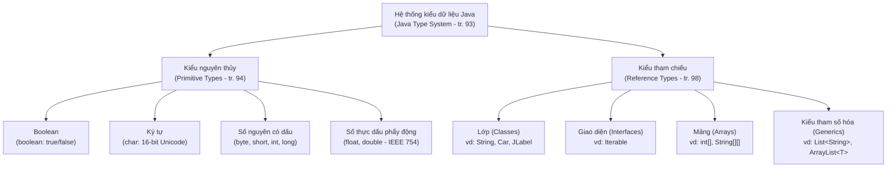
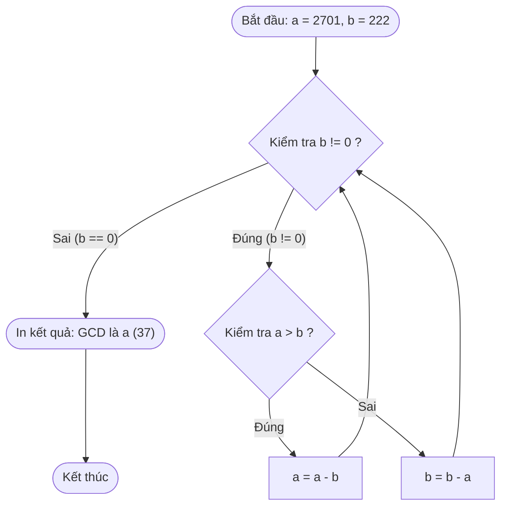
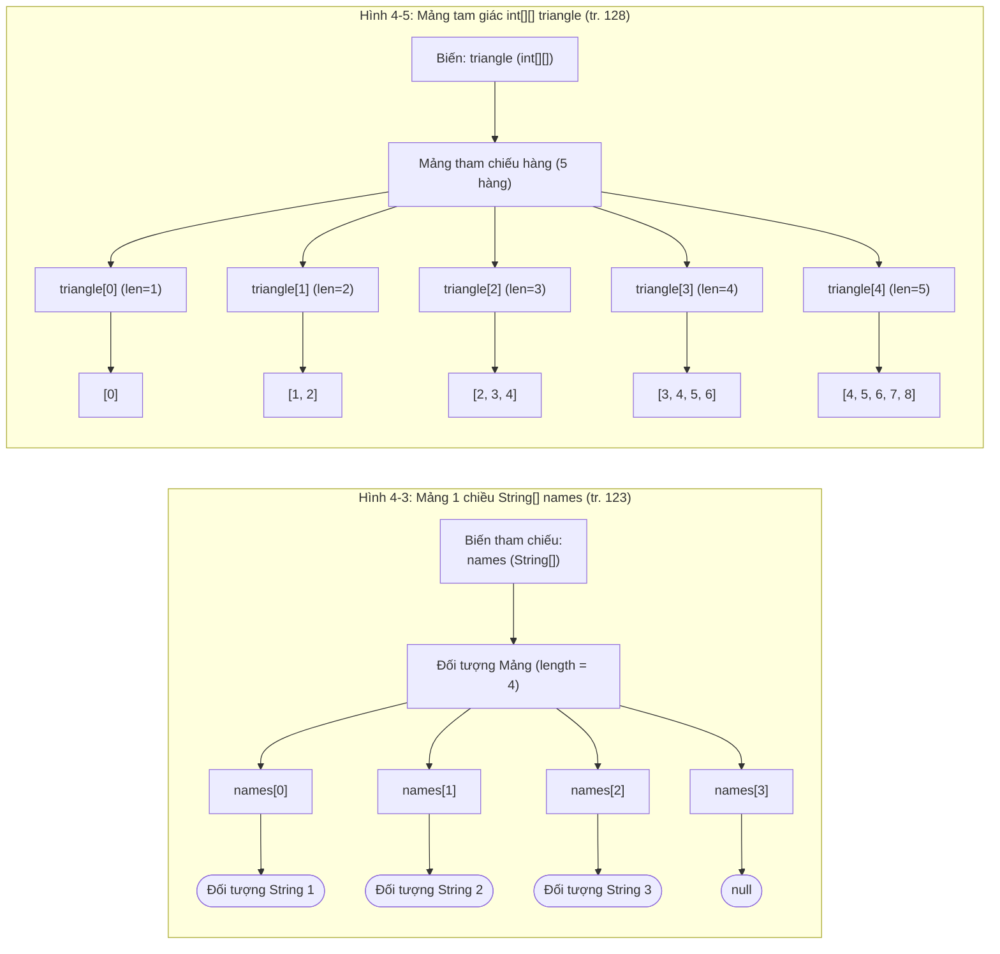
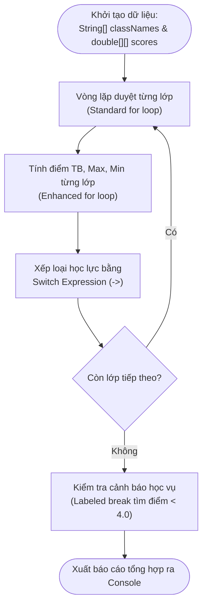

# Chương 4: Ngôn ngữ Java (The Java Language)
**Nguồn tài liệu:** *Learning Java, 6th Edition* (Marc Loy, Patrick Niemeyer, Daniel Leuck) — Chương 4 (tr. 85–132) và Phụ lục B (tr. 475–476).

> **Lưu ý từ Giảng viên về nguồn trích xuất & quy ước ký hiệu:**
> 1. **Phân biệt nguồn kiến thức:** Các nội dung trích xuất trực tiếp từ giáo trình được dẫn rõ số trang/tên mục. Các phần giải thích mở rộng, câu hỏi/bài tập bổ sung và mini project do giảng viên biên soạn thêm để hoàn thiện khung bài giảng được gắn nhãn **`[Kiến thức bổ sung]`**.
> 2. **Tình trạng văn bản nguồn (OCR/Trích đoạn):** Trong bản trích xuất của tài liệu nguồn, một số đoạn văn bản bị khuyết giữa các trang (cụ thể: chi tiết mã thoát Unicode ở tr. 86–87; cú pháp khai báo hằng `final` ở tr. 91–92; định dạng hằng số học ở tr. 95–97; phần thân vòng lặp `do/while` ở tr. 108; giải thích chi tiết toán tử `instanceof` ở tr. 119; đoạn mã `System.arraycopy()` ở tr. 125; và nội dung câu hỏi ôn tập số 2, 3 ở tr. 130). Ngoài ra, bản in gốc/OCR có hai lỗi nhỏ: tr. 90 in nhầm `@Overrides` (chuẩn Java là `@Override`) và Bảng 4-3 (tr. 114–115) bị mất ký tự hiển thị ở các toán tử bitwise/logic (`~`, `|`, `||`). Giảng viên đã ghi chú rõ ràng tại từng vị trí liên quan.

---

## 1. Mục tiêu học tập và các kiến thức tiên quyết

### 1.1. Mục tiêu học tập (Learning Objectives)
Sau khi hoàn thành Chương 4 *(tr. 85–86, 129)*, sinh viên cần đạt được các năng lực sau:
* **Hiểu cấu trúc ngữ pháp cốt lõi ("parts of speech"):** Nắm vững các đơn vị lập trình nền tảng của Java bao gồm quy tắc mã hóa ký tự (text encoding), chú thích (comments), chú giải (annotations), biến và hằng (variables and constants) *(tr. 85–93)*.
* **Làm chủ hệ thống kiểu dữ liệu (Type System):** Phân biệt rạch ròi giữa 8 kiểu dữ liệu nguyên thủy (primitive types) và kiểu tham chiếu (reference types), bao gồm cách thức cấp phát và truyền dữ liệu trong bộ nhớ *(tr. 93–102)*.
* **Điều khiển luồng thực thi (Control Flow):** Vận dụng thành thạo biểu thức (expressions), toán tử (operators), câu lệnh rẽ nhánh (`if/else`, `switch` statement và `switch` expression) và các cấu trúc vòng lặp (`while`, `do/while`, `for`, `enhanced for`) *(tr. 102–120)*.
* **Thao tác với cấu trúc Mảng (Arrays):** Khai báo, khởi tạo và truy xuất mảng một chiều (single-dimensional arrays), mảng ẩn danh (anonymous arrays) và mảng đa chiều/mảng răng cưa (multidimensional/jagged arrays) *(tr. 120–129)*.
* **Thực hành kiểm thử nhanh:** Biết cách dùng công cụ tương tác `jshell` để thử nghiệm các đoạn mã (snippets) về kiểu dữ liệu, vòng lặp và mảng *(tr. 85, 99, 124, 129)*.

### 1.2. Kiến thức tiên quyết (Prerequisites)
* **Từ giáo trình *(Chương 2 & Chương 3, tr. 27–84; Chương 4, tr. 85)*:**
  * Đã cài đặt bộ công cụ phát triển Java (JDK) và môi trường lập trình tích hợp (IDE — như IntelliJ IDEA Community Edition) *(tr. 27–35)*.
  * Hiểu cấu trúc cơ bản của một lớp (class) và phương thức điểm vào `main()` *(tr. 42–44)*.
  * Biết sử dụng trình biên dịch `javac`, trình thực thi `java` và công cụ `jshell` *(tr. 65–78)*.
  * *Lưu ý:* Giáo trình khẳng định không yêu cầu kiến thức nền tảng về ngôn ngữ C, mặc dù cú pháp của Java được kế thừa từ C *(tr. 85)*.
* **`[Kiến thức bổ sung]` Nền tảng khoa học máy tính:**
  * Hiểu khái niệm đơn vị lưu trữ nhị phân (`bit`, `byte`), hệ đếm cơ số 10, cơ số 16 (hexadecimal) và tư duy thuật toán cơ bản (tuần tự, rẽ nhánh, lặp).

---

## 2. Các khái niệm quan trọng, định nghĩa chính xác

### 2.1. Mã hóa văn bản (Text Encoding)
* **Định nghĩa:** Là cơ chế biểu diễn các ký tự văn bản dưới dạng dữ liệu nhị phân trong tệp mã nguồn và tệp lớp đã biên dịch (compiled classes). Mặc định, Java sử dụng chuẩn **UTF-8** (8-bit Unicode Transformation Format), hỗ trợ cả ký tự đơn byte lẫn đa byte, bao gồm các ký tự quốc tế và biểu tượng cảm xúc (emoji) *(Mục "Text Encoding", tr. 86–88; Phụ lục B, tr. 475)*.

### 2.2. Chú thích (Comments) và Javadoc
* **Chú thích (Comments):** Là phần văn bản giải thích logic mã nguồn dành cho lập trình viên, bị trình biên dịch (compiler) bỏ qua hoàn toàn và không ảnh hưởng tới hiệu năng chương trình *(Mục "Comments", tr. 88)*. Java hỗ trợ 3 loại *(tr. 88–89; Index, tr. 512)*:
  * **Chú thích dòng (Line comments — phong cách C++):** Bắt đầu bằng `//` đến hết dòng.
  * **Chú thích khối (Block comments — phong cách C):** Bao quanh bởi cặp `/*` và `*/`, có thể trải dài nhiều dòng.
  * **Chú thích tài liệu (Javadoc comments):** Bắt đầu bằng `/**` và kết thúc bằng `*/`, dùng để công cụ `javadoc` trích xuất thành tài liệu API tự động *(Mục "Javadoc Comments", tr. 89)*.

### 2.3. Chú giải (Annotations)
* **Định nghĩa:** Là cơ chế siêu dữ liệu (metadata) sử dụng tiền tố `@`, được đặt bên ngoài chú thích để đánh dấu các thành phần mã nguồn nhằm cung cấp thông tin xử lý đặc biệt cho trình biên dịch (compiler), IDE hoặc các framework *(Mục "Annotations", tr. 90; Glossary, tr. 495)*.
* **Ví dụ trong giáo trình:** `@SuppressWarnings` (ẩn cảnh báo trình biên dịch như mã không chạm tới) và `@Override` (yêu cầu trình biên dịch kiểm tra việc ghi đè phương thức — *lưu ý: tr. 90 in nhầm là `@Overrides`*) *(tr. 90)*.

### 2.4. Biến (Variables) và Hằng (Constants)
* **Biến (Variables):** Vùng lưu trữ thông tin có thể thay đổi và tái sử dụng theo thời gian, hoặc lưu trữ dữ liệu chưa biết trước tại thời điểm viết mã (ví dụ: địa chỉ email người dùng nhập vào) *(Mục "Variables and Constants", tr. 91)*.
* **Hằng (Constants):** Vùng lưu trữ dữ liệu mang giá trị bất biến trong suốt quá trình thực thi *(tr. 91)*. `[Kiến thức bổ sung]` *(do đoạn cú pháp ở cuối tr. 91–92 bị cắt trong bản trích xuất)*: Trong Java, hằng được khai báo bằng từ khóa `final` (ví dụ: `final double PI = 3.14159;`).

### 2.5. Hệ thống kiểu dữ liệu (Type System)
Java chia kiểu dữ liệu thành hai nhóm chính *(Mục "Types", tr. 93)*:
1. **Kiểu nguyên thủy (Primitive Types):** Gồm 8 kiểu dữ liệu cơ bản xây dựng sẵn trong ngôn ngữ biểu diễn số nguyên, số thực, giá trị logic (`boolean`) và ký tự (`char`). Chúng **không phải là đối tượng (objects)** nhằm giúp trình biên dịch và JVM tối ưu hóa trực tiếp xuống phần cứng *(Mục "Primitive Types", tr. 94)*. Mỗi kiểu nguyên thủy đều có một **lớp bao (wrapper class)** tương ứng khi cần xử lý dưới dạng đối tượng *(tr. 94)*.
2. **Kiểu tham chiếu (Reference Types / Class Types):** Bao gồm các lớp (classes), mảng (arrays), giao diện (interfaces) và kiểu tham số hóa (generics/parameterized types). Biến kiểu tham chiếu không chứa trực tiếp dữ liệu đối tượng mà lưu giữ một **"tay cầm" (handle)** hay địa chỉ tham chiếu trỏ tới đối tượng đó *(Mục "Types", tr. 93; Mục "Reference Types", tr. 98–101)*.
   * **Tính đa hình kiểu con (Subtype Polymorphism):** Nếu lớp `Dog` kế thừa (`extends`) lớp `Animal`, thì `Dog` là kiểu con của `Animal` và đối tượng `Dog` có thể gán cho biến kiểu `Animal` *(tr. 98–99)*.
   * **Chuỗi ký tự (`String`):** Là một đối tượng (thuộc nhóm Reference Types), nhưng được trình biên dịch hỗ trợ đặc biệt cho phép viết hằng chuỗi trong ngoặc kép `""` và nối chuỗi bằng toán tử `+` *(Mục "A Word About Strings", tr. 101–102)*.

### 2.6. Câu lệnh (Statements) và Biểu thức (Expressions)
* **Biểu thức (Expressions):** Là tổ hợp các biến, hằng, toán tử và lời gọi phương thức mà khi Java đánh giá (evaluate) sẽ **tạo ra một giá trị kết quả** (ví dụ: `new Object()`, `Math.sin(3.1415)`, `42 * 64`) *(Mục "Statements and Expressions", tr. 102)*.
* **Câu lệnh (Statements):** Là đơn vị thực thi hoàn chỉnh mô tả hành động của chương trình (khai báo biến, gán giá trị, thu thập đầu vào, xuất dữ liệu, ra quyết định, lặp), thường được nhóm trong các **khối mã (code blocks)** bao bởi cặp ngoặc nhọn `{ }` *(tr. 102–103)*.
* **Câu lệnh không thể chạm tới (Unreachable Statements):** Là câu lệnh mà trình biên dịch chứng minh được chắc chắn sẽ không bao giờ được thực thi (ví dụ: câu lệnh nằm ngay sau lệnh `return` vô điều kiện). Java coi đây là **lỗi thời điểm biên dịch (compile-time error)** *(Mục "Unreachable statements", tr. 113)*.

### 2.7. Mảng (Arrays)
* **Định nghĩa:** Trong Java, mảng là các **đối tượng hạng nhất thực thụ (true, first-class objects)** được tạo tự động để lưu trữ một tập hợp các phần tử có cùng **kiểu cơ sở (base type)** (có thể là kiểu nguyên thủy hoặc kiểu tham chiếu). Chỉ số phần tử (index) bắt đầu từ `$0$` và truy xuất qua toán tử `[]` *(Mục "Arrays", tr. 120–124)*.

---

## 3. Giải thích nguyên lý hoạt động từng bước

### 3.1. Nguyên lý truyền giá trị (Pass-by-Value) và sao chép tham chiếu
Giáo trình nhấn mạnh sự khác biệt cốt lõi giữa cách Java xử lý biến nguyên thủy và biến tham chiếu *(Mục "Reference Types", tr. 99–100)*:
* **Đối với kiểu nguyên thủy:** Khi gán biến hoặc truyền vào phương thức, **giá trị thực sự** được sao chép. Thay đổi bản sao không ảnh hưởng đến biến gốc.
* **Đối với kiểu tham chiếu:** Biến lưu trữ một địa chỉ bộ nhớ (reference value). Quá trình hoạt động diễn ra theo 3 bước:
  1. **Bước 1 (Khởi tạo):** Lệnh `Car myCar = new Car();` cấp phát một thực thể (instance) `Car` trong bộ nhớ và lưu địa chỉ của nó vào biến `myCar`.
  2. **Bước 2 (Gán tham chiếu):** Lệnh `Car anotherCar = myCar;` sao chép **giá trị tham chiếu** (địa chỉ) từ `myCar` sang `anotherCar`. Lúc này tồn tại **2 biến tham chiếu** nhưng chỉ có **1 đối tượng `Car` duy nhất**. Thay đổi trạng thái đối tượng thông qua `anotherCar` sẽ phản ánh khi đọc qua `myCar`.
  3. **Bước 3 (Truyền vào phương thức):** Khi gọi `myMethod(myCar);`, Java tạo ra một bản sao tham chiếu thứ 3 làm biến cục bộ trong `myMethod()`. Phương thức này có thể thay đổi dữ liệu bên trong đối tượng `Car`, nhưng **không thể** làm thay đổi biến `myCar` của bên gọi (caller) để trỏ sang một đối tượng `Car` khác *(tr. 100)*.

### 3.2. Nguyên lý khởi tạo mặc định và tầm vực biến (Scope)
* **Giá trị mặc định (Default Values):** Nếu không khởi tạo tường minh, trình biên dịch tự động gán giá trị mặc định cho biến thực thể (instance variables) và biến lớp (class variables): số bằng `$0$`, `boolean` bằng `false`, và biến tham chiếu bằng `null` *(tr. 101, 136)*.
* **Biến cục bộ (Local Variables):** Các biến khai báo bên trong phương thức hoặc khối mã `{ }` **không** được khởi tạo mặc định. Lập trình viên bắt buộc phải gán giá trị trước khi sử dụng, nếu không trình biên dịch sẽ báo lỗi *(tr. 101)*.
* **Tầm vực (Scope):** Biến khai báo bên trong một khối mã `{ }` chỉ tồn tại và nhìn thấy được bên trong khối mã đó (và các khối lồng bên trong nó). Ra khỏi dấu ngoặc đóng `}`, biến bị hủy khỏi tầm vực *(tr. 103, 109)*.

### 3.3. Nguyên lý đánh giá biểu thức (Evaluation Order)
* Khác với C/C++ (nơi thứ tự đánh giá toán hạng có thể phụ thuộc vào trình biên dịch/nền tảng), Java quy định chặt chẽ rằng khi không có ràng buộc ưu tiên khác, mọi phép đánh giá biểu thức, phép gán, lời gọi phương thức và chỉ số mảng luôn được thực hiện **từ trái sang phải, từ trên xuống dưới (left-to-right, top-to-bottom)** *(tr. 102)*.

### 3.4. Nguyên lý cấp phát Mảng một chiều và Mảng đa chiều
* **Mảng một chiều (`String[] names = new String[4];`):** JVM cấp phát một đối tượng mảng chứa 4 ô nhớ (slots) liên tiếp lưu trữ tham chiếu `String`, mặc định mang giá trị `null` cho tới khi được gán đối tượng cụ thể *(tr. 122–123)*.
* **Mảng đa chiều (Mảng của các mảng — Array of Arrays):** Java không lưu mảng 2 chiều dưới dạng một khối chữ nhật đơn nhất trong bộ nhớ, mà là một mảng chính chứa các tham chiếu trỏ tới các mảng con độc lập *(tr. 127–128)*. Nhờ vậy, độ dài các hàng không cần bằng nhau, cho phép xây dựng **mảng không chữ nhật / mảng tam giác (triangular arrays)** *(tr. 128)*.

---

## 4. Thuật toán, kiến trúc, bảng và sơ đồ quan trọng

### 4.1. Sơ đồ kiến trúc Hệ thống kiểu dữ liệu Java (Type System)
*(Tổng hợp từ Mục "Types", "Primitive Types", "Reference Types", tr. 93–101)*



### 4.2. Bảng 4-2: Các kiểu dữ liệu nguyên thủy trong Java *(tr. 94)*
*Ghi chú từ giáo trình (Footnote 3, tr. 94):* Java sử dụng biểu diễn **bù hai (two's complement)** cho các kiểu số nguyên có dấu (dùng 1 bit đầu làm bit dấu), do đó giá trị âm nhỏ nhất luôn có độ lớn hơn giá trị dương lớn nhất 1 đơn vị (ví dụ `byte` từ `$-128$` đến `$127$`).

| Kiểu dữ liệu (Type) | Định nghĩa (Definition) | Phạm vi giá trị hoặc độ chính xác xấp xỉ *(tr. 94)* | `[Kiến thức bổ sung]` Giá trị chính xác |
| :--- | :--- | :--- | :--- |
| `boolean` | Giá trị logic (Logical value) | `true` hoặc `false` | `true` hoặc `false` (kích thước phụ thuộc JVM) |
| `char` | Ký tự Unicode 16-bit | $64\text{K}$ ký tự | `$0$` đến `$65,535$` (`\u0000` đến `\uffff`) |
| `byte` | Số nguyên có dấu 8-bit | `$-128$` đến `$127$` | `$-2^7$` đến `$2^7 - 1$` |
| `short` | Số nguyên có dấu 16-bit | `$-32,768$` đến `$32,767$` | `$-2^{15}$` đến `$2^{15} - 1$` |
| `int` | Số nguyên có dấu 32-bit | `$-2.1 \times 10^9$` đến `$2.1 \times 10^9$` | `$-2^{31}$` đến `$2^{31} - 1$` |
| `long` | Số nguyên có dấu 64-bit | `$-9.2 \times 10^{18}$` đến `$9.2 \times 10^{18}$` | `$-2^{63}$` đến `$2^{63} - 1$` |
| `float` | Số thực 32-bit chuẩn IEEE 754 | $6\text{--}7$ chữ số thập phân có nghĩa | Đơn chính xác (Single-precision) |
| `double` | Số thực 64-bit chuẩn IEEE 754 | $15$ chữ số thập phân có nghĩa | Kép chính xác (Double-precision) |

### 4.3. Bảng 4-3: Thứ tự ưu tiên toán tử trong Java *(tr. 114–115)*
*(Mức 1 có độ ưu tiên cao nhất, mức 13 có độ ưu tiên thấp nhất. Các ký tự bị mờ do lỗi OCR trong tài liệu gốc đã được phục hồi chuẩn xác và chú thích rõ).*

| Mức ưu tiên | Toán tử (Operator) | Kiểu toán hạng (Operand type) | Mô tả (Description) |
| :---: | :--- | :--- | :--- |
| **1** | `++`, `--` | Số học (Arithmetic) | Tăng và giảm 1 đơn vị (Increment & decrement) |
| **1** | `+`, `-` | Số học (Arithmetic) | Dấu dương và dấu âm một ngôi (Unary plus & minus) |
| **1** | `~` *(OCR hiển thị mờ)* | Số nguyên (Integral) | Phép bù bit (Bitwise complement) |
| **1** | `!` | Logic (Boolean) | Phủ định logic (Logical complement) |
| **1** | `(type)` | Bất kỳ (Any) | Ép kiểu tường minh (Cast) |
| **2** | `*`, `/`, `%` | Số học (Arithmetic) | Nhân, chia, chia lấy dư (Multiplication, division, remainder) |
| **3** | `+`, `-` | Số học (Arithmetic) | Cộng và trừ (Addition & subtraction) |
| **3** | `+` | Chuỗi (String) | Nối chuỗi (String concatenation) |
| **4** | `<<` | Số nguyên (Integral) | Dịch trái bit (Left shift) |
| **4** | `>>` | Số nguyên (Integral) | Dịch phải giữ bit dấu (Right shift with sign extension) |
| **4** | `>>>` | Số nguyên (Integral) | Dịch phải chèn bit `$0$` (Right shift with no extension) |
| **5** | `<`, `<=`, `>`, `>=` | Số học (Arithmetic) | So sánh hơn kém (Numeric comparison) |
| **5** | `instanceof` | Đối tượng (Object) | Kiểm tra kiểu thực thể (Type comparison) |
| **6** | `==`, `!=` | Nguyên thủy (Primitive) | So sánh bằng/khác về giá trị |
| **6** | `==`, `!=` | Đối tượng (Object) | So sánh bằng/khác về địa chỉ tham chiếu |
| **7** | `&` | Số nguyên / Boolean | Phép AND trên bit / Phép AND logic (không đoản mạch) |
| **8** | `^` | Số nguyên / Boolean | Phép XOR trên bit / Phép XOR logic |
| **9** | `\|` *(OCR bị mất ký tự ở dòng 1)* | Số nguyên / Boolean | Phép OR trên bit / Phép OR logic (không đoản mạch) |
| **10** | `&&` | Boolean | Phép AND có điều kiện — đoản mạch (Conditional AND) |
| **11** | `\|\|` *(OCR bị mất ký tự)* | Boolean | Phép OR có điều kiện — đoản mạch (Conditional OR) |
| **12** | `?:` | N/A | Toán tử điều kiện ba ngôi (Conditional ternary operator) |
| **13** | `=` *(và `+=`, `-=`,...)* | Bất kỳ (Any) | Phép gán (Assignment) |

### 4.4. Thuật toán Euclid tìm Ước chung lớn nhất (GCD) *(tr. 118)*
Giáo trình sử dụng thuật toán Euclid phiên bản trừ lặp (repeated subtraction) để minh họa sự kết hợp giữa biến, vòng lặp `while` và rẽ nhánh `if/else` *(Mục "Statements, expressions, and algorithms", tr. 118)*:



### 4.5. Sơ đồ tổ chức bộ nhớ Mảng một chiều & Mảng tam giác *(Hình 4-3, tr. 123 & Hình 4-5, tr. 128)*



---

## 5. Ví dụ code có giải thích từng phần và kết quả mong đợi

### Ví dụ 1: Sao chép tham chiếu đối tượng *(Mục "Reference Types", tr. 99–100)*
```java
// Trích đoạn minh họa cơ chế tham chiếu trong jshell (tr. 99)
Car myCar = new Car();
Car anotherCar = myCar;
```
* **Giải thích từng phần:**
  * `Car myCar = new Car();`: Khai báo biến kiểu tham chiếu `myCar` và khởi tạo một thực thể `Car` mới trên bộ nhớ.
  * `Car anotherCar = myCar;`: Sao chép địa chỉ tham chiếu từ `myCar` sang `anotherCar`. Không có đối tượng `Car` thứ hai nào được tạo ra.
* **Kết quả mong đợi:** Cả `myCar` và `anotherCar` đều trỏ về cùng một đối tượng `Car` (khi in ra trong `jshell` sẽ có cùng mã định danh địa chỉ, ví dụ `Car@372f7a8d`).

---

### Ví dụ 2: Câu lệnh `switch` và gom nhóm `case` *(file `ch04/examples/SwitchDemo.java`, tr. 106)*
```java
// filename: ch04/examples/SwitchDemo.java (tr. 106)
int value = MINISCULE;
String size = "Unknown";
switch(value) {
    case MINISCULE:
    case TEENYWEENY:
    case SMALL:
        size = "Small";
        break;
    case MEDIUM:
        size = "Medium";
        break;
    case LARGE:
    case EXTRALARGE:
        size = "Large";
        break;
}
System.out.println("Your size is: " + size);
```
* **Giải thích từng phần:**
  * `case MINISCULE: case TEENYWEENY: case SMALL:`: Lợi dụng hành vi "rơi xuyên qua" (fall-through) của `switch` khi không có `break` để gom 3 hằng số vào chung một nhánh xử lý.
  * `size = "Small"; break;`: Gán chuỗi `"Small"` và dùng `break` để thoát khỏi khối `switch`, ngăn không cho chạy xuống nhánh `MEDIUM`.
  * Giáo trình cũng lưu ý từ Java 12 (preview) và Java 14 (chính thức), ta có thể dùng **biểu thức `switch` (switch expressions)** với toán tử mũi tên `->` để trả về giá trị trực tiếp mà không cần `break` *(tr. 106–107)*.
* **Kết quả mong đợi:**
  ```text
  Your size is: Small
  ```

---

### Ví dụ 3: Vòng lặp `for` cải tiến (Enhanced For Loop) *(file `ch04/examples/EnhancedForDemo.java`, tr. 111)*
```java
// filename: ch04/examples/EnhancedForDemo.java (tr. 111)
int[] arrayOfInts = new int[] { 1, 2, 3, 4 };
int total = 0;
for (int i : arrayOfInts) {
    System.out.println(i);
    total = total + i;
}
System.out.println("Total: " + total);

ArrayList<String> list = new ArrayList<String>();
list.add("foo");
list.add("bar");
for (String s : list)
    System.out.println(s);
```
* **Giải thích từng phần:**
  * `int[] arrayOfInts = new int[] { 1, 2, 3, 4 };`: Khởi tạo mảng nguyên thủy 4 phần tử.
  * `for (int i : arrayOfInts)`: Vòng lặp duyệt tuần tự qua từng phần tử của mảng; ở mỗi bước lặp, biến cục bộ `i` nhận giá trị của phần tử hiện tại mà không cần quản lý biến đếm chỉ số.
  * `for (String s : list)`: Cú pháp tương tự áp dụng được cho mọi đối tượng triển khai giao diện `java.lang.Iterable` (như `ArrayList`).
* **Kết quả mong đợi:**
  ```text
  1
  2
  3
  4
  Total: 10
  foo
  bar
  ```

---

### Ví dụ 4: Thuật toán Euclid tìm GCD *(file `ch04/examples/EuclidGCD.java`, tr. 118)*
```java
// filename: ch04/examples/EuclidGCD.java (tr. 118)
int a = 2701;
int b = 222;
while (b != 0) {
    if (a > b) {
        a = a - b;
    } else {
        b = b - a;
    }
}
System.out.println("GCD is " + a);
```
* **Giải thích từng phần:**
  * `while (b != 0)`: Lặp cho đến khi số `b` giảm về `$0$`.
  * `if (a > b) { a = a - b; } else { b = b - a; }`: Ở mỗi bước, lấy số lớn hơn trừ đi số nhỏ hơn. Khi hai số bằng nhau, `b` sẽ trở thành `$0$` ở lần lặp kế tiếp và vòng lặp dừng lại.
* **Kết quả mong đợi:**
  ```text
  GCD is 37
  ```

---

### Ví dụ 5: Mảng ẩn danh (Anonymous Array) *(Mục "Anonymous Arrays", tr. 126)*
```java
// Trích đoạn minh họa mảng ẩn danh (tr. 126)
Dog pete = new Dog("golden");
Dog mj = new Dog("black-and-white");
Cat stash = new Cat("orange");
setPets(new Animal[] { pete, mj, stash });
```
* **Giải thích từng phần:**
  * `new Animal[] { pete, mj, stash }`: Khởi tạo trực tiếp một đối tượng mảng kiểu `Animal[]` ngay tại vị trí truyền tham số mà không cần khai báo biến trung gian. Kích thước mảng (`$3$`) được trình biên dịch tự suy luận từ số lượng phần tử trong `{ }`.
  * Thể hiện tính đa hình kiểu con (tr. 98–99): `Dog` và `Cat` là lớp con của `Animal` nên đều chứa được trong mảng `Animal[]`.
* **Kết quả mong đợi:** Phương thức `setPets(...)` nhận được mảng 3 phần tử gồm `pete`, `mj`, `stash` và thực thi logic xử lý danh sách thú cưng.

---

## 6. Các lỗi phổ biến và cách tránh

1. **Sử dụng biến cục bộ chưa khởi tạo (Uninitialized Local Variables) *(tr. 101)*:**
   * *Lỗi:* Khai báo `int x;` hoặc `String s;` bên trong một phương thức rồi đem đi tính toán hoặc gọi phương thức ngay. Trình biên dịch báo lỗi vì biến cục bộ không có giá trị mặc định.
   * *Cách tránh:* Luôn khởi tạo giá trị ban đầu cho biến cục bộ ngay khi khai báo (ví dụ: `int x = 0;`, `String s = "";`).
2. **Truy cập biến ngoài tầm vực khối mã (Out-of-Scope Variable Access) *(tr. 103, 109)*:**
   * *Lỗi:* Khai báo biến `int i = 5;` bên trong cặp ngoặc `{ }` (hoặc trong phần khởi tạo của vòng `for`) rồi truy cập `i` bên ngoài dấu `}`.
   * *Cách tránh:* Khai báo biến ở khối mã bao ngoài (outer scope) nếu cần dùng giá trị của biến sau khi khối mã con hoặc vòng lặp kết thúc *(xem ví dụ biến `x` ở tr. 109)*.
3. **Quên lệnh `break` trong câu lệnh `switch` cổ điển *(tr. 105–107)*:**
   * *Lỗi:* Khi thiếu `break`, luồng thực thi sẽ trôi thẳng xuống các nhãn `case` bên dưới (fall-through) gây sai lệch logic.
   * *Cách tránh:* Kiểm tra kỹ `break` ở cuối mỗi nhánh xử lý, hoặc chuyển sang dùng cú pháp **biểu thức `switch` (Java 14+)** với mũi tên `->` để loại bỏ hoàn toàn nguy cơ trôi nhánh *(tr. 107)*.
4. **Tạo ra câu lệnh không thể chạm tới (Unreachable Statements) *(tr. 113)*:**
   * *Lỗi:* Đặt câu lệnh sau lệnh `return`, `break`, `continue` vô điều kiện hoặc trong nhánh `if (false)`. Trình biên dịch Java báo lỗi `unreachable statement`.
   * *Cách tránh:* Rà soát luồng thoát của phương thức và vòng lặp; không để mã thừa phía sau điểm kết thúc luồng.
5. **Gán kết quả của phương thức `void` vào một biến *(tr. 117)*:**
   * *Lỗi:* Viết `int mistake = System.out.println("This is a mistake.");` gây lỗi biên dịch `incompatible types: void cannot be converted to int`.
   * *Cách tránh:* Kiểm tra kiểu trả về (return type) của phương thức trước khi dùng phương thức đó trong một biểu thức gán.
6. **Nhầm tên gói Swing hoặc tên Annotation *(tr. 88, 90)*:**
   * *Lỗi:* Viết `import java.swing.*;` thay vì `import javax.swing.*;` *(tr. 88)*, hoặc viết `@Overrides` (như lỗi in ấn trong sách ở *tr. 90*) thay vì `@Override`.
   * *Cách tránh:* Sử dụng tính năng tự động nhập gói (auto-import) và gợi ý cú pháp của IDE.
7. **`[Kiến thức bổ sung]` So sánh nội dung chuỗi `String` bằng toán tử `==` *(liên hệ tr. 101 & tr. 240)*:**
   * *Lỗi:* Toán tử `==` trên kiểu tham chiếu chỉ so sánh địa chỉ vùng nhớ (hai biến có trỏ tới cùng một đối tượng hay không), không so sánh nội dung ký tự.
   * *Cách tránh:* Luôn dùng phương thức `.equals()` khi kiểm tra hai chuỗi có giống nhau về mặt văn bản hay không.

---

## 7. So sánh các công nghệ hoặc phương pháp liên quan

### 7.1. Kiểu nguyên thủy (Primitive Types) vs. Kiểu tham chiếu (Reference Types) *(tr. 93–101)*

| Tiêu chí | Kiểu nguyên thủy (Primitive Types) | Kiểu tham chiếu (Reference Types) |
| :--- | :--- | :--- |
| **Bản chất** | Giá trị dữ liệu thuần túy, không phải đối tượng *(tr. 94)*. | Thực thể (instance) của lớp, mảng, giao diện *(tr. 98–101)*. |
| **Dữ liệu lưu trong biến** | Chứa trực tiếp giá trị của dữ liệu *(tr. 99)*. | Chứa địa chỉ tham chiếu ("handle") trỏ tới đối tượng *(tr. 99)*. |
| **Cơ chế truyền tham số** | Truyền bản sao của giá trị (Pass-by-value) *(tr. 99)*. | Truyền bản sao của địa chỉ tham chiếu *(tr. 99–100)*. |
| **Giá trị mặc định (biến lớp)** | `$0$`, `$0.0$`, `'\u0000'`, hoặc `false` *(tr. 136)*. | `null` *(tr. 101)*. |
| **Hiệu năng** | Rất cao, ánh xạ trực tiếp xuống thanh ghi/phần cứng *(tr. 94)*. | Tốn chi phí cấp phát đối tượng và thu gom rác (GC). |

### 7.2. Ngôn ngữ Java vs. Ngôn ngữ C / C++ *(tr. 85, 94, 99, 102, 121)*

| Khía cạnh | Ngôn ngữ C / C++ | Ngôn ngữ Java *(theo Chương 4)* |
| :--- | :--- | :--- |
| **Kích thước kiểu nguyên thủy** | Phụ thuộc kiến trúc máy ($16$-bit, $32$-bit, $64$-bit) *(tr. 94)*. | Cố định trên mọi nền tảng (ví dụ `int` luôn 32-bit, `char` luôn 16-bit Unicode) *(tr. 94)*. |
| **Con trỏ (Pointers)** | Hỗ trợ con trỏ tự do (ad hoc pointers), cho phép cộng trừ địa chỉ bộ nhớ *(tr. 94, 99)*. | Loại bỏ con trỏ tự do; chỉ dùng **tham chiếu (references)** được kiểm soát kiểu chặt chẽ *(tr. 94, 99)*. |
| **Thứ tự đánh giá biểu thức** | Nhiều trường hợp không xác định (unspecified/implementation-dependent) *(tr. 102)*. | Quy định nghiêm ngặt: **từ trái sang phải, trên xuống dưới** *(tr. 102)*. |
| **Mảng (Arrays)** | Thực chất là con trỏ trỏ tới vùng nhớ đầu tiên *(tr. 121)*. | Là **đối tượng hạng nhất thực thụ**, có thuộc tính độ dài và kiểm tra biên chỉ số *(tr. 121, 128)*. |

### 7.3. Câu lệnh `switch` truyền thống vs. Biểu thức `switch` (Switch Expressions) *(tr. 105–107)*

| Đặc điểm | Câu lệnh `switch` truyền thống | Biểu thức `switch` (Java 14+) |
| :--- | :--- | :--- |
| **Mục đích** | Điều khiển luồng thực thi câu lệnh *(tr. 106)*. | Tính toán và **trả về một giá trị** để gán cho biến *(tr. 106–107)*. |
| **Hành vi Fall-through** | Mặc định rơi xuyên qua `case` kế tiếp nếu thiếu `break` *(tr. 105–106)*. | **Không** rơi xuyên qua; chỉ thực thi nhánh khớp với nhãn `->` *(tr. 107)*. |
| **Gom nhiều nhãn** | Viết xếp chồng nhiều dòng `case A: case B:` *(tr. 106)*. | Viết gọn trên một dòng phân tách bởi dấu phẩy `case A, B ->` *(tr. 107)*. |

---

## 8. 10 câu hỏi ôn tập kèm đáp án

> *Ghi chú: Câu 1, 2, 3 được trích trực tiếp từ mục Review Questions (tr. 130) và Phụ lục B (tr. 475–476) của giáo trình (do câu 2 và 3 ở tr. 130 bị khuyết trong bản trích xuất nên chỉ lấy đủ 3 câu có nguyên văn đáp án trong Phụ lục B). Câu 4 đến Câu 10 là **`[Kiến thức bổ sung - Giảng viên biên soạn]`** bám sát trọng tâm Chương 4.*

**Câu 1 *(Giáo trình — tr. 130, đáp án tr. 475)*:** Định dạng mã hóa văn bản nào được Java sử dụng mặc định trong các lớp đã biên dịch (compiled classes)?
* **Đáp án:** Java sử dụng định dạng **UTF-8** (8-bit Unicode Transformation Format) làm mặc định. Đây là chuẩn mã hóa 8-bit hỗ trợ cả ký tự đơn byte lẫn đa byte.

**Câu 2 *(Giáo trình — tr. 130, đáp án tr. 475–476)*:** Trong một chuỗi các câu lệnh kiểm tra `if / else if / else`, điều gì sẽ xảy ra nếu có nhiều điều kiện cùng đúng (`true`)?
* **Đáp án:** Chỉ có khối lệnh gắn với điều kiện đầu tiên được đánh giá là `true` được thực thi. Sau khi khối lệnh đó hoàn tất, luồng điều khiển sẽ nhảy ra khỏi toàn bộ chuỗi `if / else if / else`, bất kể các điều kiện phía sau có đúng hay không.

**Câu 3 *(Giáo trình — tr. 130, đáp án tr. 476)*:** Nếu bạn muốn lưu trữ tổng giá trị vốn hóa thị trường chứng khoán Hoa Kỳ (xấp xỉ $31$ nghìn tỷ USD vào cuối năm tài chính 2022) dưới dạng số nguyên USD, bạn có thể dùng kiểu dữ liệu nguyên thủy nào?
* **Đáp án:** Kiểu **`long`** (số nguyên có dấu 64-bit, lưu trữ được giá trị lên tới khoảng `$9.2 \times 10^{18}$`), vì giá trị `$31 \times 10^{12}$` vượt quá giới hạn tối đa của kiểu `int` (xấp xỉ `$2.1 \times 10^9$`).

**Câu 4 `[Kiến thức bổ sung]`:** Tại sao kiểu `byte` trong Java lưu trữ được giá trị nhỏ nhất là `$-128$` nhưng giá trị lớn nhất chỉ là `$127$`?
* **Đáp án:** Vì Java biểu diễn số nguyên có dấu theo phương pháp **bù hai (two's complement)** *(tr. 94, Footnote 3)*. Với 8 bit, có `$2^8 = 256$` tổ hợp bit: `$128$` tổ hợp cho số âm (`$-128$` đến `$-1$`), `$1$` tổ hợp cho số `$0$`, và `$127$` tổ hợp còn lại cho số dương (`$1$` đến `$127$`).

**Câu 5 `[Kiến thức bổ sung]`:** Xét đoạn mã: `Car a = new Car(); Car b = a;`. Có bao nhiêu đối tượng `Car` được tạo ra trong bộ nhớ? Nếu gán `a = null;` thì `b` có bị `null` theo không?
* **Đáp án:** Chỉ có **1 đối tượng `Car`** duy nhất được tạo ra; `a` và `b` là hai biến tham chiếu cùng giữ địa chỉ của đối tượng đó *(tr. 99)*. Nếu gán `a = null;`, chỉ biến `a` ngừng trỏ tới đối tượng, còn biến `b` vẫn giữ nguyên địa chỉ tham chiếu tới đối tượng `Car` ban đầu.

**Câu 6 `[Kiến thức bổ sung]`:** Sự khác biệt về giá trị khởi tạo mặc định giữa biến thực thể (instance variable) và biến cục bộ (local variable) trong Java là gì?
* **Đáp án:** Biến thực thể (và biến lớp) được trình biên dịch tự động gán giá trị mặc định (`$0$`, `false` hoặc `null`), trong khi **biến cục bộ không được khởi tạo mặc định** và sẽ gây lỗi biên dịch nếu đọc giá trị trước khi gán *(tr. 101)*.

**Câu 7 `[Kiến thức bổ sung]`:** Tại sao đoạn mã sau lại báo lỗi biên dịch?
```java
int test() {
    return 10;
    System.out.println("Done");
}
```
* **Đáp án:** Lỗi **câu lệnh không thể chạm tới (unreachable statement)** *(tr. 113)*. Trình biên dịch chứng minh được lệnh `System.out.println("Done");` nằm sau lệnh `return` vô điều kiện nên vĩnh viễn không bao giờ được thực thi.

**Câu 8 `[Kiến thức bổ sung]`:** Theo Bảng 4-3 *(tr. 114–115)*, biểu thức `"Kết quả: " + 10 + 20` và `10 + 20 + " là kết quả"` cho ra hai chuỗi khác nhau như thế nào? Vì sao?
* **Đáp án:** Biểu thức đầu cho ra `"Kết quả: 1020"`, còn biểu thức sau cho ra `"30 là kết quả"`. Nguyên nhân là toán tử `+` có cùng độ ưu tiên (mức 3) và Java đánh giá **từ trái sang phải** *(tr. 102)*: ở biểu thức đầu, `"Kết quả: " + 10` thực hiện nối chuỗi trước; ở biểu thức sau, `10 + 20` thực hiện phép cộng số học trước rồi mới nối chuỗi.

**Câu 9 `[Kiến thức bổ sung]`:** Khi khởi tạo mảng `String[] names = new String[4];` *(Hình 4-3, tr. 123)*, giá trị ban đầu của `names[3]` là gì? Nếu gọi `names[3].length()` ngay lúc này thì điều gì xảy ra?
* **Đáp án:** Giá trị ban đầu của `names[3]` là **`null`** *(tr. 123)*. Nếu gọi `names[3].length()`, chương trình sẽ ném ra ngoại lệ lúc chạy **`NullPointerException`** *(tr. 116)*.

**Câu 10 `[Kiến thức bổ sung]`:** Làm thế nào để thoát ngay lập tức khỏi hai vòng lặp `while` lồng nhau trong Java mà không dùng biến cờ (flag)?
* **Đáp án:** Sử dụng **câu lệnh `break` có nhãn (labeled break)** *(tr. 112)*: đặt một nhãn định danh (ví dụ `outerLoop:`) ngay trước vòng lặp ngoài cùng và gọi `break outerLoop;` từ bên trong vòng lặp con.

---

## 9. 5 bài tập thực hành tăng dần độ khó

### Bài 1 (Mức độ 1 — Cơ bản): Hoàn thiện thuật toán Euclid tìm GCD *(Giáo trình — Code Exercise 1, tr. 130–131)*
* **Đề bài:** Xây dựng lớp hoàn chỉnh `Euclid` chứa phương thức `main()` cài đặt thuật toán Euclid tìm ước chung lớn nhất của hai số nguyên `a = 2701` và `b = 222` *(tr. 118, 130)*. Hãy cải tiến chương trình để lưu giữ được giá trị gốc của `a` và `b`, từ đó in ra thông báo đầy đủ: `"The GCD of 2701 and 222 is 37"`.
* **Gợi ý:** Tạo thêm hai biến phụ `origA = a;` và `origB = b;` trước khi bước vào vòng lặp `while (b != 0)`.

### Bài 2 (Mức độ 2 — Trung bình thấp): Phân loại mức tiêu thụ điện bằng `switch` expression `[Kiến thức bổ sung]`
* **Đề bài:** Nhập (hoặc gán cứng) số bậc tiêu thụ điện `tier` (từ `1` đến `6`). Sử dụng cú pháp **biểu thức `switch` (Java 14+)** với toán tử `->` để trả về đơn giá tương ứng:
  * Bậc `1, 2`: `"Giá ưu đãi sinh hoạt"`
  * Bậc `3, 4`: `"Giá tiêu chuẩn"`
  * Bậc `5, 6`: `"Giá lũy tiến cao"`
  * Các giá trị khác: `"Bậc không hợp lệ"`
* **Gợi ý:** Áp dụng cú pháp gom nhiều hằng trên một nhãn `case 1, 2 -> ...` và đừng quên nhánh `default -> ...` *(tr. 106–107)*.

### Bài 3 (Mức độ 3 — Trung bình): Khởi tạo và in Mảng tam giác (Triangular Array) *(Giáo trình — Code Exercise 2, tr. 131–132 & Hình 4-5, tr. 128)*
* **Đề bài:** Viết lớp `Triangle` khởi tạo một mảng 2 chiều không chữ nhật `int[][] triangle` gồm 5 hàng, trong đó hàng thứ `$i$` (`$i = 0 \dots 4$`) có `$i + 1$` cột, và giá trị tại cột `$j$` bằng `$i + j$` (tạo ra hình tam giác số như Hình 4-5, tr. 128). Dùng `System.out.print()` và `System.out.println()` để in kết quả ra màn hình:
  ```text
  0
  1 2
  2 3 4
  3 4 5 6
  4 5 6 7 8
  ```
* **Gợi ý:** Khai báo `int[][] triangle = new int[5][];`, sau đó dùng vòng lặp ngoài cấp phát từng hàng `triangle[i] = new int[i + 1];` và vòng lặp trong gán `triangle[i][j] = i + j;`.

### Bài 4 (Mức độ 4 — Trung bình khá): Tìm kiếm tọa độ trong ma trận bằng `break` có nhãn `[Kiến thức bổ sung]`
* **Đề bài:** Cho một mảng 2 chiều số nguyên `matrix` kích thước `$4 \times 5$`. Viết đoạn mã tìm vị trí xuất hiện **đầu tiên** của một số nguyên mục tiêu `target`. Ngay khi tìm thấy, in ra tọa độ `(hàng, cột)` và sử dụng lệnh **`break` có nhãn (labeled break)** *(tr. 112)* để thoát ngay khỏi cả hai vòng lặp. Nếu duyệt hết ma trận mà không thấy, in `"Không tìm thấy phần tử"`.
* **Gợi ý:** Khai báo biến cờ `boolean found = false;` và đặt nhãn `searchLoop:` trước vòng lặp duyệt hàng.

### Bài 5 (Mức độ 5 — Nâng cao): Bộ phân tích biểu thức và độ ưu tiên toán tử bit `[Kiến thức bổ sung]`
* **Đề bài:** Viết một chương trình mô phỏng thao tác đóng gói (bit-packing) 4 giá trị kiểu `byte` không dấu (mỗi giá trị từ `$0$` đến `$255$`, đại diện cho 4 thành phần màu `A, R, G, B`) vào duy nhất một biến kiểu `int` 32-bit bằng các toán tử dịch trái `<<` và phép OR bit `|`. Sau đó viết đoạn mã giải nén ngược lại từ biến `int` đó ra 4 giá trị ban đầu bằng toán tử dịch phải không dấu `>>>` và phép AND bit `& 0xFF`.
* **Gợi ý:** Tham khảo thứ tự ưu tiên của `<<`, `>>>`, `&`, `|` trong Bảng 4-3 *(tr. 114–115)*; luôn dùng dấu ngoặc đơn `()` bao quanh các phép dịch bit trước khi kết hợp với `|` hoặc `&`.

---

## 10. Mini Project áp dụng kiến thức của chương `[Kiến thức bổ sung]`

### Tên dự án: Hệ thống Quản lý & Thống kê Điểm Sinh viên theo Lớp học (`GradebookAnalyzer`)
* **Mục tiêu:** Vận dụng tổng hợp toàn bộ kiến thức Chương 4 (các kiểu nguyên thủy `int`, `double`, `boolean`, `char`; chuỗi `String`; mảng 1 chiều và mảng răng cưa 2 chiều `double[][]`; biểu thức `switch`; vòng lặp `for`, `enhanced for`, `while`; `break` có nhãn; thứ tự ưu tiên toán tử) mà chưa cần dùng đến các kỹ thuật OOP nâng cao hay Collections của các chương sau.

### Kiến trúc luồng xử lý (Mermaid Flowchart)


### Mã nguồn đầy đủ (`GradebookAnalyzer.java`)
```java
/**
 * Mini Project Chương 4: Hệ thống Quản lý & Thống kê Điểm Sinh viên
 * Áp dụng: Primitive types, String, Jagged Arrays, Switch Expression,
 * Enhanced For Loop, Labeled Break, và Operator Precedence.
 */
public class GradebookAnalyzer {

    public static void main(String[] args) {
        // 1. Mảng 1 chiều lưu tên các lớp học (tr. 122)
        String[] classNames = { "CS101 - Nhập môn Lập trình", "CS102 - Cấu trúc Dữ liệu", "CS103 - Mạng Máy tính" };

        // 2. Mảng đa chiều không chữ nhật (Jagged Array) lưu điểm sinh viên mỗi lớp (tr. 128)
        // Sĩ số mỗi lớp khác nhau: lớp 1 có 4 SV, lớp 2 có 5 SV, lớp 3 có 3 SV
        double[][] classScores = {
            { 8.5, 7.0, 9.2, 6.5 },
            { 5.5, 8.0, 9.5, 3.8, 7.2 },
            { 6.0, 7.5, 8.8 }
        };

        System.out.println("=== BÁO CÁO THỐNG KÊ ĐIỂM THEO LỚP HỌC ===\n");

        double totalSystemScore = 0.0;
        int totalStudents = 0;

        // 3. Duyệt từng lớp bằng vòng lặp for chuẩn
        for (int i = 0; i < classNames.length; i++) {
            double[] currentScores = classScores[i];
            double sum = 0.0;
            double max = currentScores[0];
            double min = currentScores[0];

            // 4. Dùng Enhanced For Loop tính tổng, tìm max và min (tr. 111)
            for (double score : currentScores) {
                sum += score;
                if (score > max) {
                    max = score;
                }
                if (score < min) {
                    min = score;
                }
            }

            double avg = sum / currentScores.length;
            totalSystemScore += sum;
            totalStudents += currentScores.length;

            // 5. Dùng Switch Expression (Java 14+) xếp loại mức điểm trung bình lớp (tr. 107)
            int bracket = (int) avg; // Ép kiểu tường minh từ double sang int (tr. 114)
            String rating = switch (bracket) {
                case 9, 10 -> "Xuất sắc (Excellent)";
                case 8 -> "Giỏi (Good)";
                case 7 -> "Khá (Fair)";
                case 5, 6 -> "Trung bình (Average)";
                default -> "Cần cải thiện (Needs Improvement)";
            };

            // In báo cáo chi tiết từng lớp
            System.out.println("Lớp: " + classNames[i]);
            System.out.println("  - Sĩ số: " + currentScores.length + " sinh viên");
            System.out.println("  - Điểm cao nhất: " + max + " | Thấp nhất: " + min);
            System.out.println("  - Điểm trung bình: " + (Math.round(avg * 100.0) / 100.0) + " -> Xếp loại: " + rating);
            System.out.println("--------------------------------------------------");
        }

        // 6. Tính điểm trung bình toàn khoa
        double overallAvg = totalSystemScore / totalStudents;
        System.out.println("Tổng số sinh viên toàn khoa: " + totalStudents);
        System.out.println("Điểm trung bình chung toàn khoa: " + (Math.round(overallAvg * 100.0) / 100.0));

        // 7. Sử dụng Labeled Break để rà soát trường hợp điểm liệt (< 4.0) đầu tiên (tr. 112)
        boolean hasCriticalFail = false;
        int alertClassIdx = -1;
        int alertStudentIdx = -1;

        auditLoop:
        for (int c = 0; c < classScores.length; c++) {
            for (int s = 0; s < classScores[c].length; s++) {
                if (classScores[c][s] < 4.0) {
                    hasCriticalFail = true;
                    alertClassIdx = c;
                    alertStudentIdx = s;
                    break auditLoop; // Thoát khỏi cả 2 vòng lặp ngay lập tức
                }
            }
        }

        if (hasCriticalFail) {
            System.out.println("\n[CẢNH BÁO HỌC VỤ] Phát hiện điểm dưới 4.0 tại lớp '"
                    + classNames[alertClassIdx] + "', sinh viên thứ #" + (alertStudentIdx + 1)
                    + " (Điểm: " + classScores[alertClassIdx][alertStudentIdx] + ")");
        } else {
            System.out.println("\n[TRẠNG THÁI TỐT] Không có sinh viên nào bị điểm dưới 4.0.");
        }
    }
}
```

### Kết quả đầu ra mong đợi
```text
=== BÁO CÁO THỐNG KÊ ĐIỂM THEO LỚP HỌC ===

Lớp: CS101 - Nhập môn Lập trình
  - Sĩ số: 4 sinh viên
  - Điểm cao nhất: 9.2 | Thấp nhất: 6.5
  - Điểm trung bình: 7.8 -> Xếp loại: Khá (Fair)
--------------------------------------------------
Lớp: CS102 - Cấu trúc Dữ liệu
  - Sĩ số: 5 sinh viên
  - Điểm cao nhất: 9.5 | Thấp nhất: 3.8
  - Điểm trung bình: 6.8 -> Xếp loại: Trung bình (Average)
--------------------------------------------------
Lớp: CS103 - Mạng Máy tính
  - Sĩ số: 3 sinh viên
  - Điểm cao nhất: 8.8 | Thấp nhất: 6.0
  - Điểm trung bình: 7.43 -> Xếp loại: Khá (Fair)
--------------------------------------------------
Tổng số sinh viên toàn khoa: 12
Điểm trung bình chung toàn khoa: 7.32

[CẢNH BÁO HỌC VỤ] Phát hiện điểm dưới 4.0 tại lớp 'CS102 - Cấu trúc Dữ liệu', sinh viên thứ #4 (Điểm: 3.8)
```